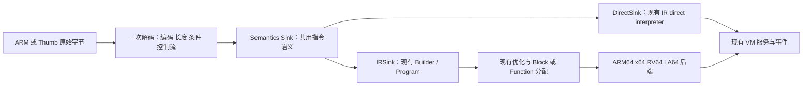

# ARM32 前端接入方案（2026-11-09）

目标是在现有中间流程上增加 ARM32 前端：同一套 ARM/Thumb 指令语义既提交 Uniform IR，也直接提交给现有 IR direct interpreter；默认全部 JIT，Mixed 模式下冷块解释、热块编译。复用四个后端、寄存器分配、dispatcher/L1/L2、异常恢复、SMC 和持久代码所有权，不建立另一套编译或执行框架。

代码基线是 SwiftVM `2f7ae360`。参考固定为用户指定的 [dynarmic-interp 5a76f693](https://github.com/ganyao114/dynarmic-interp/tree/5a76f6930935bc07a2aa5158f3ee515c34ca14fd)，已检出到 Data2 的独立只读参考目录。默认 ARMv7-A 用户态范围现已实现；实际文件布局、集中验证和 compile 回归结果见[实现与验收记录](arm32-frontend-implementation-2026-11-09.md)。本文件保留设计合同，以下文件树同步为实际实现。

## 1. 范围与完成标准

推荐先完成 ARMv7-A 用户态、小端、ARM/A32 + Thumb16 + Thumb-2，覆盖基础整数、条件执行、访存、用户态状态访问、独占访问、VFPv3-D32 与 NEON。架构版本和可选扩展由小型不可变 `Profile` 描述；为 ARMv6K 和后续 ARMv8 AArch32 留下配置位置，不把参考实现默认的 v8 隐式当成我们的默认配置。版本影响 ALU/Load 写 PC、对齐和指令合法性，不能仅用于显示名称。

前端本身不依赖 Linux，嵌入方继续使用 fetch/read/write/atomic 服务。独立运行验收补齐 Linux EABI ELF32 静态程序所需的加载、32 位地址分配、syscall、TLS 和信号帧。现有 runner 不支持 PT_INTERP，ARM32 本轮也不额外扩展动态链接器、Android linker 或完整 bionic 环境。

不包含特权模式、银行寄存器、SPSR/异常返回、MMU、任意协处理器和 Jazelle；大端/SETEND 切换先明确列为未支持。合法但未实现的用户态功能报告 Unsupported，不能伪装成 NOP 或把缺实现一概当非法编码。只有阶段 1–2 结束不能宣告 ARM32 全部完成，VFP/NEON 和运行时闭环需要各自完成。

## 2. 参考实现的取舍

| 参考位置 | 复用内容 | SwiftVM 的处理 |
| --- | --- | --- |
| `frontend/A32/decoder/{arm,thumb16,thumb32,vfp,asimd}.inc` | 编码模式、字段和重叠关系 | 导入固定版本的数据与来源说明，生成不依赖 Sink 的静态解码表 |
| `frontend/A32/a32_location_descriptor.h`、`ITState.h` | T/E/IT/FPSCR 参与翻译身份，IT 推进 | 采用一个 64 位完整位置键，复用现有目录和派发 ABI |
| `frontend/A32/translate/impl/` | 算术、PC 写入、访存、VFP/NEON 语义 | 移植到 `Semantics<Sink>`，直接生成 SwiftVM IR/direct 调用 |
| `frontend/A32/translate/translate_thumb.cpp` | 16/32 位长度、VFP/ASIMD 识别和编码归一 | 按真实半字取指，保留跨页第二半字故障与实际来源字节 |
| `frontend/A32/translate/conditional_state.cpp` | 条件区间的边界思路 | 提交时维护局部条件/flags 状态，不照搬每次遍历整个 block 的 `all_of` |
| `interpreter/A32/A64/`、`template_runtime.h` | 可参考个别运算和短序列的实现 | 不引入其 AArch64 汇编模板、预制解释块、frame stream、独立缓存或 dispatcher |

参考解码表共有 **788 条模式**：ARM261、Thumb16 79、Thumb32 239、VFP62、ASIMD147。这是模式行数，不是实现覆盖率，也不是 788 条独立指令。实现阶段需要记录每类模式的 Decode、IR、Direct 和目标后端状态。

有三处特别需要避开：参考 `TranslateSingleArmInstruction`/解释单步仍有条件处理 TODO；JIT translator 的 SWP 路径仍有 bus-lock TODO；模板解释器的浮点处理和完整 JIT translator 并不等价，而且该提交的 `InterpreterArm` 没有 ASIMD 解码分支。NEON 应参考完整前端 translator。它们可以作语义线索，不能直接成为正确性保证。导入的数据和移植片段保留原版权与 SPDX/许可证来源，不引入整个 Dynarmic 作为运行依赖。

## 3. 前端与执行流程



### Decode

`Instruction` 使用固定大小的普通值，目标约16 B：位置键或可重建该键的字段、原始逻辑编码、opcode ID、长度与控制流属性；不持有 vector、string、动态 matcher 或可执行对象。Thumb32 明确采用“首半字在高16位”的逻辑编码，不能与宿主 memcpy 得到的 little-endian u32 混用。

从表定义生成静态 mask/value/opcode 和候选索引，保持 VFP/ASIMD/core 的真实优先顺序及 ASIMD 特例，不能只全局按 mask 位数排序。Thumb16 可用65536项 uint16 ID表（128 KiB，只读、两种 Sink 共用）；ARM 保留4096桶思路，Thumb32/VFP/NEON 使用扁平桶及候选数组。生成器在构建时处理优先级，运行时不建立4096个 vector，也不为两个 Sink 分别构造 std::function 表。最终表大小与候选长度由生成统计决定，不为少一次解码扫描制造过大的稀疏表。

Block 路径取一条、解一条、立即提交，无持久解码列表。Function 路径复用有界 worklist 和连续 decoded 数组，一次形成 region，再消费已有解码结果；不重复解析字节。解码时同步得到长度、直接目标、是否写 PC/flags、IT 后继、服务边界、source spans 和 continuation；这些事实不再另做 pass。

### Semantics 与两种 Sink

使用 opcode 定义表生成 `Handle*` 成员函数派发表。ARM/Thumb 编码专用方法只提取参数，真正工作进入整数、shift、memory、control、VFP、NEON 等职责函数，不在大 switch 中堆指令实现。

`IRSink` 复用现有 Builder；`DirectSink` 复用 `ir::direct::Interpreter`，仅提供局部 predicate 跳过和架构数值服务适配。Direct 路径不构建 Program，不先翻译一个 Dynarmic IR，也不生成缓存解释块。模式切换仍由原 VM 的 JitOnly/InterpretOnly/Mixed 策略驱动，命中已编译完整位置键即可回到 JIT。

## 4. 先固定位置键与状态

### 4.1 裸地址和编译身份分离

不能把 `(PC, T)` 当成完整身份，也不能把 ARM32 的状态拼接逻辑放进四套 dispatcher。沿用参考实现的可逆编码，建议：

```cpp
context = T | (E << 1) | (ITSTATE << 8) | (FPSCR & 0x07F70000);
location_key = uint64_t(aligned_instruction_address) | (uint64_t(context) << 32);
```

低32位为真实取指地址；高位是已知翻译上下文。E 首版固定0；FPSCR 仅纳入影响翻译的控制部分，不把累计异常、FP比较结果或普通 NZCV 放进 key。具体 FPSCR mask 在实现 Profile 时冻结，并纳入持久身份。指令集版本/扩展属于 VM 不可变 Profile，同样进入持久配置身份。

- L1/L2、ready lookup、静态 link、Function entry/alias、AOT unit 和热度统计均使用完整 key。目录仍是一个 uint64 tag，不新建 ARM32 map；现有查表汇编不解析 ARM32 状态。
- 同一物理地址不同模式/IT/FPSCR 可以冲突于同一 L1 索引，但完整 tag 保证不会错命中；首版不为此给所有后端增加 hash 工作。
- fetch、CodeAt、SourceSpan、SMC 页和代码哈希始终使用物理地址。公共异常信息展示真实 PC，内部恢复记录携带完整 key。不能只在 fetch 处清高位，遗漏持久校验、源依赖和失效逻辑。
- 增加很小的 `CodeAddress(GuestISA, key)` 投影，x86/A64 是恒等；ARM32 取低32位。只在已有冷服务边界调用，不增加逐 IR 操作虚调用。
- CPSR.T/IT 的恢复从完整 key 推导；VMSR/FPSCR 控制写入结束当前单元，在现有 FP 服务边界同步数值环境并重建下一位置键，避免旧 specialization 继续执行。
- Guest 函数指针仍是标准32位 `address|T`，LR 不保存内部64位 key。BX/BLX/LoadWritePC 在前端按目标低位、当前架构版本和有效对齐构造完整后继键；不能假定 BX LR 一定返回当前模式。

### 4.2 冻结的 Uniform 状态

首版采用64位物理槽承载32位 GPR，所有写入零扩展；运算和地址生成仍按 U32 截断，再转换为宿主地址。这样复用现有 Uniform/pin8/12/16 和四后端恢复 ABI，避免为节省约64 B 的线程状态引入第二套寄存器 stride。

```cpp
struct alignas(16) GuestState {
    uint64_t r[15];                 // R0..R14，包含 SP/LR；高32位保持0
    uint64_t psr_aux;               // 第16个普通 Uniform 槽：Q/GE/用户模式等非NZCV位
    uint64_t pc;                    // 完整位置键，不是架构 R15 数值
    uint64_t packed_flags;          // 现有中立 flags ABI
    uint8_t q[16][16];              // 唯一 S/D/Q 存储
    uint32_t fpscr, numeric_control;
    uint32_t tpidrurw, tpidruro;
    uint32_t service_word, helper_status;
    uint32_t reservation_valid;
    uint64_t service_pc;            // 仅服务指令记录其原位置，不是逐指令快照
    uint64_t numeric_addend;        // 窄FMA叶子的显式第三操作数，使用尾部8 B
};
```

已冻结 PC/flags/Q 偏移128/136/144，尺寸448 B，可置入现有 state union，不扩大1072 B 的 NativeRunContext。用编译期布局断言确认后冻结，不先增加运行时通用布局验证器。

R15 不另存一份：普通操作数读取使用该指令的 PC+8（ARM）或 PC+4（Thumb），literal/addressing 按具体编码应用 AlignPC；异常帧和调试视图使用真实指令地址。`psr_aux` 不保存 NZCV/T/IT/E 的重复权威副本；Get/SetCPSR 在边界组合或拆分这些来源。第16个 pin 是普通私有 Uniform 字段，不是伪造的 R15，后端仍不理解 ARM32 寄存器名称。

S0..S31 别名 D0..D15，D0..D31 别名 Q0..Q15。VFP 写 S 或 D 必须保留同一 Q 的其他部分，不能复制 A64 scalar-write 清空其余 lane 的行为。

## 5. 指令语义中的关键合同

| 类别 | 实现要求 |
| --- | --- |
| ARM 条件码 / Thumb IT | 条件失败不能访存、写 flags、写寄存器或调用服务；仍按规则推进 PC/IT。部分 Thumb16 指令在 IT 内不更新隐式 flags。IT 指令本身设置下条指令的 IT，不再误推进一次 |
| Predication 的 IR 形态 | 简单无副作用的条件寄存器更新可用 Select；MayFault/flags/访存操作用局部 guard 包住完整语义。连续同条件且不改 NZCV 的小区间可在提交时共用 guard，不按每条条件指令拆一个 guest block |
| ARM 移位与 carry | 立即数0、寄存器低8位计数、32、>32、ROR整倍数及 RRX 各有语义；现有普通移位按宽度取模，不能直接当 ARM barrel shifter |
| 整数与 flags | U32 运算；ADD/SUB/ADC/SBC/RSC 的 C/V 按 ARM 合同映射。逻辑 S 指令的 C 来自 shifter，V保留；MUL、Q黏滞位、GE按具体指令处理，不打包整份 CPSR |
| 除法 | ARM 的除0和溢出行为不能套 x86 DivideFault；若 neutral Div 会 fault，需 guard 或正确的数值原语，不能先做 Div 再用 Select 掩盖异常 |
| 写 PC / interworking | 区分 BranchWritePC、BXWritePC、ALUWritePC、LoadWritePC，正确设置 LR和目标模式；POP/LDM到PC是控制流边界 |
| 访存 | pre/post-index写回与失败时机明确；LDM/STM、双字和NEON结构访存逐类定义部分完成，不能统一回滚或失败后换解释器重放 |
| 原子和独占 | SWP使用现有AtomicExchange，不移植普通read+write；LDREX/STREX/CLREX复用现有reservation/原子owner，先保持既有private-anonymous/外部写者边界，不宣称完整并发monitor |
| VFP / NEON | 区分VFP受FPSCR控制的运算与NEON标准FP行为，保留DN/FZ/rounding、异常累计、QC、VMRS/比较flags与非融合VMLA语义；不能直接把A32编码和state指针传给A64 helper |
| 服务和异常 | UDF/BKPT/SVC/用户态CP15/TLS/屏障依照Profile处理；定义非法、合法未实现和取指失败，不能通过参考代码的InterpretThisInstruction终端假装已实现 |

谓词还必须支配控制流结果。DirectSink不能仅跳过Emit，却让C++无条件设置`control.kind=Jump/Service`；false谓词需在共用Execute包装层跳过完整handler，IR路径的条件转移则明确保留fallthrough。BKPT等不受普通IT条件屏蔽的例外按解码属性处理。两种Sink只在这层提交控制上不同，不各写一份指令实现。

常用整数、访存、位操作与整数 NEON 优先用现有中立 IR。需要移位携带 carry 等缺少的表达时，先用固定形状组合；只有组合确实使热点明显膨胀才增加有通用数学语义的原语，同时实现 Direct 和四后端，禁止增加 `ARM32ExecuteInstruction` 一类全指令黑盒 IR。

浮点复用现有 ARM 数值实现中可独立的计算叶子。只把 ARM32 真正需要的公共叶子抽到 `arch/arm/fp*`，A32/A64 各保留寄存器和编码适配；不整体搬移 ARM64 前端。Known 后端可在合同相符的输入/控制下直接提交 FP IR，复杂语义使用窄 helper；Unknown/EarlyOff 保留正确路径。helper 不携带 decoder、dispatcher 或整块重解释逻辑，也不按每次运算复制一整份 A64 GuestState。

## 6. 运行时接入不能遗漏的部分

### 32位地址、ELF与Linux ABI

现有 loader只接受ELF64、InitialStack使用u64表项，GuestMemory::Map(0)可分配高地址。新增 ARM32 不能只增加 `EM_ARM`：

1. 先读取 ELF ident/class/machine，再配置地址模型并映射。ELF32/ELF64仅在读取边界归一到共用segment描述，映射仍由唯一 GuestMemory owner 完成。
2. ARM32 image、stack、brk、mmap和TLS缓冲都必须在32位地址范围内。给现有 GuestMemory 增加有界选址策略，在映射冷路径使用不覆盖宿主的占位/替换合同；保留 guest==host 数据访问，不增加每次 load/store 的地址翻译层，也不采用ARM64不可移植的MAP_32BIT假设。
3. InitialStack按32位word构造argc/argv/envp/auxv，保持AAPCS32入口要求；HWCAP只发布已完成能力。保留Thumb entry bit的模式意义，但可执行内存验证使用实际地址。
4. 独立 `abi_arm32` 处理r7编号、r0..r6参数、32位有符号返回、64位参数寄存器配对及struct转换；复用共用syscall语义，不复制一份完整syscalls.cpp。mmap2偏移单位固定4096，不能按宿主页大小替换；iovec/stat/time32/time64/sigaction/stack_t均按guest布局编解码。
5. ARM私有set_tls、用户态TLS寄存器以及Linux kuser TLS/原子/屏障helper作为Linux边界实现，不能把任意高地址当特殊后端指令。helper页的固定入口和版本必须与实际实现一致。[Linux kernel user helpers](https://www.kernel.org/doc/html/latest/arch/arm/kernel_user_helpers.html)

### 异常、信号、SMC与持久化

- 扩展GuestISA、NativeRunContext的state union、GuestContextView/Snapshot和ConfigureGuest的布局绑定；现有“Arm64否则x86”的入口必须变成明确的三种冷选择。不能让ARM32落入x86的syscall、数值状态、解释器或快照分支。
- 继续使用现有FaultLocation、GuestSafepoint、GuestDispatchSafepoint与L1中断视图。恢复记录与native目标寄存器携带完整位置键，冷交付再生成ARM32真实PC/CPSR；不为IT增加逐指令snapshot或新native寄存器。
- guest ARM32 sigcontext/ucontext、VFP记录、siginfo和sigaction分别编解码（普通帧752 B/119，SA_SIGINFO的RT帧880 B/173），不能直接拷贝当前64位内部结构。handler清理入口IT状态，函数指针按ARM/Thumb进入；sigreturn重建完整PC/T/IT/FPSCR环境，并允许编辑后恢复。
- 现有 `GuestSignals::InterruptSyscall` 的“x86减2，其余减4”不适用Thumb SVC。服务指令只在自身边界保存原位置键/实际长度，restart同时保留原IT与后继上下文，不能从后继IT逆推；不为普通指令增加记录。
- SMC/源哈希只管物理字节页，一次失效撤销该owner中的ARM、Thumb和不同上下文版本；纯编译缓存继续完整key，不能仅撤销其中一个模式。
- CodeImageKey显式加入guest ISA、Profile与位置键版本；CodeImage格式3→4。反序列化校验须用ISA投影后的地址判断source归属，当前`unit.pc`直接与SourceSpan比较的逻辑必须改。不要把完整key当哈希地址或ELF符号值。
- AOT外层仍是host ELF64，嵌入的guest可以是ELF32；guest符号读取分别解析32/64位布局并保留Thumb符号位。普通JIT、磁盘恢复、AOT安装共用同一key和元数据合同。
- 原有typed host→guest接口是x86 SysV并绑定x86 state，不能自动宣称支持AAPCS32。核心阶段先提供ARM32 typed context与原始寄存器调用；若恢复高级`Lookup<Sig>`，单独实现AAPCS32 soft/hard-float分类，guest指针宽度也需区分，不能复用64位GuestPtr布局。[Arm AAPCS32](https://github.com/ARM-software/abi-aa/blob/main/aapcs32/aapcs32.rst)

## 7. 实装文件组织

以下是职责边界，不是pass列表。小文件可在同一边界内合并；不建立inputs/preparation/actions/certificates链。

```text
source/runtime/
  exception.h                       # 第三种typed guest context与自有snapshot
  arch/
    guest.h                         # GuestISA::Arm32、地址模型和冷CodeAddress投影
    arm32/
      profile.h                     # 不可变架构版本与扩展能力
      location.h                    # 完整位置键、T/IT/FPSCR上下文、PC投影
      state.h                       # Uniform状态布局、S/D/Q别名、CPSR访问
      numeric.h / numeric.cpp       # A32 FPSCR与纯数值叶子的适配
      numeric_callbacks.inc         # 持久化数学操作ID清单，追加但不重排
      numeric_registry.*            # 数学叶子地址与稳定HostSymbol互转
      service.h                     # exclusive、FPSCR/CPSR等有限owner请求
    arm64/fp_*.cpp                  # 复用现有纯ARM浮点数学叶子，不拷贝A64 state
  frontend/arm32/
    types.h                         # ARM编码字段类型、Imm/Reg/Cond等薄类型
    instruction.h                   # 16 B解码结果、opcode/flow/length属性
    opcodes.inc                     # opcode与Handle方法映射，生成派发表
    decode.h / decode.cpp           # 取编码、半字组合、静态表查找与分类
    decode/
      arm.inc / thumb16.inc / thumb32.inc
      vfp.inc / neon.inc            # 来源可追溯的模式定义与优先级
      generated_tables.inc          # 一份只读表，两个Sink共用
      generated_metadata.inc        # flow、谓词、写PC、服务边界属性
      generated_dispatch.inc        # opcode到语义成员的参数提取和静态派发
      signatures.json               # 可重生成的handler签名清单
      generated_statistics.json      # 模式/表体积统计；不是运行时分析
      NOTICE / LICENSE.txt          # 原始0BSD来源与版权说明
    semantics.h                     # Semantics<Sink>入口和少量共用操作封装
    semantics_registers.inc          # R0..LR、PC读写、S/D/Q访问
    semantics_integer.inc           # 算术、逻辑、bitfield/extend/reverse
    semantics_multiply.inc          # 乘除、长乘、乘加
    semantics_dsp.inc               # packed整数、饱和、GE/Q
    semantics_shift_flags.inc       # barrel shifter、NZCV、Q/GE、predication/IT
    semantics_memory.inc            # scalar、multiple、双字及写回
    semantics_control.inc           # branch/interworking、SVC与边界
    semantics_system.inc            # 用户态CPSR/CP15/TLS、exclusive、barrier
    semantics_vfp.inc               # VFP寄存器搬运和浮点语义
    semantics_neon_integer.inc      # NEON整数/排列/饱和
    semantics_neon_float.inc        # NEON浮点合同
    semantics_neon_memory.inc       # 结构化/lane访存
    sink.h                          # IRSink和DirectSink的薄适配
    region.h / region.cpp           # 有界Function形成、按完整key保留上下文
    build_ir.h / build_ir.cpp        # Block提交、Function已有解码提交和终端
    interpreter.h / interpreter.cpp # 取指/单步/块循环；不复制指令语义
  execution/
    dispatch.h                      # state union，NativeRunContext尺寸保持
    guest_state.cpp                 # 绑定第三种布局，union仍由原owner持有
    frontend_service.cpp            # 冷选择第三个前端
    compile_service.cpp             # key用于编译身份；source分类/SMC使用物理地址
    runtime.cpp / exception.cpp     # 第三种解释入口/数值环境/事件context
    arm_state_service.cpp           # 共用ARM reservation/访存事务的owner部分
    arm32_state_service.cpp         # A32寄存器、长度、请求的适配
    code_identity.cpp / code_image.* / code_persistence.cpp
                                    # guest ISA/Profile/key版本与真实source地址
    memory.*                       # 现有owner中增加32位选址约束
  platform/linux/
    loader.*                        # ELF32/64读取与word-size栈；共用映射
    abi_arm32.h / abi_arm32.cpp     # EABI编号/参数/结构体转换
    syscalls_arm32.cpp              # r7/r0..r5边界、64位配对和共用operation适配
    signal_frame_arm32.cpp          # 752 B普通/880 B RT帧、VFP记录与返回
    arm32_user_helpers.h/.cpp       # 安装Linux kuser页，长度取符号extent
    arm32_user_helpers.S/.inc       # 实际guest代码及其生成的精确字节
    guest_signals.cpp / syscalls.cpp # 共用队列/策略/服务，修正第三ISA分支

tools/arm32/generate_decode.py      # 离线生成并检入静态表；普通构建不运行matcher
tools/arm32/generate_user_helpers.py # 从已汇编ELF的.type/.size抽取helper代码
source/tests/rebuild/
  arm32_frontend_test.cpp          # decode、控制流、IR形态
  arm32_semantics_test.cpp         # Direct/IR/JIT差分的语义边界
  arm32_numeric_test.cpp           # 纯数学叶子的独立预期，不依赖另一份前端
  arm32_runtime_test.cpp           # ELF32、模式切换、EABI、两类信号帧和restart
```

CMake已接通新前端。现有IR formatter的`isa`字段表示host TargetInfo，继续使用中立IR打印，不引入guest ISA字段或ARM32专属打印流程；有新中立操作才扩展Direct和四后端Handle方法。后端目录不新增“ARM32前端专用assembler”或另一套alloc文件。高级AAPCS32 host-call扩展若纳入实施，再在`source/aot/`新增独立ABI recipe，不塞入通用前端。

## 8. 推进顺序与阶段验收

| 阶段 | 交付内容 | 本阶段必须证明 |
| --- | --- | --- |
| M1 身份与最小纵向链路 | Profile/Location/State、静态decoder、NOP/MOV/ADD/B/BX、IR+Direct+四后端接通 | 同址ARM/Thumb不混用；key/真实地址分离；default JIT、Unknown和Direct路径均有真实执行 |
| M2 整数与Thumb闭环 | 条件码、IT、shifter、完整核心整数、branch、基本/multiple访存、fault/服务点 | false谓词无副作用；移位0/32/>32；interworking；取指跨页；Block与Function分别可运行 |
| M3 数值与用户态状态 | VFP/NEON、Q/GE/FPSCR、TLS、屏障、SWP和独占服务 | S/D/Q别名；NaN/FZ/rounding；native和Direct一致；reservation与SMC不回放副作用 |
| M4 ELF32运行时闭环 | 地址选址、初始栈、EABI syscalls、TLS/kuser、异常/信号/restart | 静态ARM/Thumb程序运行；guest信号帧编辑后恢复；Thumb SVC长度与IT恢复正确 |
| M5 持久化与性能收口 | 完整key的disk/AOT、跨后端回归、覆盖表和固定benchmark | 不同模式/IT/FPSCR不混命中；物理页SMC全部撤销；按真实编译端点报告成本 |

M1即冻结状态、位置键、Sink和owner边界；以后只补有明确职责的语义，不重新引入第二条中间流程。M2之前就解决“完整key误作地址”，不能等持久化阶段再补。

测试按上述语义边界和阶段集中执行，不每改一个handler就跑全套。参考测试可移植为输入与预期，关键边界同时用独立ARM执行器/规范预期交叉检查；Direct与JIT共用语义，只比较二者不足以发现共同语义错误。红魔执行64位SVM/Dynarmic来运行相同32位guest；不假定手机所有CPU核都能原生运行AArch32，原生32位oracle先检查能力。RV/x64/LA沿用固定system-kernel环境做集中验证。

## 9. Compile与生成质量约束

1. 不出现 `Dynarmic IR → SwiftVM IR`、持久模板解释块、每条指令堆对象、运行时matcher初始化、新全IR分析pass、逐指令CPSR快照或后端ISA虚调用。静态表生成成本属于构建，首次使用也不能再做隐藏动态建表。
2. ARM32 common整数与访存不通过整指令helper解释；GPR读写保留Uniform IR，物理pin继续由后端处理。Known TargetInfo可提前使用现有表达能力，Unknown/EarlyOff仍有通用正确分支。
3. 相邻predication、PC bias、立即数展开、IT推进、直接目标和边界事实在decode/提交时解决。现有pass只负责常量折叠、Uniform转发、flags裁剪和DCE；分配/选指令仍留在既有后端。
4. 完整上下文key会增加BX/BLX动态目标的构造工作，FPSCR变化也可能产生多个有效版本；需要分别报告，不宣称ARM32 interworking零开销。FaultSite/NativeCode/NativeRunContext保持现有尺寸为设计目标。
5. 同ISA编译对照使用参考Dynarmic的A32 JIT，保留decoder、region规模和初始化/回收端点差异；不把其模板解释块构造时间冒称JIT编译时间，也不拿FEX的x86输入直接当ARM32性能倍数。总体目标继续是低compile成本，优先争取扣实际byte decode后与对照同数量级、Function不超过2×；这是实测验收目标，不是方案先验保证。
6. 收口固定一批纯整数ARM、Thumb/IT、load-store、interworking、VFP、NEON输入，同时看compile/frontend/backend/publication/release、节点/operand数、native bytes、spill和hot cycles。现有x86/A64路径不增加逐次ARM32检查；出现明显回退再集中定位，不刷样本至达标。过程不反复全量验证生成质量。

## 10. 参考与版本记录

- [用户指定提交](https://github.com/ganyao114/dynarmic-interp/tree/5a76f6930935bc07a2aa5158f3ee515c34ca14fd)：A32 decoder/translator、LocationDescriptor、ITState和模板解释器的实际结构。
- [LocationDescriptor固定源码](https://github.com/ganyao114/dynarmic-interp/blob/5a76f6930935bc07a2aa5158f3ee515c34ca14fd/src/dynarmic/frontend/A32/a32_location_descriptor.h)：PC之外的翻译身份。
- [条件执行固定源码](https://github.com/ganyao114/dynarmic-interp/blob/5a76f6930935bc07a2aa5158f3ee515c34ca14fd/src/dynarmic/frontend/A32/translate/conditional_state.cpp)：条件区间及全块遍历边界。
- [ARM指令语义固定目录](https://github.com/ganyao114/dynarmic-interp/tree/5a76f6930935bc07a2aa5158f3ee515c34ca14fd/src/dynarmic/frontend/A32/translate/impl)：具体指令参考，包含必须单独核实的TODO。
- [Linux ARM user helpers](https://www.kernel.org/doc/html/latest/arch/arm/kernel_user_helpers.html)、[Arm AAPCS32](https://github.com/ARM-software/abi-aa/blob/main/aapcs32/aapcs32.rst)：平台ABI依据，与前端语义分层。

本轮审阅源码的SHA与解码模式统计见[引用记录](evidence/arm32-frontend-plan-20261109/references.json)。所有设计选择均为SwiftVM的接入方案，参考仓库的历史benchmark不作为本项目的性能保证。
