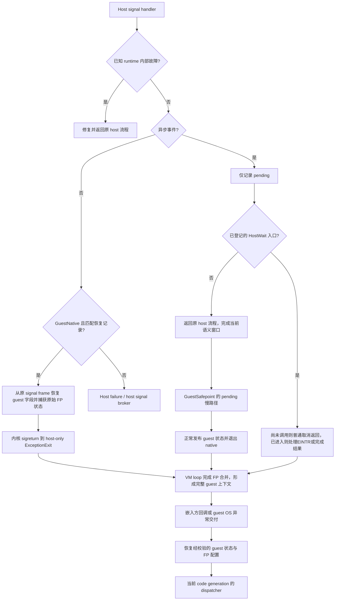

# 异常现场还原与交付机制（2026-11-08）

状态：设计稿，尚未实现。基于提交工作树 `/Volumes/Data2/SwiftVM-submit-20261104`、HEAD `08143855b4c038dc9483fe8893e5458eecf0685c` 及当前 WIP。本文延续 [runtime 架构方案](runtime-architecture-plan-2026-11-05.md) 中的代码所有权、共享前端语义和 uniform IR 合同。

本轮 review 修订：已知 guest 前端采用“源指令前安全点 + PC 单调窗口”取代每 unit 入口检查；补齐等待入口的丢唤醒协议、按信号独立的 RT 容量、停止原因分类及多读提交资格。RV64 LR/SC 的异步响应须服从架构前进约束，未解决前不承诺该区间的有界延迟。修订前原稿保留在 Data2 的 `exception-design-review-20261108/plan.before.md`。

目标：发生 guest 异常时获得符合 ISA 语义、可修改和可恢复的完整 guest 上下文；正常路径不保存逐指令快照，不保留完整 IR 或分配结果，不重新引入中间分析流水线。同步故障与异步事件采用不同的恢复路径，最终交付相同的 guest 上下文。

## 1. 当前基础与缺口

已经存在的基础：

- `backend::FaultSite` 为 32B，包含实际 native 范围、guest PC、对齐 fallback 及 8B 后端恢复描述。
- `NativeCode` 为 40B 借用视图；`CodeHeap` 独占 native slabs 和稳定的 fault metadata 分片。
- ARM64 host 能从 signal frame 恢复已登记故障点的 GPR/XMM pins、flags，并处理 SMC 和非对齐重试；其余后端已有各自的 flags 恢复入口。
- 前端已有 fault 前的逻辑发布与指令内提交次序；IR direct 复用同一套语义。
- 本轮已修正 ARM64 root entry 保存 host FP 的顺序，以及 fatal fault 的 FPSR 捕获；[两项真实设备回归](evidence/fp-exception-fixes-20261108/summary.json) 已通过。

仍未完成的部分：

- 现有 `FaultScope` 使用一个进程全局指针、每次运行安装三个 host signal handler；缺少线程 TLS activation、host altstack 和完整生命周期协议。
- 当前 fault 多数经 `siglongjmp` 转为 `RuntimeError`；`RunResult` 只有错误描述，没有在 VM 销毁后仍有效的 guest 现场。
- `FaultLocation` 只是位置标记，不能还原任意 host PC，也不是异步交付安全点。
- 某些后端现有 fault range 覆盖整个 MayFault operation，仍须收窄为真实 guest 访问／显式 trap，排除 spill、state 访问等 host 故障。
- guest Linux 的 signal dispositions、mask、pending、signal frame、`rt_sigreturn` 尚未形成完整机制。
- 新修复只验证 ARM64 host 对应路径，不能据此宣布其它 host 的 FP signal 恢复已经完备。

相关现状入口：[fault.h](../source/runtime/execution/fault.h)、[signals.cpp](../source/runtime/platform/linux/signals.cpp)、[arm64_host.cpp](../source/runtime/platform/linux/arm64_host.cpp)、[runtime.cpp](../source/runtime/execution/runtime.cpp)。

## 2. 必须固定的恢复合同

| 场景 | 对外上下文的含义 | 恢复方式 |
| --- | --- | --- |
| 同步 fault | ISA 规定的故障／重启状态，PC 通常指向故障指令 | 已登记 faultsite + 固定 ABI + 稀疏 recipe |
| 软件产生的 guest exception | 指令语义定义的状态与原因，例如整数除法异常 | 正常 cold exit，提交同一种异常记录 |
| trap | ISA 规定的 trap 状态，恢复 PC 可能在指令之后 | 前端明确给出 instruction PC 与恢复 PC |
| 异步信号 | 实际交付边界的 guest 状态 | 到达时只 pending，原 host 流程继续，到安全点交付 |
| SMC／有资格的非对齐修复 | runtime 内部事件 | 修复后重试原访问，不交付 guest 异常 |
| 已知 faultable helper 的访问失败 | helper 明确约定的 guest 访问错误 | 窄汇编 fixup 后普通返回，释放锁并由语义层报告 |
| 无恢复记录的 native／C++ 故障 | host/runtime failure | 不伪造“精确 guest 现场”，交 host 故障策略 |

“精确”不是把已经发生的所有内存写撤销。REP、ENTER、多段 x87 store 等须按各自 ISA 的部分完成规则定义恢复；权限预检查也不能提供跨访问的原子保证。

`Unsupported` 与 guest 非法指令分开：decoder 认定的非法编码可产生 guest 异常；后端暂未实现的合法指令、资源不足和编译失败不能冒充 guest `#UD`。

**默认不保存 native continuation。guest `sigreturn` 或嵌入方恢复一律使用 guest 上下文重新进入 dispatcher。** 即使恢复 PC 没变，也要采纳寄存器和 FP 修改。

## 3. 整体路径



host signal handler 不调用 guest handler，不分配、不加锁、不格式化日志，也不抛 C++ 异常。guest signal frame 的构造和用户回调都发生在 VM loop。

## 4. 数据与边界：一份 state，一份当前事件

### 4.1 Guest 上下文

继续以 `NativeRunContext` 中现有 `x86::GuestState`／`arm64::GuestState` 为唯一运行中寄存器文件。上下文 view 包含 ISA、有效架构组件和对该 state 的借用，不为每个 block 再建立一份状态。

- x86：GPR、RIP、架构 RFLAGS、FS/GS base、XMM/YMM、MXCSR、完整 x87 状态和 FIP/FDP/FOP。
- ARM64：GPR/SP、PC、NZCV、Q registers、FPCR/FPSR、TPIDR_EL0。
- 只承诺当前公开 CPU features 的架构组件；没有实现的 PKU、AVX-512 等不能因为增加 snapshot 就宣告支持。
- `packed_flags` 是内部表示，不能直接当 RFLAGS／NZCV 导出。使用既有 ISA 转换函数；guest OS signal-frame 格式化也复用这些转换。
- ARM64 的 `numeric_control`、`helper_status`、软件 exclusive reservation 属于内部机制，不直接伪装成 guest 架构寄存器。异常交付／恢复按架构许可清除 reservation，不通过 sigframe 恢复陈旧 reservation。

目前两种 state 分别为 864B 和 816B；完整自有 snapshot 只在未处理异常返回、明确请求捕获或活跃 guest signal frame 时产生。正常成功的 `RunResult` 不内嵌另一份约 1KiB 寄存器文件。

### 4.2 GuestExceptionInfo

在 `GuestThread` 保留一份固定大小事件，内容收敛为：

| 内容 | 用途 |
| --- | --- |
| kind、fault/trap/async 分类、ISA | 决定 guest 语义与交付策略 |
| instruction PC | 标识产生异常的指令；恢复 PC 由规范化后的 state.pc 表示 |
| guest fault address、是否有效、访问类型／宽度 | guest siginfo、诊断与嵌入方处理 |
| ISA 原因／syndrome 及有效位 | 表达 guest 异常，避免用 host signo 代替 ISA 语义 |
| host signal、si_code、host PC | 保留宿主诊断来源，不作为 guest ABI 本体 |
| 可选 generation/unit ID | 查阅诊断元数据；不能是指向临时编译对象的指针 |

不把所有 guest fault 都转换为 host `SIGSEGV`。特别是 page-fault 的 guest 权限、访问方向和错误位，要结合 guest memory 合同；不能简单把 host `si_code` 复制成 guest 页故障错误码。

host 地址与 guest 地址也不无条件相同。普通 identity mapping 可以直接采用 `si_addr`；alias、helper、地址转换路径需要由 memory 映射或窄访问协议提供原始 guest 地址。无法确认的字段显式无效，不编造。

核心事件不包含 `ucontext_t`、host `siginfo_t` 或 Linux guest `rt_sigframe`。guest OS 通过一个冷路径交付回调消费上下文；无需为每条 IR 引入虚接口。

### 4.3 Native activation

在现有稳定 context 增加 root frame SP 和执行阶段；`FaultContext` 借用这些字段，不再复制整份 native context。

阶段只描述 ABI 边界：`Entering → GuestNative ↔ HostHelper/Runtime → Leaving`；需要阻塞的 host syscall 另有窄 `HostWait` 阶段。只有 `GuestNative` 能直接走 exception exit。`active != nullptr` 不能代替 phase：当前部分 helper 调用期间 active 仍非空。

root SP 只在一次 `SvmRunNative` 的完整 host 保存完成后有效；native 返回后失效。阶段发布需要采用 handler 可安全读取的字段和明确的汇编顺序，不在每条 IR 上加原子状态机。

phase 在对应保存／发布完成后才切入，离开前先撤销可直接退出资格，再恢复 root frame 或调用 C++。`HostWait` 只允许自身登记汇编窗口的普通返回 fixup，不授予跳过 C++ 栈帧的权限。TLS activation 的借用与真实 code lease 分开，不能靠清 active 隐式结束二者。

## 5. 同步故障：局部恢复，不做任意 PC deopt

### 5.1 恢复的输入

恢复只依赖以下事实：

1. CodeHeap 所拥有的 immutable unit 范围及 `FaultSite`。
2. 编译配置确定的 pin、flags、FP 和 helper ABI。
3. **原始 kernel signal frame** 中的 GPR、PSTATE/RFLAGS、SIMD/FP 状态。
4. backend 在实际发码时写出的少量例外 recipe。

普通 SSA 临时值和 spill 不属于架构上下文。正常故障点之前，已经完成的 guest 写入必须在 uniform state 或已知 pin 中；尚未提交的值不能覆盖这些唯一可恢复来源。无需为全部临时值保存 Home 表。

handler 先确认 phase、真实 guest 访问／显式 trap 范围、recipe 和所需 FP record 都可用，再写 guest state 与事件、最后修改 ucontext。单纯落入某个 MayFault operation 的发码范围还不够；其中的 host spill 或 state 访问失败必须保留为 host failure。缺少必要 SIMD/FP record 时不能交付一个部分可信的 guest 上下文。验证仅针对跨边界输入，编译器自己生成的表不在每次访问时重复证明。

### 5.2 独立 ExceptionExit

目标是在每个后端 root ABI 增加一个 **只恢复 host** 的 `SvmNativeExceptionExit`：

1. handler 在原 ucontext 上完成 guest 字段恢复与原始 FP status 捕获。
2. 修改 ucontext 的 PC、SP 和明确的 context 参数，使其指向 exception trampoline。
3. handler 正常返回，由内核 sigreturn 应用修改，离开 host signal frame。
4. trampoline 使用预存 root SP，恢复 host FP、callee-saved registers 和原返回地址，清理 native activation，正常返回 VM loop。
5. VM loop 合并原始 guest FP 状态、完成异常记录后，才将上下文视为可交付。

不能从 handler 直接跳入 trampoline；也不能把 handler 栈、guest SP 或故障时的 unit spill SP 当 root frame base。

当前普通 `SvmNativeExit` 会再次发布 pins/flags、采集 FP status，可能覆盖 recipe 已还原的值。应拆出可共享的“host-only restore + root epilogue”尾部；异常入口不能经过普通发布前缀，也不能再次从现场采集 guest FPSR/MXCSR。

四后端都可沿现有 root frame 落地；当前保存区供实施核对，尺寸不作为新的硬编码来源：

| Host 后端 | 当前完整 root 保存区 | 需要改写的 host 状态 |
| --- | ---: | --- |
| ARM64 | 160B | PC、SP、context 参数；恢复 x19–30、d8–15 |
| x64 | 6 次 push + 24B，共 72B | RIP、RSP、context 参数；使用 root 原返回地址 |
| RV64 | 208B | PC、SP、context 参数；恢复 ra、s0–11、fs0–11 |
| LoongArch64 | 160B | PC、SP、context 参数；恢复 ra、r22–31、f24–31 |

偏移仍从各自 `abi_layout.inc` 和静态 layout 核对产生，不另建一套恢复布局。

现有 `sigsetjmp/siglongjmp` 按后端迁移，最终从 VM 主路径退役。迁移期只允许原本有资格的裸 JIT 路径保留旧方式；不能在 helper 阶段回退到 longjmp。直接 native 测试和自定义 FaultScope 调用者也必须明确绑定新出口，不能误用未初始化 root SP。

### 5.3 Helper 与锁

保留 `faultable_atomic.cpp` 这种窄协议：识别受保护汇编访问范围，将 ucontext 改到汇编错误返回标签，普通返回后释放 `GuestExecutionLock` 等 RAII 资源，再由语义层产生异常。

任意 C++ helper 的 SIGSEGV 不能直接跳到 VM root。helper 需要访问 guest 内存时，使用窄 safe-access 服务并返回错误；不把普通 C++ `memcpy` 纳入大范围 longjmp 恢复。

### 5.4 FP 完成点

同步故障采样读取被中断状态，不能读取 handler 的 live FP 环境。ARM64 取 signal FPSR；x64 取 signal MXCSR；RV64／LoongArch64 分别接通其 signal FP status 格式。

各后端的原始槽位和映射由 backend 负责。目前 x64 的 `floating_status` 使用 `native.guest_fpcr & 63`，不能把四后端简单统一写入 `guest_fpsr` 就认为完成。

统一在 VM loop 的唯一完成点合并架构 sticky flags，再开放外部 view。ARM64 guest 的软件 FPSR 与 x86 guest 的 MXCSR 是不同合同，不能一律 OR 原始 host FPSR。产生 FP trap 时的 cause 也不能仅由累计 sticky bits 猜测，须来自该操作的已知异常结果。

## 6. 前端提交与 pin 优化的合同

沿用共享 `Semantics<Sink>` 规定顺序，IR consumer 和 direct consumer 不各自实现一遍异常语义。

| 指令／机制 | 需要保留的提交顺序 |
| --- | --- |
| 普通 faulting load | 访问失败时保留旧目的寄存器；成功后提交新值 |
| RMW | store 成功后提交新 flags；store fault 保留之前的 flags |
| CALL／RET／POP mem | 按 ISA 规定先完成可能失败的读写，再提交 RSP 和控制流 |
| REP | 一次元素的访问全部成功后提交 SI/DI/CX；未结束时恢复 PC 仍是本指令 |
| ARM LDP 等多读 | 按已定义的 guest 指令语义提交目的寄存器，不暴露宿主中间结果 |
| ARM NEON 多寄存器 load 等多读多写寄存器 | 逐类确认是否允许已读部分写入目的 bank；不允许时用局部临时值读完后再提交 |
| x87 store／FSAVE | 复用已有 Prepare scratch → 完成访问 → Commit；单列内存部分写入语义 |
| exclusive／原子 helper | 异常返回先完成 host 锁清理；reservation 不作为可任意恢复的架构状态 |

pin 合并不能让“未来的 guest 寄存器写入”越过 fault 或可交付安全点，提前破坏旧值。现有 reverse selection 已使用 MayFault/External/Control 等 observer 取消不安全的 delayed publication；新安全点加入同一合同，不另起 rollback pass。

相邻 load 直接写 pin 仍可保留，但必须满足 native fault 不修改目的寄存器等既有资格，且不存在后续尚可能失败的访问需要旧值。复杂指令优先延迟最终 pin move，或使用现有局部 scratch，不保存完整寄存器快照。

`FaultLocation(pc)` 继续只表示位置。新增 `GuestSafepoint(resume_pc)` 才是真实可观察操作：不可删除、不可跨越，观察完整 guest flags/state；前端先 Flush pending flags 并 PublishRegisters，liveness 保留完整 flags，分配器遵守 observer。发布是 uniform/pin 的逻辑提交，不要求正常路径把所有 pin 再写回内存。它不是每条 guest 指令后固定插入的 marker。

x87 等融合窗口一次可能消费多条 decode record。安全点只能放在实际语义窗口完成的位置，使用最后一条已完成指令的结束 PC；不能为跳过的 records 伪造中间状态。可能在窗口内产生独立故障／未屏蔽异常时，须保留相应恢复点或取消该融合。

精确重启资格不仅核对多次内存写，还要核对多读后的部分寄存器更新。目前 ARM NEON 非交织多寄存器 load 是逐次 ReadMemory → WriteVRegister，与 LDP 的集中提交不同；第二次 fault 时旧 Q 可能已被覆盖。若 ISA 不允许该部分状态，须延迟目的提交，不能靠扩大 FaultSite 或再加 PC map 补救。已恢复 GPR/flags 也不等于 ENTER、FSAVE、m80 store 的全部语义已验证；未确认类别不宣称完整可恢复支持，不默默切换解释器重跑已有副作用。

## 7. 异步事件：先继续原 host 流程，再在安全点交付

### 7.1 到达时只做 pending

仅对已明确路由给该 guest 的异步事件，host handler 拷贝必要 siginfo 字段、记录 pending 请求。GuestNative 中保持原 host PC/SP 和寄存器继续执行，到达时可以处于一条 guest 指令中间，不能立即将 pin/flags 解释成完整 guest 状态。HostWait 的已登记调用前窗口允许按第 8.3 节普通取消返回；其它 host 异步信号继续由 host signal 所有权策略处理，不能全部吞进 guest。

pending 队列保存事件而非完整 ucontext：普通信号按编号合并并保留对应首条信息；实时信号采用按 signo 独立的有界 FIFO，按 guest ABI 优先级选择 signo，同一 signo 保持 FIFO。启用 RT 路由前在普通上下文准备固定容量，handler 不扩容；容量与实际内存单列统计，不默认每 VM 创建最大队列。

首版队列仅由所属 host 线程修改。普通 API 入队／drain 时短暂屏蔽相关 ingress，避免 handler 打断半次槽位写入；payload 与 ready 状态先发布，再发送唤醒。跨线程 producer 不直接写该队列，须先经已定义的路由协议送达 owner，不能因使用原子 pending bit 就宣告 FIFO 并发安全。

不能因固定队列满而静默丢失实时信号。guest 主动排队在正常 API 边界检查该 signo 的信用，耗尽则返回 EAGAIN；host RT ingress 在该 signo 最后可用槽被占用时，仅将这个 service-owned signo 加入原 `ucontext.uc_sigmask`，让后续同号信号留在内核。只在 handler 内临时改当前 mask 会被 host sigreturn 还原，不能形成持续反压。

不能让被 guest mask 的 RT A 填满共享队列后，顺带阻断允许交付的 RT B。独立容量、仅暂停耗尽 signo，以及不受这些队列占用的内部唤醒通路是同一合同；不建立无限溢出队列。

平台线程状态记录本次由服务新增的 mask 位；VM drain 腾出该 signo 的空间后，仅撤销这些位，保留调用方原本屏蔽的位，错误退出同样恢复。这里允许改变恢复后的受管 RT mask，不改变 GuestNative 的 CPU 继续执行点。RT 与标准信号可分阶段交付，未接通上述协议前不宣告支持完整 host RT 转发。

guest mask 与 host recovery mask 独立。guest 屏蔽 SIGSEGV 不能屏蔽 runtime 恢复所依赖的 host SIGSEGV。

### 7.2 安全点覆盖：不能只检查 dispatcher

已知 x86／ARM64 guest 前端按源指令 PC 安放安全点，Block／Function 使用同一规则，不增加 dominator、loop-analysis 或全 IR 扫描：

1. **直接控制转移**：若任一可能目的 `target <= source_pc`，或目的与 source_pc 不在同一逻辑 PC 窗口，则在该控制指令执行前插入 `GuestSafepoint(source_pc)`。条件分支、LOOP 等同时考虑 taken 与 fallthrough。
2. **间接控制转移**：间接 CALL/JMP、RET（含立即数形式）等在读取目标、修改 SP／LR／计数器等语义副作用之前检查。恢复 PC 是本控制指令 PC，不必为 pending 慢路构造条件目的 PC。
3. **普通顺序指令**：即使是 unit 最后一条或 formation 预算边界，也用本条实际 `next_pc` 判定窗口跨越；跨窗口时在本条执行前检查。不能等同次 decode 出现下一条 record 才插入，否则跨 unit 的顺序转移会漏掉。
4. **长语义序列**：沿已有 decode 计数在例如 256 条的局部预算处加点。x87 等融合窗口不能越过选定窗口／预算边界；截断融合或按实际 consumed span 安放，不能只检查首条 record 的 size。
5. **REP**：已完成元素之后、下一元素访问之前是同 PC 的合法部分完成边界；检查不能落在一个元素的多次访问中间。

逻辑窗口初始候选为 `Window(pc) = pc >> 12`，只是编译策略，不依赖 host 页大小，也不创建每页元数据。无检查的真实 guest 转移必定严格递增且留在同一窗口，因此内部循环、跨 unit warm 环都必经检查；跨窗口的顺序指令也检查，避免许多短块拼出无界 forward 路径。256 是额外的局部插点预算，不宣称全路径最大间隔都等于 256。窗口大小属于代码能力配置的一部分，变更要进入产物 identity。

前端直接使用已有 decode flow、静态目的和指令跨度，在执行共享语义前决定；尤其不能在现有 BranchImm／flow.branch／terminal lowering 处晚加：ARM BL/BLR 此前可能已写 LR，x86 LOOP 此前可能已减 RCX，此时再用本指令 PC 恢复会重复副作用。前端做出这一事实后，四个 host 后端只负责 lower 同一个中立 safepoint。

这取代每个 unit／callable alias 都固定检查的旧主线，不在 L1/L2 lookup 增加通用分支，不建立 target-block 安全点计划表。正常 VM loop、root 外部进入、guest sigreturn 和 service 改写 PC 后，仍先处理 ready pending 再派发。

“后端未知”不等于“guest PC 未知”：正常 guest 前端在未知 host target 时仍可提交同一中立安全点。PC-opaque 的自定义 IR 则必须由 producer 提供真实 resume PC 和完整提交边界；只凭 BlockId 非递增边和 unit 入口最多证明会检查，不能证明可以恢复，更不能读取可能延迟发布的 state.pc 伪造。没有这个合同的自定义 IR 不启用精确异步恢复。

direct consumer 使用同一语义边界；它的单步 owner 可在完成步之后检查，不需要为了代码形状复制 JIT 的每个检查，也不切换 consumer 重跑。上述有限步覆盖不包括无限 helper 或无限 native 原子重试，不承诺受 OS 调度影响的实时延迟；阻塞 syscall 按第 8.3 节处理。

### 7.3 Native 原子重试按架构资格处理

源 PC 规则不能覆盖 backend 自生重试环。可恢复 checkpoint 的前提是当前 guest 指令尚无已提交的寄存器／内存效果；只在失败边丢弃 scratch、按 before-PC 退出，成功 store 后必须完成结果提交。不是所有 IR 内部 retry 都可重跑整条 guest 指令。

ARM64／LoongArch64 先核对各自 reservation、分支和前进合同，再选择失败边检查，不能向 LR/SC 之间插普通访存。RV64 尤其不能直接给失败 retry 加 pending load：constrained LR/SC 对失败重试段也有限制，额外访存可能使其失去架构前进保证。[RISC-V 官方 A 扩展 §12.1.3](https://docs.riscv.org/reference/isa/v20260120/unpriv/a-st-ext.html#_eventual_success_of_store_conditional_instructions)

RV64 首版保持原子的合法进展路径，在指令前后交付，不承诺该内部区间有界异步响应；完整有界响应是待解决的架构项，不能宣称四后端已完成。后续若采用异步 handler 写入原子局部专用请求寄存器、retry 仅检查寄存器等窄协议，必须保持实际序列的约束及 scratch/恢复范围；有限 retry batch 后再次尝试也不能单独证明最终成功。不得为了信号响应把合法原子操作变成可能永久失败的序列。

### 7.4 pending 的正常与慢路径

ARM64 正常检查以明确 scratch 发出 flags-neutral 的 load + CBNZ 为目标；不占一个永久 GPR，不破坏 NZCV、raw PF/AF、deferred TEST carrier。其它后端遵守各自 flags ABI。

只有 pending 慢路径才物化恢复 PC，发布 pins/vectors/flags、平衡 unit frame，并按普通退出协议捕获 FP 状态。这个慢路径与同步 signal 的 host-only ExceptionExit 不同：前者尚需正常发布，后者已由 recipe 恢复，必须避免二次覆盖。

源指令前检查在 unit frame 已建立后执行，慢退出复用正常退栈协议。当前 ARM64 ready 自链还可能携带 DeferredTestTag；观察点必须完成或具有明确的冷恢复规则，不能只执行退栈。新 observer 还会改变当前 DeferTest 的精确尾形匹配，使部分输入恢复实体 TEST／完整 flags 工作。保留融合时只扩既有局部选择和冷 recipe，不能忽略 observer；两条检查指令并不包括这些必要的状态准备成本。

pending 由 VM 在事件选取和 guest mask 处理后清除，避免“先清后交付”丢事件。无可交付事件时恢复执行；不能让永久被 mask 的队列造成每次 poll 都退出，ready-request 与完整 pending 集合分开计算。

选取／pop、更新 guest mask、重算并清 ready-request 是一个短 owner 临界区，屏蔽会更新该 request 的受管异步 ingress；随后按组合 mask 放开。不能读到空队列后直接 store(0)，把刚到达的新 request 覆盖掉。临界区不包含 guest frame 访存、用户回调或阻塞等待；这些工作在释放屏蔽后进行。

**poll 有正常路径成本**，还可能减少跨观察点的 flags 裁剪与 pin 合并空间。不能沿用当前无完整异步交付版本的 benchmark 宣称零损耗。禁用 guest 事件的嵌入模式可以省略 poll，但它必须是明确的编译能力配置、进入 cache identity；启用时撤销旧入口并按新配置编译，不能只翻一个 runtime bool。

间接 CALL/JMP/RET 前仍有检查，端到端间接派发 benchmark 必须包含它，不能因为检查位于 lookup 之外就扣除这项成本。

## 8. Guest OS 交付与恢复

### 8.1 Core 与 Linux guest 分工

VM loop 只提交规范化事件和 guest context view。嵌入方可记录、自行处理、修改后恢复或终止；默认未处理路径返回带自有 snapshot 的结构化结果，并继续保留现有错误文本用于日志。view 仅在这次交付调用内借用，flags 经架构访问器读写；要在 VM 关闭后保留，须复制成自有 snapshot。同 VM 重入不在本轮合同内。

停止原因必须结构化区分：

| 结果 | 携带内容 | 对外含义 |
| --- | --- | --- |
| GuestExit | guest exit code | 正常 exit／exit_group |
| GuestSignalTermination | guest signal、core-dump 意图、可选现场 | guest OS 的默认动作或强制终止，不是 host 实现错误 |
| UnhandledGuestEvent | 事件 + 自有 guest snapshot | 没有 guest OS 处理者的嵌入场景，将处理权交调用方 |
| HostFailure | 既有 Failure、必要诊断 | 编译／runtime／host 故障 |

文本只负责说明，不再以 `error.empty()` 代替上述分类。cleanup failure 独立附带，不能覆盖原始 guest 停止原因。standalone launcher 明确将 guest 信号终止映射到宿主 wait status；要重发 host signal 时经已退出 VM 的 host signal 所有权策略处理。嵌入 API 不替宿主进程重发，也不能统一返回 125。

Linux guest adapter 负责 dispositions、guest masks、pending 选择、altstack、siginfo/ucontext/FP frame 布局和 restorer。host Linux 的 ucontext 解析与 guest Linux frame 构造是两件事，禁止复用同一个结构体或直接 memcpy。

至少补齐 `rt_sigaction`、`rt_sigprocmask`、`sigaltstack`、`rt_sigreturn`，以及已有 syscall 支持范围内的 pending／等待接口；x86 和 ARM64 syscall-number 映射同时接通。guest 多线程 clone、进程定向路由和全部 timer/syscall restart 类型单独验收，不能由单线程 frame 测试推导已支持。

guest frame 必须覆盖已宣告的架构状态。x86 使用正确的 signal FP/xstate 图像，包含有效 YMM 上半部、MXCSR、x87 control/status/tag/IP/DP/opcode；ARM64 包含其 ABI 要求的 FPSIMD 等记录。内部未实现的架构状态不能靠补一个空 frame 宣告完成。

frame 的读写也走 safe guest-memory 服务。交付栈不可写、同步 fault 被忽略／屏蔽等情况按 guest Linux 的强制交付／终止规则处理，不能无限留在 masked pending 反复退出。nested guest handler 是普通 guest 执行与多个活跃 guest frames，不递归借用原 host signal 栈。

### 8.2 sigreturn 一律重新派发

恢复步骤固定为：

1. 通过 safe guest-memory access 读入临时 guest snapshot，校验 frame、架构保留位和启用的 xstate components，再安装到运行 state。读 frame 失败不能把当前状态改成半份待恢复现场。
2. 恢复 guest GPR、PC、flags、FP/SIMD、guest mask 和 altstack 相关状态，执行必要的 reservation 清除。
3. 重建 backend FP 控制、清理或重建原始 FP status 缓存，刷新对应 FP domain。guest 已在 ucontext 清除的 sticky bits 不能被旧 `guest_fpsr` 再次 OR 回来。
4. 进入 dispatcher，按当前 source/code generation 查找或编译。RIP 不变也执行这条路径。

`rt_sigreturn` 不能当普通 syscall 返回。当前 `LinuxSyscalls::Service()` 尾部会写 ARM64 x0 或 x86 RAX，x86 还写 RCX/R11。需让 Service 明确返回 `ResumeGuestContext` 控制结果，跳过普通 syscall 结果写回，避免覆盖刚恢复的现场。

guest frame 只保存 guest 上下文，没有 host PC/SP continuation，因此 frame 本身不引用旧 native code。SMC 后同 PC 恢复会进入新代码，不恢复旧指令序列。

### 8.3 阻塞 syscall

服务适配层保留本次请求必要的 syscall PC、完成后 PC、参数和返回状态，不新增通用事务日志。必须闭合“检查 ready pending → 进入等待”的丢唤醒窗口：事件可能在最后一次检查后到达，handler 返回后普通 read/futex 才开始阻塞；只处理调用中途的 EINTR 不够。

等待原语分两类：

- `ppoll/pselect/epoll_pwait` 等已有 mask-atomic wait 的接口，屏蔽所拥有的唤醒通知、检查 pending，再以原子恢复 mask 的等待进入内核。[Linux ppoll 文档](https://man7.org/linux/man-pages/man2/poll.2.html)
- 普通 `read/write/futex wait` 等没有该原子 mask 参数的调用，走已登记的窄 HostWait syscall stub。不能把“先 poll readiness，再普通阻塞 read”当作无竞态，也不为方便而全局修改共享 open-file-description 的 O_NONBLOCK。

窄 stub 协议为：

1. 首版 HostWait 用于 VM loop 中 guest syscall service，native helper 不在其 C++ 栈帧内交付 guest handler。在普通上下文屏蔽该服务拥有的异步唤醒通知，检查 ready pending；有可交付事件则不开始调用。
2. 发布本次 wait record 和 HostWait phase，再进入已登记的汇编 stub；stub 恢复等待所需 host mask，并执行指定 syscall。
3. 信号在 syscall 尚未执行的登记窗口到达、形成 ready request 时，handler 记录事件，并仅将 host PC 改到 `CancelledBeforeCall` 标签；stub 普通返回 C++，不跳过任何 RAII 栈帧。这封闭解除 mask 到真正 syscall 之间的窗口。
4. 已进入可中断 syscall 时，由服务拥有的唤醒信号不启用 host SA_RESTART，使其按 EINTR 正常返回。guest SA_RESTART 在上层按该次请求解释，不能直接照搬到这个 host handler。
5. syscall 完成后的 PC 不在取消范围内；保留原始返回寄存器和部分 IO 结果，再由 service 处理事件。撤销 wait record 和临时等待屏蔽后退出 HostWait；需要再次等待时重新 arm，不复用已撤销窗口。

mask 统一按“调用方基础 mask + 当前各 signo 的 RT 反压位 + 临时 wait 屏蔽位”组合。wait 入口、取消、drain 和错误路径不能盲目写回一份旧 saved mask，否则会撤掉期间新增的 RT 反压；内部专用唤醒通路在实际等待时必须可达。无可交付 guest 事件的内部 EINTR 重新 arm，不能无故作为 guest EINTR 返回。最终 VM 离开后再撤销其反压并按 host 所有权合同恢复调用方状态。

HostWait 的取消是明确的普通返回状态，不是 guest errno；由适配层决定后续交付、重启或 guest EINTR。平台必须为每种 host ABI 给出准确的 syscall 前后 PC 范围，区分内核重启／已完成结果，不能取消或重做已产生部分效果的调用。futex 自身的 value 比较只保护 futex word，不能单独覆盖 runtime pending 的竞态。

已有部分 IO 按结果提交，不能重复执行。尚未产生效果的中断按 guest disposition、SA_RESTART 和具体 syscall 规则决定 EINTR、重新执行或 restart-block。未适配的不可中断设备调用、内核 uninterruptible sleep 和任意外部 C++ helper 不宣称有界响应；不要用后台 worker、无限重试或固定短 timeout 轮询偷偷替代这一合同。

## 9. Host signal 所有权和代码生命周期

### 9.1 Process service 与线程 activation 分开

- host signal service 管理进程级 handler 安装；线程 TLS 指向当前 activation。未执行该 VM 的 host 线程不读取其栈对象。
- TLS 和 altstack 在普通上下文准备，handler 不触发首次 TLS 初始化或内存分配。登记／撤销 activation 时在所属线程屏蔽所管理信号。
- host altstack 与 guest altstack 完全独立。优先遵守嵌入方已有安排；服务自建栈按实际 kernel 最小值和所需扩展 frame 预算分配，不以固定小数组假设所有 CPU 扩展。
- host 原 signal action 的 mask、SA_NODEFER、SA_RESETHAND、SA_RESTART、altstack 等语义，不能用直接调用原函数完整模拟。standalone 明确拥有自己的 signal 服务；嵌入场景接入 host signal broker，不临时在 handler 中全局卸载／重装 action 来假装透明。
- standalone 的 process service／旧 action 存储首版驻留到进程退出，VM 关闭只撤销本线程 activation，不逐 VM 卸载进程级 handler。嵌入模式由外部 broker 持有 service 生命周期；显式卸载／动态库卸载须由调用方先保证所有 handler reader 静止，不能仅看 active guest 数为零。首版保持 guest 执行串行限制，不借此引入通用 RCU、并行 guest 或任意 callback 重入。

同步 recovery 只接受指定阶段和登记范围；helper 锁区只能使用指定 fixup。恢复代码自身再次发生 host fault 属于 host failure，不递归覆盖原 guest 事件。

### 9.2 Native code 与 metadata 同寿命

CodeHeap 继续独占代码与恢复表；CodeCache／PC directory 只保存 ID 和借用入口。失效顺序保持撤销入口、清 L1、解除 links，然后等实际 native reader 离开再回收 code + metadata。

`active == nullptr` 不足以表示所有 native 返回地址都消失。helper、host callback 等若仍可能返回旧 native 代码，需要覆盖整个调用的 generation lease；恢复后有 SMC／失效则转 dispatcher，不能因为旧内存尚在就继续执行旧代码。

沿现有单 executor 合同，真正进入 cold resolver 前 unit frame 已拆，返回点只在静态 entry assembly，此时可撤销旧 generation lease 并收口 SMC retirement；root activation 继续存活。普通 HostHelper 则不能仅因 active 清空而撤 lease。不需要为此增加通用退休队列或每 block 引用计数。

guest signal frame 默认不持有 native continuation，因而不延长旧 generation 寿命。若未来另加 native-resume 扩展，须单独引入它的状态与回收合同，不能污染默认恢复路径。

## 10. 元数据布局和内存上限

### 10.1 必需信息与可选定位信息分开

| 信息 | 设计 | 是否恢复必需 |
| --- | --- | --- |
| 固定 pin／flags／FP ABI | 每个 backend/profile 一份规则 | 是 |
| faultsite | 保持 32B 目标；相同规则复用默认 recipe，特殊情况才编码例外 | 同步恢复必需 |
| 安全点 | 源指令前／规定的部分完成边界实际发码；正常慢退出形成现场 | 异步恢复必需，不需为所有 IR 保存状态 |
| Function／block provenance | 共享紧凑数组与整数 ID | 诊断／管理用途，不是恢复前提 |
| host-PC → guest-PC map | 可选稀疏相对 offset 表 | 定位／profile 用，单独不能证明现场可恢复 |
| SSA、Home、use/liveness、完整 CFG | 编译结束后释放 | 不常驻 |

FaultSite 的范围必须与 recipe 的有效阶段一致，并记录 guest access／trap 类别和访问事实。当前 recovery 剩余字节可先用于命名这些标志，统一格式版本后再使用，不新建每 node 分类表。hot body、outlined cold、entry stub、helper transition 分别按实际 native 范围描述；不能把某段的最后一条 PC map 无限外推到 padding、DATA 或另一阶段。

沿现有发码过程直接写最终 offset 和 recipe，不生成 inputs → preparation → actions → certificates，也不增加第二遍全 IR 恢复分析。特殊 recipe 超出 8B 时进入按需共享扩展区，不让所有 faultsite 固定膨胀为完整快照。

恢复格式、ABI 或 poll 能力变化时同步更新磁盘 cache／AOT identity 和格式版本；恢复旧产物不能跳过新的观察合同。正常 JIT 与恢复产物使用同一发布与 metadata 所有权路径，不为持久化建立第二套恢复表。

PC 窗口判定基于编译时的实际 guest 布局，沿现有 `MakeCodeImageKey` 的 load_bias 校验复用。若未来允许改变 guest 布局的重定位，必须重新满足此覆盖条件，不能只修地址常量后复用旧安全点布局；不因此新增一份常驻 guest 页表。

### 10.2 与 Function／Block 元数据的组合

可以采用此前讨论的紧凑候选：Function 16B、unit 在现有 NativeCode 基础上合计 48–64B、实际 native fragment 24B。unit 是一次发布／回收范围，Function 是逻辑来源，二者不绑定一对一；同一 block 的 hot/cold 或不同版本按实际 fragments 计数。

这是替换／扩展现有记录的预算，不能保留完整 NativeCode 后再额外叠一份“unit owner”。不为每个 block 建立 vector、shared_ptr 或全局 guest-PC hash；只有真实 callable entry 进入 L2，内部 BB 留在共享数组。

host-PC lookup 初期可保留现有线性查找，因为只在异常路径使用。规模需要时，在 slab 内按发布顺序追加 `u32 unit IDs`，按实际范围二分；不在每次发布时重排全局表，也不在 handler 加锁。所有表的增长／重建只在 native reader 静止时进行。

以内含 NativeCode 的 64B unit 上限举例：一 unit、10 个 fragments、20 个 faults 为 `64 + 10×24 + 20×32 = 944B`，尚未包含目录、links、capacity/slack 和可选映射。若另给 100 个指令各加 8B PC row，还要增加 800B，不能把它藏进“很小的 block 元数据”。

当前 L2 的 32B slot 配合扩容策略，较大目录每个 occupied PC 实际约 128–256B；目录膨胀可能比 Function/block 行更贵。完整预算须计入四个 FP domains、fault 分片余量、live/retired generations、guest frames、host altstack 和 pending queue。

## 11. 源文件职责

以下为目标职责，不是要求先创建空包装文件。迁移已有实现并删除旧入口，不让新旧两套链路长期并存。

```text
source/runtime/
  execution/
    fault.h / fault.cpp          # Core event、activation 合同、现场完成与冷路径交付
    guest_thread.h              # 唯一运行 state、当前异常、pending request；不放guest Linux frame
    dispatch.h                  # root ABI 字段与 ExceptionExit 声明
    runtime.cpp                 # 消费退出原因；合并FP后交付，按guest state重新派发
    runtime.h                   # 停止原因分类、可选自有 exception snapshot 的返回接口
    code_heap.h / code_heap.cpp # 代码及 immutable 恢复 metadata 的唯一 owner
    code_cache.h / .cpp          # 入口目录、native范围借用；不拥有signal frame
  frontend/
    x86/semantics*.inc           # ISA提交／fault／部分完成语义，IR和direct共用
    x86/build_ir.cpp             # 沿现有decode/formation在语义执行前安放可观察安全点
    arm64/semantics*.inc         # ARM64对应语义
    arm64/build_ir.cpp           # ARM64对应安放，BL/BLR写LR前已完成检查
  ir/
    opcodes.inc                 # FaultLocation与GuestSafepoint的不同effect合同
    direct/                     # 同一完成边界传播事件，不重跑已完成动作
    passes/liveness.cpp         # 既有分析识别观察点，不增加新的分析pass
  backend/
    arm64/recovery.h / .cpp     # 从原始寄存器view按本ABI/recipe恢复guest字段
    arm64/entry_elf.S           # root frame、普通exit、host-only ExceptionExit
    arm64/emit_control.cpp     # 真实安全点检查与正常慢退出
    arm64/emit_dispatch.cpp    # 现有出口与直链；不承担全unit入口poll
    arm64/allocation_selection.cpp # observer阻止不安全pin合并
    x64/{recovery.h,recovery.cpp,entry_elf.S,...}
    riscv64/{recovery.h,recovery.cpp,entry_elf.S,...}
    loongarch64/{recovery.h,recovery.cpp,entry_elf.S,...}
  platform/linux/
    signals.h / signals.cpp     # Host service、TLS/altstack、分类及host handler入口
    *_host.cpp                  # 各host ucontext解析／改写，调用backend recovery
    faultable_atomic.cpp        # 仅窄访问fixup，不承担通用guest exception交付
    wait_syscall.h / .cpp        # HostWait登记、取消/完成结果、通知mask的所属方
    {arm64,x64,riscv64,loongarch64}/wait_syscall.S # 各Linux host ABI的窄等待stub
    guest_signals.h / .cpp      # Linux guest dispositions/mask/pending/交付/restart策略
    signal_frame_x86.cpp        # Linux x86 guest frame与sigreturn格式
    signal_frame_arm64.cpp      # Linux ARM64 guest frame与sigreturn格式
    syscalls.cpp / syscall_abi.h # signal syscall接线；特殊ResumeGuestContext结果
    run_guest.cpp               # VM关闭前形成自有异常结果，cleanup结果独立附带
```

`backend/recovery` 不包含 Linux ucontext 头，输入是窄寄存器 view；`*_host.cpp` 不知道 guest Linux frame 布局。Linux syscall stub 确实依赖 OS syscall ABI，故放在 platform/linux；root native entry 继续属于 backend。wait record 借用已有 syscall 请求，不再复制整个 guest state 或建立异步 task 对象。

现有 ARM64 `runtime.cpp` 中 RestoreGuestState、`patch.h` 的 recovery 解码迁入 recovery 文件，runtime 只保留绑定，patch 专注代码修补。不要为每个概念再加独立 manager、plan、certificate 或 observer 类。

## 12. 与 FEX 的取舍

对照固定本地 FEX `a156752fae3a4f65fefb1ed95af980bcdfac43d7` 及 Android 补丁，不代表后续 upstream 状态。

- 复用可取之处：固定寄存器映射、稀疏 HostPC/RIP 定位、显式 helper/syscall spill、独立 signal 服务与 guest frame，以及 native continuation 对代码寿命的明确影响。
- 不能把 HostPC/RIP map 当完整恢复：该版本 `Core.cpp::RestoreRIPFromHostPC` 主要做位置重建；SignalDelegator 中也明确注释在 JIT 内完整修改／重建状态存在 tearing 问题。
- 该版本部分 sigreturn 路径选择恢复原 host context，RIP 改动或指定异常才转 dispatcher；它需要保留 host continuation 和旧 code buffers。SVM 默认统一从 guest context 重新派发，采用更简单的恢复／SMC合同。
- FEX 的 critical-scope deferral 和 interrupt page 有参考价值，但不能据此省略 SVM function 内循环的交付覆盖。SVM 首版选择源指令前的 pending poll，以 PC 单调窗口覆盖循环／长路径，不强制每个 unit 入口检查，也不把 signal 引入 L1/L2 lookup。
- 固定版本的 SRA AVX 上半部恢复仍有 TODO，不能复制后宣称完整 xstate。SVM 按自己公开的 CPU features 验收。

本地核对入口：`FEXCore/Source/Interface/Core/Core.cpp:147`、`Source/Tools/LinuxEmulation/LinuxSyscalls/SignalDelegator.cpp:111,262`、`SignalDelegator/GuestFramesManagement.cpp:111`、`FEXCore/Source/Interface/Core/CPUBackend.cpp:324`，均相对固定 FEX source 根。

## 13. 推进顺序与验收

按完整恢复路径逐步接通，每阶段只做所需定点验证，收口后再跑一次相关性能矩阵。

1. **先统一同步异常输出。** ARM64 host 的已登记内存 fault 从原始 signal frame 走 host-only exit，VM loop 完成 FP 合并，未处理结果携带自有 guest snapshot。同步软件异常接同一事件；helper fixup 保持普通返回。
2. **先在 ARM64 host 闭合 guest 交付与恢复。** 接通 x86/ARM64 guest Linux 基础 signal syscalls、同 PC 修改恢复、完整公开 FP/xstate、停止原因分类；guest frame 不保留 native continuation。尽早验证一次真实 fault→handler→sigreturn→dispatcher，不等四后端改完才验证整个合同。
3. **接通异步边界与等待。** 实现 source-PC 规则、REP、观察合同、HostWait 和标准信号；RT 按独立容量协议再接通。确认 pin/flags 优化不越过观察点，实际测量 poll 与 DeferTest 损失。
4. **推广其余后端并退役旧出口。** 接通各 host FP frame／特殊 recipe、root exit、wait stub 和直接 native 调用者，移除 VM 主路径 siglongjmp。原子重试按架构资格验收；RV64 未完成有界响应时明确保留该缺口。nested/altstack/restart 的边界验证随完整路径收口。
5. **最后按实际数量压缩 metadata。** 统计 fault、fragment、目录、queue、live frame 和 retired code；只有查找成本证明需要时才加 host-PC 索引，不为压缩先增加流水线。

必要的验证覆盖以下边界，优先扩展既有测试，不新建镜像实现的测试框架：

- 一条 fault 前已有 GPR/XMM/flags/FP sticky 更新，faulting load 的目的寄存器仍为旧值；Block 和 Function 分开验证。
- RMW store fault 不发布新 flags；REP 保留已完成元素；多访问写及多读后写目的寄存器按逐类资格核对。
- helper 失败正常释放锁；root/unit spill SP 不同仍能正确返回；host FP/callee-save 不泄漏。
- async 在指令中间到达，只在真实提交点交付；内部循环、跨 unit warm 环、顺序跨窗口、REP、长块能响应。CALL/RET/LOOP 在副作用前交付，poll 不改变 flags；原子内部响应仅按该 host 已验收能力表声明。
- `sigreturn` 同 PC 修改 GPR／flags／SIMD／sticky 后生效，且不被普通 syscall 结果写回覆盖；SMC 后重新派发；nested/altstack/frame错误路径正确。
- 事件恰在 pending 检查后、等待解除 mask 后、syscall 前、已进入内核、partial IO 完成后到达时，不丢唤醒、不重复副作用；masked RT A 满不阻断可交付 RT B。
- 非 guest host 线程及未知故障不读已销毁 activation，不伪造成 guest fault；signal 服务关闭前 reader 静止。

不能用 QEMU-user 信号行为代替所有实体内核结论。ARM64 首轮沿用红魔真实 kernel；其它 host 用真实 Linux kernel 的 system 环境验证恢复，再单列实体性能边界。

性能收口记录真实新增工作：安全点数量和动态检查次数、DeferTest等局部融合保留/退化、native bytes、fault metadata bytes、每线程常驻/RT容量/活跃frame、HostWait成本及 compile/frontend/backend/publication/release。诊断计数只在专用版本启用。Block、Function 和间接调用热路径分别比较，不能用Function整体收益掩盖小Block回退。

设计约束是零新增全 IR 分析 pass、零逐指令 snapshot、零 per-block owner；metadata 随现有发码线性产生。整体 compile 目标仍为 FEX 同数量级、最多 2×，新增机制不能通过移出初始化／销毁计时或静默省略异常能力达标。现有 x87 Block 本来尚未达标，本文没有运行新 benchmark，也不宣告达到绝对门槛。

process service 改为驻留后，首次安装仍计入实际首次使用窗口；同进程复用的摊销成绩另列，并报告保留的资源。不能仅因 owner 从 VM 提升到 process 就把首次安装或线程 altstack 的真实成本从完整成绩中隐去。

异步 poll 的成本必须在功能接通后实测；采用源PC规则已在设计层减少入口检查，但仍不声称无性能损失。若超预算，先处理现有局部融合／冷路径和重复检查，不削弱精确恢复合同。过程中不因每次文件调整反复跑完整 benchmark。
