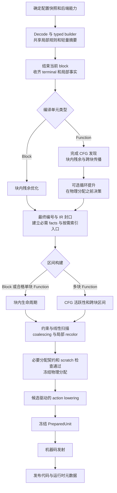

# SwiftVM 中间流水线重构方案

日期：2026 年 10 月 21 日。基准分支：`refactor/middle-pipeline-simplification`，代码与交接状态以提交 `2804a51b` 为起点。

重构范围是 decode 时的 IR 构建、中端优化、分析事实、寄存器分配、ARM64 指令选择与发射准备，以及这些阶段之间的所有权和接口。目标是退役现有重复实现和 plan 容器，建立可以逐批替换、逐批删除旧代码的结构。IR/HIR 的指令语义、Block 与 Function 两种编译能力、现有运行时和代码发布契约继续保留。

本文的目录、类型和阶段接口是目标设计；现状判断依据当前源码。此前方案中的“统一硬预着色替代 Bind”已被后续实验证据修正：当前施工路线是分配阶段内的局部 recolor 事务。详细背景见 [交接记录](middle-pipeline-handoff-2026-10-21.md) 与 [简化执行记录](middle-pipeline-simplification-2026-10-21.md)。

FEX 流程对照固定于提交 `3b7daa5e8dc004f6e9cec3a877f3f3f1ddd6ce11`（2026 年 10 月 20 日），借鉴范围见 2.4。按需 facts、flags/DCE 协作、共享折叠规则、候选驱动 lowering 和临时存储复用属于本方案交付要求；构建期延迟标量状态写单列为 R2E 受控实验，不作为核心迁移的前置条件。

阅读导航：[流程与路径分工](#3-目标中间流程)、[decode 与 pass 边界](#4-decode-时开展的分析与优化)、[目标目录和逐文件职责](#10-目标目录与文件布局)、[旧文件退役表](#12-旧代码迁移与退役清单)、[施工顺序](#13-施工顺序与阶段交付)、[验收矩阵](#14-验证方案)。

实施中的完成状态、构建参数和实际验证结果见 [重构执行记录](middle-pipeline-rebuild-progress-2026-10-21.md)。本文的现状清单以起点提交为准，目标和验收标准继续适用于完整迁移。

## 1 重构目标与范围

### 1.1 完成后应具备的结构

1. `ir/` 保存 IR 数据结构与语义，不再承载物理分配器。
2. `compile/` 保存与后端解耦的构建、残余 pass、分析事实和分配框架。
3. `backend/arm64/compile/` 保存 ARM64 约束、驻留决策、物理宽度证明和 action lowering。
4. `backend/arm64/jit/` 消费冻结后的分配与 actions，负责机器码、标签、临时寄存器租用、运行时 flags 状态记账和代码缓冲区。
5. Block 与 Function 有不同的活跃性构建入口，共享分配核心和局部规则。单块 Function 有明确的快速路径。
6. 每项事实有明确的所有者、构建触发条件和有效期；每个 emission 决策有唯一的生产位置。
7. 旧模块完成迁移后，源文件、CMake 条目、旧接口、废弃配置和旧测试夹具一并退役。

### 1.2 工作范围

| 范围 | 本次处理 |
| --- | --- |
| x86 decode 到 IR | 收敛到 typed builder，前移安全的局部简化，增量记录廉价事实 |
| ARM64 与 Slang 前端 | 接入相同构建接口；保持原有指令语义与能力边界 |
| Block 优化与分配 | 独立入口、块内事实与区间；不支付 Function CFG 分析成本 |
| Function 优化与分配 | 局部规则复用；显式处理跨块使用、入口、回边和活跃性 |
| ARM64 target planning | 驻留决策归分配事务；其余发射配方归统一 actions |
| RISC-V64 | 共享安全的目标无关 builder/pass 接口；保留自身分配、ABI 和恢复协议 |
| 解释器 | 继续消费规范 IR；不被强制接入 ARM64 物理映射与 actions |
| JIT 代码发布与运行时 | 只改编译结果的交接接口；保持 SMC、fault、retirement、link 和中断行为 |
| AOT 与磁盘缓存 | 适配入口和结果生命周期；按实际格式或发码契约变化更新版本 |

本次不扩展 ARM64 对 `AddPhi`、`DefineLocal`、`LoadLocal`、`StoreLocal` 等当前拒绝的 IR 的支持，也不重做 guest ABI、内存模型、运行时调度器或多块单元形成策略。

### 1.3 设计约束

- 优化 IR 的阶段可以修改 IR；全部改写和最终编号完成后封口，分配、lowering 和 emission 只读取 IR 及其编译期元数据。
- 只有分配阶段可以修改物理 mapping、spill/reload、residence 和 preservation。
- lowering 只读取冻结后的分配结果；可选组合只有在普通配方满足当前 mapping、scratch 和 clobber 契约时才能回退。已改变分配的 width/low32 等省略必须在冻结前证明成立，证明失败不能直接补发普通指令。
- emission 不重新扫描 uses、推导 guest-state 安全性、选择 coalescing 或触发分配重放。
- 保留必要的 CFG 固定点和局部正反扫描；“减少遍历”以消除重复工作为准。
- 同一事实只维护一份，但不要求每个单元提前构建所有事实；普通 Block 的分析、扫描与分配成本有单独验收条件。
- 文件家族不等于执行遍历；builder/pass 共用纯规则，flags/value 改写共用 DCE 通知，lowering 按候选和显式依赖执行。
- 不以新增大量子 plan、独立 shared_ptr、proof token 或通用事务框架替换现有复杂度。
- 优化开关影响语义或代码选择时继续进入配置快照和缓存身份；构建布局迁移开关在迁移完成后删除。

## 2 当前实现与清理依据

### 2.1 当前主链

Block 路径大致为：

```text
X86Instance::Translate
  -> X64Decoder + ir::Assembler
  -> PassPipeline::RunBlock
  -> RegisterAllocPass::Run(Block*)
  -> CompleteARM64UnitForEmission
  -> ARMTargetPlanner::Declare / Bind / Seal
  -> JitTranslator::Translate(Block*)
  -> Flush / fault metadata / code cache publication
```

Function 路径大致为：

```text
function region discovery + HIRBuilder
  -> ComputeRPO / IdByRPO
  -> PassPipeline::RunFunction
  -> IdByRPO
  -> RegisterAllocPass::RunWithScalarInsert
  -> optional loop-hoist apply + second allocation + choose/revert
  -> ARM64 target planning
  -> FunctionCodeObjectEmitter
  -> code object publication
```

当前 `LinearScanAllocator` 已有 Block 和 Function 构造入口。Function 还会调用 `CollectCFGUseEnds` 延长跨块生命周期，不能用 FEX 的块内 RA 直接替代。`ra_1blk` 是既有快速路径，其实际成本应与多块 Function 分开统计。

起点提交的代码入口见 [runtime.cpp](https://github.com/ganyao114/SwiftVM/blob/2804a51b6c0477756ca081bec5ba744d152d81d8/source/runtime/backend/runtime.cpp)、[register_alloc_pass.cpp](https://github.com/ganyao114/SwiftVM/blob/2804a51b6c0477756ca081bec5ba744d152d81d8/source/runtime/ir/opts/register_alloc_pass.cpp)、[linear_scan_allocator.h](https://github.com/ganyao114/SwiftVM/blob/2804a51b6c0477756ca081bec5ba744d152d81d8/source/runtime/ir/opts/linear_scan_allocator.h) 和 [target_allocation_planner.cpp](https://github.com/ganyao114/SwiftVM/blob/2804a51b6c0477756ca081bec5ba744d152d81d8/source/runtime/backend/arm64/alloc/target_allocation_planner.cpp)。

### 2.2 当前规模与重复

按当前树的文本行统计，包含头文件、实现及注释：

| 目录或集合 | 文件数 | 行数 | 说明 |
| --- | ---: | ---: | --- |
| `source/runtime/ir/opts` | 36 | 10983 | 同时容纳 IR 优化与物理分配 |
| 其中分配相关文件 | 12 | 6486 | 约占该目录 59%，应归独立分配层 |
| `source/runtime/backend/arm64/alloc` | 57 | 9849 | 混合约束、配方、分析、证明和审计 |

已确认的清理对象：

- `DataflowAnalysisPass` 没有调用者，Function 实现为空。
- `VRegisterAllocator / VRegisterAllocPass` 没有调用入口；现行 Block 分配走 `LinearScanAllocator`。
- `ConstAddressCandidate` 只有声明，是已删除机制的残留。
- `ReIdInstrPass` 只有测试调用，只包装 `IdByRPO()`。
- `CollectWidthChainUseEnds` 与 `CollectGuestGPRUseEnds` 的 43 行函数体完全相同。
- `CFGAnalysisPass` 当前只有测试调用；生产 Function 使用 `HIRFunction::ComputeRPO()`，不能把旧 pass 与生产 CFG 路径混为一谈。
- `GPRBlockPlan` 仍持有多套子 plan 与按指令指针索引的 map。
- `RegAlloc` 仍拥有 target planning 的声明存档、Bind 和 replay 接口。

### 2.3 已完成和仍需完成

| 状态 | 内容 |
| --- | --- |
| 已完成 | decode 期 uniform load 转发、绑定 ARM64 时的全宽 store 映射、部分立即数与常量扩展折叠 |
| 已完成 | 删除 induction tie、const-address cache、funnel shift 三套优化机制 |
| 已完成 | 完整 plan 审计由 `SVM_VERIFY_PLAN` 控制；默认继续生成必要的宽度证书和 flags-only spill 结果 |
| 已完成 | FrozenGPRPlan 类、头文件及全部 operand 快照已退役；必要 residence/scratch/spill-input 归 UnitActions，身份/代际检查归 owning prepared unit、AllocationView 与 UnitActions |
| 未完成 | writer 和 narrow-preserved 的 Bind 修正清零，局部 recolor 事务尚未实现 |
| 未完成 | 单一 actions 表、重复事实与遍历的收敛 |
| 未完成 | 旧 `ir/opts`、旧 ARM64 `alloc` 目录与过渡 API 的完整退役 |

交接基线记录为 607 个用例、9 个既有失败、67 个失败断言，失败用例集合与 DN2 基线相同。后续验收必须使用可复现的当前基线及失败用例清单，不能把该记录解释为零失败。

### 2.4 FEX 流程对照与采用边界

所核对快照的主要路径为：

```text
x86 decode 与块发现
  -> OpcodeDispatcher / IREmitter 构建 IR、寄存器缓存与立即数选择
  -> Finalize
  -> 可选 x87 优化、dead flags 消除（内含 DCE）
  -> RA：反向 kill/affinity、正向分配、spill/fill 与有限邻接合并
  -> JIT 发射
```

优化关闭时仍运行 RA；x87 pass 在没有对应指令时直接返回。流程依据为 [Core.cpp](https://github.com/FEX-Emu/FEX/blob/3b7daa5e8dc004f6e9cec3a877f3f3f1ddd6ce11/FEXCore/Source/Interface/Core/Core.cpp)、[PassManager.cpp](https://github.com/FEX-Emu/FEX/blob/3b7daa5e8dc004f6e9cec3a877f3f3f1ddd6ce11/FEXCore/Source/Interface/IR/PassManager.cpp) 和 [x87 pass](https://github.com/FEX-Emu/FEX/blob/3b7daa5e8dc004f6e9cec3a877f3f3f1ddd6ce11/FEXCore/Source/Interface/IR/Passes/x87StackOptimizationPass.cpp)。

| FEX 机制与源码 | SVM 采用方式 |
| --- | --- |
| [RA 首次需要 spill 时计算 next-use，并在正向分配中做有限邻接合并](https://github.com/FEX-Emu/FEX/blob/3b7daa5e8dc004f6e9cec3a877f3f3f1ddd6ce11/FEXCore/Source/Interface/IR/Passes/RegisterAllocationPass.cpp) | 保留 SVM 已有的按压力收集 spill uses；共享 facts 不使其变为预先全量构建。物理组合放在分配事务或候选 lowering 中 |
| [flags 反向扫描同时执行 DCE，并传播 CFG 需求](https://github.com/FEX-Emu/FEX/blob/3b7daa5e8dc004f6e9cec3a877f3f3f1ddd6ce11/FEXCore/Source/Interface/IR/Passes/RedundantFlagCalculationElimination.cpp) | flags/value 共用改写与删除通知；Function 保留跨块删除队列、固定点及 SVM 自己的 fault/effects 语义 |
| [IREmitter 构建辅助函数](https://github.com/FEX-Emu/FEX/blob/3b7daa5e8dc004f6e9cec3a877f3f3f1ddd6ce11/FEXCore/Source/Interface/IR/IREmitter.h) 与 [元数据生成器](https://github.com/FEX-Emu/FEX/blob/3b7daa5e8dc004f6e9cec3a877f3f3f1ddd6ce11/FEXCore/Scripts/json_ir_generator.py) 共用立即数规则 | 复用现有 `ir.inc/ir_meta`，纯折叠归公共规则，ARM64 编码谓词归 target；不另建平行 opcode schema |
| [guest 寄存器缓存记录当前值与 written mask，再在边界发表](https://github.com/FEX-Emu/FEX/blob/3b7daa5e8dc004f6e9cec3a877f3f3f1ddd6ce11/FEXCore/Source/Interface/Core/OpcodeDispatcher.h) | R2E 只试验可证明窗口内的完整标量状态写，先落实 SVM 的 helper/fault/出口契约 |
| [线程编译器对象](https://github.com/FEX-Emu/FEX/blob/3b7daa5e8dc004f6e9cec3a877f3f3f1ddd6ce11/FEXCore/Source/Interface/Core/Core.cpp) 与 [池化 IR 存储](https://github.com/FEX-Emu/FEX/blob/3b7daa5e8dc004f6e9cec3a877f3f3f1ddd6ce11/FEXCore/Source/Interface/IR/IntrusiveIRList.h) 复用 | SVM 已有 Inst arena；本次重点复用临时队列、候选与扫描数组，PreparedUnit 存储按单元生命周期隔离 |

FEX 支持多块翻译和 flags 的 CFG 传播，但其 RA 按块重置寄存器状态，并原地将 SSA 参数改成物理寄存器、插入 spill/fill。SVM 不照搬这两项：Function 保留跨块生命周期，语义 IR 在分配前封口，后续物理改变记录在 Allocation/actions 中。上述对照是设计依据，不是已经测得的性能收益。

## 3 目标中间流程

### 3.1 阶段顺序



每个阶段有一个所有者和明确输出。IR 规则未提交时可以保留原 IR；分配候选未提交时可以保留原 mapping。冻结后只有与该 mapping 兼容的可选 action 可以回退。必要分配契约失败时终止当前准备结果，不把普通发射当作修复手段，具体失败处理见 7.3。

### 3.2 阶段输入和输出

| 阶段 | 输入 | 主要输出 | 可修改的对象 |
| --- | --- | --- | --- |
| 配置确定 | ModuleConfig、FeatureSet、ISA、执行模式、guest-state 布局 | 单元级配置快照、BuilderCapabilities | 配置快照 |
| Decode/build | guest 指令、明确的类型和副作用 | IR/HIR、块摘要、代码依赖、已知值事实 | 当前 IR 和 builder 临时事实 |
| 残余 pass | IR/HIR、入口属性、布局和能力 | 简化后的规范 IR、CFG 摘要、由 CompileUnit 持有的提升锚点 | IR、uses、相关分析缓存和提升元数据 |
| 编号与 facts | 全部改写后的 IR、完整单元边界 | 稠密编号、封口后的只读 IR、必需 facts；按需补充 consumer/FunctionCFG 等索引 | 完成编号及元数据后封口；派生索引构建不修改 IR，已发布视图保持有效 |
| 区间与约束 | SemanticFacts、后端约束、寄存器池 | 区间、fixed-home 输入、scratch 需求 | 分配输入 |
| 物理分配 | 分配输入 | mapping、spill/reload、coalescing、residences | Allocation |
| 分配完成 | 最终 mapping 与候选事务 | 必要契约通过的 AllocationView、物理证明与 scratch 检查结果 | Allocation；必要契约通过后才能冻结 |
| Action lowering | 必需及本家族所需 facts、AllocationView、target 配置、候选索引 | 普通发射标记、例外动作 payload、BlockActions、EdgeActions | actions，不能修改 IR 或分配；进入 emission 前补齐所需结果 |
| 发射与发布 | PreparedUnit、代码缓冲区 | 原生代码、fault/link/recovery 元数据 | emission 状态和发布记录 |

“最终编号一次”指完成所有生产 IR 改写之后，只建立一次供分配与 lowering 使用的稠密编号。迁移期旧 pass 可以继续使用临时编号；终态将它们改为使用稳定节点引用或局部序号，不承诺构建全过程没有临时编号。Function 必须先完成 R2H 的提升决策迁移，才能接入这条封口与最终 facts 路径；旧 Apply/Revert 流程不能与新 facts 混用。

### 3.3 Block 与 Function 的分工

| 项目 | 独立 Block | 单块 Function | 多块 Function |
| --- | --- | --- | --- |
| 局部 builder 规则 | 全部适用 | 全部适用 | 每个 block 内适用 |
| 块内标签与前向分支 | 需要处理 | 需要处理 | 需要处理 |
| Function CFG 固定点 | 不运行 | 证明等价后跳过 | 按需运行 |
| terminal 使用 | 作为生命周期与 DCE 根 | 同左，另保留函数入口信息 | 加入块摘要与跨块传播 |
| 提升锚点的隐式使用 | 若输入含合法提升元数据，延长到块尾/回边 | 同左，不能因跳过 CFG 固定点而遗漏 | 块内延长并纳入相关回边活跃性 |
| 跨块 SSA | 不引入外来定义；手工 IR 按既有 admission 检查 | 验证没有隐藏的外来使用 | 计算 live-in/live-out 和跨块区间 |
| guest-state 初始状态 | 按独立入口契约保守初始化 | 保留 Function 的入口与恢复属性 | 区分外部入口和可证明的内部边 |
| preservation | 块内观察窗口 | 块内窗口加函数属性 | 含跨块和回边窗口 |
| 分配核心 | 公共线性扫描 | 复用块内区间核心 | 公共线性扫描，输入含 CFG 延长 |
| 分析成本 | 必需 use-end/隐式根；consumer、next-use 和专用事实按需 | 同左，保留入口及自环要求 | 必需 CFG/跨块事实，其他扩展仍按需 |
| 验证与统计 | 独立报告 | 独立报告 | 独立报告 |

单块判定应基于实际可执行块和跨块使用，显式处理合成入口块，避免只根据 API 名称或未经解释的容器大小选择算法。

### 3.4 分配所有权与执行入口

Function 的 `JitCache` 描述整段代码分配，供释放、SMC、fault 和持久化使用；它的起点可能是要求已有调用帧的 continuation 序言。canonical、direct、pending-flags、continuation 等入口各有明确偏移和进入条件，不能把分配起点作为任意执行入口，也不能为了修正 dispatch 而改写分配起点。

`Module::GetNode(location)` 按节点起始地址精确查找。Function 的其他块入口由 AddressSpace 的 L2 dispatch 表按 guest 地址查询，不通过范围查找把内部地址解释成 Function 根。ARM64 的 Module 根查询读取已发布的 canonical 槽；槽未发布或已清除时返回缺失，不能通过整段分配重新得到可执行指针。独立 Block 的精确节点缓存回退和 RISC-V 的子块缓存规则分别保留。实际编译与 AOT 恢复都必须遵守这一边界。

已经没有调用的 `Module::GetNodes/GetRangeNodes`、`AddressHashMap::GetRange` 及专属容器别名已删除；SMC 的范围失效继续使用自身的追踪记录，不保留第二套 Module 范围扫描 API。底层桶边界检查与精确读写规则保持。

ARM64 已增加不依赖可选 audit 的必要检查：定义归属、块内先定义后使用、唯一有效编号和跨块支配关系。封口 facts 在已有原始参数与隐式根访问中收集，只有实际非局部使用才准备共享 FunctionCFG；每次物理 attempt 复用同一封口结果。FunctionCFG 先比较完整成员身份，再读取邻居，保留原始边顺序、重复项及独立的 call-return 关系。证书缺少这份证明时不能进入发射。

块内前向 Goto/NotGoto/BindLabel 现增加路径检查，不能只凭文本上的先定义后使用。准备期在既有 raw-use 访问记录局部片段；仅出现局部分支时创建短期 LocalFlow，按定义片段合并查询，证明 join、terminal、提升锚点和导出至后继 HIR 块的值没有被路径跳过。导出值还须支配定义块的局部出口。BindLabel 是控制 token 的唯一同块前向绑定，不作为物化数据读取；未绑定、重复、错误来源/归属的绑定及将 token 用作普通数据均拒绝。局部检查不建立 FunctionCFG、不增加第二遍参数扫描，不把该暂存交给 emission；条件保守保留两条路径。后向 label 仍保持既有拒绝边界，其局部循环活跃性未扩展。

入口现进一步区分独立可进入的 canonical body 与依赖单元状态的内部 body。必要 SSA 检查在跨块使用的反向路径上标记全部 relay 块，在定义块停止；目标准备再合并已经计算的入口宽度事实。任一条件成立时，冻结的 EdgeBlockAction 标记 requires_unit_state；已准备宽度只要非空即保守标记，尚不根据最终是否采用某项优化收紧。这份依赖不会把所有 Function 或 Function 分配关闭。

compiler 只为原始普通 CFG 边生成已证明的状态传递 PC 对，冻结至 EdgeActions。发射时这些边维持单元内跳转，不依赖可选 region_edges 或 BlockLink；逻辑 call-return 关系不自动成为保存边。循环切边和退出观察必须包含这些强制局部传递，向前边仍遵守已有的延迟观察契约。可选 audit 不能决定正确性路由。

依赖单元状态的 body 不发布到 L2、调用和链接入口表。其 guest 范围仍作为现有 MetadataOnly 记录参与代码依赖、SMC 和持久化；代码体保留 fault 范围。外部 dispatch 或中断恢复遇到这样的 PC，使用既有 CodeMiss 路径从当前 canonical guest state 重新 decode，建立独立入口，不恢复先前捕获的任意 SSA 值。入口宽度必须重新保守播种。guest call 的返回 PC 有此依赖时，不发布指向旧 body 的 host continuation；使用单个 external frame 和空 host continuation，返回后走 canonical dispatch，再按需独立编译。其他合法独立入口仍可发布。

磁盘缓存和 AOT 必须保留未导出 body 的 guest 依赖范围，AOT 另为所需独立入口安排编译。粗粒度 fault 范围使用独立 GuestRange 标签；精确 GuestFault、IndirectCallMiss 与 ExternalContinuation 的验证规则分别保留，不能为容纳范围而放宽所有 recovery site。当前代码格式版本为 39，显式拒绝旧 38 的跨 sink 范围观察错误发射语义，AOT schema 保持 6；复用既有 MetadataOnly/DependencyOnly 编码，语义兼容性由 CodeFormat key 隔离。

必要证书的 entry_state_valid 表示本次准备完成了上述入口分类与路由约束。它不表示任意 guest-call SSA payload 已保存，也不证明所有 fault 状态重建。当前已验证普通 relay、显式外部进入、环上退出/恢复、静态和间接调用返回，以及真实磁盘/AOT round trip；局部前向路径证明另由 ssa_valid 覆盖。后向 label 的局部循环活跃性、完整类型/Phi 规则、任意故障恢复、全部调用保存协议和真实负载重新进入的完整成本仍须接续；ARM64 仍拒绝 Phi/local IR，RISC-V 的对应规则单独处理。

## 4 Decode 时开展的分析与优化

### 4.1 Builder 的接口调整

目标 builder 接口在操作创建前取得结果类型、操作数类型、effects 和 flags 输出意图，支持“返回已有 Value”“返回规范化 Value”“真正创建 Inst”三种结果。前端不再要求每次调用一定产生新节点。

改造前的 `Value::SetType()` 会修改定义指令的返回类型，返回别名后继续定型会影响其他使用者。该接口现已退役：调用方在创建时传入结果类型，合法读取视图使用 `SetCastType`，真正的宽度转换创建显式节点；Block 与 HIR 在参数登记和链接前设置结果类型。结果来源现统一由既有 schema 声明，构造与改写继续遵守下列约束：

既有 ir.inc 的一百九十一项声明现同时给出结果来源：二十九项 Void、二十三项 Fixed、一百零一项 Arg0、三十五项 Explicit 与三项 Call。Fixed 从 BOOL/U32/U64 token 取得类型；Arg0 只读取逻辑参数零的直接 Value/use-site view、Imm、Uniform 或 Local，不能搜索后续参数或深入 Operand/Lambda/Params。访存、选择、转换等 Explicit 操作和三种 Call 必须由调用方声明结果，不能以地址、条件或输入类型猜测。C++ void 默认参数表示缺失 hint；ValueType::VOID/TypedValue<VOID> 表示真实无结果，调用仍保留 effects 和参数使用，HIR 按编号保留空行而不创建值记录。静态工厂直接使用编译期规则，动态无 hint 入口先解析再分配；生产工厂将最终类型直接传给 Inst 构造。

SetArg/SetArgFresh 的八处隐式定型分支、Inst::Create/InstAllocator 与无类型 helper 包装已退役；参数写入仅负责槽位、使用计数和阶段检查，SetInst 在写入参数前按显式/既有类型或声明规则定型。默认结果已知的 IrBuilder 入口调用 AppendTyped/共享规则，Unknown flags 仍保守处理。低层显式覆盖和改写契约分别保留，IrBuilder 的具名工厂校验固定返回 token；这不等于全部 IR 已通过完整参数/类型/SSA/宽度规则。越界和缺失类型的报告归独立冷函数；类型已知的 Inst 构造正常路径不加载元数据表，也不建立格式化错误报告的固定帧；动态无 hint 工厂仍需查询结果来源。实际代码、内联归属、私有存储与传递栈仍须计量，不能由构造路径变短或单批 .text 减少宣称完整成本验收。

构造后的基础检查现归 IR 原语共享。Value::HasValidTypeView 同时检查规范定义与本次读取视图的类型枚举，不能用合法 cast 掩盖 VOID 或越界定义；HasValidDataView 另外要求真正的数据结果，排除无结果调用、非值操作和 Goto/NotGoto 控制 token。Inst::HasValidResultType 只检查基本结果可用性，不把构造默认值当成所有低层显式契约：RV64 Function lowering 通过独立目标表绑定的 VOID 分支可以作为控制节点存在，但不能因此作为数据读取。BindLabel 的有类型控制引用继续由各后端的绑定关系检查处理。

参数形状现由同一 ir.inc 声明：单字节 ArgSignature 区分实际 ArgType 与可选后缀，CallLambda 为 Lambda 加零至三个 Value/Imm，Not 为 Value 加可选完整 Operand。编译期 ValidArgumentPack 同时校验 C++ 参数种类、数量与展开后的物理槽容量，ValidArgCount 是其长度子规则，所有具名工厂共用；原按 opcode 特判参数个数的规则已删除。可选项只能连续出现在末尾，Operand 的三个物理槽必须完整存在，空右侧合法，空左侧、可选参数空洞和签名外尾参均拒绝。IRMeta 的唯一运行时表以 span 借用原 constexpr 签名，不再逐 opcode 持有 vector 副本；constinit 与 trivial destruction 保证表本身无动态构造/析构。没有平行 opcode 签名表或逐指令缓存。C++ 类型到 ArgType 的投影、槽位计算与绑定参数种类的构造 opcode 归 instr.h，基础签名匹配及只引用既有签名的 InstructionSignature 归 ir_meta.h。

Inst::CheckArguments、ForEachValue 和带物理槽编号的 ForEachValueUse 共用嵌套枚举；CheckTypeViews/HasValidTypeViews 已退役。检查在 SSA/use-end 收集同次访问中完成，覆盖全部 schema 参数种类、Imm/Uniform/Local 和 Value 视图、Lambda 直接/间接来源、Params 中每个 Value/Imm、Cond/Flags 枚举及 Operand 操作类型和 PlusExt 的合法移位范围。空 Params 是实际参数；缺失 Params、空 Lambda 和未知 Params 数据种类不能放行。合法带 helper 标签的立即数继续使用 Lambda::IsImm 判断，不把标签误当作普通 ArgType。不建立 GetValues 临时快照或第二遍完整签名扫描。StoreUniform 继续允许同宽有符号/无符号别名，声明字节范围必须等于源读取视图宽度。

Inst::Validate 已删除三种 Call 的提前返回和独立不完整的签名循环，消费同一 HasValidArguments。构建快路径仍允许 unchecked append；工厂构造签名准入、优化前准入与封口后的必要证明各自保留，不用其中一层替代另一层。HIR 的 UseInst/UnUseInst 已删除各自元数据遍历和 CallLambda 特判，使用 ForEachValueUse 的物理槽及 Params 标记；快慢创建路径均从已安装的 Inst 登记，模板 UseFreshArg/AppendValueFast 已退役，不读取 moved-from Params。类型视图与使用计数不能因为参数是立即数、嵌套列表或重复 Value 而失真。RV64 准备必须先完成通用参数检查，再查询 native ABI，避免非法形状进入类型化 GetArg。

具名工厂现以 requires/ValidArgumentPack 排除错误 C++ 参数种类、缺参及总物理槽超过五的调用；Operand 的头部 Operand::Op 不能作为完整逻辑参数。原始 SetArgs/SetArgsFresh 仍允许未完成/导入的 IR，但只接受已知 C++ 参数类及合法容量，并按编译期种类展开槽位，不构造临时 Arg。动态 Block/HIRBlock/HIRFunction 入口在分配 Inst、登记 uses 和编号前检查声明形状，SetInst 在写 opcode/result 前检查；RV64 内部完整 Emit/Inst 同样先检查。HIRBuilder 的 pending-flags 记账移到实际 append 成功后，terminal 后忽略 AdvancePC 的分支也先验证参数包。完整数据视图、Operand 载荷与改写清理仍有各自阶段约束。

具名工厂现通过 KnownOperation<op, Args...>() 将编译期签名结果传到共享创建入口；真正动态 opcode 经 CheckArgumentPack 检查一次后返回同一种 OperationFor<Args...>。该单字节临时对象只保存 opcode，类型按规范化的 C++ 参数种类绑定，不按每个 opcode 复制大型创建函数；私有构造，不能由枚举直接构造、默认构造或隐式转回枚举。ir_meta.h 的 InstructionSignature 只引用既有 kArgs，不建立另一套运行时表。Block、HIRBlock、HIRFunction、HIRBuilder 与 IrBuilder 逐层传递同一凭据，guest-state 的十处已知 opcode 原始创建也走此路径。Inst 的具名改写沿用既有结果覆盖规则并转入共享写入；RV64 内部动态完整工厂仍先检查，分阶段 placeholder New/SetArgs 不要求当场完整。凭据不存入 IR/facts，不证明实际 Value、Operand 载荷、位宽、CFG 或 SSA；优化前准入与封口证明继续保留。动态无 hint 入口仍独立解析结果来源，可变阶段/归属检查也继续生效。上述交付仍不是全部 opcode 位宽、立即数值域、转换、Phi/CFG 或完整 SSA 合法性证明。低层显式结果覆盖及 RV64 无结果控制分支的已有契约继续保留。新检查暴露的旧夹具应改为合法 IR；例如 GetFlags 必须引用算术结果，不能接收 SaveFlags 的无结果标记。完整宽度、转换和控制流规则继续按 R2/R7 验收。

十四项标量操作的基础整数域与选择立即数约束现归 Inst::HasValidScalarArguments：BitExtract/BitInsert/BitClear、ByteSwap、Crc32c、四种零/符号扩展、四种 32/64 位计数和 PopCount。它在完整签名及嵌套 Value 视图检查之后只读固定字段，不再次枚举 uses，不新增 IRMeta 字段、逐指令缓存或运行时 opcode 表。位域位置/长度必须是标量整数 Imm，0≤lsb<64 且 width≤64-lsb，保留零宽 extract=0、insert/clear=原值；减法先检查位置以避免大立即数溢出。ByteSwap 接受 16/32/64、CRC 接受 8/16/32/64，均按完整立即数读取；计数输入视图分别为 U32/S32 或 U64/S64。相关操作的输入/结果必须处于标量整数域，显式结果宽度仍不强制等于默认 token；扩展方向、任意窄读取/结果之间的关系及其余 opcode 规则尚未完成。

ARM64 优化前、封口 SSA/use-end 同次访问与 RV64 Prepare/Translate 继续消费同一 CheckArguments。RV64 三处位域/字节交换/CRC 晚期范围拒绝已退役；这十四项不会由 V256 lowering 新生成或拆分，普通克隆保持标量读取视图、结果类型和完整 Imm，不能将这一限定属性推广为全部 lowering 的类型证明。ARM64 补齐零宽位域和宽结果 ByteSwap16；必要 ABI、Phi/local、configured uniform、条件与 pair marker 检查继续属于后端阶段。

标量整数的类型/位宽判断统一使用 ir_types.h 的 IsScalarIntegerType(type, bits)，明确接受同宽 U/S 别名并拒绝浮点、向量和非法枚举。ARM64 JitContext 的普通读、结果写和临时 GPR 都据此选择 W/X；已修复 S64 误用 W 导致高三十二位丢失。共享 value_rules 先用整数域谓词拒绝无效类型，再查询大小，本地 ScalarInteger 副本退役。逻辑位宽读取和原始位运输仍是两种契约：解释器 BitCast/GetResult 的原始槽位复制、ARM64 的别名以及 RV64 保留 raw bits 的写入保持；后续规范化须在具体逻辑读取边界证明，不能对全部读取统一加 mask。Block 与合格单块 Function 已有独立的解释器/JIT 边界 oracle，多块 CFG 和全部转换规则继续验收。

四类整数转换的数值读取契约现统一为 IntegerConversionInputBits：ZeroExtend32/ZeroExtend32To64 读取 min(输入视图位宽, 32)，ZeroExtend64/SignExtend 读取完整输入视图；后者复制该视图的符号位，与源类型的 signed token 无关。低层显式整数结果覆盖保留结果位宽的低位，允许收窄；frontend 具名工厂仍沿用各 opcode 的默认结果约束。GetScalarIntegerBits 是标量专用宽度查询，非法/非整数返回 0；同宽谓词、位分析、解释器和两后端共用，analysis/value_bits 的本地 IntegerWidth 退役。解释器在转换时先掩码读取的副本，RV64 在独立结果寄存器上处理并仅在已证明时省去结果掩码。ARM64 的 SignExtend 64→32 使用同宽 W 移动；显式宽结果的 32 位零扩展仍必须清除物理高半，不能因寄存器相同而直接跳过。BitCast/GetResult 的原始运输函数不做此规范化。Block/合格单块 Function、优化开关两种模式以及全部八种整数源/结果类型已验证；其余窄算术/比较、向量/FP/地址、完整 flags/effects 和 CFG/Phi 契约继续接续；八类移位的后续交付见下文。

八类标量整数移位（Lsl/Lsr/Asr/Ror 的 Imm/Value 形式）现采用统一数值契约：运算位宽取整数结果类型，数据读取 min(输入视图位宽, 结果位宽) 位；逻辑/循环移位先零扩展到结果宽度，算术右移复制有效输入的最高位，与 signed token 无关。两类计数均按结果位宽取模，允许窄/混合宽度及完整 64 位立即数。x86 byte/word shift 的既有 32 位显式容器继续承担 guest 计数规则。ir_types.h 的 IntegerShiftKind/ClassifyIntegerShift、IntegerShiftInputBits 和 NormalizeIntegerShiftCount 为短期纯规则，不增加 IRMeta 字段、opcode 表或 facts 缓存；共享标量准入由十四项扩大到二十二项，非法输入/结果/计数域在优化删除前拒绝。

decode 的 FoldValue 与残余 FoldWidthValue 共用有界位查询，变量计数只要求结果宽度对应的低 3/4/5/6 位已知；计数高位未知不阻止可证明的折叠，必需低位未知时保持保守。改写经同一 TransfersIntegerValueBits 范围通知宽度消费者，不增加 pass、epoch 或 evaluator。解释器八个入口共用 RunIntegerShift，仅在数值读取副本上规范化，BitCast/GetResult 原始运输保持。ARM64 八个入口共用 scalar_bits 的 EmitIntegerShift，四个立即数主体从巨型 scalar 文件删除；窄立即数右移直接用 UBFX/SBFX，变量窄计数掩码、窄 ROR 周期展开与来源/计数别名保护保持。register_contract 为窄/暂存输入的精确 RorValue 预算预留一个 GPR。RV64 八项也从 translator.cpp 收至 translator_scalar_bits.cpp。Block/Function 的分配入口、封口证明及各自 CFG 生命周期继续分开。

解释器整块 Run 入口在原有最大编号/宽向量预扫中接入共同签名/值域检查，Value 宽度随同嵌套 use 遍历收集，Uniform/Local 的 V256 限制按已校验 opcode 读取；旧五槽独立宽度扫描退役。非法输入在 stack 分配与指令执行前返回 IllegalCode。单条 fallback 沿用其调用方的有效 IR 约定，不为每条执行再增加完整扫描。构造期 C++ 参数凭据仍只证明种类/数量/容量，这些实际值约束不由它替代；完整 decode 约束、全 opcode 类型/位宽和 CFG/Phi 继续接续。

十六类标量 ALU 的整数域也已接入同一 HasValidScalarArguments：Add/Sub/Adc/Sbb/Mul/Div/And/Or/Xor/AndNot、二元 Not、Neg、MulSub、SignedDiv64、MulHigh 和 Div128。Operand 的头部与左右数据槽分开检查，保留空右侧以及 Value/Imm 的合法排列；MulHigh/Div128 的选择立即数也必须处于整数域。只补实际 Value、Imm 和结果的域检查，不新增同宽、固定 64 位或立即数数值限制，不改 raw 运输和数值读取。非法且无用的节点必须在常量折叠/DCE 前被拒绝，不能先删掉再把单元认定为合法。Block 与 Function 分别验证，直接 RV64 发射拒绝时不能已有代码字节。

Params 现为 move-only RAII owner，真实 slab Node 私有，迭代返回独立 Param 数据快照；安装前取得的 iterator 也不导出真实节点写别名。Inst 采用私有平凡 Storage，SetArg/SetArgFresh 仅接受 Params&&，先完成阶段、槽与全部 CheckUse 验证，再无分配转移链表，并从已安装列表登记每个 Value occurrence。const/non-const Arg 的 Params getter 都只借用 View；替换/普通销毁逐项 UnUse，整体 teardown 只释放自身链表而不读取其他定义。未安装/失败 owner 自动释放，所有释放均清空头。ConstructionArguments 在实际消费入口排除 lvalue/const owner 和 View；签名证明保持独立，普通标量参数在真实大型创建主体前归一为 const 引用，避免引用类别复制模板。链入前 Inst 由局部 owner 保护，已归属节点在 raw HIR 接管前拒绝；这些保证不等于完整 RewriteContext 事务回滚或 Push OOM 覆盖。

terminal 的 CheckTerminal 与只读 ForEachTerminalValue 共用单一递归；前者检查 Cond 完整 EQ..NV、If 的有效整数视图、Switch 的整数 key/case Imm，递归包含未选择的子树。普通 Invalid dispatcher、空/重复/混宽 signed case 和宽整数 If 视图保留，AL/NV 均恒真。analysis/uses、SSA 的 ObserveImplicitUses、融合 facts 及 ARM64/RV64 优化前/直接发射、解释器入口消费同一契约；不可达 Function 成员也验证形状，但不附加可达路径支配要求。形状、SSA use 与 use-end 尽量在原访问中收集合流，不复制终结树/逐值类型缓存。Standalone capacity 的已有 U8/explicit terminal/owned-before 限制继续属于该专用入口，不能推广到公共契约。anchors 仍是独立隐式根。

ARM64 对 AL/NV 先发表真实 pending 状态，再按 canonical 状态发射选中边，避免透明后继复活 ClearFlags 的旧位；普通条件与内部边仍按既有 flags 交接。公共 JitRun 从 State.host_cpu_flags 重新播种 PSTATE并清上次 Run 的 park，同次 helper 返回保留独立 park/unpark。生成代码语义的共享 JIT/AOT kCacheFormatVersion 升至 41，旧 40 在安装前拒绝；外壳格式 6/ABI 1 没有布局变化。优化前准入与封口后必要证书各自保留，Block/Function 的分配策略仍分别验收。

1. 常量、扩展、寄存器读写、访存和算术 helper 在参数登记前确定类型；低层显式覆盖与生产 builder 验证分开。
2. 返回别名时，用 use-site 的类型视图表达合法转换；不能改写共享生产者的类型。
3. 未知 flags 输出的调用仍保守创建节点；结果类型已知不表示允许依赖 flags 的替换。
4. `SetArg`、删除、替换和移动指令必须更新或失效相关 builder/pass facts。
5. 旧 Assembler、Value::SetType、setter 隐式定型与无类型构造兼容入口已删除；继续验证完整类型/SSA/宽度规则，不再引入依赖参数写入来补类型的兼容入口。

Value 的定义身份及 anchor/capture/HIRUse 的指令引用现已收紧为 const，Value 的 use bookkeeping 也已转为内部职责。Block/HIRBlock 的指令列表及 HIR value 表、记录和 use 链现在统一只读；指令写入口校验所属 Block 与封口状态，RewriteContext 在通知前校验指令和单元归属。HIR 的成员表、RPO、前驱/后继、边列表和 call-return 查询也统一只读；需要写入的 decode/pass 通过 HIRFunction::EditBlock 校验 Function 归属与实际 Block 的封口状态。边和 HIR 链节点私有，添加边先校验两端再修改列表；ARM64 emitter 与 RV64 HIR 规划接收 const 输入。

生产 ARM64 入口通过 CompileUnit 在分配至发射期间封口，并在所有消费者结束后回收 IR。AddressNode 的范围、种类和链节点已私有，范围写入按实际 Block/Function 检查封口；持久 Function 的成员表查询只读，添加、转移、回收等写入口也受阶段约束。多个 region 共享实际父 Function 时，结构封口按消费者计数，最后一个结果退出后才解除；局部 HIRBlock 封口也保留父对象结构约束，不能只设置空的 region header。多 region 先完成语义准备和所有权合并，再全部封口、分别分配；普通 Block 的 guest 范围也在分配前确定。

HIRFunction 在构建和发布后持续持有持久 Function 引用，Module 持有独立引用，Function 仍直接删除其 Block。CompileUnit 已从构造时持有 HIRPoolLease 及实际 canonical Function/独立 Block，覆盖尚未封口的优化准备阶段；删除默认构造和带参数的 SealIR。准备阶段通过 EditBlock/EditFunction 取得 writer，SealIR 后只提供只读输入，移动单元同时转移持有权和阶段责任。原始 HIR header 在 region 合并后可能已无成员，不能用它代替实际父对象。

准备期间的成员所有权由单独的 compilation 计数约束，防止通过持久 Function 的添加、移除、转移或批量回收入口使持有者失效。CompileUnit::MergeFunctions 先校验整组成员无重复，再完成无分配的 intrusive 转移并更新各单元的实际父引用；失败时不先移走前几个 region。指令和 CFG 的语义编辑仍在封口前完成，成员转移不再由 runtime 在单元外实施。

`backend/arm64/compile/compiler.{h,cpp}` 现提供 PrepareBlock、PrepareFinalBlock、PrepareFunction、PrepareFunctions；必要契约通过后才返回 owning Arm64PreparedUnit。其稳定存储同时拥有 CompileUnit 和分配/target 结果，对外只提供 const 查询；FunctionCodeObjectEmitter 只接收这些准备结果，删除公开的裸 Function/RegAlloc 配对入口。普通 Block 与已经编号的 HIRBlock 分开准备，后者不重跑普通 Block 优化。生产 ARM64 runtime 已改为调用这些入口，再组织编码与发布；AllocationView 与独立结果持有权已接入；公共 facts、预制约束、完整轻量 actions 和其他调用方仍按 R1/R3/R5/R6 接续。

HIR pool 的内部布局放在 `ir/hir_pools.h`，消费者只使用 `ir/hir_storage.h` 的 lease。每个活跃单元保留自身 pool 会话；builder 结束、源线程退出或其他 region 先释放，都不能使其槽位或实际父对象提前回收。最后一个持有者释放时才 reset，线程缓存仍存活时复用一个空闲 pool；缓存容量整理失败时直接回收。未解码且非主入口的占位块留在 HIR 自身存储中，不进入持久 Function；跨 region 转移只接受实际成员不重叠的情况，不交换各 pool 所拥有的占位对象。当前验证与边界见 [执行记录](middle-pipeline-rebuild-progress-2026-10-21.md)。

flags 需求也可能在算术节点之后以 `SaveFlags` 等形式追加。接口用明确的 FlagsIntent 区分无 flags 输出、已声明输出掩码、尚未确定三种情况；它描述该操作必须保留的输出，不预测后续 flags 是否死亡。不能保留这些输出的折叠只接受“无 flags 输出”；未知时保守构建，到 guest 指令结束通知收齐 pseudo uses 后再用共享规则处理。声明无 flags 输出的调用不得随后追加依赖该生产者的 SaveFlags；旧 API 按未知处理。这个结束通知只用于完成构建契约，不引入通用回滚事务。

builder 与残余 pass 必须调用同一份纯折叠规则。`compile/rules/value_rules.{h,cpp}` 接收已知值、类型、flags/effects 条件，返回可复用值或规范化建议；节点创建、删除、use 更新仍由调用方负责。ARM64 的 add/sub、logical、地址立即数合法性只在 `backend/arm64/compile/target.cpp` 实现，通过明确的能力接口使用；公共规则不 include ARM64 emitter。当前 `BoundIsAddSubImmediate / BoundIsLogicalImmediate` 与 const pass 对应副本在接入后删除，避免以后只修正其中一套。

默认 Inst setter 现与已验证的 OperationFor 共用结果解析：普通 Void 操作不能继承被替换节点的返回类型，原始畸形结果由必要检查拒绝；值操作继续保留显式视图。公共 ir_meta.h 内的 meta::IsControlToken 统一 Goto/NotGoto/BindLabel 的身份角色，兼容 RV64 Function lowering 的 typed self-label 与无类型分支，并保证控制 token 不作为数据读取。无返回值 Call 继续合法，runtime metadata 表与 opcode/缓存版本保持；现有类型用例增加三十二项，Block/Function 必要检查及 RV64 新执行已验证，详见执行记录的“公共类型边界”批次。此项不代替完整类型/SSA 与 guest-state 统一。

### 4.2 可直接在前向构建时完成的工作

| 工作 | Decode 时处理 | 必须满足的条件 | 后段保留内容 |
| --- | --- | --- | --- |
| 常量求值 | 对整数常量、扩展、提取和合法位运算求值 | 精确按 IR 位宽、移位与溢出语义；保留 flags 和其他附带输出 | 类型或需求未知的节点、后续改写触发的级联 |
| 恒等化简 | 消除纯值上的恒等运算、重复转换 | 不丢弃 flags、fault、内存或状态效果 | 需要最终需求或唯一使用证明的规则 |
| 立即数选择 | 将已知常量变为合适的立即数操作数 | 后端已绑定且编码合法；未绑定只做目标无关变换 | 复杂地址和后续出现的常量机会 |
| 宽度与 known bits | 记录常量位、已知零位、符号扩展来源和截断范围 | 记录值语义，不冒充物理 W/X 状态 | coalescing 后的物理宽度与 low32 证明 |
| uniform/guest-register 转发 | 维护字节级 SSA 绑定，复用或提取已知值 | 类型、覆盖范围、observer 和 helper effect 均满足当前契约 | 路径汇合、部分写、延迟 FPR 映射等残余 |
| 全宽固定映射 | 直接构造已知的 GetHost/SetHost 形式 | 绑定对应后端与 JIT；满足 guest-state 布局和类型条件 | 未绑定路径与窄写的完整上下文判断 |
| 局部覆盖死写 | 后写已证明完全覆盖前写时清理前写 | 同一可执行区域，无相关读取或观察；保持 fault/恢复契约 | 复杂 byte-liveness、fault sink 和跨块证明 |
| 延迟完整标量状态写（R2E 实验） | 只更新 pending 绑定，发表前被覆盖的写不创建节点 | 满足 4.6 的观察边界、临时活跃根和完整覆盖条件 | 未命中及未启用时使用常规 typed builder；部分写与复杂 FPR 仍保留原规则 |
| EA 规范化 | 合并常量位移，保存 base/index/scale/disp | 保持 guest 地址位宽、segment、地址转换顺序和访存属性 | 依赖物理寄存器的 writeback、preindex、biased 组合 |
| 短窗口常量复用 | 复用邻近的相同常量 | 类型和控制流作用域一致；限制 live range 延长 | 未知 profitability 或跨路径机会 |
| 基础别名信息 | 记录 BitCast/extend 的直接来源 | 不绕过保留宽度、观察和生命周期约束 | 最终 consumer 视图和物理 alias 关系 |

当前 `analysis/value_bits` 与 `rules/value_rules` 的 FoldWidthValue/FoldConditionalValue 已供 decode 的 FoldValue 和残余 values pass 共用。查询支持常量、BitCast、五类扩展/提取、简单 And/Or/Xor/AndNot、Add/Sub/Neg，以及全部八类 8/16/32/64 位整数移位、四类整数谓词和标量选择器；移位按输入/结果逻辑视图取得有效位，再传播已知零/一位与符号复制范围，计数按结果位宽取模。变量只查询必需的低计数位；未知计数仍可保留独立证明的零值、算术右移/循环右移全一等稳定结果。加减通过编译期六十四字节 full-adder 状态表传播可能 carry/borrow，不执行有符号宿主溢出。复杂 Operand 仍保守未知，逻辑位事实不能作为物理高位证书。完整结果已知且输出契约允许才折叠；每次最多访问 32 个 value，非法输入、循环或预算耗尽使整个查询未知。TransfersIntegerValueBits 同时供 worklist 级联通知；没有使用图、逐值缓存或 SemanticFacts 新字段，完整单元摘要、其余算术/CFG 传播与全部成本继续接续。

decode 立即数选择的 `bound_positions` 全 builder 寿命哈希已退役，改为按 append 位置排序的来源历史。这里的五条窗口只计算经 IrBuilder、目标能力启用时实际追加的节点，包含 metadata；外部 raw appends 和被合并后返回空的 AdvancePC 不推进计数。它不是残余 pass 的八条实际 IR 常量共享窗口。逐指令提交按候选的原始位置查询；较早的 width 节点变成常量时，按原位置插入历史，不能被较晚追加的常量提前淘汰。无延期候选时及提交/取消后裁剪过期来源，保持既有跨块合法引用和能力关闭后冻结计数的行为，不从 decode 顺序推断支配关系，也不把外部未登记常量加入折叠资格。

稳定能力配置下，裁剪后只需保留最后六个位置的来源；这不是通用的六条记录或六条容量上限。延期提交期间要保留历史查询所需记录，能力切换可使不同定义共享位置，vector 的历史峰值容量保留到 builder 销毁。Android 产物中 IrBuilder 从 536 降到 520 bytes，单条来源记录为 16 bytes；已有常量窗口测试验证预热后追加 256 个无延期候选的常量不再请求 C++ new 存储。该检查不覆盖所有 malloc/arena、长指令历史搬移和总堆峰值；这些成本以及正式 PMU 仍待验收，不能仅凭 owner 缩小或 launcher text 减少认定 R2 完成。

普通 guest memory load 不因结果未使用或地址相同就消除。fault、并发可见性、原子和内存序属于实际效果；地址表达式可以简化，内存访问的观察语义必须保留。

当前分支的窄 store 映射、窄 Add/Sub 立即数折叠和 Neg 常量替换均已有明确限制。扩大规则时应逐条满足这些限制背后的语义条件，不能通过删除 guard 扩围。

整数谓词与条件读取已接入同一规则边界。TestZero、TestNotZero、一参 Not 按输入 Value 的完整逻辑视图测试零/非零；TestBit 的整数 selector 在 [0,64)，位于输入视图之外时结果为零。结果 U/S 和宽度不改变真值，二参 Not 保留 Operand 补位契约。已准入且真实物化的布尔 primitive 与 0/1 literal 具有完整 scalar 0/1 保证；HasBooleanResult 不由普通 known-bits 推导 raw alias、guest home 或延期 native condition 已规范化。

Select/SelectZero、Goto/NotGoto 和 terminal If 的条件按输入视图判断零/非零，terminal BOOL 为 U8；不把条件规范化施加到数据臂或 Switch。选择结果仍服从既有结果宽度和运输约定，本批不为结果视图外位建立新保证。解释器 ReadBoolean、ARM64 CompareIntegerZero/ConditionRegister 和 RV64 ReadCondition 只规范化数值副本；RV64 scalar、GPR-pair/RVV vector 及 V256 拆分路径均接入条件读取。

decode 的 FoldValue 和残余 values 共用 FoldConditionalValue，只在输出契约允许、完整逻辑结果已知且参数通过共享准入时替换常量；公共规则对 Unknown flags 保守处理。查询推导谓词、已知条件的选择臂或两臂事实交集，加宽后未知高位保持保守。worklist 将条件值纳入候选并转发改写，不增加图、逐值缓存或持久 facts。raw BitCast/GetResult 主体不变；完整 bound-decode 配置、其余算术/类型、CFG/Phi 和全部成本仍属于 R2 验收范围。

### 4.3 同时记录的廉价事实

| 粒度 | 记录内容 | 有效期 |
| --- | --- | --- |
| 每个已确定类型的值 | 常量、known bits、宽度来源、直接别名 | 定义或类型被改写前 |
| 每个 block | memory/FPR/helper/标签/flags/原子操作等 presence bits 与必要候选摘要 | 可以保守只加不减；结合最终编号遍历收紧，不能用假阴性跳过必要处理 |
| 每条指令 | 所有者 block、guest 指令边界；静态 effect 查询 opcode 表，动态 helper effect 按需解析 | 指令保留期间；语义改写时更新，不复制整份静态 effects |
| 使用关系 | 复用现有 Inst/HIR 的 use 维护；记录已有使用与跨块引用 | 当前构建版本；“当前最后一次”不等于最终最后一次 |
| guest-state | 当前字节/寄存器版本、helper 读写影响、观察边界 | 当前有效控制流作用域 |
| Function 边 | 已发现的目标、待解析目标、入口来源与代码依赖 | Function 发现完成前持续补齐 |
| flags | 已出现的读写掩码、生产者关联和观察要求 | 块/函数收尾后才能计算完整需求 |

不在 decode 同时构建第二套完整 consumer 图或物理生命周期表。现有 use 计数继续增量维护；最终编号后建立必需的 use-end 和隐式根。完整 consumer 图、spill next-use 与专用事实仅在对应消费者需要时建立，具体触发条件见 6.4。

### 4.4 事实失效与控制流

- 函数模式仍按各 block 独立维护前向状态；decode 顺序不构成支配关系。
- 块内 `Goto/NotGoto/BindLabel` 使用已有的保守重置或等值交汇规则。不能复用某个分支独有的常量或 guest-state 版本。
- helper 按已知 effect 精确失效；未知 effect 保守失效相关事实。CallLambda、CallDynamic、CallLocation 均须处理，不能让未列出的调用穿过前向字节缓存。
- 加入或重置解码块时，同步处理 guest 代码依赖、边和摘要，避免保留旧节点引用。
- 多个初始播种策略共享算法和只读基础效果，保留各自的入口事实。当前 RegisterStatePreparation 的多实例有不同入口播种与物理视图，不能直接按 block 合并。

### 4.5 Decode 结束后才定案的内容

Block 结束并收齐 terminal、隐式使用和观察根后，可以确定块内 DCE、反向 last-use 和保守出口条件下的 flags 需求。

Function 需要先完成发现，才能确定跨块 live-in/live-out、flags 传播和回边影响。可在各块结束时生成摘要，随后在摘要上运行必要固定点。

物理 register home、是否发生 spill、整条 width chain 是否共寄存器、writeback 是否覆盖仍活跃版本，都由后续分配与 target 阶段决定。

### 4.6 构建期延迟标量状态写实验

R2E 将一部分“先创建 StoreUniform/SetHostGPR，再由 DSE 删除”的写改为 builder 的 pending 绑定。首次仅覆盖当前能证明的完整标量寄存器写；相同窗口内的读取复用当前 SSA 值，后写完全覆盖且无人观察的旧写可以不生成 IR。它不延迟普通 guest memory store，也不改变 guest ABI 或恢复协议。

| 边界或事件 | 首次实现的处理要求 |
| --- | --- |
| 完整覆盖、无相关观察 | 更新当前值与 written 状态；被覆盖的旧 pending 值释放临时根，不创建其状态写节点 |
| pending 值仍由缓存持有 | 作为 builder 临时活跃根，局部删除不得仅凭普通 use-count 回收；不把它误算成 flags pseudo use |
| 可能 fault 的操作或恢复观察点 | 在该操作前发表应可见的状态；首次实现保守发表全部 pending 写，不凭 FEX 的 flush 位置推断 SVM 可恢复性 |
| helper 或其他状态观察 | 首次实现先发表其读/写范围涉及的 pending 状态，再失效被修改的绑定，防止部分写丢失其余字节；effect 不完整时发表全部 pending 写并保守失效；可能 fault 的 helper 同时服从上一行 |
| 分支、label、块出口与外部入口交接 | 在分流前及必要的汇合处发表，保守结束缓存窗口；不把 decode 顺序当成支配关系 |
| 部分写、复杂 FPR 写或其他未支持形状 | 先发表相关 pending 状态，再使用现有 typed 构建规则，不改变字节覆盖语义 |
| block 收尾或构建失败 | 成功收尾时所有 pending 写均已发表或已证明被覆盖；失败时丢弃当前未完成单元并释放临时根，不能返回带悬空绑定的结果 |

pending 绑定只由 IrBuilder 持有，不跨 block，不进入 Allocation/PreparedUnit。实验关闭和不命中路径也通过新 typed builder，不能为此保留旧 Assembler。R2E 单独记录省掉的写节点、发表原因、峰值活跃量、spill 与生成代码质量；语义测试和 15.3 的质量门通过后再扩大范围，失败则撤去实验实现及其迁移开关，不阻塞核心重构。

## 5 残余 Pass 的组织

### 5.1 固定顺序与内部协作

目标保留一个显式、固定顺序的 IR pass 调度入口，提供 Block 和 Function 两个函数。规则按家族放置，文件数不等于全量遍历数，避免为每个家族保留 HIRBuilder/Function/Block 三套批量包装和动态 `std::function` 注册表。

```text
校验输入与能力
  -> guest-state 残余转发、DSE 与必要的 fault sink
  -> flags 需求与反向消除，同时处理失去使用的定义
  -> 常量和宽度残余规范化，使用相同的删除/改写通知
  -> 排空受影响节点队列与必要的 flags/CFG 传播
  -> 可选循环提升决策与改写
  -> 最终编号、IR 封口和必需 facts
```

首次迁移保留现有的先 uniform、再 flags/const/width、最后 DCE 的语义顺序，并建立行为对照；R2 退出前把 flags、常量、宽度和 DCE 接到共享改写通知与删除队列。`flags.cpp` 逆扫时先清理已经无用的纯节点，删除 reader 后立即更新 uses 和 flags 需求，避免死 reader 阻止更早的 writer 消除。`values.cpp` 的改写若改变 flags 读取或 pseudo uses，必须重新处理受影响窗口及 Function 摘要，不能只更新 use-count。

`dce.cpp` 提供公共删除机制，不强制代表最后一次全量遍历。队列初始播种结合已有局部扫描，手工 IR 或尚未提供增量通知的入口允许一次显式播种。Block 在合法顺序下复用逆扫，Function 保留跨块 def 回收、带活性验证的队列和必要固定点；不把 FEX 的局部 RA 假设用于跨块 SSA。若可选局部规范化达到预算上限，停止扩大该优化，但必须完成已提交改写的 use/DCE 一致性维护。不能为了声称单遍而隐藏整块重扫或放弃必要的 CFG 固定点。

活跃 ValueWorklist 已保存全部定义的指针、owner 与存活状态，Function DCE 直接复用其身份表，包括未作为优化候选的不可达节点，不再同时建立第二份逐指令 owner 哈希。查询先验证行仍存活，再解引用队列项；删除将原行置空，重复项不能复活。没有 value epoch 的 Function 仍独立维护必要的 owner 表，不为此强开 value 身份表。进入/退出 epoch 时清空旧队列与旧 owner 条目、使下一次必要 DCE 从当前 IR 重新播种；构造新名册失败时不撤销原有 DCE 状态，退出后不能继续依赖已释放的借用。原始必要播种扫描保留，既有队列容量复用；先前独立 DCE 的哈希 bucket 容量可能保留，完整私有成本另计。

Function flags 的 live-in 与 transfer 两张逐块哈希已合为一份短期状态表，按现有 HIR block order 索引，同时核对成员指针身份；不复制 CFG 边，也不作为封口后的 SemanticFacts 使用。同一次 EliminateFlags 中复用成员与容量，改写后仍刷新全部必要 transfer/live-in 并求固定点；不可达成员的初始需求保持 None。只有首次且启用 branch-only，并遇到终结与 condition 基本形状合格的第一个候选时，才在外层调度准备一次改写前需求。无这类候选时跳过专用前置计算；候选识别复用既有 RPO 访问，不增加资格预扫。快照必须在任何 branch-only 改写之前建立，包括带 marker 的候选，不能把全函数求解放进更深的候选调用栈。该门控不保证晚期拒绝或仅有 marker 的 Function 都跳过分析；必要的后续需求重算保持。只写不读的 BranchOnlyStats 五项统计及其递增已删除，原 ACCEPT 诊断仍保留。

terminal 需求改为直接归并 LinkBlock/LinkBlockFast、If 和 Switch，删除每次查询的目标 vector；目标 PC 仍在原始后继中匹配，保留这部分访问成本。缺失边/成员、空块、无 terminal 以及其他未知出口仍保守返回 All，CheckHalt/Condition 不因包含内部子节点而放宽。纯 transfer、成员校验与 Function 固定点现归 `analysis/flag_flow`；查询外来或空 HIRBlock 时先拒绝身份，不能先读取其 terminal。独立 Block 只创建局部 label 工作状态，不分配 Function 状态表，也不运行 Function 固定点。Function 表每槽 32 bytes，按 MaxBlockCount 分配，含空槽初始化、私有分配及 terminal 递归栈另计。

局部 label 的摘要哈希和逆扫需求哈希已合为 FlagFlow 的一个短期有序缓冲。首次实际遇到 BindLabel 才扫描当前块的绑定并原地堆排序，查询不扫描或分配；只有本轮逆扫已经经过的绑定才提供需求快照，索引中存在目标不等于目标已知。摘要保存 generated/preserved，清理合并需求，carry 屏障通过 epoch 丢弃先前快照，回绕时清除旧 epoch。切换块清除键并复用容量，同一块可复用键；发生 label 创建或重定向后必须重建整个分析作用域。该状态不归 SemanticFacts、不跨封口、不由 decode 求跨块需求。无绑定的块不准备 label 索引；有绑定的块增加一次索引准备访问及 O(L log L) 排序，容量可能保留到整次清理结束。必要逆扫、摘要刷新和两层固定点继续存在，不能把哈希退役写成零扫描、零总堆或整体提速。

`Block::GetTerminal()` 返回 `const Terminal&`，直接借用 Block 的 terminal 存储。只读分析、分配准备、发射和解释器的同步递归不得为了读取而隐式克隆 If/Switch/CheckHalt 子树。借用在 SetTerminal 或 Block 销毁时失效，遍历必须先结束；需要跨替换使用或交给另一个 Block 的 terminal 显式复制。terminal 快照本身不延长其引用的 SSA 定义寿命。HIR reset 先完成旧 terminal 的 uses 释放再替换；准备/发射继续由 CompileUnit/PreparedUnit 持有 IR，不将 terminal 子对象引用放入持久 actions。

branch-only 的整块指令 vector、整数路径的 flags/polarity/inversion 三份 vector 和 victims set、浮点路径的 victims vector 已退役。直接在 intrusive list 中定位 condition、唯一 marker 与 producer 窗口，用计数及保留的迭代器完成全部证明，再有限重扫已接受窗口、按源顺序删除；先前整数 set 的删除通知顺序因此改为确定的源顺序。删除前推进游标，保留的边界节点不得删除，DCE 通知只入队，不能在该遍历中递归回收后续节点。保留重复 marker、缺失 AdvancePC、共享 condition、flags 观察者、carry 和宽度等拒绝条件；拒绝后仍由公共清理移除 marker。候选触发遵循上述基本形状门控，晚期拒绝及 marker-only 的快照成本继续单独计量；不删除必要的 flags/CFG 固定点或局部 label 暂存。已有 C++ new 失败夹具覆盖只读嵌套 terminal 遍历及一个关闭普通 DCE、无 carry consumer 的独立 Block 命中路径，不能推广为全部路径或全部内存分配均为零。

carry 保护不再先构建 Region 数组、保护位数组，再对每个 consumer 重复回溯；ClassifyCarryRegions 的旧定义及公共声明已退役。块清理按逆序进入每个尚未编辑的 AdvancePC 区间前，有限扫描该区间一次，按原 writer 清单归纳 consumer/writer，并以 pending 位向前传播。后续 consumer 的需求在 writer 处截断；当前区间自身有 Adc/Sbb 时，即使同时写 C，也仍保护其前面的 producer。连续空区间、全部原 flags 观察边界及关闭 carry 消除时的原回退保持；没有 carry consumer 时不准备区间摘要。分类不分配区域容器，每轮总访问线性，但仍有必要的区间摘要访问、清理逆扫和 flags/DCE 固定点，不能记为单遍或整个 pass 零堆请求。

状态 DSE 与 sink 直接以当前 typed IR 的 StoreUniform/SetHost 写入为依据。原 UniformCaptureRecipe、Block 中的 recipe vector/get/set/take/clear、CaptureLatestStateValues、DSE 的 carrier 修补，以及 sink 的 published、位置哈希、提前 retarget 和 HasObservableUse 回退已经整体退役。DCE 不再借用该配方制造隐式根；真实 store/SetHost 的参数承担所需 SSA 使用。提升 anchors/prefix 的必要根、物理寄存器 capture/entry-width 证明仍保留，不能因同有 capture 一词而混同删除。

前向读取转发与后向 dead-store 证明采用不同条件。访存不改 guest state，前向值可能继续有效；但它可能 fault，其后的覆盖不能删除 fault 前的必要发表。DSE 保留 MayFault/Unknown、GetUniformAddress、UniformBarrier 及原 helper/位置/分支边界，删除只能依据反向 byte 覆盖；没有恢复证明时不得放宽。旧 survivor/递归祖先守卫及 consumer 图均已退役，共享 DCE 保留副作用，Block 与 Function 两个区间入口各自为存活的零使用定义分配目标，包括编号零的首个定义；两种分配算法继续独立。

sink 沿 intrusive 指令链推进，先保存后继，再摘下符合范围资格的 store。PendingStore 仅保存原 Inst*、offset/size、Pending/Publish/Erase 和 detached，实测 24 bytes；不复制 Value，不把较早 store 的操作数改成未来 producer。读取转发先逐字节证明同一条 pending store，再从原节点读取类型视图；窄整数仍通过共享 BitExtract，不能用不发射截断的 BitCast 代替。

完整包含于 XMM 范围仅表示可以进入 pending 队列，不表示其他直接访问与 pending 不相交。跨范围头部、尾部或间隙的 LoadUniform/StoreUniform 仍须在原节点之前发表交叠 pending；否则会读旧字节或把较早写移到较晚重叠写之后。有效但不全含的访问在有 pending 时额外检查声明范围，只有相交才执行 pending/coverage 扫描；不相交不准备 coverage。offset/size 先以减法检查边界，越界访问前保守全 flush，不把溢出当作合法范围。该修正自代码格式 39 起生效；当前格式 40 还包含完整 64 位 GPR 的逻辑发表证明，并拒绝此前的缓存格式。

fault/control 观察点由唯一 IR metadata 的 MayFault/Unknown/Call/ControlFlow 加显式状态操作判定；对现有 191 个有效声明 opcode，与原 sink 判定逐项相同，未知 effects 保守处理。UniformBarrier、映射 Get/SetHost、位置/地址暴露及 RSB 边界保持；普通内存 barrier 不冒充完整 guest-state 观察。逆向覆盖、未来观察和完整窗口仍属残余 pass，decode 只前移局部已知值、静态 effects 和可立即证明的转发，不预测未来覆盖或故障恢复。

部分 flush 的 reverse coverage 同时闭合较早重叠写的依赖，防止未选中的旧写随后覆盖已发表的新字节。coverage 仅按全部 pending 的包围区间准备、相对 byte 访问并复用容量，仍包括内部空隙；后续选中写完整覆盖的旧写可删除。原顺序重连与删除通知完成后，稳定压缩未选中的行，保留 source order。pending/coverage 容量仍保留至该块返回，未据此宣称整个 pass 零堆或完成所有 CompileWorkspace 迁移。

异常归属独立于 Publish/Erase。扩容先于摘链；重连后先解除 detached，再执行可能失败的删除通知。压缩转移持有状态并解除旧槽，失败清理只把仍 detached 的节点不分配地交回原 Block 后重抛；不能访问已删除的行。失败输入仅保证可以销毁，必须丢弃，不重试、不发射、不承诺恢复原顺序或语义，也不加入整段 IR 备份/replay。现有失败夹具覆盖 Block/Function、额外全 flush、外块定义组成的空链、删除及转移后的失败；不将这些 C++ new 路径推广为全部运行时异常证明。

现有字节 oracle 已加入跨范围头尾/间隙的四种读写程序，并比较解释器改写前后和真实 JIT；另一既有用例通过实际 helper 读取部分覆盖/恢复的中间状态。纯配方结构用例及重复配置退役。具体计数、构建/夹具错误及 RV64 编译依赖复用依据见执行记录。相邻批实测 IR Block 256→232、PendingStore 32→24 bytes、编译器 text 减少 12760 bytes；普通 spill 保持，但前批保守 fault 发表带来的累计压力、私有容量/动态成本及正式 PMU/FEX 门尚未验收。GPR 的逻辑 GuestStateFacts/EntryPolicy/version/CFG 已有后续交付（见 6.1），完整 uniform/FPR 状态流及独立物理入口播种仍须分别接续。

### 5.2 各类 Pass 的任务

| Pass 家族 | 负责工作 | Block | Function |
| --- | --- | --- | --- |
| state cleanup | builder 未覆盖的 uniform 映射、byte facts、死写、标量与 FPR 的观察点发表 | 按块运行 | 块内处理加现有合法的入口/跨块事实 |
| flags cleanup | NZCV/PF/AF 读写、dead flag、branch-only 形态、carry 保护；逆扫中同步执行公共 DCE | 保守出口条件下逆扫，立即更新死 reader 的影响 | 按受影响 CFG 摘要传播，跨块删除通知进入共享队列 |
| value cleanup | 调用共享纯规则处理常量、立即数、宽度与 consumer 改写；维护局部复用窗口 | 按块候选/worklist，复用公共删除通知 | 维护跨块 use 关系及受影响 flags 摘要 |
| DCE | 删除无使用且无可观察效果的节点，递归回收 def 链；作为公共机制随改写执行 | 含 terminal 和状态根，不强制独立整块末扫 | 跨块共享删除队列，保留真实引用 |
| loop hoist | 只保留当前可证明的循环形状，统一在分配前决定 | 无候选时零成本；不强行增加能力 | 处理合法自环/既有支持形状 |

RISC-V64 使用显式的 pass 能力配置，保持其现有 flags admission、TSO barrier 和 IR 支持检查。ARM64 uniform 物理映射不能因共享调度器而进入 RISC-V 或解释器路径。

### 5.3 循环提升的处理

终态删除“分配 baseline、改 IR、再分配 hoisted、比较 spill、撤销 IR”的双结果选择流程。提升决策在最终编号前完成，使用当前候选的额外活跃范围、可用池和保守压力估计。

迁移时独立验证新决策的质量。若估计无法给出可靠的保守条件，跳过该候选；在达到既有质量门之前，Function 暂留既有入口，Block 可以独立迁移。旧入口不消费新最终 facts，也不把同一份 facts 带过 Apply/Revert。不能以默认关闭整个优化掩盖退化。

该迁移是 R2H，必须在 R3 的 Function 分配入口切换前完成，不延后到 R6。R2H 通过后，生产路径删除 `original_order` 存档、`Revert` 和 `FunctionRegionAllocation::baseline/hoisted` 的双份结果，所有提升决策都发生在 IR 封口前。为验证质量保留的临时比较路径在本阶段退出时删除。

### 5.4 提升元数据与隐式活跃根

改造前 `LoopHoistMetadata::anchors` 指向局部 LoopInvariantHoistRecipe 的 vector，recipe 结束后 admission、分配重试或发射仍可能读取该元数据。该存储现已移交 CompileUnit，旧 recipe/Apply/Revert 已退役；下面的生命周期要求继续约束最终 PreparedUnit 的所有权接续，不能只保留算法迁移。

- CompileUnit 持有每块的 anchors backing storage；临时 recipe 中的锚点在 pass 返回前复制或转移到该存储，定址后再发布 `LoopHoistMetadata` 视图。`prefix_end` 和锚点引用的 IR 节点也必须保持存活。
- 存储和视图覆盖所有 allocation attempts、必要重试、admission、actions 构建与发射。移动 CompileUnit/PreparedUnit 只转移存储持有权，不能使视图失效；发布视图后不再扩容或搬移被引用的 backing storage。所有消费者结束后，若 Block 继续存活，先解绑元数据视图再释放存储；不序列化这些指针或 span。
- 候选拒绝或准备失败不留下半份 metadata；CompileUnit 在所有消费者结束后解绑自有视图并释放存储。最终 PreparedUnit 继续接续这项职责，不能恢复到临时 recipe 持有 backing storage 的形式。
- anchors 是块尾/自回边处的隐式活跃根。即使 terminal 没有显式 Value 参数，也要延长锚点区间、spill use-end 和相关固定约束，防止寄存器在下一轮复用前被覆盖。Block、单块 Function 和多块 Function 都遵守该规则，不能只放进 CFG 固定点。
- facts 显式记录这种隐式使用，区间构建消费它；不伪造普通 IR 参数或把它等同于 guest-state observer。若封口前仍运行 DCE/改写，必须保留锚点并同步元数据，或撤销该提升后再改写。

## 6 分析事实与生命周期

### 6.1 数据所有权

| 数据 | 所有者 | 主要内容 | 冻结与失效 |
| --- | --- | --- | --- |
| 构建状态 | IrBuilder | 局部常量/宽度、字节转发、标签快照、presence bits；R2E 启用时含 pending state bindings | block 结束前提交所需状态写并释放；不能被 emitter 持有 |
| CompileUnit | 优化前由当前编译调用持有；封口后依次由 OptimizedUnit、准备结果接续 | Block 或 Function 引用、阶段、guest 代码范围、HIR pool 与实际父对象 | 贯穿准备和发射；不拥有正在执行代码的生命周期 |
| OptimizedUnit | 公共 pipeline 的移动专属结果 | 封口 CompileUnit、不可变 FeatureSet 快照、decoded-block 计数和唯一 SemanticFacts | 独立稳定存储保证移动不使 facts 视图失效；最后一个准备 writer 退出后才可移交 IR 并释放 facts |
| CompileWorkspace | 调用方或线程编译上下文 | 删除队列、扫描数组、候选与局部编辑暂存；复用容量 | 按活动编译作用域独占；结果不引用其中的可复用内存，释放占用后才能复用 |
| 提升元数据存储 | CompileUnit | 每块 anchors 的 owning 存储及 prefix/计数；Block 上的 LoopHoistMetadata 只是视图 | pass 返回前完成持有权交接，封口后只读；覆盖全部分配重试至发射结束，释放前解绑仍存活 Block 的视图 |
| FunctionCFG | OptimizedUnit 内的 SemanticFacts，按需创建 | 唯一结构投影：RPO、普通边、显式入口及独立 call-return 关系；数据流和目标策略不写入图 | CFG 改写后重建；纯 Block 不创建 |
| FunctionValueFlow | SemanticFacts 按需独立持有，与 FunctionCFG 分开 | CFG use-end 和非局部 SSA 的入口依赖位图；同一封口输入复用，普通 Block 不创建 | 新输入清除；不存物理位置、home 或目标宽度传播 |
| SemanticFacts | OptimizedUnit；分配 writer、请求状态与 target 仅借用 | 必需的编号/use-end/隐式根与摘要；按需补充的 consumer 等索引 | 由封口 IR 派生；准备阶段显式补齐，已发布视图只读且地址稳定；最后一个准备消费者退出后释放 |
| GuestStateFacts | OptimizedUnit 的语义事实，附明确的 EntryPolicy 与查询策略 | 按需求建立版本、观察窗口、动态 helper effects、逻辑发表要求 | 不把物理位置缓存进语义事实；不同策略的派生结果不可互换 |
| GuestStateFacts（已接入的部分 owner） | SemanticFacts 按需唯一持有 | 观察候选、GPR 定义目录、编号后读写/barrier 输入，以及按显式 Block/Function EntryPolicy 建立的 GPR 逻辑字节版本证明；不缓存 FeatureSet、物理高位或忽略发表结论 | BeginInput 统一清除；前三族独立按需，span/pointee 稳定。版本族仅在封口且 SSA 合法的具体查询触发，缓存包含类型视图的正/负答案；Find 不扫描 IR、不构图。完整 uniform/FPR 状态流继续接续 |
| spill use 索引 | 同一 SemanticFacts 的跨 attempt 准备作用域 | 封口 IR 上不可变的使用位置，含 terminal 和隐式根 | 首次压力需求时构建，跨 attempt 复用；与可变游标分开，最后一次分配消费者结束后可释放 |
| Allocation | 一个分配 attempt | mapping、区间、spill/reload、home/preservation、dirty masks | recolor 时事务更新；完成后只读 |
| UnitActions | ARM64 PreparedUnit | 按指令索引的动作、紧凑 payload、块和边动作 | lowering 结束后冻结 |
| emission 状态 | JitContext/JitTranslator | 标签、缓冲区、scratch 租用、动态 flags/dirty 与延迟 spill 状态 | 仅发射期间可变 |
| 发布元数据 | code object / Module | fault、恢复、guest 代码依赖、link、retirement | 沿用运行时现有生命周期 |

2026-10-25 的公共逻辑基础已接入：`GuestStateByteFact`、读取分类/连续性和局部分支 meet 由 `analysis/guest_state.{h,cpp}` 唯一定义，decode builder、残余 state pass 和 pending-store sink 实际消费。普通转发、允许低 FPR 视图的转发、pending-store 三种策略显式区分；sink 仍先证明所有读取字节来自同一条 pending store，不能用“同一 Value”代替该证明。builder/pass 的短期字节表和标签快照保留各自生命周期；布局 eligibility、helper 失效、observer/flush 及物理 home 不进入纯规则。随后已把保守观察候选按需归唯一 SemanticFacts，home-only 查询不建候选列表，发表窗口再应用消费者自己的边界规则；普通与 pending 的窄标量读取共用实际截断规则，pending 另保留 V128→U64 lane 提取。当前 GuestStateFacts 已为实际 owning 对象，分别持有观察候选、Get/SetHostGPR 定义身份目录与编号后的访问/barrier 输入；原 GuestStateObservations 类已退役。含扩展别名的目录按真实指针排序，外块同编号独立，物理 ActiveState 按候选数建行，不再复制全指令身份或维护 fallback 哈希。共享候选身份之后，已继续接入 GPR 字节版本、显式入口策略与 CFG 查询（见下文）；这仍未覆盖完整 uniform/FPR 逻辑状态流。物理入口/宽度、忽略发表和提前 clobber 继续独立播种。目录的冷扫描/位图/外块去重/排序、更长寿命与二分查询成本，不能由热视图的无关 IR 分配检查推导为完整编译收益。

2026-10-25 后续已将 decode/pass 的四套 mapped access 判定收为 ResolveGuestStateAccess，并用同一 GuestStateBranches 管理局部边快照。live byte 表保留原调用方的存储/寿命；快照不存在与存在但空交集明确区分，builder 出口 Reset。decode 的部分 mapped store、resident FPR deferral、helper/统计和物理入口高位策略继续显式处理。封口后的 GPR 版本查询另归 GuestStateFacts，不复用这些可变临时快照；完整 uniform/FPR 流继续接续，共享调用、map/vector 容量与叠加栈成本仍须计量。

前批编号后的 GPR 窗口输入已归 GuestStateFacts：Get/Set 位置和潜在 barrier 身份与物理 clobber 分开，多个准备视图复用静态输入；目标仅维护当前 FeatureSet 的 mask 投影，既有摘要 spare bit 跳过空家族。公共 owner 48→72 bytes、记录 56 bytes、目标准备 header 1536→1544、投影 32 bytes 和 launcher text +7400 bytes 已计入开放成本，不以局部帧或普通 spill 相同替代完整动态/内存质量门。当前 GPR 逻辑版本交付见下段；其余状态家族及完整质量门仍需完成。

2026-10-25 的 register-state-windows-v2 将该目录改为唯一 GuestStateRegisterAccesses：Get/SetHostGPR 与 Get/SetHostFPR 共用 bank/home/读写键，含部分写，GPR barrier 的消费者策略仍独立。FPR 初始 allocation inputs 与最终 contract 显式消费同一目录和观察流；最终 verifier 保持只读，准备入口借用 writer，HasFPRWrites 在基础摘要同次收集。纯读取 FPR、无写 scalar tie 和 shuffle-only 不为本家族建立窗口。严格开区间保留原端点，65535 的最后 ID 与 65536/UINT_MAX 上界有独立线性 oracle 对照。此改动没有交付跨 CFG 的 FPR/uniform 状态版本；Block/Function 分配入口、物理 owner/高半、AES committed-home fault 例外及必要 retry 保持独立。GuestStateFacts80、共享目录56、BlockSummary8 bytes 不变，但目录新增 FPR 项与冷排序成本，临时 FPRContractBuilder96→128；完整私有容量、动态成本和 PMU 门仍开放。

2026-10-25 的 `r1-guest-state-versions-v3` 已在 `analysis/guest_state_cfg.cpp` 接入真正消费的逻辑 GPR 字节证明。`PrepareGuestStateGPRMatch` 显式准备，`FindGuestStateGPRMatch` 只读区分未准备与已准备的负答案；缓存键保留定义指针、使用的类型视图、声明槽/偏移和观察位置。Block 策略使用未知入口；Function 策略复用唯一 FunctionCFG，沿全部普通前驱求证，function/external/call-return/缺失前驱均保守未知。入口策略按当前消费者显式选择：Function 初始约束的独立块视图继续使用 Block，后续 BeginFunction 的准备视图使用 Function；不能因单块 Function 采用块区间分配就混同其入口语义。不同策略不互换答案，也不借用物理高位播种。

证明按请求的字节反向访问共享候选流，处理部分 Get/Set、透明整数转换、前向局部分支交汇及 Function 回边；跨过所依赖 SSA 源的定义块入口即拒绝，防止把循环不同动态实例当成同一值。直接、非重入且不写 guest state 的 helper 可保留逻辑字节；未知/重入调用、未解析 uniform 写与内存写等保守失效。当前 ARM64 发表窗口仅为完整 64 位整数使用该附加证明，仍先检查原 clobber/读取窗口并保留全部物理准入；窄值的高半、physical capture、CurrentEntry 与 DefinitionEntry 继续独立。缓存格式为 40，AOT schema 仍为 6。后向局部 label、完整 Phi/type/SSA 与 uniform/FPR 状态传播并未由此交付。

该批 production 净增 382 行，不能当作整体减量。Android 实测 GuestStateFacts 72→80 bytes；版本视图 104、外层 roster 24、每块输入 40、局部边 12、答案 24 bytes，容量与更长寿命另计。LogicalByte 由初版 24 压到 16；冷构造/证明分出后，公共准备函数自身栈帧 848→240 bytes，但 constructor/Prove/ByteOf 自身仍为 320/656/176 bytes，不能据此推导整条调用链栈或编译耗时下降。launcher text 相对 windows-v2 增加 14016 bytes，完整内存、动态编译与 PMU/FEX 质量门仍开放。功能验证和历史失败详见执行记录的 versions-v3 节。

后续 `r1-guest-state-demand-v2` 将该查询改为先证明当前块。只有入口仍有未决字节时，才为逻辑状态请求共享 FunctionCFG 和 canonical-root 可达性；SSA 准入本身需要的 CFG 仍按原契约准备。观察/label 输入按实际访问的块建立，未查询块不因 Function 视图存在而扫描 IR。跨块时单独建立 56-byte FunctionInputs，加每个 CFG 块五字节的输入 ID/状态元数据；40-byte 输入记录只为访问到的块分配。局部阶段只保留当前一个块的私有输入，可替换这些临时记录而不撤销此前缓存答案；跨块阶段以稳定 ID 追加，扩容失败回滚 label/point、未完成输入不发布。直接 Func owner 和有序 Block owner 分开，策略、完整类型与偏移仍各自保留。

缓存命中在已经验证的同一封口输入上直接查询，不重复 owned-block/SSA 准备；冷入口继续检查归属、RPO、类型范围和 SSA。转换读取位数复用 IntegerConversionInputBits，删除本地 min32 副本。既有用例补充本地 Function 不额外强开 CFG、只访问必要前驱、旧答案跨输入增长存活，以及类型/偏移缓存隔离；既有 constant-window 模式再覆盖18前驱、66前向 label、冷缓存/已有答案的逐分配失败，合计217 injections/125603 checks（每个 fast 模式）。Semantic 热入口自身帧176→80 bytes，GuestStateFacts/视图头保持80/104，VersionViews24→32；launcher text 再增加3040 bytes，ByteOf 自身帧176→192。按需范围缩小不等于完整堆/调用链栈或动态编译收益，完整质量门继续开放。

后续 `r1-uniform-forwarding-v2` 将 decode 与残余 pass 的可变 uniform/FPR 状态更新收为公共实现：DescribeGuestStateForwardAccess 在 ResolveGuestStateAccess 基础上唯一确定读取转发、load 播种和 store 更新资格，保留既有固定 GPR、XMM 开关、窄 FPR 与 resident deferral 规则；GuestStateForwarding 唯一执行字节写入、完整/声明写范围失效及前向局部交集。旧 GuestStateBranches 类、两份 helper/分支更新和重复逐字节记录循环退役。调用方仍拥有 live 表及其生命周期，公共对象只拥有短期边快照；统计只由 pass 解释更新结果，builder 不额外统计整个 byte 表。decode 的部分 mapped store 继续等待 pass，不把合法范围内的 SSA 字节与物理高半播种混同。

该批修改六个既有生产文件及一个既有测试文件，production 净减115行；IrBuilder 实测520 bytes不变，原 GuestStateBranches40 bytes替换为同尺寸 GuestStateForwarding，临时 access/update 为12/8 bytes。launcher text减少1136 bytes；公共调用的自身帧和调用链成本仍须计入，不能据此声明动态编译/PMU收益。两种IR模式各新增472条通过断言，19项RV64受影响用例及重新执行的strong-TSO通过，其他复用范围和历史11/66见执行记录。这里只交付封口前的共同状态更新；Function uniform/FPR版本、完整语义宽度/生命周期、动态成本与正式FEX质量门继续开放。

后续 `r1-state-target-policy-v1` 将两项固定 home 规则迁回 ARM64 target：0–9/22/23/29 的强制转发与 load 播种集合，以及扩展映射的 DSE 阶段选择。AddressSpace 在全部绑定建立后按 backend_isa 调用 ConfigureGuestStatePolicy，配置结果作为 GuestStateLayout 的只读数据提供给 builder/pass。公共 DescribeGuestStateForwardAccess 与 state pass 只消费显式 mask/阶段位；默认布局不因出现某个编号自动继承 ARM64 资格，非 ARM64 不套用其编号约定。FeatureSet.ir_uniform_range 的范围转发仍独立于 load 播种，物理 CurrentEntry/DefinitionEntry 和 Block/Function 入口策略不变。

新增策略为八字节值记录，不持有容器、回调或逐单元缓存。Android GuestStateLayout96→104 bytes，由每个 AddressSpace 唯一持有；GuestRegisterBinding8、转发结果12、IrBuilder520及各 facts/准备对象大小不变。已有用例扩展96组decode/pass、三类显式策略、range开关、四个home和U32/U64对照，两种IR模式各新增384条通过断言；完整质量门仍按14/15章验收，不把该字段迁移或原有失败基线误当成完整R1交付。

### 6.2 身份、编号与 IR 封口

- decode/pass 期间使用稳定节点引用或构建局部序号，不把可变的 `Inst::Id` 当作长期键。
- 所有 IR 改写和提升元数据交接结束后，为单元建立稠密 InstructionId 和 BlockId。函数内按最终 RPO 编号；块内保留确定的指令顺序，然后封口并建立必需 facts。完整 consumer/reverse-use 索引不作为所有单元的固定开销。
- 构建 facts 时统一覆盖 Lambda、Params、terminal、pseudo/projection 与提升锚点的隐式使用，不能只覆盖直接 Value 参数。按需的是索引表示和特定派生分析，不是省略必需 use-end、活跃根或正确性检查。
- 本方案采用不可变 IR 边界，不新增 IR revision 计数或逐指令签名。Optimize 结束时收回 builder/RewriteContext 的可变访问权；Allocation、lowering 和 emission 只得到不会暴露可变 IR 的视图。结构、操作数、返回类型、terminal、CFG、编号和提升元数据都在封口范围内。
- `const Inst*` 本身不足以保证这个边界。此前 `Inst::ArgAt(int) const` 返回 `Arg&` 的问题已修正，Value 定义、metadata、HIR 集合和 CFG 查询也已接续只读访问；仍须关闭可写构建别名在封口后的逃逸。写接口只向封口前的构建/改写上下文开放，并校验所属单元的阶段与实际拥有关系。保留 IR/HIR 数据模型，不为此再造一套节点体系。
- scratch/FPR 的有界重试只重建物理分配，复用同一份封口 IR、提升存储及已构建的不可变语义索引；重置 attempt 专属游标和物理派生结果。若确需修改 IR，必须丢弃所有依赖它的准备结果，在可变优化入口重新完成编号、封口和 facts；不得在 allocation、lowering 或 emitter 中就地修改后继续使用旧结果。
- 补充派生索引不改变 IR 或先前 facts。索引按独立稳定存储发布，不能因另一索引扩容使已有 span 失效；消费者显式声明需求，由准备阶段的所有者完成构建，普通只读查询不隐式分配或重建。进入 emission 前所需结果已经齐备。
- 冻结结果校验 unit 身份、配置快照以及现有 allocation generation/attempt。分配重置或成功的物理事务提交按统一规则使旧物理派生结果失效；不另增平行 epoch 体系。这些检查只能拒绝错单元或过期分配，不能检测任意 IR 写入，IR 不变性由上述访问与阶段边界保证。

### 6.3 事实共享规则

基础 def/use 和 effects 查询共用实现与来源。静态 opcode effects 直接读取现有 `ir_meta`，不复制成逐指令 effects 数组。consumer-specific 的 observer/full-write 谓词、不同入口播种和物理 mapping 视图必须显式区分。

直接 helper 的 guest-state/fault/reentry/uniform traits 由 ir/args.h/.cpp 的 HelperStateEffects::Resolve 统一解析，ir/instr.cpp 的 Inst::GetEffects 与 backend/arm64/helper_call_contract.h/.cpp 共享这份五字节值记录；后者继续独立负责 FeatureSet、host 寄存器、FPCR、NZCV 和 ABI 规则。它不含 host 寄存器、FPCR 或 ABI 策略，不作为逐指令缓存；Lambda 与目标契约布局保持。Inst 仍只在直接 CallLambda 且 NoReentry 时精化 guest-state/fault bits，memory/call effects 与其他 opaque 调用保持保守。UniformEffectSet 是独立的 call-wide 写范围承诺，不证明无读取、fault 或 reentry；HelperUniformWrites 必须显式选择 Declared（前向失效）或 NoReentry（循环稳定状态）策略，后者保留直接/非重入要求并可采用 ReadOnly/None 的空写证明。两种策略共享完整范围校验，不能用写集合删除可能被 helper 读到的旧 store。

现有 `BlockAnalysisIndex::FollowingWrite` 是按调用方谓词构建的派生事实；不能把它作为一个全局共享结果。迁移为只读基础索引加调用方短期窗口状态，或带明确策略键的派生查询。

多个 coalescing 阶段可复用相同的基础 use-end；Function 的 CFG 延长和 preserved span 作为附加结果保留。FPR 当前采集与 GPR 的 terminal/参数规则存在差异，统一前先明确所需语义，不能只按返回类型相同合并。

### 6.4 必需事实与按需分析

| 数据 | 构建触发条件与所有者 | 普通路径要求 |
| --- | --- | --- |
| 稠密编号、必需 use-count/use-end、隐式根、块 presence | 最终编号及基础扫描；OptimizedUnit 的 SemanticFacts 持有 | 必须完整，尽量共用一次扫描；不重复保存可直接查询的静态元数据 |
| 完整 consumer/reverse-use 索引 | 首个需要查询任意消费者的规则或契约；SemanticFacts 显式建立 | 无此需求不建；同一封口 IR 上建一次供相关家族共享 |
| spill next-use 位置 | 第一次压力淘汰确实需要时，由分配入口调用 `spill.cpp` 建立 | 延用当前 `CollectSpillUses` 的惰性条件；不可只因进入 RA 就建。不可变位置数据跨 attempt 复用，当前游标由 attempt 持有 |
| FPR 专用 use/区间与组合事实 | 存在对应值、候选或必须检查的 FPR 契约时 | 无需求不建；即使没有 FPR 值，也不能跳过 opcode/helper 实际要求的 FPR clobber、scratch 与 ABI 约束 |
| guest-state 版本与 observer 窗口 | state 优化、residence/publication 或恢复契约提出具体查询需求时 | 按 EntryPolicy/谓词建立所需范围；简单块不预建所有 consumer 的窗口 |
| 动态 helper effects | 静态 opcode 元数据不足以描述当前 helper 时 | 查询统一解析接口，必要结果按单元共享；不复制静态 effects 表 |
| CFG/跨块活跃性 | Function 的入口、优化或分配语义需要时 | 纯 Block 不建；合格单块 Function 只承担其真实入口/回边所需分析，不强制执行多块固定点 |
| lowering 候选索引 | 依据最终 opcode/presence 播种，优先并入基础扫描 | 按家族保存紧凑候选，未命中家族不再遍历全块；局部后继/后缀摘要也由实际候选触发 |

当前落地：OptimizedUnit 在最终编号、封口后准备基础活跃性、flags 与八字节 BlockSummary，摘要本身不创建 consumer/spill 索引。consumer lowering 已共用一次候选播种，GPR 输入以保守 opcode presence 排除空家族。PrepareIndex 只准备编号指令 roster、成员查询和摘要；PrepareUses 显式补齐直接边，PrepareResolvedUses 接续准备其前置直接边。fixed/residence、GPR/FPR、memory、flags、scratch 和必要证书在实际家族/证明候选处申请边表，纯普通块可以完成准备而不建图。可选完整 audit 的准备单列计量。memory-feeder 的首个原始使用分类已并入输入/spill 的同次参数遍历，借用共享行缓冲，不再为此建图；low32 在物理初筛后的实际使用查询处建图，固定发表需块内确有 SetHostGPR。纯整数位事实已由 decode 和残余折叠共享，按有界查询计算，不增加 SemanticFacts 字段或稠密位事实表。其余家族继续收紧触发并计量，不能以这些覆盖认定所有输入都达到最细成本；完整单元语义宽度摘要、其余候选播种及扫描继续施工。基础 facts 从后续分配移到封口结果构造的工作，要同时计入总体编译成本，不能把 RA 子桶减少算作节省。

基础 flags 的两个结果直接写入各自所有者：单元需求向量归 SemanticFacts，块内 packed pseudo demand 归其 BlockRecord，后者在 PrepareIndex 时一次移动到稳定索引。扫描末尾的 BlockFlags 临时集合、二次记录查找/移交和单元 demands 临时向量已退役。flags 已就绪后补活跃性不重置这些结果；重新开始未完成的 flags 收集时清除部分计数/home 与当前块结果。单元需求包含可达跨块 pseudo，局部发射需求只接受本块 producer，不将二者混成同一结果。必要 packed demand 仍复制到 UnitActions，确保 prepared 结果不借用已经销毁的语义索引。

整单元 GetHostGPR/SetHostGPR 的声明 home 掩码已并入基础 flags/presence 访问，由 SemanticFacts 持有；Block 取本块，Function 只取 RPO 可执行成员。原始窄视图仍声明其 home，不先解析 BitCast。GPRHomes 是准备完成后的 const 查询，分配输入不再专门重扫整个单元；新输入清零，ARM64 自己保留 home 31 的拒绝规则。该掩码来自最终 IR，不能直接用 decode 时尚未失效收敛的候选代替。

FPR 的 destructive ties 与 publication 在同一次局部前向投影中收集；保留有实际候选时的反向 observer 写窗口和 operand use-end 查询，不为合并遍历增加逐指令的跨文件 builder 调用。两种 scalar insert 条件、原始参数边和独立 FPR retry 保持。减少扫描次数本身不替代整体成本验收。

捕获寄存器的语义使用宽度/末次位置现由 SemanticFacts 的显式 PrepareRegisterReads 缓存提供。只有目标准备遇到实际未绑定、池中合法的 GetHostGPR 候选后才创建；Block 扫本块，Function 扫 RPO，汇总前向原始参数、pseudo/BitCast 和 terminal/提升锚点。宽度在解析 BitCast 之前记录，不用物理 ValueLiveness::UseEnd 替代。结果只为 GetHostGPR 声明保留八字节稀疏行，const Find 不构图/分配，新输入丢弃旧表；旧 ARM64 VersionUseEnds 哈希表和无条件收集已删除。该缓存并非完整单元宽度推断：SemanticFacts 为指针增长八字节，候选表对象八十八字节，超过内联八行后还会增长；九类工作区计量不包含它，完整成本仍须接续。

DescribeAllocationInputs 保持 const AllocationWriter 的物理只读约束，同时显式接收 SemanticFacts 与 CompileWorkspace 的可变准备借用；不能为了取得暂存把物理视图改为可写或让 const getter 隐式修改工作区。

这里不引入通用 analysis manager、跨阶段自动失效框架或任意 lazy getter。各数据的生产者、触发点和消费者在固定入口中明确连接。需要分析就显式构建，随后传只读视图；必要证明不能因“本次不优化”而被误判为无需求。按需路径的结果用独立完整参考算法抽查，成本计数见 15.4。

### 6.5 临时工作区复用

`CompileWorkspace` 放在 `compile/workspace.h/.cpp`，只管理准备期间的工作队列、扫描缓冲、候选数组和局部编辑暂存；`unit.h/.cpp` 单独负责 IR 所有权与封口。消费者按实际借用直接包含 workspace，只有引用声明的接口可使用前置声明。SVM 的 Inst 已有 arena/free-list，本次不重写 IR 分配器，也不建立通用内存框架。

- 调用方或线程编译上下文可保留 workspace 容量；开始下一单元/attempt 时重置相应逻辑状态，不能把旧队列、visited 标记、候选或游标带入新输入。
- OptimizedUnit 持有 facts，CompileUnit 持有 IR/anchors，PreparedUnit 接续 IR 并拥有 Allocation/actions；分配专用的不可变 spill use 索引与基础活跃性输入由同一 facts 的跨 attempt 作用域持有。结果可以从 workspace 转移存储，但转移后 workspace 不再拥有或复用它。公开结果不得保留指向可复用暂存的引用。
- 多个 prepared region 等待统一发射时，允许它们共用先后执行的临时工作区，前提是每个结果已经脱离暂存。并发或嵌套编译必须使用各自尚未被占用的 workspace，不能仅依赖“同一线程”推定安全。
- 记录首次编译与容量复用后的分配次数、增长次数、初始化/清零字节和峰值；对极大单元设容量保留上限或显式回收时机，避免一次峰值永久占用线程内存。
- 此处的临时存储与 ARM64 scratch 寄存器预算是两个独立概念；复用容器不改变 scratch headroom、clobber 或重试规则。

当前 ARM64 PrepareBlock、PrepareFinalBlock、PrepareFunction、PrepareFunctions 各在外层持有一个 CompileWorkspaceScope，覆盖该入口实际执行的优化、普通分配、scratch/FPR 重试与 target 准备。公共 Optimize 入口和 AllocationWriter 构造显式接收同一 CompileWorkspace&；AllocationState 不再内嵌工作区，CompleteARM64Allocation 也不再另外创建作用域。返回的 OptimizedUnit/Arm64PreparedUnit 不保留该借用。

四类借用 scope 在正常或异常退出时清空各自逻辑状态，并释放容量超过 64K entries 的缓冲；该上限按每个容器的元素数计算，各元素字节数不同，不能写成统一的 64KB。直接由调用方持有的 workspace 同样执行回收，不依赖外层线程作用域退出。spill cursor 在各 attempt 开始时清空，writer 退出时检查容量上限，保留跨 scratch/FPR 重试的复用；外层 Reset 负责最终清理。

AllocationWriter 另独占借用同一 workspace 的分配期：即使 Allocation 与 SemanticFacts 都不同，前一 writer 尚未析构时也不能用该 workspace 创建下一 writer。拒绝发生在设置结果/facts 的 writer 标记之前，失败不污染另一份输出。冻结结果不再需要工作区，writer 析构后可继续查询；下一 writer 可顺序复用容量。此守卫不是锁，并发准备仍须使用不同 workspace。

九类 workspace vector 通过无状态 allocator 接入既有 SVM_PROF2，记录成功的分配请求次数、释放次数、请求/释放字节、当前请求字节及逻辑峰值；总峰值独立累计，包含 vector 扩容时新旧缓冲重叠，不将各类峰值相加冒充同时峰值。另在借用结束、重新借用和析构时配对记录九类闲置容量、保留事件及独立的进程同时保留峰值；重复 Reset 不重复增加已闲置的容量。只在显式批量初始化处累计 spill cursor 清零、instruction rows 的 UINT32_MAX 填充和 value links 两个 UINT32_MAX 字段的逻辑字节，按实际 size 计算，不按历史 capacity 计算。consumer 与 vector 共用的缓冲标签现为 lowering_candidates，旧证据中的 consumer_candidates 通过显式标签映射比较，保留原始名称和日志哈希；新增借用和保留事件按实际记录，不作为纯重命名抹平。

计数器属于进程，支持顺序跨线程交接后在另一线程释放；不同 workspace 的并发保留按实际同时容量累计。开关在首次存储使用（包括读取快照）时固定，测试重载配置不能让同一缓冲的申请和释放分别落在开关两侧；需在编译开始前设置环境。关闭计量时，存储申请/释放、借用结束和上述批量初始化入口只判断开关，不更新计数原子变量、不遍历九个缓冲或逐指令计时；借用互斥检查仍执行。快照在编译静止时读取，容量是容器请求口径，初始化量只覆盖上述三类显式批量填充，未覆盖其余 payload 构造、扩容搬迁、硬件流量、分配器实际块大小或 RSS；这些指标不得相互替代。布局未增长也不能替代整体成本验收。

值清理在最终编号前独占借用 ValueQueueScope；该改写期不插入新节点。队列以节点身份查成员并先检查删除墓碑，再解引用；Block 的局部 use 边保留重复使用次数并随通知更新，Function 直接消费 HIRUseList。已有 epoch 的初始标量/向量 CSE 也复用该 uses 视图，真实匹配后快照本块后续普通用户并直接改写，不再建立初始 replacement 表或逐节点查其参数；无 epoch 路径仍使用原有轻量替换表，不为纯常量单元另建身份表/反向图。初次 CSE 后，活跃 epoch 中的新 LoadImm 和删除事件将相邻八条实际 IR 的常量候选送入同一队列；首次出现该反馈才启用有序处理。普通规范化任务始终先于 CSE 任务，避免共享增加 uses 后阻止单用立即数折叠；每行可分别挂一个普通任务和一个 CSE 任务，以既有 u32 槽编码，不增加第二个缓冲，但容量、比较及初始化成本仍需计量。两类可选任务共同使用原 roster 节点数的 8 倍加 32 的访问预算，耗尽只停止可选改写，不能截断已提交的 use 维护、必要 DCE 或 flags 收敛。初始有序 CSE 扫描仍存在，不能算成已退役的工作；直接更新用户仍有索引、快照及潜在建图成本，单值位查询的独立预算也不能代替整个阶段的成本度量。

RewriteContext 显式借用调用方工作区，仅在 Function DCE 首次播种时取得 RewriteQueueScope；Block 继续合法反向删除，不申请队列。队列作用域在正常/异常退出时清空逻辑引用并释放占用；嵌套编译的外层 scope 使用独立存储。独立运行一个 pass 的入口拥有自己的完整作用域，生产共享 RewriteContext 的路径不再逐 pass 申请。RV 现有 Block/单 Function 编译入口也显式持有工作区，各块 Prepare 借用同一对象，保留原有架构/flags admission 和本地分配路径。

MemorySelectionBuilder 在块声明时借用行索引，Finish 后释放，再由 LowerConsumers 顺序借用。索引按 BlockAnalysisIndex::InstructionPosition 的实际块内位置分配，只在首次插入时初始化四字节行列，不按 Function 的最大指令 ID 扩大。已有稠密 consumer 存储的 InstructionSlot 语义不变，稀疏/手工编号保留身份校验和有序查找。

公共优化、分配的 spill 游标与目标准备的行暂存已接入上述调用方所有权。其余候选容器、代表性首次/复用成本、完整初始化/搬迁总量仍按 R1 接续。当前生产在同步 scope 内完成准备。已有永久寿命场景验证两个独立 Block、两个合并 region（含跨块 SSA）在实际工作区复用/扩容和超限回收、创建线程退出、逐结果移动及主 owner 先释放后仍能通过 admission，并发射完全相同的机器码；value rows/lookup/queue 的实际扩容由既有计数断言确认。

已封口 OptimizedUnit 的阶段交接也已分别验证独立 Block 和多块 Function：生产线程建立基础活跃性、CFG 与直接 uses 后退出，接收线程保持同一 facts/索引地址，借用自己的 workspace 执行公共分配及 ARM64 admission；writer 结束后 TakeIR 释放 facts，两线程及其 TLS 工作区均退出后仍可由保留的 IR/Allocation/actions 发射相同字节。这是优化完成后、分配开始前的顺序独占交接。当前测试不移交活动改写/writer 作用域或 workspace 本身；若未来调度支持这些移交，须另证独占归属。并发准备、发布和 guest 代码执行的适用场景仍须接续，不能由独立工作区的并发计量或字节比较替代。

## 7 分配阶段的职责

### 7.1 公共核心与两种输入

Block 入口从完整块内 uses、terminal、提升锚点等隐式活跃根、约束和观察点建立区间，不创建函数级集合或执行 CFG 固定点。

多块 Function 入口先计算 live-in/live-out，在 RPO 上延长跨块值的覆盖范围，再交给公共线性扫描。单块 Function 在验证入口和使用范围后直接复用块内区间路径，仍保留提升锚点到块尾/回边的延长。

公共核心负责 active/inactive、分配和释放、spill 选择、重物化、基础 tie、scratch headroom 与结果记录。ARM64 的 fixed-home、物理 W 写、特定 scalar/FPR tie 由后端规则提供，通用分配器不直接 include VIXL 或 ARM64 plan 类。

初始区间必须包含全部真实与隐式活跃范围，但不必附带每个值的全部 next-use 位置。只有压力淘汰需要比较下一次使用时才构建对应索引；重物化可能在没有最终 spill 的情况下触发这项需求，不能用最终 spill 数量反推是否应构建。

### 7.2 分配完成前允许的修改

1. 固定区间和已证明的 read/transfer 约束作为分配输入。
2. 普通分配产生第一份完整结果。
3. width-chain、guest-home 和 FPR coalescing 在同一分配阶段内提交事务，统一维护 mapping 和缓存。
4. 驻留候选若需要 producer 换家，由局部 recolor 事务处理；提交前拒绝时保留原 mapping 与普通 copy/publication。
5. 完成 preservation、spill/reload、dirty masks、scratch 与必要的 width/low32/read-elision 等分配契约检查。
6. 必要契约全部通过后冻结分配，进入纯读取的 lowering；失败按 7.3 处理，不能带病冻结。

不把一次普通分配成功结果与“无条件只扫描一次”混为一谈。正确性需要的 scratch reserve 升级可以保留为有界重试；FPR contract retry 在可由输入或局部事务可靠替代前也保留。它们由分配入口统一管理和计数，不暴露为任意 target planning 的 replay 回调。

### 7.3 必要分配契约、可选动作与审计

值语义的 U32、读取 W 视图、实际写入 W 寄存器、以及 width-chain coalescing 后可省略转换，是不同事实。

生产路径继续生成 width/low32/host-read/zero-store 和 flags-only spill 所需结果。当前 `certificates.cpp` 组织最终 fixed、宽度和 spill 必要证明，并提供 zero-store 资格；宽度细则归 `width_contracts.cpp`，只读借用唯一共享分析索引。必须区分以下两类结果，不能统一解释为可选优化资格。

| 类别 | 典型情形 | 失败处理 |
| --- | --- | --- |
| 必要分配契约 | coalescing、alias/tie、read elision 或 preservation 已改变物理映射，正确执行依赖特定省略、读取视图或保存动作；包括相应 width/low32 证明 | 冻结前必须通过；不能在原映射上直接补发普通指令 |
| 可选 lowering 资格 | 普通指令序列在冻结 mapping 下已经正确，组合只改变发射选择，例如满足此条件的 zero-store 或局部融合 | 资格不成立时使用该普通序列，且它的 scratch、clobber、flags 和覆盖要求必须已被分配契约容纳 |

例如现有 low32 copy 测试允许 U64 source 与 U32 BitExtract 结果共用寄存器，且 source 的全宽值后面仍会被读取。该分配依赖省略转换；若证明缺失后补发普通 W 目的寄存器的 UBFX，会清零同一 X 寄存器的高 32 位。普通发射在这里不是安全回退，不能只清掉 elision 标记。

必要契约的失败处理按阶段固定：候选提交前失败，拒绝候选并保持原结果；提交后、冻结前失败，默认丢弃当前 attempt 并报告准备失败，只有能完整恢复受影响 mapping、spill、preservation、alias 和派生数据时，才允许撤回修改并重新验证后冻结。冻结后发现契约失配，拒绝该准备结果并阻止代码发布，emitter 不修复分配。这里不新增通用 Bind replay 或无限重试；既有 scratch/FPR 有界重试仍按各自显式原因管理。

当前 `audit.cpp` 使用 `SVM_VERIFY_PLAN` 入口，独立复核类型、位置、preservation、支配/SSA 和 clobber；不生成必要证书，不隐式准备分析图。fixed 和宽度必要证明在开关判断前无条件完成，原 audit 路径不再额外生产同一份证书。审计关闭不能跳过分配契约，也不能使可选资格自动成立。

普通分配 attempt 的基础 fixed 检查在 scratch reserve 决策和目标编辑之前执行；最终 fixed 检查在全部目标编辑之后，额外包含真实 target-write span。二者覆盖不同阶段，均须保留，不能当作公共 Finish 与最终检查的重复而删除。公共 AllocationController::Finish 当前只清理准备状态。

`compiler.cpp` 的 Finalize 先关闭物理编辑，再绑定整单元匹配 FeatureSet/策略的 fixed 语义描述，组织必要证明、可选审计、边/原子/backedge 准备与最终冻结。关闭编辑时验证结果身份及 location session，并记录局部事务全部提交后的 allocation attempt；不能把合法的 attempt 递增判为旧会话，也不能接受 ResetAllocations 后的旧动作。必要证明只读 AllocationView，派生 uses 仍通过共享索引的显式准备入口生成。

## 8 局部 Recolor 与 Bind 退役

### 8.1 当前根因

交接普查记录中，transfer 类 Bind 变更已清零；还剩 writer 7 个、narrow-preserved 6 个。writer 包含多使用的 transferred-use producer，部分在普通分配后为 MEM。把它们全部前移到 uses==1 的早预着色路径不能覆盖这些形状。

最新方案在驻留候选确认后，对所需 producer 和关联 width/extend 链做局部位置事务。该决策属于分配阶段，不能下放给 action builder 或 emitter。

### 8.2 事务输入与执行顺序

输入应明确列出候选值集合、目标 home、逻辑 residence 区间、publication 点、transfer 点、各 consumer 的视图、preserved 前后缀以及附带的 width-chain owner。

```text
匹配 copy/select/spilled-publication 候选
  -> 收集完整受影响链与窗口
  -> 检查 fixed home、clobber、observer、重叠生命周期
  -> 在短期编辑集上计算新 mapping 与附带结果
  -> 检查所有受影响 uses、宽度、spill、preservation 和 scratch
  -> 一次提交
  -> 候选成立，或不提交并使用普通 publication
```

先验证再提交。事务失败不留半份 alias/coalesced 标记，不调用完整 `ReplayAllocation`。实现使用局部编辑集，范围限于受影响值、区间和缓存，不建立通用可嵌套事务系统。

### 8.3 必须一致更新的对象

| 对象 | 处理要求 |
| --- | --- |
| 规范 mapping | MEM/GPR、slot、fixed 标志、REF 根与有效 allocation id 同步 |
| width/extend/low32 链 | 整链处理必要的共寄存器关系；owner target、anchor、alias end 与最终映射一致 |
| spill/reload | 移除或修正失效区间；保留仍有跨块、preserved 后缀或观察要求的 backing |
| consumer homes | 普通定义位置、低位视图、whole-value、转交后的 use home 分别更新 |
| fixed 定义与发表 | 保留 publication/end/transfer/last_use 的实际语义，不能只改 home 字段 |
| preservation | 更新 transfer 前后的来源、目标、spill backing 和 scratch；不能让 consumer 读被覆盖的旧 home |
| home intervals | 失效或更新受影响 home 的占用缓存 |
| dirty/live masks | 对新驻留范围和旧位置释放范围重新计算，包含 VOID 指令与 terminal |
| scratch 结果 | 确认新占用没有侵占已承诺的临时空间；不满足则拒绝候选 |
| 物理证明与 actions | 提交前验证候选所需条件；提交使受影响的旧证明失效，所有事务结束后重验必要契约并生成最终证书，通过后冻结，再生成 actions |
| allocation generation/attempt | 成功提交通过统一分配版本规则使旧物理派生结果失效；不承担 IR 修改检测 |

MEM producer 被 recolor 后不再满足旧 spilled matcher 的前提。应先保存候选的逻辑形状，再提交物理改变，避免重跑 matcher 时因类型变化丢失候选。

Function 模式除本块窗口，还必须覆盖真实跨块 uses、提升锚点的隐式使用和入口可见性。最初可在提交前保守拒绝不满足局部证明的候选，保留原 mapping 与普通发表；不能只清理本块 spill 片段就宣称整值已换家。

### 8.4 Narrow Preservation 单独处理

当前残留包含 preserved 捕获的 transfer/end 与下一条 selected use 相差一个指令点的情况。应为每个 consumer 明确其读取的是原 home 还是 displaced 副本，并固定 preservation action 相对于 transfer 指令的执行顺序。

可验证的两种处理形态是：让超出前缀的使用读取 displaced 副本，或在完整证明后扩展 transfer 边界。不能通过统一延长 end 绕过 clobber 或观察检查。

### 8.5 Bind 删除条件

在默认配置、绑定 decode 关闭及审计配置下，分别对 Block、单块 Function、多块 Function 记录 Bind 的候选、changed 和 replay 原因。覆盖正确性语料及压力形状后，writer/narrow/transfer/operand 的残余变更清零，才能删除：

- `BindDeclaredGPRHomes` 和 `BindTargetDefinition`。
- Bind 触发的完整分配重放和回调存档。
- `SaveTargetDeclarations / RestoreTargetDeclarations / TargetDeclarations`。
- 只服务于该绑定流程的 undo、声明备份及普查分支。

scratch reserve 升级与 FPR contract retry 使用各自的原因和计数，独立于上述删除条件。

## 9 统一 Actions 与发射边界

### 9.1 结果组织

目标 `UnitActions` 是 ARM64 编译结果的一部分，由同一个 PreparedUnit 拥有。组织方式为稠密指令索引加按需 payload，不为每个指令家族创建 shared_ptr 或 map。

| 数据 | 内容 |
| --- | --- |
| 指令索引表 | 每个 InstructionId 的动作范围、普通发射/被覆盖标记、必要的 side-data 索引 |
| 动作序列 | 指令前保存、主体动作、指令后发表，具有确定的执行顺序 |
| payload 区 | 只有需要组合或额外保存/发表动作时才保存地址、publication、narrow、flags、FPR 等具体参数 |
| spill 输入事实 | 所需 consumer/value 的 clobber、last-use、forwarding 和 backing 要求 |
| BlockActions | 入口、局部标签、block 终结、恢复和布局信息 |
| EdgeActions | region/internal/external、flags/PF/AF、poll、回边和恢复要求 |
| 配置与身份 | 分配版本、unit 身份、被捕获的 target 配置 |

索引结构首先满足紧凑性和一次所有权。具体结构大小以样例编译后测量为准，不预设每条指令都带一个覆盖所有家族的大型 union。普通指令在符合冻结 mapping 与 scratch/clobber 契约时使用默认发射，只保留轻量索引/标记和必需的冻结分配信息，不逐条复制 opcode、参数或创建普通动作 payload；额外 spill/preservation 动作仍按需要记录。必须省略的 coalesced 节点必须显式标记，不能落入该默认路径。

### 9.2 Lowering 的内部依赖

“一个 lowering 入口”不要求所有决策只能看到当前节点。它读取必需 facts、本家族显式请求的派生索引和最终 AllocationView，在共享数据上做必要的正向、反向或候选窗口查询。每个 `lower_*.cpp` 是规则归属，不对应一次默认全块遍历。

候选由最终 opcode/presence 在共享扫描中播种，各家族只遍历对应候选。未命中家族不建立自己的索引或扫描整块；前一规则确实生成了后续规则的新候选时显式入队。候选过滤只是节省工作，不能改变既有匹配优先级、coverage 或必要分配契约。

迁移时保留当前规则的先后依赖：

1. 先完成分配相关驻留、FPR coalescing 和 publication 选择。
2. 按现有语义建立 memory/scalar-FPR 覆盖信息。
3. integer branch、integer flags、boolean select、scalar preparation 和 narrow-bit 规则读取此前覆盖集合，避免同一节点被两个组合重复消费。
4. unit/edge 选择明确 internal entry、flags 状态和回边观察点。
5. 普通主体保留默认标记，特殊动作写入统一索引和 payload；可选组合无效时，只能选择已验证与冻结 mapping、scratch 和 clobber 契约兼容的普通序列。必要省略或 preservation 契约失配则拒绝准备结果。

对需要后继信息的规则显式请求共享 consumer/edge 索引，或在首次有需求时建立短期后缀摘要；无候选不执行这些派生扫描。记录候选访问量与额外扫描量，避免把全块扫描隐藏在逐候选查询中。

有限邻接合并可以在此读取最终物理映射并输出 actions，不原地改写封口 IR。凡会改变语义 uses、flags 需求、生命周期的合并，归封口前的 builder/pass；影响物理位置或新增寄存器需求的选择必须在分配冻结前纳入约束或事务。冻结后的合并只选择已有预算和覆盖契约内的形式，不模仿 FEX RA 的 SSA 参数改写与 IR 内 spill 插入。

### 9.3 可以保留的发射时状态

JitContext 仍负责 scratch 租用、脏状态、延迟 spill writeback、flags 当前表示、寄存器与 ABI 的实际编码、标签位置和缓冲区。机器码布局决定的分支距离、地址回填和 code-cache placement 也继续在发射/发布层处理。

宽结果 helper 的调用也遵守这一边界：Div128 的 native/helper 选择来自准备结果；pair-call 的 region BL 位移由布局回填，不重新分析 IR。现已将可用 region 中的双结果调用记录为带类型的 PairCall recipe；helper 地址仍使用主程序镜像重定位，恢复时必须同时验证四条 x11 物化、唯一 helper relocation 和 BL 占位指令。运行时生成的 trampoline 绝对地址不能冒充 host-image 地址。region 不可用时保留原调用布局，该回退的持久化适用性需单独验收。

这些状态不能反向决定新的值驻留、重新读取 IR 使用图或修改分配。布局失败时可以用同一冻结结果重发射兼容布局，例如现有 region trampoline 的回退；不会重跑 IR pass 或寄存器分配。必要证明失配属于无效准备结果，必须停止发射并禁止发布，不能借布局回退补发不兼容的普通指令。

手工测试 emitter 应通过显式 fixture 准备冻结输入。迁移完成后，正式发射入口不再携带“没有 admitted plan 时临时扫描 IR”的兼容分支。

2026-10-25 的 emission-inputs-v2 已将 JitContext 的缺失输入兼容分支退役：TickIR 先验证冻结 allocation/attempt 和当前块，再取得同一 scratch range，交给 pending-spill flush 与本指令 scratch 租用。FlushSpillWrites 不再调用独立 operand 扫描或重新分类 opcode，缺少有效目标准入时保留 backing 写回；terminal 的空 consumer 路径不请求输入图。unit scratch 直接读取冻结 actions，不重新派生。三个隔离编码夹具通过测试 support 显式 ImportUnitEdges/ImportBlockActions，复用已准备 pseudo flags，不再建立独立 BlockAnalysisIndex。AssemblerOnlyTag 只用于原始汇编缓冲，不能消费 IR/分配事实；生产入口、原始缓冲与旧/错 unit/attempt 拒绝分别验证。

## 10 目标目录与文件布局

### 10.1 目录树

下面是本次新中间层的完整目标清单。`ir/` 的核心数据结构、前端具体 ISA 解码文件、实际机器码 emitter 和运行时文件继续存在，其接口变更见后文。

本节的职责划分已随 public-audit-v2 完成交付。表后的分批实施注记保留当时的接续状态，最新实现与验收状态以 16.1 为准，不将历史“待接续”重复记为当前结构缺项。

```text
source/runtime/
├── common/
│   ├── perf_storage.h                    workspace 请求字节统计与只读快照
│   └── perf_storage.cpp                  进程级分配/释放配对与逻辑峰值
├── ir/                                  现有 IR/HIR 数据结构与语义
│   ├── hir_storage.h                     HIRPoolLease 的小型持有接口
│   ├── hir_storage.cpp                   会话引用、线程缓存和最后释放回收
│   └── hir_pools.h                       pool 内部布局，其余消费者不包含
├── compile/
│   ├── CMakeLists.txt
│   ├── unit.h
│   ├── unit.cpp
│   ├── workspace.h
│   ├── workspace.cpp
│   ├── optimized_unit.h
│   ├── optimized_unit.cpp
│   ├── pipeline.h
│   ├── pipeline.cpp
│   ├── builder/
│   │   ├── ir_builder.h
│   │   ├── ir_builder.cpp
│   │   ├── instruction.cpp
│   │   └── guest_state.cpp
│   ├── rules/
│   │   ├── value_rules.h
│   │   └── value_rules.cpp
│   ├── passes/
│   │   ├── passes.h
│   │   ├── state.cpp
│   │   ├── state_internal.h
│   │   ├── state_dse.cpp
│   │   ├── state_map.cpp
│   │   ├── state_sink.cpp
│   │   ├── flags.cpp
│   │   ├── value_worklist.h
│   │   ├── value_worklist.cpp
│   │   ├── values.cpp
│   │   ├── widths.cpp
│   │   ├── dce.cpp
│   │   ├── loop_hoist.h
│   │   └── loop_hoist.cpp
│   ├── analysis/
│   │   ├── facts.h
│   │   ├── facts.cpp
│   │   ├── liveness.h
│   │   ├── liveness.cpp
│   │   ├── flag_flow.h
│   │   ├── flag_flow.cpp
│   │   ├── register_reads.h
│   │   ├── register_reads.cpp
│   │   ├── semantic_facts.h
│   │   ├── block_index.h
│   │   ├── block_summary.h
│   │   ├── value_bits.h
│   │   ├── value_bits.cpp
│   │   ├── consumer_roles.h
│   │   ├── uses.h
│   │   ├── pseudo_flags.h
│   │   ├── pseudo_flags.cpp
│   │   ├── cfg.h
│   │   ├── cfg.cpp
│   │   ├── value_flow.h
│   │   ├── value_flow.cpp
│   │   ├── ssa.h
│   │   ├── ssa.cpp
│   │   ├── effects.h
│   │   ├── effects.cpp
│   │   ├── guest_state.h
│   │   ├── guest_state.cpp
│   │   └── guest_state_cfg.cpp
│   ├── allocate/
│   │   ├── allocation.h
│   │   ├── inputs.h
│   │   ├── inputs.cpp
│   │   ├── constraints.h
│   │   ├── constraints.cpp
│   │   ├── fixed.cpp
│   │   ├── fixed_validation.h
│   │   ├── fixed_validation.cpp
│   │   ├── fixed_verify.cpp
│   │   ├── ties.cpp
│   │   ├── fpr_inputs.h
│   │   ├── fpr_inputs.cpp
│   │   ├── fpr.cpp
│   │   ├── gpr_inputs.h
│   │   ├── gpr_inputs.cpp
│   │   ├── gpr.cpp
│   │   ├── gpr_write_inputs.h
│   │   ├── gpr_writes.cpp
│   │   ├── width_inputs.h
│   │   ├── width.cpp
│   │   ├── writer.h
│   │   ├── writer.cpp
│   │   ├── writer_locations.cpp
│   │   ├── preservation_index.h
│   │   ├── preservation_index.cpp
│   │   ├── home_index.h
│   │   ├── home_index.cpp
│   │   ├── controller.h
│   │   ├── internal.h
│   │   ├── allocation.cpp
│   │   ├── locations.cpp
│   │   ├── intervals.cpp
│   │   ├── linear_scan.cpp
│   │   ├── coalesce.cpp
│   │   ├── recolor.cpp
│   │   ├── spill.cpp
│   │   ├── spill_inputs.h
│   │   ├── spill_inputs.cpp
│   │   ├── spill_regions.cpp
│   │   ├── transaction.h
│   │   ├── transaction.cpp
│   │   ├── scratch.h
│   │   └── scratch.cpp
│   └── audit/
│       ├── verify.h
│       └── verify.cpp
└── backend/arm64/
    ├── compile/
    │   ├── CMakeLists.txt
    │   ├── compiler.h
    │   ├── compiler.cpp
    │   ├── target.h
    │   ├── target.cpp
    │   ├── internal.h
    │   ├── actions.h
    │   ├── actions.cpp
    │   ├── admission.h
    │   ├── admission.cpp
    │   ├── edges.h
    │   ├── edges.cpp
    │   ├── edge_flags.h
    │   ├── edge_flags.cpp
    │   ├── allocation_preparation.h
    │   ├── allocation_preparation.cpp
    │   ├── register_contract.h
    │   ├── register_contract.cpp
    │   ├── inputs.h
    │   ├── inputs.cpp
    │   ├── fpr_inputs.h
    │   ├── fpr_inputs.cpp
    │   ├── gpr_inputs.h
    │   ├── gpr_inputs.cpp
    │   ├── spill_inputs.h
    │   ├── spill_inputs.cpp
    │   ├── constraints.h
    │   ├── constraints.cpp
    │   ├── fixed_validation.h
    │   ├── fixed_validation.cpp
    │   ├── write_successors.h
    │   ├── residences.h
    │   ├── residences.cpp
    │   ├── register_state.h
    │   ├── register_state.cpp
    │   ├── register_widths.cpp
    │   ├── register_versions.cpp
    │   ├── register_capture.cpp
    │   ├── residence_preparation.h
    │   ├── residence_preparation.cpp
    │   ├── residence_reads.cpp
    │   ├── publication_copies.cpp
    │   ├── publication_values.cpp
    │   ├── publication_windows.cpp
    │   ├── publications.cpp
    │   ├── fpr_contracts.h
    │   ├── fpr_contracts.cpp
    │   ├── fpr_preparation.h
    │   ├── fpr_preparation.cpp
    │   ├── certificates.h
    │   ├── certificates.cpp
    │   ├── width_contracts.h
    │   ├── width_contracts.cpp
    │   ├── effects.h
    │   ├── effects.cpp
    │   ├── call_preparation.h
    │   ├── call_preparation.cpp
    │   ├── location_preparation.h
    │   ├── location_preparation.cpp
    │   ├── scratch.h
    │   ├── scratch.cpp
    │   ├── scratch_preparation.h
    │   ├── scratch_preparation.cpp
    │   ├── lower.cpp
    │   ├── memory_selections.h
    │   ├── memory_selections.cpp
    │   ├── memory_preparation.h
    │   ├── memory_preparation.cpp
    │   ├── lower_memory.h
    │   ├── lower_memory.cpp
    │   ├── lower_consumers.h
    │   ├── lower_consumers.cpp
    │   ├── lower_scalar.h
    │   ├── lower_scalar.cpp
    │   ├── lower_flags.h
    │   ├── lower_flags.cpp
    │   ├── lower_integer_flags.h
    │   ├── lower_integer_flags.cpp
    │   ├── lower_predicates.h
    │   ├── lower_predicates.cpp
    │   ├── lower_vector.h
    │   ├── lower_vector.cpp
    │   ├── vector_preparation.h
    │   ├── vector_preparation.cpp
    │   ├── lower_edges.h
    │   ├── lower_edges.cpp
    │   ├── lower_atomics.h
    │   ├── lower_atomics.cpp
    │   ├── audit.h
    │   └── audit.cpp
    └── jit/                              现有机器码发射与动态 emission 状态
```

这套目标布局按数据和生命周期分层。公共分配核心不依赖 ARM64 头文件；ARM64 语义匹配和最终 admission 放在 `backend/arm64/compile`，已有语义输入上的通用物理算法归公共 allocate。当前 Allocation/AllocationView、公共 AllocationWriter、控制器及局部事务均不包含 ARM64 头文件；ARM64 AllocationPreparation 单独借用 actions，compiler 负责目标 admission 和重试决策。公共分配已显式消费 AllocationInputs；默认预算、静态 clobber、GPR ties 和偏好由 ARM64 预制。初始 fixed/read/transfer/preservation 已由 ARM64 生成稀疏输入并由公共核心安装；FPR destructive ties、publication/AES 语义候选和未来写窗口也已预制，公共核心只执行位置检查及提交。完整 GPR/FPR 读取的分类已并入目标输入扫描，公共 fixed.cpp 消费稀疏记录处理读取别名和写入窗口冲突；逐指令 scratch 预算与两种池状态的最大需求也已作为请求输入，公共验证及 reserve 升级只消费数据；GPR 物理家族和必要 fixed 验证已消费语义输入；FPR 最终契约已归目标 fpr_contracts，必要 fixed/width/spill 证明、zero-store 与纯 effects 已独立到 compile，compiler 统一最终封口和冻结；冻结动作的 scratch 接缝、其余契约与候选扫描仍待收敛，不能把部分输入数据化视为完整 R3。旧 `backend/arm64/alloc` 目录已整体删除，旧 `ir/opts` 的剩余入口按迁移清单继续退役。

### 10.2 公共编译入口

下表路径均相对于 `source/runtime/compile/`。

| 文件 | 职责与输出 |
| --- | --- |
| `CMakeLists.txt` | 编译公共中间层；显式列出 sources 和公共 include 边界；不通过 glob 把退役文件重新加入构建 |
| `unit.h` | CompileUnit 的强类型输入、准备/封口阶段、只读查询与 writer；持有 HIR/实际父对象及提升锚点。不拥有发射结果、物理分配或可复用暂存 |
| `unit.cpp` | 接续 IR/HIR 生命周期、成员所有权、整组 region 合并、guest 范围、封口和提升视图；pool 生命周期归 ir/hir_storage.cpp |
| `workspace.h` | CompileWorkspace 与各类独占借用 scope，封装九类暂存 vector 及无状态请求计数 allocator。行索引、Function 删除队列、lowering 候选和可变 IR roster/queue/uses 各自拒绝重叠借用；consumer、vector、predicate 与 PF 在各自独占 scope 内顺序复用同一四字节 LoweringCandidate 缓冲；predicate 只用位置，Select 的重复 entry 表示真实 arm occurrence，PF 在同一借用中保留固定候选前段与逐候选复用的 capture 尾段，角色编码只属该 scope；角色位不跨 scope 解释，结果不得保留其引用；spill 只导出当前 span，容量由工作区管理 |
| `workspace.cpp` | 管理线程缓存、嵌套隔离、逻辑重置与容量上限。行索引首次插入才初始化，借用结束释放超限缓冲，spill 在 writer 结束时回收并跨 attempt 复用；不承载 IR 所有权或优化规则 |
| `optimized_unit.h` | 移动专属 OptimizedUnit：持有封口 IR、不可变 FeatureSet 快照和唯一 facts；const 查询不构图，PrepareFacts 是显式可变准备入口；只允许在准备借用结束后移交 IR |
| `optimized_unit.cpp` | 独立稳定存储、封口输入校验、Block/Function facts 绑定与 TakeIR 交接。构造封口结果时显式准备基础活跃性、flags 与每块摘要，不建立 consumer/spill 图；移动不改变已借用 facts 的地址，移交时释放全部分析缓存，不复制 IR |
| `pipeline.h` | CompileOptions、OptimizeBlock/OptimizeFunction/OptimizeFunctions 的公共入口；显式借用 CompileWorkspace&，消费 owning CompileUnit 并返回不借用工作区的 owning OptimizedUnit，不暴露 ARM64 actions |
| `pipeline.cpp` | 固定 pass 依赖、Block/Function 分流、guest 范围、RPO/临时编号、提升及最终编号、整组合并、封口与 PerfStats；目标仅传能力/提升策略数据。必需摘要与剩余扫描继续收口，不包含优化规则主体 |

### 10.3 Builder 与共享规则文件职责

下表路径均相对于 `source/runtime/compile/builder/`。

| 文件 | 职责与输出 |
| --- | --- |
| `ir_builder.h` | typed IR 构建 API、BuilderCapabilities、显式 FlagsIntent、值返回约定、构建作用域和轻量摘要；保留必要的 HIR/Block 双入口与立即数来源历史 |
| `ir_builder.cpp` | 节点创建与复用、use 注册、label/terminal 收尾和摘要记账；驱动共享纯规则，维护有序立即数来源、原 append 位置查询和过期裁剪，不再为全部 LoadImm 保留全寿命哈希；FoldValue 统一宽度/条件值驱动，原 FoldExtend 私有入口退役 |
| `instruction.cpp` | guest 指令构建作用域、提交与异常退出；在 HIR terminal 关闭前提交，以原始位置处理候选并校验已声明的 flags 输出，提交/取消后裁剪来源历史。迁移期仅处理显式 typed 候选；旧入口及 Unknown flags 保持保守。只有前端完成相应构建契约迁移后，才根据收齐的 pseudo uses 消除 Unknown |
| `guest_state.cpp` | decode 期 uniform 字节事实、guest-register SSA 转发、局部覆盖及 helper 失效；访问与读写/播种资格统一调用 DescribeGuestStateForwardAccess，部分 mapped store 仍留 pass，resident FPR deferral 显式传入。字节记录、三种 Call 的 Declared 范围失效和局部分支合流调用 GuestStateForwarding；不保留私有状态更新算法，IR 节点创建与 terminal 收尾仍归 builder。R2E 若交付再接 pending 标量写、活跃根和 flush |

下表路径相对于 `source/runtime/compile/rules/`。规则不持有 builder、RewriteContext 或 IR 修改权限。

| 文件 | 职责与输出 |
| --- | --- |
| `value_rules.h` | 定义常量、类型/宽度、flags/effects 与目标能力的只读输入，以及复用值/常量/规范形式的简化建议；供 builder 与残余 pass 使用 |
| `value_rules.cpp` | 常量、恒等、扩展/截取、整数谓词/选择器和立即数的共享纯规则；FoldWidthValue/FoldConditionalValue 消费 analysis/value_bits，只在完整逻辑结果确定且输出契约允许时返回常量，条件规则还核验参数。旧 FoldWidthConstant 已删除；不创建或删除 Inst，不维护 use-count，不复制 ARM64 编码谓词 |

### 10.4 Pass 文件职责

下表路径均相对于 `source/runtime/compile/passes/`。

| 文件 | 职责与输出 |
| --- | --- |
| `passes.h` | 实际残余 pass 仅接收显式 RewriteContext，DCE 通过 CollectDead；旧 Block/HIR 便利重载和隐式 workspace 获取退役。CaptureLatestStateValues helper 及其跨 pass 配方 API 已删除；SinkStateStores 不再接收未使用的 FeatureSet，资格开关保留在外层 pipeline |
| `state.cpp` | builder 未覆盖的 state forwarding、byte facts、helper effects 与路径交汇；映射资格与临时分支 owner 同 decode 共用，真实访问类型决定 store 范围，计数及 RewriteContext 归属保留。从布局的显式后端策略读取映射前 DSE 顺序，不按固定 GPR 编号推断；捕获配方、carrier 修补、published 与位置收集已整体退役。公开 pass 仅接收 RewriteContext，fast/slow 由 FeatureSet.uniform_fast 输入，旧 Block/HIR 和 bool 包装退役 |
| `state_internal.h` | state 家族内部协作声明；不向后端公开批量 pass 包装 |
| `state_dse.cpp` | 反向 byte 覆盖、重叠、fault/helper/状态暴露与分支边界；经 RewriteContext 删除已证明无用的真实写，保留 fault 前的必要发表。没有 survivor/consumer 图、捕获配方或 carrier 修补；发表要求与 SSA 使用及目标分配分开 |
| `state_map.cpp` | 延迟 FPR 映射的最终收尾；只在已有静态绑定范围内改写 Load/StoreUniform，并同步 HIR uses |
| `state_sink.cpp` | typed 状态写的局部 pending/coverage、读取转发和观察点前发表；保持原 store 操作数。跨资格范围的直接读写也观察交叠 pending；部分 flush 反向闭合重叠依赖。PendingStore 24 bytes、三态稳定压缩、HIR uses 与 detached 异常归属；无 recipe/published/位置/consumer 图，无 FeatureSet 参数。失败输入丢弃，容量/动态成本单列 |
| `flags.cpp` | flags 清理调度、carry 保护、dead-flag 和 branch-only 改写；扫描中消费删除通知、维护 pseudo use，接收 value 改写引起的需求变化。借用本次清理的 FlagFlow 查询 Function/label 需求；首次 branch-only 前置计算按实际启用条件执行，改写后仍完成必要重算与 DCE 收敛。保留未知需求回退，不再内置纯 Function transfer/CFG 求解或两套 label 哈希；不向 sealed facts/emitter 导出该暂存 |
| `value_worklist.h/.cpp` | 改写期受影响值的有界队列、稳定身份和原始块内距离；订阅改写/删除通知；通过 analysis/value_bits 的 TransfersIntegerValueBits 与查询共享转移范围，删除私有 TransfersBits。算术和完整移位族即使没有独立局部折叠，也继续将上游变化通知宽度消费者。BeginValueCleanup 按模式和 FeatureSet 预查 Block/可达 RPO，有候选才建立身份表并在同一次名册访问播种首阶段 Simplify；全新行直接写入既有队列，末尾反转保持原栈处理次序。构造不改 IR，预算仍按实际行数设置；Run 不再重复首阶段播种，All 在 value/CSE 后的 SeedWidths 仍完整保留，Widths-only 不再重扫。候选预查本身仍在。无候选仍执行请求中的初始 CSE 与必要清理，不为反馈另开 epoch。活跃 epoch 中，普通 value/width 任务优先完成，常量反馈再按原顺序处理，共用同一 u32 队列和 8N+32 预算；首个实际反馈才启用堆顺序。共享位放入既有 ValueRow padding；后续八节点通知不重扫全块。Block 按需建立可更新直接 uses，Function 借用 HIRUseList；初始标量/向量匹配与后续标量反馈共用稳定行快照，重写本块后续普通用户，重复 Params 引用不丢失，零 uses 不查询消费图。初始资格预扫、初始有序候选扫描和完整动态成本仍待收口，不进入最终编号或冻结结果 |
| `values.cpp` | 单候选常量/立即数和条件值折叠，消费共享规则及 worklist 的距离/flags 查询；保留 live flags 生产者与完整 GPR 发表间必要的直接扩展边，不改变纯规则或物理 W-write 证明。初始 CSE 仍逐块一次有序扫描，两条用户运输路径共用同一候选规则；标量采用惰性八指令窗口，类型与完整位值共同匹配，重复不推进锚点。label 清候选但既有替换对边界后的普通用户仍有效；向量块内共享保持。活跃 epoch 的初次匹配直接更新实际用户，replacement 表仅保留在无 epoch 路径；后续标量反馈检查前八条实际 IR，不以稀疏 ID 算距离、不跨控制边界或重定向跨块导出。两条初次替换路径和反馈共用 Value/Lambda/Params 改写主体，保留原始视图、pseudo 配对与 branch 参数。无 epoch 替换表、初始候选/资格扫描和完整成本仍待收口；不预记为编译成本收益 |
| `widths.cpp` | 单候选扩展链、掩码与直接提取规范化；通过 worklist 查询可变 uses 和有界来源窗口，替代三轮固定全块扫描及旧 consumer_index。实际 operand view 随重定向保留，不承担物理 W-write、寄存器分配或必要省略证明 |
| `dce.cpp` | 共享 use-count 删除队列、所有者跟踪与跨块 def 回收；Function 在活跃 value epoch 复用已有存活行与归属，无 epoch 时建立自身必要 owner 表。首次必要播种才借用调用方队列，跨 epoch 交接清空旧队列并使下次播种重建成员关系，复用已有队列容量；重复项先验证 owner 再解引用。Block 继续反向删除。保留 fault/terminal/architectural state/提升锚点活跃根和原回收顺序，正常/异常退出均释放借用 |
| `loop_hoist.h` | 提升入口、结果统计与目标寄存器预算查询契约；只接收可用池与只读 site 描述，不接收物理分配结果 |
| `loop_hoist.cpp` | 既有循环形状识别、分配前压力估计和一次性 IR 提升；helper 写入经共享 HelperUniformWrites 的 NoReentry 策略，删除私有 trait/范围校验，保留原正负资格；局部使用稳定节点与序号，存在真实跨块 GPR 时才求 CFG 活跃性。摘要/跨块活跃性/压力末次使用共用 VisitTerminalValues 的原始次序和重复 occurrence，不追加隐式锚点；ScalarRoot 继续在整数/浮点 BitCast 边界停止。将 anchors 交给 CompileUnit 持有后发布 LoopHoistMetadata；拒绝的候选不改 IR，不保存顺序备份或两套物理分配结果 |

state、flags 和 values 共享改写通知及删除机制，但保留各自的传播方向。flags 反向扫描应先消除已死 reader，再判断前序 writer；Function 的通知和删除队列可跨块，受影响的 flags 摘要仍按 CFG 收敛。主入口只控制这些依赖，不变成新的千行规则集合。

### 10.5 Analysis 文件职责

下表路径均相对于 `source/runtime/compile/analysis/`。

| 文件 | 职责与输出 |
| --- | --- |
| `facts.h` | 当前声明 FlagsDemand、BlockUseEnds；块内 use-end 使用局部稠密存储、跨块来源使用稀疏存储，独立 owning AllocationFacts 类已退役。规划中的完整 BlockFacts/ValueFacts 与宽度摘要继续接续；终结成员查询单列在 terminal_uses |
| `facts.cpp` | 单元事实的 Block/Function 初始化；最终封口后的同一基础访问收集 use-end、host 写入、局部性、两种 flags demand、BlockSummary、声明 GPR home 和 SSA 必要检查结果；SSAValidation::ObserveInstruction 在消除 BitCast 视图前同次验证原始定义/读取视图并收集 use-end，不为类型验证另扫参数；terminal/提升锚点经 UseImplicit 验证数据可用性。home 与 flags/presence 同次收集，Function 仅取 RPO 可执行成员，重置输入时清零；摘要仍覆盖全部实际成员。单元需求与块内 packed demand 直接写各自 owner，旧 BlockFlags 集合、二次移交和临时 demands 向量已删除；PrepareIndex 将局部 backing 移入稳定索引。先准备 flags 再补活跃性不会重置已经移交的结果。FindIndex/FindUses 分别查询 roster/直接边表，const 查询不准备数据；块 use-end 仅在直接边已就绪时复用，否则遍历 IR 使用，不为活跃性单独建图。不存物理 mapping |
| `liveness.h` | 只读 ValueLiveness 与紧凑 HostRegisterWrites；区分 Block 物理读、Function 当前操作数/保守 HIR use-end、定义块尾与块内使用资格，供所有物理 attempt 共用 |
| `liveness.cpp` | 基础 use-end、定义块尾、局部性和按寄存器范围的 host 写入查询；不构建 consumer、CFG 或 spill 索引，不包含目标寄存器选择或分配重置 |
| `flag_flow.h` | 单次可变 IR flags 清理的 FlagFlow 接口；区分独立 Block 的 label 工作状态和 Function 的成员/live-in/transfer，声明显式 ComputeLiveIn 与只读需求查询。本批 Android 测得对象 80 bytes，不归封口 SemanticFacts，不保留到分配或发射；改写 flags 后重算，创建/重定向 label 后重建作用域 |
| `flag_flow.cpp` | 纯 flags transfer、带成员身份校验的 terminal 归并及 Function 固定点。一个惰性、有序的 32-byte label 行缓冲供摘要与清理复用，epoch 区分当前逆扫和 carry 屏障，索引存在不构成已绑定证明；缺失快照仍回退 All。仅实际 BindLabel 触发本块键收集和原地堆排序，const 查询不扫描或分配。切块重建键但复用容量；Function 槽为 32 bytes，独立 Block 不建立该表。额外准备访问、容量/保留、初始化和完整调用链成本单列 |
| `register_reads.h` | 只读 RegisterReadUses 与紧凑 Demand：GetHostGPR 声明的原始使用末端和最大视图宽度。稀疏行仅包含声明家族，seen 区分未使用与编号零处的使用；不推断物理高位、home 或具体捕获策略 |
| `register_reads.cpp` | 由实际捕获候选显式触发，先播种声明，再扫描原始参数与隐式根，保留 BitCast 前宽度、重复/嵌套参数和 Block/Function RPO 边界；排序稀疏查询，不建立直接/resolved-use 图或整单元稠密列。表由 SemanticFacts 唯一拥有并复用，const Find 不准备数据 |
| `terminal_uses.h`、`terminal_uses.cpp` | 短期只读 TerminalValueUses：调用方显式选择 Raw 身份或 Resolved BitCast 根，范围为独立 Block 或 Function 的可执行 RPO 成员，提升锚点保持为独立隐式根。四个内联指针、有序插入去重与 const 二分成员查询；同一值重复出现不扩容，较大集合的指针搬迁和容量仍须计量。fixed 声明与必要宽度复证共用实现、各自持有短期对象，不给 SemanticFacts 增加持久缓存或物理高位结论 |
| `semantic_facts.h` | 唯一 SemanticFacts owner 与显式 Prepare/只读 Find；独立持有观察、GPR 定义/访问/版本家族。版本热入口只查同一封口输入中已验证的完整键，冷入口验证归属、RPO、类型和 SSA；逻辑版本按实际跨块需求请求唯一 FunctionCFG。既有 ValueLiveness、flags、声明/use-end/uses 与必要 SSA 准入保留，不缓存物理高位或分配结果 |
| `block_index.h` | 封口、编号后的直接 consumer 与 BitCast 来源。SemanticFacts 经私有入口传入本块已准备的 BlockSummary；独立 Build 从真实 IR 收集摘要，不接受外来快照。PrepareResolvedUses 显式准备别名消费者；ResolvedUses/LastInstructionUse 的 const 查询只读，未满足前置条件时拒绝，派生构建不改变已有直接 use span。Build 是独立完整索引构造入口；SemanticFacts 先建立轻 roster，实际消费方显式调用 PrepareUses。PrepareUsesOf 与 PrepareHasPseudoUse 是可变准备入口：全局 total-use 为零或 pseudo-use 为零时直接给出空/不存在答案，否则只在图未就绪时准备同一份直接图，再查询本块真实消费者；非零全局计数不证明本块归属。Uses/ForEachUsedDefinition/ResolvedUses 在前置直接边未准备时拒绝，不通过 const getter 构图；resolved 准备可接续补齐直接边。dense/sparse/compact 与外块真实 Def 计数规则保持一致 |
| `block_summary.h` | 八字节 BlockSummary：指令数和 memory/FPR/vector-constant/consumer/select/single-use/GPR 输入候选、PushRSB、CallLambda/Sse42Str host-call、SetLocation、CallReturn/PopRSB、GPR window 候选与 SetHostFPR presence。与基础事实同次收集，不持有 consumer 边；精确 use-count 继续使用 Inst 既有计数，不复制稠密计数表。PushRSB 标记在块声明时按值交接到十二字节 BlockActions，发射不再完整重扫。host-call 标记仅供 Function 的静态共享准备按块跳过扫描，不在公共摘要内保存目标地址；SetLocation presence 排除空尾部家族，CallReturn/PopRSB presence 替代该家族另扫全块判断必需资格。新增 opcode 比较计入基础摘要成本；候选 presence 保守分类，不能跳过必要的非法输入检查；HasFPRWrites 与基础事实同次收集，使纯 FPR 读取和无 guest-FPR 写入的 scalar tie 跳过窗口准备，必要 helper/ABI 检查保持 |
| `value_bits.h` | IntegerValueBits 的语义值视图：位宽、已知零/一位与符号复制范围；视图外的位未定义为已知，不能作为物理 X 高半部、guest home 或 alias 证书。声明无分配的有界查询、共享宽度/谓词转移接口及供查询/worklist 共用的 TransfersIntegerValueBits opcode 范围 |
| `value_bits.cpp` | 按需推导常量、BitCast、扩展/提取、简单逻辑、Add/Sub/Neg、八类整数移位、四类谓词和整数选择器。选择器传播已知臂或两臂事实交集，浮点/向量数据臂及加宽未知高位保持保守。加减用静态 full-adder 表传播 carry/borrow；移位消费统一逻辑输入/结果宽度及取模计数，只要求变量必需的低计数位确定。访问预算 32，非法/循环/耗尽使整次查询未知；literal operand-view 与非 literal 加宽边界保持。decode/pass 共用，不维护完整图、逐值缓存或物理分配状态；递归帧、位传递与完整成本继续计量 |
| `consumer_roles.h` | 纯 IR opcode 的 consumer 角色分类，由摘要和 LowerConsumers 的一次候选播种共用。区分生产入口、pair、compound-clear、local condition、PSTATE、反向控制/flags 事件及可选 ALU audit；不包含物理位置、目标条件或可变状态；四字节位置/角色容器 LoweringCandidate 归 workspace，不让通用暂存头依赖 consumer 分类 |
| `uses.h` | VisitTerminalValues 统一 If/Switch/Condition/CheckHalt 中原始 Value 的次序和重复访问；fixed/width、hoist 与 scratch 分别保留其 Def/别名/返回类型规则；scratch 的终结需求按 occurrence 计数，不沿用逐 IR 指令的去重策略。VisitImplicitUses 在 terminal 值后追加 loop-hoist anchors，调用方提供位置和记录策略，供基础摘要、捕获需求、CFG 与 Function 区间复用；独立 audit 保留参考遍历 |
| `pseudo_flags.h` | 纯 IR 的 pseudo flags 需求、合并掩码、拥有数据的 PseudoFlagsPlan 与只读 PseudoFlagsView；set/clear、BranchOnly 与 SaveFlags parity 共用原打包规则。目标 prepared 结果持有独立 backing，不借用语义索引的存储；不含 NZCV 或 ARM64 编码策略 |
| `pseudo_flags.cpp` | pseudo flags 收集与打包规则；共享块索引在需要时复用，不为每个目标消费者重复扫描 |
| `cfg.h` | 只读 FunctionCFG：保存可执行 RPO、HIR 前驱/原始出边、显式入口及独立的 call-return 目标/属性；不保存数据流结果、物理位置或目标策略。非 RPO 邻居用 MissingBlock 表示，查找只比较指针身份，不解引用外部邻居；边的顺序和重复项保留。只能由 SemanticFacts 显式创建，不可复制；FunctionValueFlow 已独立到 value_flow.h，纯图固定布局保持 72 bytes |
| `cfg.cpp` | FunctionCFGClosed 先比较完整成员身份，再读取邻居，校验原始边与缓存行的顺序/重复项一致性；Matches 检查已有投影仍符合输入。PrepareFunctionCFG 显式按需创建唯一结构投影，const FindFunctionCFG 只读，新输入清除。数据流计算已移出；活跃性与 ARM64 入口宽度分别借用结构，后者遇非 RPO 前驱仍降为未知，不合并其入口播种和传播策略。terminal 派生的循环/回边图仍有独立语义，不由本投影补边或替代，也不另建 DFS |
| `value_flow.h` | 独立的 FunctionValueFlow 缓存：CFG use-end、非局部 SSA 入口依赖位图及就绪状态，由 SemanticFacts 按需唯一拥有，固定布局 64 bytes；不持有 workspace 借用、物理 mapping 或目标宽度状态。SSA 入口位图与逻辑 use-end 的使用/解析策略分别保留 |
| `value_flow.cpp` | PrepareCFGUseEnds 使用既有 u32 端点缓冲的高半部暂存定义块序号加一，低半部保存 use-end；静态约束指令/块编号域为 u16，并检查 RPO 数量上限。每次未就绪准备先清空，按原始文本顺序记录定义，局部先使用后定义仍播种；完成后清除全部高半部才设 ready 并返回。扫描非 pseudo 原始参数并解析 BitCast，追加 terminal/提升锚点；按 value/block 去重需求，向普通前驱和独立 call-return 源反向传播，先延长前驱块尾，再在定义处停止。四组生产哈希集合、集合固定点复制及独立定义行表均已退役，无 CompileWorkspace 参数或借用。仅本地定义后使用的 Function 不为本查询构图，普通 Block 直接返回空结果；需求对、返回源与可达性暂存仍局部持有。输出零填充与最终去标签扫描仍有成本，不将删除行缓冲等同于全部初始化流量消失 |
| `ssa.h`、`ssa.cpp` | 准备期必要检查：原始定义与读取视图的有效类型、数据可用性、定义归属、唯一编号、同块先定义后使用，包含嵌套参数、terminal 与提升锚点；封口输入随基础 facts 访问收集并缓存结果，可变手工输入显式重查。实际跨块使用按定义块去重分组，借用共享 FunctionCFG，通过避开定义块的入口可达性判断支配；再从使用反向遍历普通前驱与独立 call-return 源，在定义块停止，将 relay 一并记入 FunctionValueFlow 的入口依赖位图。复用 generation/worklist，暂存线性，不建立二次方支配矩阵或第二遍完整 IR 扫描。另以 preparation-only LocalFlow 检查前向局部分支：既有 raw-use 访问记录片段，控制 token 单独验证，普通使用/隐式根及非局部导出均须满足局部路径支配；按源片段复用线性可达性暂存，不建立二次方矩阵。LocalFlow 只在出现局部控制流时创建，随检查结束释放，不进入 SemanticFacts 固定 payload 或发射结果；普通直线块不创建该对象。后向 label 保持既有拒绝，Phi/完整类型与局部循环活跃性仍另行接续，不保存物理驻留 |
| `effects.h` | 公共 ConditionFlags、FlagAccess 与显式 UniformWritePolicy 的 HelperUniformWrites。FlagAccess 区分读取与必然写入的 guest 位；未知 helper 的可能写入不能充作必然覆盖。Declared 只使用显式 call-wide 写范围作转发失效，NoReentry 还要求直接/非重入，并允许只读 body 的空写证明。写范围不代替读取/观察、fault 或 ABI 契约；其他 guest-state/memory 观察类别继续统一 |
| `effects.cpp` | 共享条件掩码与指令实例 flags 读写查询；GetFlags 读取完整 packed flags，FCmpCondSet 的具名关系独立。复用 Inst::GetEffects 的 helper 精化，memory/call 副作用保持；HelperUniformWrites 借用 IR 的 HelperStateEffects 一次解析，通过显式策略验证范围，builder/state 与 loop-hoist 不再各自解析和检查。所有范围完整校验后才返回，非法数组/越界保守未知。不复制逐指令 effects，不将 ARM64 NZCV、FPCR 或 host clobber 规则移入公共层 |
| `guest_state.h` | GuestStateLayout、由后端声明的 GuestStateOptimizationPolicy、byte/read/映射与转发资格，以及封口前的临时 GuestStateForwarding；声明 GuestStateEntryPolicy。GuestStateFacts 唯一拥有观察、定义、GPR/FPR 访问和按策略分开的逻辑版本缓存；GuestStateRegisterAccesses 的显式 GPR/FPR bank 位置与独立 GPRBarriers 查询不含目标 clobber、物理宽度或 ignored-publication 决策 |
| `guest_state.cpp` | 共享读取/连续性/meet、映射与转发资格、字节记录、helper 写范围失效和局部边合流；GuestStateForwarding 仅持有临时边快照，每次调用借用调用方字节表，不保留 span 或 IR 改写权限。按需建立观察、GPR 定义与编号后按 bank/home/读写区分的静态寄存器访问/barrier 三族输入，完整构造后发布稳定对象。不同族各自准备，const 查询不扫描构图；逻辑版本及 CFG 求证归 guest_state_cfg.cpp。共享寄存器访问每项四字节；GuestStateObservationWindow 只截取已有观察 span 的严格开区间，不复制子列表或补建数据 |
| `guest_state_cfg.cpp` | 逻辑整数 byte origin 与按 Block/Function 分开的查询缓存；读取位数复用公共 IntegerConversionInputBits。先证明局部字节，未决入口才建立 Function 语义元数据，观察/label 输入只为实际访问块准备；跨块、前向局部交汇、回边和动态 SSA 守卫继续。Function owner 独立、Block owner 按身份有序，冷热入口及输入/图/证明冷函数分开；输入扩容失败回滚，已有答案不撤销。不得混入物理位置、ABI mask、ignored/coalesced 或入口高位；其余状态家族继续接续 |

通用 facts 保存值的来源和语义宽度。物理高位状态、consumer-dependent home 和 fixed-register 生命周期由 Allocation 与 ARM64 target 层持有。当前已删除旧 ARM64 对应入口与独立 AllocationFacts 类；封口后的 OptimizedUnit 持有唯一 SemanticFacts，基础分配、物理重试和 target 通过 writer 借用同一对象。writer 不再创建或拥有 facts，封口输入不能切换为另一单元；Function 还校验实际成员身份。ResolvedUses 的 const 惰性构图已退役。封口结果现在强制准备基础活跃性/flags/presence；精确 use-count 沿用 Inst，single-use presence 只负责筛选。直接使用图已与指令 roster 分离并改为显式按需求准备；纯整数位查询已接入 decode 与残余折叠，但完整单元语义宽度摘要、其余候选及基础扫描、阶段化分配输入和成本计量仍待完成，不能据此声明完整 R1。

### 10.6 Allocation 文件职责

下表路径均相对于 `source/runtime/compile/allocate/`。

| 文件 | 职责与输出 |
| --- | --- |
| `allocation.h` | Allocation、AllocationView、RegisterPool、物理位置与 spill/preservation 的公共类型和只读查询，以及要求显式 AllocationInputs 的分配入口；输入定义归 inputs.h，共用 spill-area ABI。发表省略标记属于物理结果，避免公共查询依赖目标动作容器。GPRLocationAt 提供显式 ID/ValueType 入口，GPRValueHome 提供 ID 入口，Value 包装保留原类型视图；已证明的多结果动作无需保存正向 Inst 指针 |
| `inputs.h` | 移动专属 AllocationInputs、AllocationBudget 与 PoolPolicy；保存单元/编号容量、配置和池快照、初始 fixed/preservation、按编号排序的 fixed_reads、scratch 变化点和最大预算/reload 上界、静态 clobber、稀疏 tie/偏好/发表来源及首个局部 consumer 摘要。按需持有 const FPRInputs/GPRInputs，空家族不保留 payload；目标请求另持有 const FixedValidationInputs，复用现有块索引供必要物理验证；固定发表已归可选 GPRInputs。两种池的 GPR coalescing 策略独立快照。请求持有 const 输入，不携带物理结果或 target callback |
| `inputs.cpp` | 输入身份/池校验与只读范围查询；ScratchFor 在压缩变化点中查询指定指令/池的完整需求（包括指令实例级 spill scratch outside 数量），不补建或调用目标函数；显式区分首次 guest-home 声明前后的池策略，同一请求的物理重试复用输入。不得通过 const 查询补建目标分析 |
| `constraints.h`、`constraints.cpp` | 公共 FixedGPRDefinition/FixedGPRInput、RegisterClass/FixedRegisterRead、FixedGPRPublication、PhysicalGPRWrite 和单一稀疏缓冲的 FixedGPRHomeIndex；初始生产与后续物理编辑使用相同的 home/transfer 半开区间规则，支持忽略两个别名 owner，不包含目标规则或普通 mapping；初始请求只取编号 roster，narrow/transfer matcher、preservation 和地址 alias 在实际直接使用证明处显式准备边表，matcher 准备接口不再伪装成 const 查询 |
| `fixed.cpp` | 初始 GPR precolor 的物理安装、single-home 压力降级、读取约束最终化与 fixed 冲突判断；按 attempt 单调游标消费 fixed_reads，为 Block/Function 保留各自的 owner/use-end 与跨写检查，再提交 GPR/FPR 别名。消费可选 GPRInputs 的 publications，依次检查发表值及可选 producer 的实际 fixed-home 冲突后提交复用；共享 coalescing 的块内物理资格检查也在本文件。没有 ARM64 include 或 opcode 匹配，不重扫 IR 生成语义候选 |
| `fixed_validation.h`、`fixed_validation.cpp` | 只读 FixedValidationInputs、稀疏 Site、透明链 Step 与块索引借用；查询不补建语义分析，不保存物理 mapping。请求拥有 const 数据，准备结束即释放，不进入 emission |
| `fixed_verify.cpp` | 以 AllocationView、已准备的语义描述和 PhysicalGPRWrite 检查 home、覆写区间与 preservation。先从本块实际声明收集 prefix/transferred home，写入按完整 home/u32 ID 的单一 u64 键缓冲排序，退役三十二个 vector；目标 consumed-use 见证借用输入行并排序查询，退役哈希节点。全部目标输入仍验证 home；带 consumed-use 的行还检查时序、实际节点及重复消费 key，包括未进入 writer 缓冲的 home；u32 编号不压成十六位。单条 writer 从四字节变为八字节，不能仅由容器头减少推断总堆或栈帧收益。保留首个 fail_kind、透明链遇到待验 value 即停与该边类型宽度、Block/Function 独立入口；必要验证不受 audit 开关控制，不识别 ARM64 opcode/helper |
| `ties.cpp` | 安装预制 fixed 声明一次；物理重试保留已降级或调整的结果，不重复覆盖。消费预制 tie/偏好与固定 home 掩码，维护 active set、位置转交、动态 clobber 合成及区间相交查询；实际映射与 preservation 冲突仍由 attempt 判断，不识别 ARM64 opcode 模式 |
| `fpr_inputs.h` | 可选 FPRInputs 的紧凑语义记录：destructive tie、压缩写窗口、单块 operand use-end、publication、链节点和动态冲突输入 ID；没有普通 mapping 或可变分析缓存，不进入 emission |
| `fpr_inputs.cpp` | 对已准备 FPR 表做范围/模式查询；scalar insert 两种模式独立表达，查询不补建数据。未来写窗口按 observer 与 block 边界分段 |
| `fpr.cpp` | 消费 FPR 候选做实际 home、merge、存活重叠和输入冲突检查；通过后转交 active interval、提交 mapping/AES 标记及发表省略。候选已在目标层证明语义窗口，不重新识别 opcode，不在每个 attempt 重建 use-end 或未来写掩码 |
| `gpr_inputs.h` | 可选 GPRInputs 的固定发表、窄读取复用、共享低位/扩展视图、W-view 发表、块范围、clobber 窗口和消费规则；另持有可选 const WidthInputs 和 GPRWriteInputs；只借用封口块/指令，消费规则保存 site 标记而不复制 use 图。无 mappings、writer、回调或 emission 对象 |
| `gpr_inputs.cpp` | 只读块范围、候选 span、消费规则和块内 inclusive clobber 查询；查询不补建数据，块范围与成员身份对应，空块不产生候选范围 |
| `gpr.cpp` | 根据 GPRInputs 执行窄读取 home 准入与 low32 的 live-view、transfer、recolor、邻接 wrapper 四种物理策略；借用唯一 raw-use 图，检查实际 GPR/MEM、固定/width owner、活跃区间、重叠及 scratch。保留拒绝时 mask 恢复和提交顺序，不重新匹配目标 opcode、helper 或 observer；只取 roster，low32 的 LiveView/Transfer 在原物理和 clobber 初筛通过后、首次直接使用证明前显式准备唯一图，view_count 本身不触发构图 |
| `gpr_write_inputs.h` | 可选 GPRWriteInputs 保存 baseline/width 两种模式的静态准入、producer/wrapper、u32 live-end、可选窄 load ID、实际 fixed-class 标记与 raw capture。无 mapping、回调或独立 use 图 |
| `gpr_writes.cpp` | 消费预制写入与 capture，检查实际池、preservation/owner、目标重叠、未结束输入、component 与 scratch 后提交。窄 load 是否加入 component 留待实际 GPR 映射，component 通过共享 ValueView 扩张；拒绝恢复临时 masks，不重识别 ARM64 opcode/helper/observer |
| `width_inputs.h` | 可选 WidthInputs 的 owner/high-zero/long-step 发表 witness、可能前驱关系和视图索引；长链最少步数为 32。只描述语义拓扑，不预先选择依赖实际 mapping 的相邻步骤，不复制 use 图 |
| `width.cpp` | 消费共享视图、发表 witness 与唯一 resolved-use 图，执行 pinned W-view、width owner 冻结/验证、长链物理筛选和 bridge 合并；保留 home/活跃重叠、scratch、mask 回滚及原 Block/Function 遍历顺序。长链结果使用稀疏 ID 集合，避免每块再分配 unit 大小的标记数组；不包含目标 opcode 或回调。bridge/W-view 通过物理及局部性初筛后，在实际 resolved-use 证明点显式准备唯一图，不依赖输入描述的构图副作用 |
| `writer.h` | AllocationWriter 构造显式借用唯一物理结果、OptimizedUnit 的 SemanticFacts 及调用方 CompileWorkspace；提供阶段内可变接口、局部编辑与请求状态。PrepareFixedGPRHomes/PrepareGPRPreservations 是非 const 准备入口，Find 只返回已经准备的索引，不隐式建表。结果/facts 限制一个活动 writer；工作区须覆盖全部普通分配与目标重试，固定 home 掩码由目标传入，不持有 ARM64 actions |
| `writer.cpp` | 映射、dirty masks、spill/reload、coalescing 标记、重置和写入寿命；SetActiveRegs 按值接收两个小 mask，不要求调用方提供可变快照。公共构造保留调用方寄存器池，目标保留策略留在后端 |
| `writer_locations.cpp` | fixed/consumer home、residence、编辑阶段与冻结；新语义请求清除旧约束、映射和请求状态，物理重试只重置 attempt 输出并保留当前约束。home 与 preservation 冲突索引分别归 home_index/preservation_index；writer、recolor 与局部事务统一调用私有失效入口。Freeze 只验证并冻结物理结果，不通过空查询预热索引 |
| `preservation_index.h`、`preservation_index.cpp` | 准备期唯一 GPRPreservationIndex：用一个连续缓冲保存十二字节 begin/end/home 记录，两个端点保持 u32；不再内嵌三十二个 vector。Prepare 按定义编号前向扫描，只与该 home 的末个窗口合并，再按 home/begin 排序最终不相交窗口；三十二项末窗口索引仅在本次准备栈上使用，排序后不再读取。writer 独占持有，显式完成构建后才借出 const 接口；Locations/Ready/Conflicts 不分配、不重建，不可复制或移动。查询按 home/end 找到首个 transfer 晚于 begin 的窗口，再比较 inclusive consumer end，保留相接合并与空前缀排除。新请求、编辑中止、涉及 preserved 声明的变化、recolor 与事务撤销保持失效；普通 mapping 重置不改变 fixed 声明。lowering 检查已准备且属于同一物理结果，索引不进入 prepared 结果 |
| `home_index.h`、`home_index.cpp` | 准备期唯一 GPRHomeIndex，绑定公共 Allocation 身份并复用 constraints 中的紧凑 FixedGPRHomeIndex；writer 显式准备或失效，const Locations/Ready/Conflicts 只读。原 home/transfer 区间端点和两个忽略 owner 规则不变；新请求、中止、fixed 声明变化、recolor 与事务撤销后重新准备。供 publication/residence 的阶段内查询及 branch lowering 借用，不检查普通 mapping 写入，不替代最终 fixed 验证，也不进入 emission |
| `controller.h` | 从初次分配到 target admission 的请求状态，持有不可变输入、区间选择和策略并借用同一 SemanticFacts；不拥有 workspace。RunAttempts 从 writer 取得调用方工作区，scratch/FPR 重试复用同一对象；Finish 只释放请求状态。异步跨线程交接须接续调用方 facts/workspace 的独占所有者并另行验证，不保存重放 lambda，不被发射结果持有 |
| `internal.h` | 单元内部 interval、active set、attempt、编辑集及核心函数声明；区分单元不变索引、attempt 游标与 workspace 暂存，不对 frontend/emitter 暴露扫描器实现 |
| `allocation.cpp` | Block/Function 分配入口、attempt 生命周期、同一封口 IR 上的有界重试、必要契约通过后的最终化与冻结；失败结果不得交给 lowering，替代分散的 RunVerified/target replay 控制流 |
| `locations.cpp` | value/low32/whole/definition 视图查询、consumer home、transfer/preservation 位置；冻结后只做数据查询 |
| `intervals.cpp` | 分开的 Block/Function 区间入口只消费共享 ValueLiveness，提交 fixed/alias mapping 与普通区间；单块 Function 保留资格检查与专用活跃集策略。通用 Function 的 CFG 延长由 linear_scan.cpp 消费 analysis/value_flow.cpp 的按需最终端点，不再为其借用定义行；旧 function_liveness.cpp 及三套前扫描已退役 |
| `linear_scan.cpp` | active/inactive、分配释放、基础偏好、压力处理和结果记账；使用已准备的约束表，不内嵌 ARM64 模式匹配 |
| `coalesce.cpp` | 公共 FinishCoalescing 和 GPR baseline/width 事务编排；保留 Block/Function 各自的成员顺序和原家族优先级。省略点标记和两种单元的门槛来自目标输入，公共层不 include ARM64、不匹配 opcode 或调用 target callback |
| `recolor.cpp` | AllocationEdit::RecolorGPR 的通用物理窗口、位置、alias/owner/consumer 准入和释放寄存器的活跃 mask 重建。用一份八字节 RecolorValue 保存规范物理 root ID、调用前 home 与 GPR/fixed 标记，排序去重后复用于成员查询和位置重写；删除独立 root-ID 与完整 OldHome 两份并行容器。这里的物理 ResolveId 与上层语义 root 不同，调用前快照也不能替代整次事务的 first-write 日志。只有实际释放旧 GPR 或删除 reload 时才建立事件并重建相应 mask 位；其他 live/reload owner、保留位和 clobber 保持。目标语义、scratch/fixed/width 证明仍由调用方在 Commit 前完成；记录排序特化、容量及传递成本，不能仅用记录缩小判断整体收益 |
| `spill_inputs.h`、`spill_inputs.cpp` | 可选 SpillInputs 保存 target transfer/consumer/handoff/ownership site 标记、本块 local-control-flow 分段和范围查询；段只引用唯一 BlockAnalysisIndex 的位置，无 operand/use 图、映射或发射对象。查询不补建分析；非 pseudo 整数参数类别由 inputs.cpp 的共享 raw 遍历提供，保留本文件原有 control 早返回及分段，不再另遍历 operands |
| `spill_regions.cpp` | 公共 BuildSpillReloads 在 coalescing 前消费已准备的段；按实际 MEM/allocation alias 投影物理使用。四份关联树与 prepared-values 查找退役，一个按 allocation ID 排序的临时映射持有 consumer 位置、完整 u32 occurrence、计数 presence、transfer/handoff 资格及已处理位。每条非 pseudo 指令只做一次 ForEachValue，首个实际标量 MEM occurrence 才查询一次 consumer flags；同一 consumer 位置去重，每个 raw typed Params/Lambda 引用仍计数，原始 alias ID 与去 BitCast 的 ID 独立处理；只有计数的行不参与 ownership 选择。借用唯一 BlockAnalysisIndex 已验证的稠密编号直接定位本段定义，稀疏/手工编号保留原序列查找；每值定位一次，pair/transfer/handoff 共用该结果与现有行，不再重复查树。保留原升序选值、ownership pair、definition transfer、重复 reload 三种顺序、严格 ID 邻接及 scratch headroom。预算直接访问 raw 参数；terminal alias 通过共享只读 VisitTerminalValues 按块一次投影，不扩入 hoist anchors。无新图或指针段，不匹配目标 opcode。私有 SpillValueUses 仍为三十二字节，不含树节点、位置 payload 或实际分配成本，不进入 prepared 结果；自身栈帧和完整动态成本另验 |
| `spill.cpp` | 压力淘汰首次需要时建立可复用 next-use 位置；管理 attempt 游标、spill slot、区间、reload、backing、重物化及 terminal reload 记录；不负责发射 load/store |
| `transaction.cpp` | 局部编辑的 first-write 日志、提交、回滚与缓存失效。按需保存改动前 mapping/owner/alias/dirty masks、位置、发表、consumer 与 reload 条目，拒绝或异常退出恢复整次事务开始前状态；成功且实际修改时才推进 allocation attempt。一个事务内可多次 recolor，各次调用的旧 home 另归 recolor.cpp 的紧凑快照；不复制整个 target 声明世界 |
| `transaction.h` | 内部局部编辑作用域和按需 undo 日志；仅保存改动值、owner、alias、dirty masks、被修改的位置/发表/consumer 条目及 reload 记录，支持提交、拒绝与异常退出。块内编号索引在首次真实修改时建立，块外 owner 使用稀疏条目；不作为可变 emitter 接口 |
| `scratch.h` | ScratchNeed/Requirements/Reloads 公共数据与只读检查；公共层分别统计逐指令去重 reload、terminal 的逐 occurrence 需求和物理 headroom，不声明目标预算回调或建立第二个分配扫描器 |
| `scratch.cpp` | 消费 AllocationInputs 的逐指令预算，验证指令及 terminal 的物理 headroom；reserve 升级复用预制最大需求，不再重扫 IR 收集预算，不从 emitter 借用临时寄存器。终结 reload 复用 VisitTerminalValues，删除 std::function 递归与分支按值复制；仍以 ResolveBitCastSource 的根映射和返回类型累计每个 occurrence，不建立图或合并重复使用 |

当前 R3/R4 已落地 Block/Function 分开的公共入口、扫描/区间/spill/scratch、请求控制器与局部 recolor；旧 ir/opts、生产 Bind、声明快照、Bind undo 和重放 lambda 已退役。AllocationEdit 同时处理映射、闭合 width/alias 组件、reload 和释放寄存器的局部 masks，提交前验证 scratch 与必要 fixed/width 证明。含 capture 的组件暂时拒绝 recolor，保留原 backing 和普通发表；narrow-preserved 的后缀明确读取 displaced 副本，未把 capture actions 纳入普通位置日志。FPR contract 在 target 编辑前检查；ARM64 compiler 负责 admission 与重试决策，公共控制器通过 RetryWithoutFPRCoalescing 复用原 facts/workspace，通过 Finish 释放请求状态。公共 Allocation 独立拥有物理字段，8 字节 AllocationView 是可复制的只读借用值，locations.cpp 保存唯一的查询实现。公共 AllocationWriter 显式借用 Allocation 与 OptimizedUnit 的 SemanticFacts；ARM64 AllocationPreparation 在此基础上另借用 UnitActions，保留集与必要证明由目标层处理。生产准备入口使用栈上 writer，返回的稳定结果只保存 CompileUnit、Allocation 和 UnitActions，已经用完的扫描、事务和分析缓存不进入 emission。每个物理结果只允许一个 writer，冻结结果不能重新打开。测试由独立 AllocationFixture 持有真实输出，生产不再提供便利 owning 构造。RegAlloc 三个源文件及全部 include/构建项已经退役，未保留兼容别名。预制默认预算/静态 clobber/GPR 候选已接入请求持有的 AllocationInputs；初始 fixed/preservation 输入已接入；FPR 候选与公共物理执行已分离；完整 GPR/FPR 读取分类与通用别名 admission 已落地；逐指令 scratch 预算的公共输入与验证已接入；GPR 物理家族、FPR 最终契约/动作与冻结 scratch 动作已接入公共分配/目标 compiler 链；memory、vector、必要 FPR 与 scratch 的可变准备和只读 lowering 已显式分离。剩余 fixed/spill/helper 调用方、完整 facts/候选扫描、初始化与堆成本继续接续，不将这些输入和动作迁移等同于完整 R1/R3 完成。实测范围与限制见执行记录的 R4 及 R3 输出寿命分离批次。

物理冲突索引已按显式准备和只读消费分开：两个 Prepare 入口只在可变 writer 上提供，const 查询不再通过 mutable 缓存建表，Freeze 不再执行两次空查询预热。branch lowering 只接收 AllocationView 和身份绑定的 const GPRHomeIndex，未使用的 GuestStateMap 参数退役。原五处失效、区间端点及两个忽略 owner 的规则保持；普通 mapping 写入和最终 target-write 验证仍各自检查。home 索引保持 40 bytes，preservation 的三十二份 vector 已合为单一缓冲，其对象从 784 降至 40 bytes；AllocationWriter 936→192、派生 AllocationPreparation 944→200，是同一份 744-byte 固定空间减少，不能重复相加。每条合并记录为十二字节，相较原每 home 的八字节 pair 增长；Prepare 另使用逻辑 128 bytes 的局部末窗口表并初始化，不等于实际 stack frame。上述索引堆容量与暂存初始化不在九类工作区统计中，不能将固定布局减少视为总堆占用或完整初始化流量下降。memory 已拆出 PrepareMemory：roster 查询不构图，窄加载只补直接 uses，物理 post-index 候选通过 preservation 窗口后才补 resolved uses；只读 lowering 不再持有 writer 或补建图。可选 scalar FPR 同样拆出 PrepareVector，一次投影与 consumer 复用同一独占候选缓冲；仅实际 load 目标的 owner 请求 resolved uses，仅选中的两用转换请求直接 uses，lower_vector 只读输入。low/high 写入与 extension 输入按 raw Value 类型检查，保留便捷构造接口的合法 U64 视图，不要求 producer 元数据被改写成 U64。必要 FPR 也已拆出 fpr_preparation：实际绑定候选触发图需求，fpr_contracts 只读复证；owner 仅投影实际 home，递归状态借用现有工作区并按块位置索引，不再按 ID 范围分配或保留三十二份 owner 头。旧私有缓存不在九类工作区计量中，新行初始化和候选扩容的可见增长必须与之区分。更细的 owner 初筛、动态成本与其余家族契约继续接续，不能认定完整 R1/R3 已完成。

### 10.7 公共 Audit 文件职责

下表路径均相对于 `source/runtime/compile/audit/`。

| 文件 | 职责与输出 |
| --- | --- |
| `verify.h` | 短期只读 `compile::audit::IRReference` 与 `FailureKind`；接收实际 Block/RPO roster、可选 Function 和编号容量，提供 Valid/Failure/Owner/Dominates。借用封口 IR，不成为生产优化成立的返回值来源，不保存 operands 快照或无人消费的 UseEnd 表 |
| `verify.cpp` | 从 raw IR 独立核对指针身份、编号、owner、完整参数及重复 Params/Lambda 边；先确认成员再读取定义。以唯一前向 Goto/NotGoto binding 的跳越区间检查本块支配及导出至块尾的定义；从真实 CFG、入口/外部入口和 call-return 边计算独立支配参考。terminal 与 hoist anchors 均作为隐式根，非 RPO 成员只检查形状/归属，不强加可达 SSA 条件；不借生产 SemanticFacts/SSAValidation/BlockAnalysisIndex 或证书结果充当真值 |

公共 CMake 已注册该模块。ARM64 `compile/audit.cpp` 消费其只读参考，只保留物理 home/view/宽度、preservation、internal-edge 与 helper/clobber 策略；原 GetValues 临时集合和私有 `std::function` terminal walker 已由纯 IR 枚举替代。compiler 已删除 audit 前没有消费者的 PrepareResolvedUses 循环，必要 certificates 仍独立执行。唯一生产接点仍是默认 false 的 `SVM_VERIFY_PLAN` 分支，普通路径不构造审计参考；本批不改变生成语义，cache42 保持。独立 API 与真实 ARM64 准备/发射接线的验证范围见 16.1。

### 10.8 ARM64 编译文件职责

下表路径均相对于 `source/runtime/backend/arm64/compile/`。

| 文件 | 职责与输出 |
| --- | --- |
| `CMakeLists.txt` | ARM64 target 准备与 lowering 的 sources；与 jit 发射库保持明确链接边界 |
| `compiler.h` | PrepareBlock、PrepareFinalBlock、PrepareFunction、PrepareFunctions 与 Arm64PreparedUnit 的公开入口；同时声明 CompleteARM64UnitForEmission、ARM64UnitReadyForEmission 和 ARM64StandaloneHIRCapacity，统一 owning 与独立分配调用方的准备/准入边界，已经编号 HIRBlock 不重新编号或重跑普通块优化 |
| `compiler.cpp` | 串联公共 owning 优化结果和物理分配，分配前检查 SSA 必要证明，发射前要求证书携带该结果；Function 准备先检查 CFG 引用闭合性。创建短期 TargetPreparation，组织独立 FPR contract retry 与公共 Finish。Finalize 统一关闭物理编辑、绑定整单元 fixed 语义输入、执行必要证书与可选 audit、准备最终边/原子/backedge 动作并冻结；合并共享 SSA 入口依赖与已准备入口宽度，冻结普通状态传递边及 entry_state_valid；可选 audit 的内部传递支持由 Function 语义决定，不依赖 region 优化开关；结果通过 admission 后才交给 emitter。普通 attempt 的 fixed/scratch 检查保留在公共分配层；其余目标契约和只读输入继续收敛；可选完整 audit 前显式准备其参考分析，不把审计构图计入普通候选路径 |
| `target.h` | ARM64 的不可变能力、寄存器池和编码查询接口；向 builder/allocator 传递紧凑能力或约束数据 |
| `target.cpp` | ARM64 立即数编码谓词的唯一实现，以及支持的 IR、固定 home 等基础能力策略；通过紧凑查询接口供共享规则使用，不持有 MacroAssembler；ConfigureGuestStatePolicy 由 AddressSpace 在完整布局建立后调用，声明固定 GPR 转发集合与映射前 DSE 顺序，公共层不解释 ARM64 编号。NZCV/helper/观察窗口和 spill consumer 分类的现有纯规则归 effects |
| `inputs.h` | ARM64 PrepareAllocationInputs 与 DescribeAllocationInputs；前者显式开始新请求，后者为已绑定输入生成描述并保留已有物理状态，供准备阶段及冲突夹具使用 |
| `inputs.cpp` | 读取基础 facts 的声明 GPR home 掩码形成两种池阶段，生成默认预算、fixed-class/静态 clobber、GPR tie、调用返回偏好、发表来源和局部首消费者摘要；在同一 DescribeBlock 访问中收集完整 GPR/FPR 读取，交接前排序。GPR 复用 IsGetHostRegOperation 的零偏移要求且宽度为 u64；FPR 要求零偏移及浮点返回类型，记录是否跟踪局部读取末端。实际跨写/owner-end/保留区间检查归公共 fixed.cpp。先完成基础 facts/摘要，再描述 fixed 及目标输入；复用 SemanticFacts 的图与 flags，保留候选顺序。GPR 家族无保守 opcode 候选时不创建其 builder，逐指令 scratch/helper/clobber/fixed 描述仍完整；以一次 raw 参数遍历同时产生 spill 参数类别与首消费者 memory feeder 事实；共享行暂存只记本块定义是否已经见过首个有效 raw consumer，pseudo、重复边、BitCast 和 foreign Def 规则不变，不为此建立直接或 resolved-use 图。GetOperand 的 memory tie 在首消费者到来时生成，仍在交接前排序。调用 constraints.cpp 生成初始 fixed/preservation 输入，调用 fpr_inputs.cpp 生成可选 const FPR 表，同一访问调用 scratch.cpp 描述逐指令预算并累积两种池状态的最大需求；排序后合并连续相同的需求，不增加全单元预算扫描。固定发表的开关按两种实际池分别快照；本访问只收集扩展候选和完整交换标记，块末调用 gpr_inputs.cpp 处理稀疏工作表，不另扫整块筛选。同一访问调用 fixed_validation.cpp 描述必要验证的语义规则，使用请求 FeatureSet 和显式 clobber 配置身份；实际 physical writes 由准备动作另外提供，不在描述中固定。其余目标规则继续接续 |
| `fpr_inputs.h`、`fpr_inputs.cpp` | 在一次局部前向投影中同时描述 AES/shuffle/scalar destructive ties 与 publication 的两种 scalar insert merge 条件，以及 AES 链的语义消费者和 fault-safe 窗口；原两次前向候选筛选合为一次，保留实际候选触发的反向 observer 写窗口和 value-end 投影，不引入逐指令跨文件 builder 调用。显式借用共享 ResolvedUses，不复制第二份使用图；普通参数 use-end 包括 BitCast 的实际参数边，不混入 terminal/hoist 根。AES/发表候选通过形状和 use-end 筛选后显式准备共享 GuestStateRegisterAccesses 与观察流，按 FPR bank 查询同 home 读写，按严格区间筛选 observer，保留链节点/BitCast 与 committed-home-safe fault 例外；不再逐候选扫描整个 IR。没有 writer/普通 mapping 依赖，重试复用同一输入 |
| `spill_inputs.h`、`spill_inputs.cpp` | SpillInputBuilder 在同一 DescribeBlock 访问准备 transfer/consumer/handoff 与 GetOperand→LoadMemory ownership 标记，按 BindLabel/Goto/NotGoto 切段；无 non-pseudo scalar operand 的块不保留 payload。不读取普通 mapping、alias 或 MEM 状态，不另建 use 图；非 pseudo 整数参数类别由 inputs.cpp 的共享 raw 遍历提供，保留本文件原有 control 早返回及分段，不再另遍历 operands |
| `gpr_inputs.h`、`gpr_inputs.cpp` | GPRInputBuilder 在既有目标访问中描述固定发表、窄读取复用、共享 low32/扩展视图、pinned W 发表及 width owner/长链 witness。共享指令序列/块 use-end，只收集稀疏候选及 site 规则；按 home 维护发表/observer 状态，用本块原始写入拒绝读取跨写。copy clobber 合并原有固定写入、guest 发表及 helper 精确掩码，保留 inclusive 窗口。observer/clobber/read 固定标记沿用物理结果的 FeatureSet 来源，策略沿用请求配置；不读 ordinary mapping。高位清零仍允许在公共层由已提交 width owner 补足。WWriteRoot/HasKnownWWrite 统一常量、投影、窄 unsigned load 与真实 U32 写入规则；Raw/Resolved 别名策略显式区分，默认 Raw 不把别名当作写入，GetHostGPR 根仍由调用方验证已提交 capture/width owner，不用纯谓词替代物理证明。固定发表先要求本块存在 SetHostGPR，候选通过 source 类型筛选后显式准备直接 use 索引，首个消费者、raw source/zext 边数和覆盖后使用查询共用它，保留重复边、pseudo/Lambda/Params 及跨块计数拒绝；zext 覆盖判断为严格后用，source-home 捕获判断包含覆盖指令自身的参数读取。其余 observer/写入窗口与原资格不变，不要求在本 builder 准备别名图。长链闭合与可能前驱在块末处理稀疏发表工作表，实际 home 筛选及相邻步骤选择留在公共分配器，不新建 consumer 图 |
| `internal.h` | 已落地的目标私有 TargetPreparation 会话、PendingGPRBlock 和短期候选声明；会话借用 allocation/config/facts，持有准备期 memory selections 与 publication rows，待交接块明确接续其存储。TargetPreparation 是显式禁止复制/移动的普通 final 类，不继承带虚析构的标记基类；其内嵌 ResidencePreparation 也不携带虚表指针。旧 ARMTargetPlanner 与头文件已退役。选择索引和临时候选只跨越本次准备，不进入可发射结果；候选播种与剩余跨层编排继续接续 |
| `actions.h` | UnitActions 的只读接口、紧凑指令动作和块/边结果；GPR 发表为八字节 PublicationAction，load/update/value 为八字节 MemoryTransferAction，地址为十六字节 AddressAction，后者保留完整 s64 偏移。pseudo demand 使用单元 packed backing 与块表内八字节 offset/first/last，flags-only spill 使用四字节 consumer/producer 记录，不扩宽 u16 证明表。residence/scratch/spill-input 也由本单元保存，分别使用四/二十/十六字节记录；单元 scratch 只保存一次。共享 host-call 只保存已选完整地址的 const u64 数组及 u16 长度；空结果不申请数组，不存计数、IR 或 Label，开始/中止新准备时清空，过期物理结果查询为空。终结位置发表另保存已选指令 ID 的 const u16 数组，构建/Ready 查询绑定真实块及 allocation 身份/代际，开始/中止准备清空；不保存寄存器猜测或 Label。此前共享 host-call owner 由 848 增至 856 bytes，终结 ID owner 再增至 864，两个 u16 长度复用 header padding；普通单元同样承担固定增长。两类暂存/数组复制、动态 Label 容量和初始化须计入完整成本。寄存器使用编号，普通 source 沿已证明的封口边读取原始类型视图，冻结 payload 不复制 IR/Value/VIXL 对象 |
| `actions.cpp` | 单元动作的索引查询、证明标记及物理结果身份/代际绑定。密集 scratch 已有序时线性封口，仅乱序时排序；稀疏 residence 合并资格，spill 输入按真实 producer 身份去重并拒绝外部 ID 冲突。发射只读视图按块限定，重置后准入查询拒绝旧结果；不负责模式匹配或重新分配 |
| `admission.h`、`admission.cpp` | UnitCertificate、配置与 scratch 输入快照及整单元准入；检查 owning actions/物理结果、代际、注册身份、完整 IR/CFG、入口 provenance 和配置，包含准备期审计摘要对应的 flags_regs_audit。证书必要且独立，不受可选 audit 控制；ssa_valid 表示定义/顺序/跨块支配，entry_state_valid 表示本次入口分类/路由已冻结，两者均为必要条件，不等同任意状态恢复。单块与 Function 分别捕获，捕获 CFG 快照前先验证成员与邻居身份，闭合性失败时不读取外部 IR；布尔位压缩保持证书布局 |
| `edges.h`、`edges.cpp` | EdgeActions、BackedgeAction、PFAFAction、AtomicActions 等最终只读类型；连续边表及排序后的 membership/cycle/canonical 查询，共享纯 terminal visitor。三十二字节 EdgeBlockAction 保存 requires_unit_state、可选审计首个严格尾段 AdvancePC 编号和 guest 指令数，三个布尔标志压缩为位域；ForBlock 区分实际块身份及重复 location。独立 unit_state_edges 向量保存已证明的普通 PC 对，排序去重，CarriesUnitState 只读查询；call-return 关系不自动计为传递边。BlockActions 借用指针只在同一 prepared owner 生命周期内有效；无每块子 plan 强引用 |
| `edge_flags.h`、`edge_flags.cpp` | 纯 flags edge contract、acceptance 固定点、块透明性与 token overwrite 分析。目标 fault/helper 谓词由调用方提供，不含 VIXL 标签、当前 pending token 或物理结果所有权 |
| `lower_atomics.h`、`lower_atomics.cpp` | 只读最终物理分配，按原宽度、alias 和 address-bias 规则选择未对齐原子 fallback。四字节指令记录直接引用 key/count cohort；准备期临时计数 map 不进入结果。跨块编号必须属于同一单元；动态 helper/标签在 jit 创建 |
| `allocation_preparation.h` | ARM64 AllocationPreparation：借用公共 writer 和独立动作，提供 target 事务、证明与动作提交入口；不拥有第二份物理映射 |
| `allocation_preparation.cpp` | ARM64 GPR/FPR 保留策略、target begin/seal/end/abort、证明与分配代际绑定。Seal 校验实际结果和 location session，关闭物理编辑后记录最终 attempt；End 封口 actions 并冻结。发表省略写入公共结果，公共分配无需反向清理目标容器 |
| `register_contract.h` | ARM64 寄存器类、固定 home/clobber 与 scratch 策略；ScratchBudget/ScratchOnlyGPRCount 和目标纯描述入口仅在本层声明，公共 ScratchNeed/Requirements 数据归 allocate/scratch.h，spill 容量归 allocation.h，公共 headroom 检查不包含本头 |
| `register_contract.cpp` | ARM64 寄存器池、x86 固定 home 策略、opcode/flags demand 对应的基础预算；不持有 allocation 或 MacroAssembler；精确 Load/StoreUniform 预算按实际 State 地址和访问宽度复用 VIXL scaled/unscaled 谓词，不可编码地址准备一个临时 GPR；MXCSR 的三个显式临时量另外计入；RorValue 的窄/暂存输入精确计入一个 GPR，其他既有默认移位预算保持。契约持有静态需求，不创建 MacroAssembler |
| `constraints.h` | 初始 fixed 输入构建器、read/transfer 语义匹配的声明；Block/Function 输入构建各自显式借用外层 CompileWorkspace。FixedGPRTransferUses 是普通、不可复制/移动的短期作用域，仅实际 alias 才借用既有 LoweringCandidateScope；一份四字节位置记录同时作遍历队列和返回视图，后者在作用域结束/重置前消费，无 alias 不借用。实际物理检查接口归公共 allocate/fixed_validation.h，不把可变 mapping 作为输入构建依赖；初始请求只取编号 roster，narrow/transfer matcher、preservation 和地址 alias 在实际直接使用证明处显式准备边表，matcher 准备接口不再伪装成 const 查询 |
| `constraints.cpp` | 从封口 IR、共享 consumer 图、guest/helper effects、声明后的池生成稀疏 fixed GPR/read/transfer/capture 输入，不读取普通 GPR/MEM 分配；函数与普通块独立入口。捕获版本按需借用共享 RegisterReadUses，完整 use-end 包括 terminal 与提升锚点，读取视图的语义宽度先于 BitCast 解引用记录；旧 VersionUseEnds 哈希收集已删除，Block 与 Function RPO 范围保持。早期结果 home 先收集再批量提交，保持原候选与发表顺序；初始请求只取编号 roster，narrow/transfer matcher、preservation 和地址 alias 在实际直接使用证明处显式准备边表，matcher 准备接口不再伪装成 const 查询 |
| `fixed_validation.h`、`fixed_validation.cpp` | 在 DescribeBlock 的既有访问中描述默认 fixed clobber、helper 低十个 home 的掩码、host read/write 与 extension 规则；透明链保留逐边原始 Value 类型视图及可达外部前驱，借用唯一 BlockAnalysisIndex。准备期描述对象仅在 FeatureSet 与影响 clobber 的配置均一致时借用请求数据；手工或不同配置的审计调用显式生成短期描述，不在 const 查询或 emission 中补建 |
| `write_successors.h` | fixed-home 准备与 publication 各自持有的 write-successor 投影；输入共享只读 use 图和本调用方的 observer/full-write 谓词，不复制图，也不覆盖其他调用方的查询结果 |
| `residences.h` | GPRResidences 直接持有按指令编号排序、合并标记的四字节 GPRResidenceAction；三份指针哈希集合、一份 result-home map 及末端重投影已退役。准备期仅保留一个块身份与稀疏连续动作，查询先校验真实所属块，避免独立编号相同的块互相授权。移动后的结果随 GPRBlockPreparation 交接，StoreGPRResidences 显式消费唯一所有权；第一份缓冲直接转入 UnitActions，后续块追加紧凑记录，必要 target-write witness 仍独立。排序插入的搬迁、容量与完整动态成本继续计量 |
| `residences.cpp` | 已接续原 coordinator 的 coalesced host-write、pinned load update、memory source/value/address、preindex/biased update 和 publication-only zero-extend 规则。保持原共享 use 图、全局/局部 use、home/dirty/preservation、helper/fault/覆写窗口及候选优先级；必要物理赋值和写入 witness 在准备期提交。BitCast 根复用公共 ResolveBitCastSource，terminal 查询消费唯一只读遍历；初筛中直接 GetHostGPR 的独立 feature/home 条件保持。只将编号选择交给短期 MemorySelections，私有节点候选留在调用栈，后续继续合并播种/窗口扫描 |
| `register_state.h` | RegisterStatePreparation 的目标 home/入口高位/版本/fault 证明与准备寿命；BeginFunction/BeginBlock 重置独立视图。借用公共 GuestStateRegisterAccesses 的 GPR bank 与 GPRBarriers，只持有 FeatureSet-resolved ClobberProjection，header 1544 bytes；只读 use/宽度查询不建表，物理高位不混入公共 IR 值位事实 |
| `register_state.cpp` | survival/first-clobber/window 的显式准备与只读内核。原 HomeAccessIndex/HomeAccesses 及每视图静态 key 复制退役；共享输入按三次成功大窗口或 first/window 请求准备，已存在即复用，现成空摘要跳过 payload。目标仅持有排序 {position, homes} 与 home union；忽略位置、区间边界和独立观察/fault-width 规则保持。新增 headers/较长事实寿命、冷构造/sort、相关 barrier 扫描和叠加栈/周期成本单列 |
| `register_widths.cpp` | 显式 Function 入口物理宽度准备，借用同一 SemanticFacts 的 FunctionCFG，不复制结构；保留实际根/未知前驱/call-return、W-write 与 helper 掩码的独立播种和固定点。独立 Block 不建立 Function 事实，入口视图与公共逻辑 SSA/值宽度保持区分 |
| `register_versions.cpp` | 按实际复用发表请求公共 GPR 定义目录，临时 ActiveState 按候选数建立独立物理版本行并借用身份；原全指令 owners/rows、稠密开关和 fallback 哈希已删除，外块同 ID 以真实指针区分。入口高位、忽略/合并发表、早写失效和三十 home 暂存保持各视图语义；二分查询与冷目录成本另计，不作为 emitter payload；潜在 GPR barrier 接入公共六-op 谓词，旧私有 MayClobberFixedHomes 删除 |
| `register_capture.cpp` | 按实际需要捕获 observer/fault 前的版本和物理高位，boundary/version/home 完整键与只读覆盖查询；既有条件与捕获语义保持，其他暂存和公共逻辑状态分析继续收口 |
| `residence_preparation.h`、`residence_preparation.cpp` | 块局部物理驻留会话与二十四字节 PublicationSelection。五类发表选择复用同一候选序列，在已有 dead-write/version 正向访问中播种本块 roster 位置；仅筛选零偏移、固定 home、未被判死的 SetHostGPR，宽度、coalesced 与 pool 资格继续由各家族判断。保留原家族先后顺序，不把五轮提交改成逐节点交错。既有 publication_index 的 u32 容量依次用于候选位置、选择查询索引与最终写入排序，由一字节 Unseeded/Candidates/Selections 阶段标记约束；const 查询不建表。所有可选家族关闭时不为候选播种，显式 spill 请求才补建；进入查询阶段后禁止再次把索引当候选。Finish 结束查询，保留原家族、旧指针 key 和首次插入顺序，在全部编辑后提交物理写入；Required residence facts 和 writes 交给 PendingGPRBlock。正常最终子集不超出查询容量，手工直接 Finish 可首次分配；私有候选容量、排序和完整成本仍需计量，emitter 不持有该会话 |
| `residence_reads.cpp` | 窄 fixed-home read、full-width transfer 的纯语义匹配和物理 home 提交；transfer 仅访问共享发表候选序列，窄 read 保持自己的输入遍历；共享块 use 图和 GuestStateMap 的存活/观察事实，保留原始类型视图、alias 与 consumer 的精确区间。transfer 的独立指针 worklist 与返回 aliases vector 已退役，root 隐式处理、alias 以块 roster 位置进入同一短期队列，按原广度顺序证明；扩容后重新取得视图，不保留旧 span。预分配和目标准备均在提交后结束借用，候选内的 publication 副本已删除；普通分配与 target home 继续由公共 Allocation 管理 |
| `publication_copies.cpp` | 在共享发表候选序列上完成固定 home copy、扩展和低位 ALU alias 的候选闭合与提交；CopyCandidate 只保留四十字节标量证明，不拥有 aliases/transferred_uses 两份列表。先保持原全局 use/角色与子使用闭合证明，再按 narrow-extension、Add source、outer-extension 的原顺序访问共享直接使用图；alias 与转移使用的角色由已证明的不可变 opcode 和 source 条件恢复，保留 occurrence 数量，不在物理映射改变后重跑匹配。重着色成员经 AppendRecolorValue 转为唯一的语义 root ID 列表，不再中转 component 指针向量；只输出后续需要的 producer/source/target/width 选择。局部邻接重复访问、稀疏编号查找与完整成本继续计量 |
| `publication_values.cpp` | 在共享发表候选序列上完成 select 发表、低位 publication view 与 MEM 来源发表的匹配和物理提交；显式 spill 请求不再携带重复 Block 参数；select/view 直接借用共享直接使用表，显式排除 publication，保留原全局 use 计数、子 alias、last-use 与生存窗口证明，不复制两份 aliases vector。物理 recolor 只补独立 resolved 使用表，不使借用失效；借用在本候选同步提交后结束。删除候选内未使用的 value/publication/last-use 副本；MEM 发表直接返回最终 PublicationSelection，SpilledPublicationCandidate 中转类型退役。局部 MEM 发表先确认 producer 属于本块，再取得或遍历 intrusive 迭代器；Function 的外块 MEM 定义保留普通路径。select/spill 的 component 只保存已验证、去重的语义 root ID。继续复用统一 recolor，不保存 select_results/select_publications/publication_views/spilled_publications 子 map；其余窗口和完整成本继续接续 |
| `publication_windows.cpp` | 统一目标发表的 recolor、clobber/observer/home 窗口、局部事务验证/回滚，以及下一写入驱动的 dead publication 和共享候选播种。版本复用检测以 ForEachValue 保持原 occurrence 顺序，省去 GetValues 的临时集合。AppendRecolorValue 证明本块标量 root、排除 hoist anchor，保持首 owner/成员顺序并去重；recolor 借用唯一语义 ID 列表，定义按 roster 查回，公共 AllocationEdit 的物理 ResolveId 仍独立。scratch 仅在维护的含/不含 pseudo use 计数不等时查询本块 pseudo 边；保留完整 requested/pseudo_count/branch_only/has_save，SaveFlags(None) 仍计数，不能用全单元 packed flags 代替。terminal 复用共享遍历；fixed 证明临时追加 target_writes 并在作用域退出恢复长度，空的纯证明容量在 Finish 前释放。逐点 clobber sites、必要 scratch/fixed/width 和 helper/fault 策略保持；sorted dead roster 只借给同步版本分析。私有容量、递归/传递栈及完整编译成本仍待验收 |
| `publications.cpp` | 只投影最终 GPR PublicationAction；物理 recolor 与窗口验证已归 publication_windows.cpp。显式建立稀疏发表索引，再保持 select/spilled/load-update/dead-write、transfer/copy、biased/preindex、coalesced 与普通 Value 的原优先级。直接产生八字节动作，记录 home、width/bit-offset、clear/adjust/adoption 和 fused-source；发表省略/PF 候选仍按原指针顺序提交，最终动作按 ID 封口，不重新匹配候选 |
| `fpr_preparation.h`、`fpr_preparation.cpp` | 显式接收 AllocationWriter 的 PrepareFPRContract 在一次块访问核对 IR/索引身份并筛选实际物理省略/tie；无候选不借用候选或状态缓冲。PSHUFD 必要证明只补直接 uses，read/write/scalar/AES 和可编码 destructive shuffle 才补 resolved uses；错误选择仍交给复证拒绝。按实际 proof role 和 HasFPRWrites 从 writer 的 SemanticFacts 准备共享寄存器/观察流；无 SetHostFPR 的读取/scalar tie 和纯 shuffle 需求不为本家族准备窗口，重复准备复用同一稳定对象。仅实际 proof home 的 owner 投影为四字节 position/home，按 home、原始块内位置排序，保留整型 IR 值映射到 FPR 的冲突语义。SelectPshufdDirect 的物理选择只依赖公共 AllocationWriter，保持 disabled/retry 与逐 use 精确组件检查。过期索引明确拒绝，不能返回有效空证明 |
| `fpr_contracts.h`、`fpr_contracts.cpp` | FPR 必要 read/write、scalar/AES tie、shuffle/PSHUFD 的只读复证；消费 AllocationView、const BlockAnalysisIndex、共享寄存器指针/可选观察 span 和候选/owner span，查询不构图，不补建 owner 表或修改物理 mapping。原五项核心判断、递归拒绝和首次失败/前缀证书顺序保持；BitCast 根复用公共 ResolveBitCastSource，不另留解析副本。五类递归四状态编码到既有 u32 行的十个位，首次 Cached 调用才借用 InstructionRowScope，按实际块位置索引，避免 ID 间隙扩表；Visiting 仍拒绝。所有块通过后才将短期 ID/action/control 证书交给 UnitActions，独立 FPR retry 归 compiler。builder 临时布局先前848→96，本批为128 bytes；准备侧 owner 缓冲、行初始化、共享目录新增 FPR 项及 vector 容量另计。初始语义候选与普通物理提交仍分别归 fpr_inputs 和公共 allocate/fpr。五处全指令窗口替换为共享 FPR 访问/observer 区间；最后使用包含端点时显式查询 end+1，scalar tie 保留同 owner 写入例外 |
| `certificates.h` | 三十二字节 EmissionCertificateInput 显式借用 block、唯一 index 与最终 target-write span；EmissionCertificates 按值返回宽度及 flags-only spill 结果，接口只读借用 AllocationView 和 UnitActions；flags-only spill 先检查实际 MEM 位置再请求直接边。zero-store 在原有访问中筛选本地/外来零来源，直接复用调用方输出去重，满足候选后才证明全部使用；不用建图来枚举任意定义 |
| `certificates.cpp` | 无条件验证全部目标编辑后的 fixed 约束，调用宽度证明并生成 flags-only spill；ProveZeroStores 保留本地/入边零值与完整 raw-use 规则。先检查 actions/result/session/attempt，再读物理输入；必要证明失败阻止冻结；flags-only spill 先检查实际 MEM 位置再请求直接边。zero-store 在原有访问中筛选本地/外来零来源，直接复用调用方输出去重，满足候选后才证明全部使用；不用建图来枚举任意定义 |
| `width_contracts.h`、`width_contracts.cpp` | WidthCertificates 与宽度、low32、host-read 必要重证明；局部 recolor 使用同一 CheckWidthContracts。显式借用唯一共享索引，删除 owned graph、可空/default index 与隐式 fallback 构图；准备入口按需派生 resolved uses，检查器只读物理结果。先按候选位置的 WholeValue 物理 home 收集 bridge/copy 查询范围，仅读取省略不建 owner/点位表；五组三十二份私有 vector 已归为两份缓冲，owner 的前缀最大末端内联，点位以 home/种类/full-u32-ID 的 u64 键排序查询。该表证明物理归属和 clobber，不代替完整单元语义宽度摘要；私有容量、工作区复用和候选扫描的总体成本仍须接续。W-write 查询复用共享 Resolved 根及纯写入规则，GetHostGPR 仍须 feature/已提交 owner/anchor/原始视图检查；终结成员改用公共 TerminalValueUses 的本块 Resolved 查询，私有哈希及未使用的终结 helper 已退役。Check 直接返回验证结果，只有必要 Prepare 生成三组正式证书，失败拒绝和证书顺序保持 |
| `call_preparation.h`、`call_preparation.cpp` | Function 封口后的共享 host-call 目标选择；借用同一 SemanticFacts 的八字节摘要，只访问 RPO 中有 CallLambda/Sse42Str 候选的块。完整直接地址出现至少两次才输出，动态/零目标、未命中 helper 模式及不可达成员不贡献；保留原始 occurrence 和完整地址顺序，不因 action 覆盖改变阈值。计数 map/输出 vector 为准备暂存，最终仅由 UnitActions 持有 const 地址数组；不创建 Label、不发射、不改 IR/物理分配，也不建 consumer 图。decode 可做候选初筛，最终 Function 范围与 DCE 完成前不决定共享 |
| `location_preparation.h`、`location_preparation.cpp` | Function 封口、最终物理编辑及必要证书之后的终结位置发表选择。仅看 RPO、支持的 Invalid/ReturnToDispatch/PopRSBHint terminal 和 SetLocation presence；反向跳过尾部 CallReturn/PopRSB 定位最后 SetLocation，不另外全块 any_of。按尾部最后 IR ID 查询 WholeValue，直接 GPR/已规划 reload home 才参与两次共享分组；body CallReturn/PopRSB presence 仍允许单次必需选择，未知普通 spill scratch 使用常规发表，不租寄存器或猜 home。输出排序 u16 ID，不能前移到 decode，不创建图、代码或 Label；实际 transport/恢复寄存器归 emitter |
| `effects.h`、`effects.cpp` | ARM64 opcode effects、host NZCV/helper/观察窗口、zero-store consumer 与 spill consumer 分类的纯规则；保留唯一分类表，不持有分配状态、动作容器或 emitter。观察直接消费原 FeatureSet，旧状态类的三处委托包装退役；手工编码和目标准备使用同一分类函数 |
| `scratch.h` | 必要单元/指令 scratch 事实、二十字节 ScratchRange、十六字节 SpillInputAction 和只读 InstructionScratchView。相同事实只合并同块内连续编号，编号间隙与块边界保持独立；不为未列出的指令提供默认事实。临时 range 容量按实际块指令数封顶；结束容量界限不等于请求/扩容重叠峰值界限。MEM 运输保留精确 Def 身份，准备期状态和使用图不进入结果 |
| `scratch_preparation.h`、`scratch_preparation.cpp` | PrepareScratch 是唯一可变准备入口，依据既有八字节 BlockSummary 中的 pseudo-use presence 显式准备直接图，不为 MEM 末次使用建图。调用只读 LowerScratch，不引入资格预扫；必要 roster 身份在 lowering 的实际访问中校验。SVM_PROF2 按准备和最终封口边界记录 scratch 指令/range/input 数及 vector 容量和，口径独立于九类工作区请求，不代表分配请求、实时占用或峰值 |
| `scratch.cpp` | 分配前的预算、两种实际池最大需求和 reload 上界继续使用同一必要规则；最终 LowerScratch 只读 AllocationView 和 const BlockAnalysisIndex。SaveFlags(None) 保留 presence/count，排除外块保存；Div128 保留局部 uniform、barrier 与有界解析规则。一次参数访问按实际本块 Def 统计完整 u32 occurrence，借用既有行工作区并逐 consumer 清理，和 GetUses(false) 的总使用数比较；保留 Params/Lambda 重复、原始 Value 视图及 foreign/colliding-ID 拒绝。冻结前的 key 冲突/去重检查保留。cursor 在同一 range 内直接读取，跨 range、跳转与反向访问通过边界检查/二分定位；准备期手动描述接口仍用于独立参考和测试，正式及隔离 IR encoder 都消费冻结 actions；JitContext 不再调用独立 scratch/spill 准备 |
| `lower.cpp` | 块声明、独立早期 FPR retry 判定、GPR 目标事务和各块动作 lowering；短期 selections/publication rows 交给 UnitActions 后释放。全部编辑完成后仅在 Function 入口调用 call_preparation，先存入静态共享目标再由 compiler 的 Finalize 完成必要证明/audit；有效 Function 的终结发表资格在最终物理状态上另由 location_preparation 选择、复制并冻结；Block 不启用 Function 的共享策略。纯只读 action 调度、候选共享和无候选跳过扫描仍需 R1/R3/R5 接续 |
| `memory_selections.h` | 声明阶段内只读 MemorySelections 与单块 MemorySelectionBuilder。结果仅持有共享语义索引身份、连续 transfer/address 记录及必要的 u16 load-publication 名单；builder 显式借用 CompileWorkspace，不保留哈希表，不向结果交接可变索引或 publication 链接 |
| `memory_selections.cpp` | builder 按真实块内位置在共享行列中索引八字节候选 slot，保留首次角色/payload/publication 选择。Finish 排序决策，释放行列借用及临时链接；后续只读查询在连续记录上二分，不再携带每块哈希节点。指针身份由唯一 BlockAnalysisIndex 校验 |
| `memory_preparation.h`、`memory_preparation.cpp` | PrepareMemory 是该家族唯一可变准备入口，借用公共 AllocationWriter 和本块共享 BlockAnalysisIndex。一次按块访问先内联排除非 memory opcode，再调用只读物理候选筛选；地址别名/RCpc offset 只需 roster，窄 load 仅请求直接 uses。首个物理可编码 post-index 候选才请求同一 writer 的 preservation 索引；冲突时撤销该候选，不尝试后续更新，也不为它构图。通过 preservation 窗口后才显式准备 resolved uses，再把 const 索引交给 lowering；post-index 被拒绝仍允许窄加载继续。没有第二份图、全块预扫或回调，不把可变 writer 传进只读匹配器 |
| `lower_memory.h`、`lower_memory.cpp` | 只读 SelectMemoryCandidates 与 LowerMemory：借用 AllocationView、MemorySelections、块身份绑定的紧凑 GPRResidences 和 const BlockAnalysisIndex，负责地址别名、RCpc simm9 offset、post-index 的实际使用/观察/发表证明及窄加载动作。只读成员/Between 查询不补建图；有实际候选才构造临时 MemoryCandidates（sizeof 为 64 bytes），保留原始 Value 类型视图和首个三指令扫描顺序，单访问结束即释放。PostIndex payload 为二十四字节，包含在候选的 optional 中；候选及外层 optional 不进入 prepared 结果，sizeof 不代表实际 frame。旧可变 LowerMemory 公共入口及 eager preservation 参数退役，现有调用直接使用 PrepareMemory。八字节 MemoryAction、覆盖及 write witness 的内容和顺序保持；更细的 owner 初筛与其余候选/窗口成本继续接续 |
| `lower_consumers.h`、`lower_consumers.cpp` | 已替代 ConsumerPlan：显式借用唯一块索引，准备 boolean/local/terminal 消费、pair secondary、FCmp compact/raw reader、carry parity、compound-clear、SSE string demand、PSTATE mask 和 incoming-zero receiving edge。冻结后合为八字节 ConsumerAction 的稀疏编号行，ALU split 审计单独保存十六字节记录；PSTATE 前缀与保留 Inst 身份的 Test 仅属准备期，未使用的 SoleConsumer map 直接删除。FCmp 跨块来源的 packed 标记写在接收 reader/publication 上，不把外块 producer ID 当成本块定义；incoming zero 核验接收参数边的真实 Def。反转窗口只保留 producer ID 与奇偶性，实际 pending-C 仍由每块 emitter 状态排除。临时动作行 map 与 terminal-condition 哈希表已删除：显式借用共享行工作区，行号和 terminal NZCV 合取状态共用一个 u32，Finish 后只交接按 ID 排序的连续动作。保持每个 terminal occurrence 的合取规则，不向 frozen 结果交接工作区。每次 LowerConsumers 只扫描一次 opcode 并播种四字节位置/角色候选，pair、compound-clear、local、audit 与反向事件遍历共用；Last 依据真实 IR 尾，不能依据候选尾。FCmp/observer 窗口和必要 PSTATE 前缀仍完整；候选暂存通过 LoweringCandidateScope 借用外层 workspace，退出（包括异常）清空并释放占用，不进入冻结结果。LowerConsumers 与 AddIncomingZeros 显式接收可变索引，在 pair/FCmp/local/compound/string/receiving-edge 的实际查询处请求共享图；Boolean related-use 先检查既有 GetUses()==1 前提，audit 与 PSTATE 的纯 roster 路径不因此构图。const 查询契约保持，IR 不变；其余候选和扫描继续按 R1 收敛 |
| `lower_scalar.h`、`lower_scalar.cpp` | narrow-bit 与 Self-XOR/独占输入省略已迁入：使用最终编号 IR、显式唯一块索引及只读 AllocationView，保留原宽度、相邻、raw-use、spill/preservation/width-chain 和 W-form 资格。准备期输出四字节 NarrowAction 与指令标记，冻结后不保存源 Value、反向 map 或独立 analysis；Source 按已证明的两/三条封口 operand 边读取原始类型视图，不重建图、不重匹配。省略继续在原 emitter 方法内消费，保留入口副作用与 zext_no_elide；不修改分配。Div128 选择也已归本文件：SelectNativeDiv128 只读共享 const BlockAnalysisIndex 的原始有序 roster，按真实 load 位置核对本块 uniform 前缀，不建图、不接收可变分配。PrepareManualDiv128 属显式手工编码准备，保留所属块查找与 blockless SSA；两入口共用有界解析/窗口规则，结果仅沿既有 scratch.div128_native 位冻结。原 helper/control/部分写保守边界保持，effects 进一步统一及其余标量复制/候选扫描继续接续 |
| `lower_flags.h`、`lower_flags.cpp` | PF token 保留资格已迁入 LowerFlagsTokens，只读 AllocationView、显式接收 CompileWorkspace、发表候选 span 与 PseudoFlagsPlan；整块或精确 capture-point 资格只在 UnitActions 保存八字节 producer/point/home-mask 记录。有实际候选后，物理后缀使用 31 行局部记录，保存最后发表/定义、各自前一项 ID 和最后 clobber；退役两组 per-home vector 与 upper_bound 查询。随后 24 字节私有 Candidate vector 与每候选 points vector 也已删除：同一 LoweringCandidateScope 的固定前段保存发表 roster 位置及 home/已选零扩展来源角色，动态尾段只保存本候选的额外 OR capture 位置；追加前复制候选，尾段排序去重，下一候选仅清除尾段，普通单点直接用 producer ID。只保存真实本块位置，外块同 ID 发表提前拒绝；共享图由实际 PrepareUsesOf 请求，统一位置投影排序与其他家族共享实现，借用不进入 UnitActions。发表必须是 producer 之后唯一一次；普通 GPR 后缀最多允许一个合法零扩展 wrapper，preserved 驻留仍按每个 capture 点完整检查，不用静态 home 摘要替代。此资格依赖最终 allocation，decode 只能初筛语义候选。raw-carry 已归 LowerCarryConditions，在实际 SoleUser 查询处显式准备唯一块 use 图并复用编号窗口，消费 ConsumerActions 的 LocalCondition 准入，保留 CFINV/FLAGS_REGS/FlagM 门控和两段 NZCV 窗口证明；八字节 CarryAction 保存 TestFlags/combine/invert ID 及最终条件，反转省略复用 u16 证明表 bit15。PreparePstateEligibility 生成短期 Test 向量与 first-advance 前缀，lower_consumers 将可用 mask 合入动作；narrow integer flags 共享同一准备结果。发射只消费准备结果，pending host-C 与实际 token 有效性仍属发射状态。窄整数 flags 的独立匹配归下述 lower_integer_flags；其余 NZCV/PF/AF 和延迟物化继续接续 |
| `lower_integer_flags.h`、`lower_integer_flags.cpp` | 头文件定义短期 IntegerFlagsInputs 和仅含编号动作/覆盖的 IntegerFlagsActions；cpp 匹配 carry、窄比较与 low-extract 接收边。需求直接借用 PseudoFlagsView、真实 producer 归属和选中分支覆盖；旧需求 map/StaticFlagDemand/无生产消费者的排除集合已退役。候选资格并入既有接收边访问。carry/compare 现在直接形成八字节最终动作，不再保存中间候选 map；compare 的“存在后续已选 carry”只保留最大 test ID。covered set、逐候选 unordered memo/std::function 和 zero/dead-input 指针向量已退役。显式接收 CompileWorkspace，实际 carry 候选按本块 roster 位置借用 InstructionRowScope，一行 u32 保存已选覆盖、当前证明状态和仅本次调用内的查询标记；每个候选重新判定，整条零链证明结束后才提交覆盖，visiting 状态保守拒绝 use 环。纯 compare 不借用该行表，跨块单使用立即数仍以完整 unit ID 进入最终覆盖；输出排序去重，不持有工作区引用。PSTATE/use/extra-flags 覆写、fault/observer、spill、canonical-C 与原始 operand 视图保持。无新常驻字段或 buffer kind；首次写行需要本块 N×4 初始化，递归深度、PSTATE 触发和完整动态成本继续验收 |
| `lower_predicates.h`、`lower_predicates.cpp` | Boolean Select 已迁入 LowerSelects，使用已有块索引及显式 target defer 谓词，保留布尔递归深度、raw-use、pseudo-use/flags 安全窗口和局部常量覆盖条件；输出四字节 SelectAction 与 covered ID。LowerIntegerBranch 也已迁入：保留 dead-edge 条件、NZCV/CBZ 双窗口、固定 home/dirty/preservation、窄立即数和 fault/helper 资格，冻结结果仅保存十二字节 IntegerBranchAction；condition/producer 使用编号，discarded/立即数加载复用 bit10，不保留旧子 plan 或指针集合。编号转换前拒绝非本块真实节点，emitter 每块只缓存一次动作视图。branch 显式接收 CompileWorkspace、AllocationView、已准备的 const GPRHomeIndex 和语义块索引，拒绝未就绪或属于其他物理结果的 home 索引；不依赖 AllocationPreparation 或未使用的 GuestStateMap 参数。外层只用 dead-edge proof 门控该家族，不再预准备直接使用图；branch 只读既有 roster 与物理输入，不需要 consumer 图。基础条件消费者与 FCmp 静态决定归 lower_consumers；其余条件与边融合继续接续；LowerSelects 显式接收可变 BlockAnalysisIndex、CompileWorkspace 和 defer 谓词；仅实际 condition window 的非零 pseudo 查询才准备共享图，未查询的 Select 不构图，Select/CondSet 的真实指针、位置和区间均来自该 roster，不再接收另一份 Block 或访问 intrusive list。整数分支 condition 也复用 InstructionPosition，dense 为直接核对、稀疏为已有有序查询；常量共享计数、pseudo-use/defer 和物理窗口规则保持。共享常量 map 与两份 discarded set 随后已退役：共享 arm occurrence 才借用既有候选缓冲，排序分组与总 raw-use 比较；单使用常量直接覆盖，不分配计数表。condition recipe 仅保留最多三个节点的局部数组，完整 discarded 随真实窗口增长，使用同一缓冲并在排序去重后与 roster 线性合并；外来节点先验证真实身份，所有借用在失败/正常返回时释放，不进入 UnitActions。没有新增整块计数/清零表或 owner；目标资格与全块必要窗口保持；其他家族的图触发、查询入口代码与首次建图栈嵌套、完整成本继续接续 |
| `vector_preparation.h`、`vector_preparation.cpp` | PrepareVector 是可变准备入口，一次核对 IR/索引身份并投影 publication 与 resident conversion/read/extract 候选，借用与 consumer 顺序复用的 LoweringCandidateScope；没有候选不借用缓冲。BlockSummary 的八字节现有 presence mask 记录低 64 位写入存在性，不再单独预扫。先验证实际 load 融合形状、类型和 barrier 窗口，再仅收集候选目标 home 的物理浮点 owner；首个匹配 owner 才准备 resolved uses。仅选中且有两个原始使用的转换才补直接 uses。两组动作一起生成，但 lower.cpp 仍在原来的两个覆盖点分别存入 UnitActions；候选位置与临时 owner span 不外逃 |
| `lower_vector.h`、`lower_vector.cpp` | 纯只读 publication/resident 筛选与 lowering，BitCast 根复用公共 ResolveBitCastSource，接收 const BlockAnalysisIndex 和候选/owner span，不再接收可变 writer、可变图或自行构图。保留 zero-high 状态、首个匹配、conversion→read-store→extract-store 次序、目标覆写与 barrier；owner 的外部使用仍独立否决 load 融合，不能只按 birth 窗口过滤。每对 low/high 写入按原始 Value 类型证明完整 64-bit lane 覆盖，ZeroExtend64 的 Load32 融合额外要求输入原始 U32 视图；避免以 producer 类型覆盖窄边语义。输出同一四字节 ScalarFPRAction 与 u16 covered ID，冻结后没有分析图、指针 map/set 或子 plan。其余必要 FPR/fixed/scratch 契约独立保留 |
| `lower_edges.cpp` | region/edge、canonical entries、DFS cycle cuts、backward terminal candidates 与 backedge/PFAF 准备；声明归 lower_edges.h。保持 RPO 首次插入、重复 guest location、原 terminal 遍历与 cycle-source 规则。可选 CFG 报告保存精确目标顺序/重复项；审计复用已有原始 terminal targets，严格尾段保持“恰好两项、含重复项、均为 internal”及原 helper 观察谓词。一次顺序扫描确定最后观察点之后的首个 AdvancePC，发射按身份切换尾段状态，不假定编号单调；gap 指令数也在准备期计数。关闭对应审计时不新增 IR 扫描。动态 Module 查询、poll 和恢复编码仍在 jit 普通循环图与回边候选共用每单元原始目标缓冲，严格资格/后继顺序先读取原始重复项，再排序去重生成回边；可选 CFG 报告单独保留原始次序。 |
| `audit.h`、`audit.cpp` | 当前 GPR 类型、位置、preservation、支配/SSA 与 clobber 的可选整单元审计；只读封口 IR、AllocationView 和显式 UnitActions。保留全部原始 Lambda/Params/terminal 边，从原始 HIR 独立推导 call-return 前驱及合成入口后继根，不复用生产 CFG 的支配结果；不生产 fixed/width/spill 证书或隐式构图；其余家族的独立审计继续接续 |

各 `lower_*.cpp` 接收该家族的候选及已声明的只读事实；有限邻接合并只生成冻结契约内的动作。需要全块摘要的家族显式请求一次共享构建，不在入口中无条件扫描全部 IR，也不在查询函数内逐候选重扫。

当前从旧 allocator 拆出的 GPR 写入及 coalescing 编排已归公共层，gpr_home.cpp、allocation_rules.h 和最后一套 CoalescingQueries 已退役。spill-region 随后也已输入化：目标 spill_inputs.{h,cpp} 在既有指令访问生成 site/segment，公共 allocate/spill_regions.cpp 执行实际物理准备；旧 spill_reload.{h,cpp}、RecipeSpillReloadRegions 和两段 OOB-RECIPE 临时诊断已删除。gpr_ties.cpp 已退役：纯候选匹配归 ARM64 inputs.cpp，物理 tie/偏好/clobber 操作归公共 allocate/ties.cpp。初始 fixed/preservation 的纯生产已从旧 alloc/fixed_gpr_constraints.{h,cpp} 迁至 constraints.cpp，必要物理检查现归公共 allocate/fixed_verify.cpp，旧两文件及构建/include 条目已删除。原 compile/fpr_coalesce.cpp 也已退役：纯候选归 ARM64 fpr_inputs.cpp，物理提交归公共 allocate/fpr.cpp；其公开 helper 和逐 attempt 写掩码已删除。

fixed_registers.cpp 现已删除：通用 precolor/压力处理/读取别名归 allocate/fixed.cpp，目标 scratch 实现归 compile/scratch.cpp，完整 GPR/FPR coalescing 顺序已归公共 allocate/coalesce.cpp；spill-region 物理执行也已归公共层；fixed 验证已消费显式 FixedValidationInputs 并归公共 allocate/fixed_verify.cpp，最后的 compile/allocation_finish.cpp 和旧 constraints_verify.cpp 均已删除，目标层不再定义公共 LinearScan 方法。逐指令预算表与公共验证现已落地：DescribeInstructionScratch 已改为 ARM64 纯描述函数，不再定义公共函数；CollectUnitBudget 的 Block/Function 重扫和扫描器独立 flags 引用已删除。spill-region 的预算和 Inst 级 scratch-only/clobber 现已在同一 scratch 描述阶段生成。ScratchProfile 分别保留普通 opcode 级与 spill 实例级 outside 数量，压缩相邻相同 profile；Add/Sub overlap 和默认 headroom 复用既有字段。publication 局部检查及冻结 emission 元数据仍待统一。旧 alloc 的其余 FPR 发表动作及其他家族后续向 residences/publications、certificates 和统一 actions 收敛时，应迁移实现并删除被替代接缝。

物理 GPR affinity 的 recipe、分配入口、两份逐 attempt 密集数组、32 个范围容器及五个专属计数已退役，没有新增同义输入家族。在生产的全新结果或清空 coalesced writes 后的正确性重试上，affinity 要求来源在发表处结束；未预着色来源必然与该发表自身的 inclusive fixed-clobber 相交，在提交 mapping 前被拒绝。该规则在重构起点 HEAD 已存在。fixed-class 池策略、初始 fixed/preservation 和实际 fixed 读取 admission 均保留。诊断 `[svm-ra-shape-fixed]` 随之删除；跨版本比较必须显式记录这一 schema 变化，不能声称完整原始 shape 相同。

固定 GPR 发表链的纯匹配现已从 gpr_copy.cpp 迁至 gpr_inputs.cpp，FusePinnedWriteChains 及其公共扫描器的目标实现已删除。公共 allocate/fixed.cpp 的 ReuseFixedPublications 只处理实际 home 准入，顺序仍在其余 target coalescing 之前；发表值被拒时不会单独改 producer。候选的块指针只借用封口 IR，不进入 emission。CoalescingValueUsesStayInBlock 的原主体已迁回公共 fixed.cpp，CoalescingQueries 的无调用方 directly_feeds_memory 字段已删除。窄 GPR 读取和 low32 copy 的候选已由目标 GPRInputBuilder 生成，物理执行归公共 allocate/gpr.cpp，原 gpr_copy.cpp、旧 free-function 声明、相关 target 回调生产处及构建项已删除。Block/Function 调用顺序、动态 width-owner/high-zero 和四种 copy 策略保持原行为；source/view 的物理查询按原值 ID 处理。IsPinnedCoalesceTarget/Producer/Observer 的转发别名已替换为规范谓词；width-root/W-write 的原主体迁入纯输入文件。pinned W-view 与 width 家族也已迁至公共 allocate/width.cpp，旧 gpr_widths.cpp 及对应 free-function 声明/构建项已删除，gpr_home.cpp 随后也已退役：写入的两模式语义输入由 GPRInputBuilder 生成，实际物理执行归公共 allocate/gpr_writes.cpp，baseline/width 和最终 coalescing 顺序归公共 allocate/coalesce.cpp。GPRInputBuilder 提前准备 W producer/known-W/capture 语义、发表见证与长链可能前驱；共享 ValueView 同时供 low32、W-view 和 width 使用，不再另扫 opcode 生成相同视图。需要时显式准备唯一 resolved-use 图，计数保留 BitCast 消费边与重复次数；owner、最终 fixed home、实际 GPR/MEM、长链筛选后的相邻关系及事务提交仍由公共层判断。写入准备保留 request FeatureSet 的 helper clobber 与 physical writer FeatureSet 的 observer/fixed-class 来源；raw captures、partial store、SaveFlags 豁免和窄 faulting load 的动态参与均保留。fixed 验证的语义准备与公共物理检查也已分离；最终 FPR 分配契约已独立为 fpr_contracts 并将证明并入 UnitActions；其余 emission 契约与动作仍需迁移，不能据此宣布完整 R3 完成。

当前 UnitActions 已独立保存块动作和稠密证明标记，并以实例地址、generation、attempt 校验 AllocationView；发布省略的独立哈希集合已删除。FPR 必要证明已并入同一 u16 指令表：低四位为原证明，后六位为 FPR；PSHUFD 控制值只在有动作时保存稀疏四字节记录，封口排序，reset/attempt 失配拒绝旧证明。旧 FPRAllocationPlan、每块 shared_ptr、两份按块稠密向量及隐式独立 use 图已删除。标量 FPR 发表也已使用同一指令表的 bit10 覆盖标记和稀疏四字节 Load32/Load64/Value 记录；发射的 terminal-body 判断与主循环统一读取冻结覆盖和既有动态 bitmap，目标后续规则仍在原位置读取覆盖 ID。旧 scalar-FPR 子 plan、两个指针 map、覆盖指针列表及专属发射导入已删除。Boolean Select 与 PF token 也已迁入 lower_predicates/lower_flags：分别保存四字节选择记录与八字节 producer/point/home-mask 记录，覆盖复用同一证明表；旧两个子 plan、指针动作/覆盖列表、稠密 home 数组、point map 及每块 shared_ptr 均已删除。封口前排序消除 RPO 与数字 ID 顺序的差别，PF 的整块保留和精确 capture 点不混用。narrow-bit 与 Self-XOR/输入省略也已归 lower_scalar：四字节窄位记录与 bit11–14 的四类标记替代旧七个 map、tied set 和独立 ScalarCopyAnalysis；这些省略在原发射方法内读取，不进入主循环覆盖，zext_no_elide 仍按原条件处理。resident conversion/store 已并入同一四字节 FPR 记录与 bit10，raw-carry 的八字节 TestFlags/combine/invert 编号记录及 bit15 反转标记也已接入；旧两类分析、六个持久 pointer map/set 与 ScalarPreparationPlan 聚合包装均已退役。CFINV 省略仍在原 EmitInvertCarry 内消费，保持前置 transport/状态时机；发射局部条件按 prepared unit 唯一 ID 记账。当前 UnitActions 的 u16 证明位已全部分配，新增家族必须审查稀疏 payload 与索引成本，不能隐式扩宽稠密表。memory narrow/offset/post-index 现也合并为每访问一条八字节记录并复用 bit10；旧 memory plan、三个持久 map、两个指针列表和专属导入已删除。direct narrow 读取已证明的目标寄存器；offset 只沿封口 operand 边读取原始 use 类型；写回验证 witness 不进入冻结结果。preservation 窗口索引改为 writer 独占、lowering 显式借用的公共只读事实，五处失效保持。旧 GPRBlockPlan 的其余必要契约与 region/backedge 子结果继续迁移；pseudo demand 和 flags-only spill 已接入 UnitActions，完整指令索引与候选播种/扫描收敛仍未完成。

consumer 家族也已并入 UnitActions 的独立稀疏向量，没有扩宽已用满的 u16 证明表。ConsumerAction 为八字节，按 opcode 解释 related/properties/pstate_mask/auxiliary；审计 payload 不占每条普通指令的常驻空间。boolean 与 pair 关联使用编号，FCmp 用 reader 标记和反转奇偶窗口代替指针集合，incoming-zero 使用 receiving slot 并核验封口边的真实 Def；PSTATE 前缀仅在准备期共享。GPRBlockPlan 与 RegionBlockCertificate 中的 consumer shared_ptr、旧 ConsumerPlan/PstateFacts 及未消费的 SoleConsumer 图均已删除；region admission 绑定 UnitActions 实例和 consumer revision。pair secondary 的结果/溢出写入通过显式 ID+ValueType 接口完成；Value 包装保留原始类型和当前定义的指针身份判断。consumer 省略仍在原发射位置消费，不并入主循环 Covered，避免改变 transport 与 pending-C 状态时机。准备期单 map 工作区、余下子 plan 与全块候选扫描仍需继续清理。

窄整数 flags 与 dead-edge branch 也已进入统一动作。三个持久 map、两组覆盖/丢弃集合、dead-input 指针列表和两个每块 shared_ptr 已删除；准备期私有候选保留原匹配算法，结果交接后释放。IntegerFlagsAction 为八字节，输入投影记录精确接收者，carry/compare 只沿有界封口边读取原始 Value 视图；IntegerBranchAction 为十二字节，窄立即数先验证编码范围再缩为 u32，CBZ home/宽度和所需 flags 为紧凑字段。原已导入覆盖的 carry/test/立即数等节点使用现有 bit10，不扩宽稠密证明表；input extract 仍在 EmitBitExtract 内读取动作后省略，保留原 transport 时机。旧两个专属覆盖导入不再写入动态 bitmap。branch 的只读 home 冲突缓存仍由准备 writer 持有，工作区与剩余只读输入边界继续接续。

GPR 发表、pinned memory value/address 与 load/preindex/biased update 也已进入 UnitActions，旧 GPRBlockPlan 的七个直接指针 map 已全部删除。PublicationAction 为八字节，保留物理 home、视图及已证明的 source 投影；MemoryTransferAction 为八字节，按角色记录接收编号和窄偏移；AddressAction 为十六字节，保留 s64 地址偏移。准备期唯一稀疏 slot 索引不进入冻结结果，load 的 update/publication 反向角色保留原首次插入行为。省略仍在原 EmitAdd/EmitSub/EmitBitExtract/EmitGetOperand/SetHostGPR 位置消费，没有提前并入主循环 Covered；动态 spilled-memory 状态仅将接收者改为当前块编号，保留每块清空和实际临时寄存器资源。旧 coordinator 两个文件已退役；FrozenGPRPlan 随后也已退役，最终契约/编排与 region/edge 的剩余迁移继续推进。

pseudo demand 与 flags-only spill 已完成同一结果边界迁移：准备期读取共享 BlockAnalysisIndex，冻结时按 active block 的 ID span 追加 packed words，块表只增加 offset/first/last，不为每块分配整单元数组。发射绑定一次 PseudoFlagsView，之后按 ID 常数时间读取，视图有效期服从 prepared unit 和 allocation admission。SaveFlags parity 与 BranchOnly parity 的区别保留。flags-only spill 仍在最终 mapping 上证明单一 flags consumer、完整重复边计数与 MEM residence，再生成编号对；它不是 decode 时可以确定的省略。decode 可以播种 presence/关联信息，最终需求须在重写、编号后汇总。旧 CopyPseudoFlags、ReleasePseudoFlags 和独立 flags-only plan 已删除；测试辅助调用方显式持有 isolated encoder 的 packed words，不向生产对象添加兼容字段。


这些动作需要最终 allocation、home/alias/preservation、全块使用与观察窗口，决定留在编号封口后的目标准备阶段。Decode 可以播种 opcode、立即数、宽度和邻接形状候选；pass 改写后需用最终事实重新核验，不能在 decode 固定物理 home 或把早期候选视为最终省略证明。

共享 use 图与分配摘要现在由 OptimizedUnit 的唯一 SemanticFacts 持有，target 与普通分配通过准备 writer 借用它；旧 AllocationFacts 与 UnitFacts 的独立所有者均已退役。需要别名 use 的家族在可变准备入口显式补齐索引，算法只借用只读查询。生产 compiler 消费公共 pipeline 的 owning 结果，最后一个准备 writer 销毁后调用 TakeIR，释放 facts 并将封口 IR 交给 prepared 结果；发射动作不保留图的借用。必需摘要、剩余基础扫描、预制分配输入与完整轻量 actions 仍待接续，不能把持有权边界落地视为完整 R1/R3/R5。


### 10.9 保留文件的职责与接缝

| 现有位置 | 重构后的职责 |
| --- | --- |
| `ir/instr.cpp`、`args.cpp`、`block.cpp`、`terminal.cpp` 及对应头文件 | 保留指令、参数、使用计数、块与终结语义；基础结果、参数形状、类型视图和数据可用性检查归 Inst/Value；CheckArguments、ForEachValue/ForEachValueUse 共用嵌套枚举和物理槽位置，不保存派生类型快照；区分只读访问和封口前的改写/删除原语，消除 const 接口返回可变引用或节点的逃逸 |
| `ir/hir_builder.cpp`、`function.cpp`、`module.cpp` 及对应头文件 | 保留 HIR/CFG 数据、RPO/编号基础操作与 IR 所有权；记录 Block 的实际父 Function，解码占位对象由所属 HIR pool 保留，真实成员转移禁止重叠；修改接口服从编译阶段边界；UseInst/UnUseInst 共用 Inst 的带位置枚举，Params 的 HIRUse 标记保持，高级优化和物理分配移出 |
| `ir/hir_storage.{h,cpp}` | 提供不暴露分配器布局的 HIRPoolLease；覆盖 builder、编译结果和跨线程消费者，最后释放后安全 reset/回收，线程缓存只保留一个空闲会话 |
| `ir/hir_pools.h` | 只供 HIR 实现与底层生命周期 fixture 使用的 pool 布局；先销毁 HIRFunction 再销毁 HIRBlock，避免析构读取已经回收的 synthetic entry；编译消费者不直接 reset 或保留这些分配器 |
| `common/perf_storage.{h,cpp}`、`perf_stats.h` | 既有 SVM_PROF2 的 workspace 请求计量与输出；进程级配对申请/释放，提供编译静止时的只读快照。不得把请求字节视作初始化流量、malloc 实际占用或进程 RSS |
| `ir/ir_meta.h/.cpp`、`ir_types.h` 与 `ir.inc` | 单一 opcode/ArgSignature/基本 effects 与 Void/Fixed/Arg0/Explicit/Call 结果来源；可选 Value/Imm 后缀、完整可选 Operand 与编译期个数验证均由同一声明投影，IRMeta 的签名元素仍为一字节。instr.h 在构造前解析类型，instr.cpp 的参数 setter 不改变结果；无结果调用不创建 HIRValue，越界/缺失类型/构造参数错误归冷路径。运行时表以 span 借用 constexpr 签名并 constinit，不持有逐 opcode vector；InstructionSignature 只作类型投影，instr.h 的单字节 ConstructionOp 按参数种类绑定，具名/动态入口共用创建主体；不复制逐指令 effects/type 缓存 |
| `ir/instr.h/.cpp` 的参数与标量契约 | 原始参数写入、完整逻辑/物理槽及嵌套 uses 枚举；HasValidScalarArguments 按家族读取固定字段，统一基础整数域、位域/bit selector、移位计数和条件视图；选择器只收口条件整数域，不由此拒绝合法浮点/向量数据臂。HasBooleanResult 共用 primitive 和 0/1 literal 的真实物化契约。纯标量类型/位宽谓词归 ir_types.h；不把后端 ABI 或完整 CFG/转换证明藏入此谓词 |
| `frontend/x86/decoder*.cc`、ARM64/Slang 前端 | 保留 ISA/语言 lowering；逐家族改用 typed builder，不出现物理分配逻辑 |
| `translator/x86/function_region_decoder.cpp`、frontier/membership | 保留 guest 单元发现和边界；向 CompileUnit 提供入口与代码依赖 |
| `translator/x86/translator.cpp` | 选择执行模式、启动 decode、处理 CodeMiss；不扩张为 pass/分配总装 |
| `backend/runtime.cpp` | 接收 prepared 编译结果，组织发射与发布；读取冻结入口依赖，仅为可独立进入的 body 发布执行指针，其他 body 保留 MetadataOnly guest 范围和代码 fault 范围。按全部 decode/dependency 范围保留 SMC 依赖；CodeMiss 交给前端重新 decode，不将分配基址作为入口 |
| `backend/code_serial.{h,cpp}`、`jit_cache.cpp`、`fault_entry.h` | 序列化与恢复明确区分 GuestRange 和精确 recovery site；统一 ValidSerialFaultSite 的边界/对齐/种类检查，ARM64 disk revive 另外要求精确 GuestFault 单指令，调用 miss/continuation 始终单指令。代码格式 36；逻辑条件/谓词和窄移位语义变化拒绝旧格式 35，沿用 MetadataOnly/DependencyOnly guest 依赖，不序列化编译期入口位图 |
| `backend/arm64/continuation_contract.{h,cpp}` | external frame 与 continuation 的编码 ABI；显式接收实际 guest-return 寄存器的重载支持空 host continuation，不要求人为固定为 x14，不覆盖动态调用目标。依赖旧单元状态的返回由 canonical dispatch 重建，不把此回退称为任意 SSA 保存协议 |
| `backend/arm64/jit/jit_context.cpp` | 保留 assembler、scratch 实际租用、动态 spill/flags 状态和代码缓冲区。TickIR 在任何 spill 写回/编码前核对绑定块和 allocation epoch，取得一次已准备 scratch 行，flush 和本指令共用；CurrentUnitScratch 仅读取冻结 UnitActions。缺失 scratch、PrepareSpillInput、手工 unit 派生及三份未使用 opcode 分类器已退役。目标输入失配不能授权 spill forwarding，必要 backing 保留；零 consumer 的 terminal flush 不补分析。不得在此重新构建 use/flags/Div128 事实 |
| `backend/arm64/jit/terminal_location_publication.{h,cpp}` | 仅管理实际恢复 Label 的创建、绑定、偏移和 current_loc/ReturnHost 冷代码；Prepare、Defers、候选计数及 deferred unordered_set 已退役。每次 Function 编码重置，冷代码结束清空，不保存静态 IR 选择 |
| `backend/arm64/jit/translator*.cpp` | 读取动作与物理视图，执行编码；旧的 Match/Prepare 方法改为简单读取后退役。translator_narrow_integer_flags.cpp 的专属覆盖导入已删除；narrow_flags_input 只读取已证明的接收边，dead_edge_branch 保留条件记账和 CBZ/CBNZ 编码。主循环读取冻结覆盖，动态 bitmap 仍供实际 backedge polarity 状态使用。末条主体位置从尾部按实际 coverage/动态 suppression 查找并跳过 CallReturn；该编码状态查询不变成新的持久 plan，PushRSB 与审计准备不再重扫 IR。Function host-call 不再由 emitter 全段计数；BindHostCallThunks 仅读取冻结地址、创建连续的 mutable Label 表，二分查询服务 call/branch，目标物化/ABI/冷代码发射保持；唯一 helper 也不再先创建 emitter 计数树节点。SetLocation 仅读取冻结 ID 选择常规/延迟发表，延迟路径不在此读取目标；TickIR 将它接入既有 deferred-consumer spill 规则，保留所需 backing。dynamic_location_deferred 仅为编码状态，间接转发在实际读取目标时创建对应寄存器的恢复 Label，不依赖更早租出的 scratch |
| `backend/arm64/pair_call_trampoline.{h,cpp}`、`region_link_trampoline.{h,cpp}` | 前者定义双结果调用帧和唯一 trampoline 编码体，后者把同一编码体加入 region 并导出入口偏移；保留非 region 布局需要的独立入口。两者不承担 Div128 资格分析或寄存器分配 |
| `backend/code_cache.{h,cpp}`、`code_serial.{h,cpp}` | CodeCache 拥有 region trampoline 的实际地址及寿命；序列化保存准确的 B/BL recipe 与主程序镜像 relocation，恢复到目标 cache 后重绑定。PairCall helper 必须有唯一、连续四指令的 x11 relocation；错误 opcode、kind/mask 或缺失/重复 relocation 在发布前拒绝。代码格式现为 36，AOT 外层字段布局仍为 6 |
| `backend/arm64/jit/function_code_object_emitter.cpp` | 保留多 region 共用 code object 的发射；发射第一字节前检查所有 prepared region |
| `backend/{module,address_space,link_manager,smc_tracker,fault_catalog}*.cpp` | 保留代码所有权、失效、回收、fault 与链接协议；接收明确复制出的发布元数据 |
| `backend/riscv64/jit/compile.cpp` | 适配公共 pass API，维持自身 admission、分配、原生调用及 instruction resume 协议 |
| `source/aot/aot_compile.cpp` 等 | 复用 owning 准备入口和支持检查；未导出 body 保留 MetadataOnly 范围，并为需要独立进入的 PC 安排 canonical 编译；ARM64 与 RV 均保留代码依赖。不序列化编译期指针、arena 或动作对象；AOT schema 6 配合 CodeFormat 35 检查兼容性 |

当前 JitContext 接收 AllocationView 与 const UnitActions，全部构造和 GetAllocation 已不再导出 RegAlloc；指令游标和发射 profiling 归 encoder。Arm64PreparedUnit 拥有准备至发射的 IR、anchors、分配与 target 结果，移动保持内部地址稳定；函数 code-object emitter 只从这些 owning 结果取得内部物理/动作视图，生产 runtime 不再组装裸配对。准备 builder、最终分配输入/结果分离、公共事实归属、统一动作 payload 及 emitter 内残余准备扫描继续接续。

### 10.10 文件粒度约束

文件按一类数据或一组有共同依赖的规则拆分。`pipeline.cpp`、`compiler.cpp`、`lower.cpp` 只组织阶段；复杂匹配、固定点和提交逻辑不回填其中。

新增 source 若持续超过约 600 至 800 行，先检查是否混入不同生命周期或规则家族；该区间是 review 提示，不是机械拆文件指标。分离家族时共享同一事实与结果存储，不重新生成一个私有分析器和子 plan。

必要物理发射数据也已脱离旧块快照：UnitActions 保存指令 scratch、稀疏 residence 与精确 MEM 输入，JitContext 只借用当前块的 InstructionScratchView。旧全 operand 快照、逐块拥有的 residence map/set、scratch shared_ptr、writes/参数表与独立 owner-demand 线性查找均已删除。target-write witness 只留到最终必要检查，正常与 audit 路径都在全部 target 编辑后验证；完整类型/位置审计访问封口 IR。RegionBlockCertificate 仅记录块结果身份，先验证 owning UnitActions 的实例/代际再比较，不延长物理快照寿命。Function 模式继续使用函数级普通分配结果，每块仅收集原有块局部发射资格；单元预算需求与块局部需求分别保留。最终 fixed/headroom/helper ABI 输入和编排收口仍属完整 R3 的剩余工作。

## 11 公开接口与依赖方向

### 11.1 概念接口

下面仅定义成功路径的边界，具体签名以现有 IR/HIR 所有权适配为准。实际接口必须沿用明确的错误传播方式；必要契约失败时不能产生可发射的 Arm64PreparedUnit。

```cpp
// 公共优化入口，Block 与 Function 分开；返回的 IR 已封口且不导出可变访问。
OptimizedUnit OptimizeBlock(CompileUnit, const CompileOptions&, CompileWorkspace&);
OptimizedUnit OptimizeFunction(CompileUnit, const CompileOptions&, CompileWorkspace&);
optional<vector<OptimizedUnit>> OptimizeFunctions(
    vector<CompileUnit>, const CompileOptions&, CompileWorkspace&);

// 公共分配核心只消费通用约束，返回分配阶段内部的可最终化结果。
// 不主动调用 ARM64 planner；此时结果还不能交给 emitter。
Allocation AllocateBlock(const OptimizedUnit&, const AllocationInputs&, CompileWorkspace&);
Allocation AllocateFunction(const OptimizedUnit&, const AllocationInputs&, CompileWorkspace&);

// ARM64 入口拥有 target 事务与动作结果。
Arm64PreparedUnit PrepareArm64Block(OptimizedUnit, CompileWorkspace&);
Arm64PreparedUnit PrepareArm64Function(OptimizedUnit, CompileWorkspace&);

// 发射阶段只读输入，动态 emission 状态由调用方拥有。
EmissionResult Emit(const Arm64PreparedUnit&, EmissionContext&);
```

`Arm64PreparedUnit` 接续封口 CompileUnit 与提升锚点的存储持有权，拥有 Allocation 和 UnitActions。准备阶段的 SemanticFacts 由 OptimizedUnit 持有，在最后一个分析消费者退出后释放；发射所需信息必须已经写入最终结果，不能留下对这些分析缓存的借用。不能返回指向局部 writer、局部 hoist recipe 或已销毁 arena 的视图；移动结果不得使其内部非 owning 视图失效。发布后的代码只保留按运行时契约复制出的长期元数据。

当前公共 OptimizeBlock/OptimizeFunction 已消费 CompileUnit 并返回独立 owning OptimizedUnit；OptimizeFunctions 在整组优化、合并与封口后才交给目标分配。实际优化签名接收 CompileWorkspace& 与 CompileOptions；分配入口已将 FeatureSet 参数替换为移动专属 AllocationInputs，显式传递给公共核心。输入在请求中保持 const，跨 scratch/FPR 重试复用；完整 fixed/FPR/scratch 输入仍继续收敛；workspace 已由外层准备入口持有，公共优化与分配 writer 显式借用，目标重试复用同一对象。ARM64 以 optional 返回 owning Arm64PreparedUnit，生产四类入口和函数 code-object emitter 已接入；最终 HIRBlock 经已有容量校验后封口，不重跑普通 Block 优化。稳定结果只拥有 CompileUnit、公共 Allocation 和独立 UnitActions，AllocationView 借用其物理字段；准备 writer、facts、缓存和事务均已在交接前释放。公共分配层不通过 Module 或回调反向启动 ARM64，目标重试由 compiler 组织。必需事实/剩余扫描、其余候选工作区、容量度量与其他后端完整接续仍需推进，不等同于上面的完整输入/结果模型。准备对象不延长已发布代码或 AddressSpace 的执行生命周期，编码仍要求有效的目标上下文并复核 admission。

`CompileWorkspace&` 仅借给当前准备作用域及其顺序执行的子阶段，返回结果不依赖它的可复用暂存。准备入口在交出消费者只读视图前显式补齐所需公共索引；压力触发的 next-use 由分配层显式构建，在 `allocation.cpp` 管理的跨 attempt 准备作用域中持有，与 attempt 游标分开。`const OptimizedUnit&` 只提供只读语义输入，不通过 const getter 隐式构图。某项分析在最后一个消费者结束后即可释放，不要求为了 PreparedUnit 保存整套优化工作区。

`AllocateBlock / AllocateFunction` 返回普通分配后的阶段内结果。ARM64 compiler 随后调用分配层提供的局部编辑接口，完成 target 事务、必要契约检查和统一最终化，通过后冻结，再构建 actions。对 scratch/FPR 的有界重试，`allocation.cpp` 维护 attempt、预算和重置规则，compiler 只按显式原因重新提交输入，复用同一份封口 IR 和 facts；不保存调用 ARM64 的 replay lambda。整个准备入口只有一处重试控制流，不承担提升 Apply/Revert 或任何 IR 改写。

### 11.2 依赖关系


- frontend 通过能力数据使用后端已绑定的安全规则，不 include ARM64 allocator 或 VIXL。
- 公共 Allocation 不保存 ARM64 plan 指针，也不通过 `CompleteGPRAllocation(Module)` 反向启动后端规划。
- ARM64 compiler 调用公共分配核心，并在冻结前完成 target 事务。
- emission 的视图查询来自冻结结果；runtime 所有权和编译期 arena 分开。
- 公共 pipeline 不默认启用 ARM64 专用 pass；不同执行路径提供明确的能力配置。

### 11.3 RegAlloc 退役与剩余边界

`backend/reg_alloc.h/.cpp` 与 `reg_alloc_gpr_locations.cpp` 已删除，全部生产和测试调用方已经接入新接口，未保留 RegAlloc 别名或转发文件。公共 AllocationWriter 只借用物理结果；ARM64 AllocationPreparation 负责目标保留集、证明和动作提交，生产在返回 prepared 结果前销毁准备对象。RegisterMask 已独立在 backend/register_mask.h；测试便利持有权归 tests/support/allocation_fixture.h。

公共控制器、局部事务及位置写入不包含 ARM64 头文件，也不维护第二份 mapping 或动作容器。完整预制 AllocationInputs、公共 facts 统一和目标家族脱离 LinearScan 内部实现仍需接续；旧类删除并不代替这些阶段目标。

## 12 旧代码迁移与退役清单

### 12.1 可以先清理的对象

下表中的删除仍包含调用方、include、构建条目和测试调整；“可先清理”不意味着只删文件后跳过编译。

| 对象 | 当前依据 | 第一批处理 |
| --- | --- | --- |
| `DataflowAnalysisPass` | 无调用者；Function 实现为空 | 删除 `.h/.cpp` 和 `source/runtime/CMakeLists.txt` 条目 |
| `VRegisterAllocator / VRegisterAllocPass` | 只有自身实现互相引用，未接入当前编译路径 | 删除旧类、Run 包装与私有字段；保留现行 Block 线性扫描分配 |
| `ConstAddressCandidate` | 仅余声明 | 删除该结构，不重建已退役的 const-address cache |
| `ReIdInstrPass` | 测试中的 `IdByRPO()` 薄包装 | 测试直接使用现有编号入口，删除包装文件与 include |
| 旧 `CFGAnalysisPass` | 只有测试调用；生产 CFG 依赖 HIR 数据和 ComputeRPO | 先迁移测试到真实生产入口；若仍需参考算法，限于 test support，然后删除生产 pass |
| `ScalarFPRLiveness` | 已退役；原类只被 register_alloc_fpr_test 的独立 helper 使用，从未接入生产选择 | 删除类、cpp/h 和两个 CMake 源项；原独立查询测试改为实际 Block 编译、发布、ARM64 运行，分别验证 32/64 位乘加、product 位于左/右时的 inactive lanes 与真实左侧 merge 来源。不复制旧算法到新生产模块或 test support |
| `CollectWidthChainUseEnds / CollectGuestGPRUseEnds` | 实现相同且多阶段重复计算 | 先合成一个基础实现，再接入最终 facts；保留 CFG 和 preservation 的扩展结果 |
| builder 的未使用 elision 查询 | `IsZeroExtendElided / IsSignExtendElided` 无调用者 | 删除未使用访问器；实际设置 elision、生成证明及查询 spill 输入的接口继续迁移 |
| `MatchesFrozenIR()` 的旧命名与重复分支 | 已不验证 IR 签名，与 MatchesAllocation 的判断相同 | 统一为身份/版本检查，调整断言和测试名；不恢复 IR token 快照 |

上述对象的判断基于本分支起点。施工前重新查引用，避免把同时发生的新增调用误判为死代码。

### 12.2 旧 ir opts 的完整去向

本表覆盖本分支起点 `source/runtime/ir/opts/` 的全部 36 个文件；`.{h,cpp}` 表示两个文件。新路径以 `source/runtime/` 为根。

| 旧文件 | 目标去向 | 删除旧实现的条件 |
| --- | --- | --- |
| `dataflow_analysis_pass.{h,cpp}` | 直接退役 | 构建引用清零 |
| `cfg_analysis_pass.{h,cpp}` | 生产 CFG 归 `compile/analysis/cfg.cpp`；必要参考算法归测试 | 测试不再调用旧 pass；保留 irreducible CFG 的终止性覆盖 |
| `reid_instr_pass.{h,cpp}` | 复用 HIR 编号操作，收口于 `compile/unit.cpp` | 测试与调用方使用真实编号入口 |
| `pass_pipeline.{h,cpp}` | `compile/pipeline.{h,cpp}` 与 `passes/passes.h` | Block/Function 固定调度完成，动态注册包装清零 |
| `uniform_elimination_pass.{h,cpp}` | 构建期部分归 `compile/builder/guest_state.cpp`；残余按转发、DSE、最终映射分别归 `compile/passes/{state,state_dse,state_map}.cpp` | 绑定/未绑定和 partial store 路径都覆盖 |
| `uniform_store_sink_pass.{h,cpp}` | `compile/passes/state_sink.cpp`；公共观察语义归 `analysis/effects.cpp` | typed 状态读写、局部 pending/coverage 与 fault/范围观察；FPR mapping 独立归 state_map |
| `flags_elimination_pass.{h,cpp}` | 改写归 `compile/passes/flags.cpp`，纯 transfer/Function 求解与局部 label 工作状态归 `compile/analysis/flag_flow.{h,cpp}` | flags 需求、pseudo use 和共享删除通知接入新入口；死 reader 删除可及时影响 writer 判断；两套局部 label 哈希已退役，未知绑定、carry 屏障及必要固定点保持 |
| `flags_carry_regions.{h,cpp}` | carry 语义保护归 `compile/passes/flags.cpp`；ARM64 具体形态归 `backend/arm64/compile/lower_flags.cpp` | 公共 pass 不依赖具体机器码形态 |
| `const_folding_pass.{h,cpp}` | 纯规则归 `compile/rules/value_rules.{h,cpp}`；构建与残余驱动分别归 builder、`compile/passes/values.cpp` | 两个调用路径共用规则，typed API 与残余级联覆盖原有合法行为；ARM64 编码判断只保留 target 一份 |
| `integer_width_elimination_pass.{h,cpp}` | IR 宽度规范化归 `compile/passes/widths.cpp`，调度归 value_worklist | 不混入 physical W-write/low32 共寄存器证明 |
| `ir/consumer_index.h` | 已由改写期 value_worklist 的 Block uses 与 Function HIRUseList 接续 | 删除独立 SingleConsumerIndex 及手动 Transfer；重复 uses、Lambda/Params、删除与 DCE 后重定向均覆盖，不留兼容包装 |
| `deadcode_elimination_pass.{h,cpp}` | `compile/passes/dce.cpp` | terminal、helper、fault、跨块 def 回收及 flags/value 通知闭环通过；不留下固定末扫包装 |
| `loop_invariant_hoist_pass.{h,cpp}` | `compile/passes/loop_hoist.cpp`；锚点存储归 `compile/unit.{h,cpp}` | R2H 在 Function 分配入口切换前通过压力决策质量门；元数据所有权与隐式活跃根已验证，双 allocation 和 Revert 删除 |
| `register_alloc_pass.{h,cpp}` | `compile/allocate/allocation.{h,cpp}` | 旧 VReg 删除，Block/Function/单块 Function 入口已切换 |
| `linear_scan_allocator.h` | `compile/allocate/{intervals,linear_scan,coalesce,scratch}.cpp` | 大型头文件类与匿名实现删除；ARM64 规则已经分离 |
| `register_alloc_internal.h` | `compile/allocate/internal.h`；ARM64 候选归后端 internal | 不残留旧候选、后端头依赖和重复声明 |
| `register_alloc_cfg_liveness.cpp` | `compile/analysis/value_flow.cpp` 以稀疏需求传播计算 use-end，`compile/allocate/linear_scan.cpp` 消费清除暂存标签后的结果；结构图归 cfg.cpp。独立定义表与专属 workspace 参数已删除 | 多块 Function 与单块快速路径分别验证；独立 raw-HIR 固定点仅作测试参考，旧生产哈希集合与过渡 function_liveness.cpp 已退役 |
| `register_alloc_coalesce_copy.cpp` | 通用别名/tie 归 `compile/allocate/gpr.cpp` 和 `recolor.cpp`；语义准入归目标 `gpr_inputs.cpp` | 精确保持 whole/low32/consumer 视图差异 |
| `register_alloc_coalesce_gpr.cpp` | 物理写入/宽度/owner/事务归 `compile/allocate/{gpr_writes,width,coalesce,transaction}.cpp`；目标语义规则归 `backend/arm64/compile/gpr_inputs.cpp` | width-chain owner 与 mapping 同步，不留下第二套事务模型 |
| `register_alloc_coalesce_fpr.cpp` | 已退役；候选归 ARM64 `compile/fpr_inputs.cpp`，物理检查/提交归公共 `allocate/fpr.cpp`；最终必要契约由目标 `compile/fpr_preparation.{h,cpp}` 显式准备，`compile/fpr_contracts.{h,cpp}` 只读复证，冻结证明归 UnitActions | 不误删独立的 FPR contract retry |
| `register_alloc_spill_reload.{h,cpp}` | `compile/allocate/{spill,spill_regions,spill_inputs}.cpp` 和公共 Allocation 结果类型 | reload/backing/preservation/terminal 查询迁移完成；next-use 仍按压力触发，可复用语义位置与 attempt 游标分离 |
| `register_alloc_verified.inc` | `compile/allocate/{allocation,scratch}.cpp` 与 audit | scratch/headroom 正确性仍在生产路径；删除文本 include 与任意 replay 回调 |
| `allocation_statistics.h` | 公共统计视图归 Allocation 或 audit，测试支持从该视图读数 | 先保留实际使用的 spill/压力统计，再删除旧头 |

目标是删除旧目录。不能将 2771 行 allocator 原样移入新头文件后，把路径变化视为该部分完成。

### 12.3 旧 ARM64 alloc 的完整去向

本表覆盖本分支起点 `source/runtime/backend/arm64/alloc/` 的全部 57 个文件。下列新路径相对于 `source/runtime/backend/arm64/compile/`，公共层另行标明。

| 旧文件 | 职责拆分后的去向 |
| --- | --- |
| `target_allocation_planner.{h,cpp}` | 已退役：私有会话归 compile/internal.h，声明/单元调度归 lower.cpp，residence 规则归 residences.cpp，发表选择归 publications.cpp，三项公开准入归 compiler.{h,cpp}；无旧头、类或 CompleteARM64TargetPlanning 转发包装。必要契约/冻结编排进一步收口与候选/工作区收敛继续接续 |
| `gpr_allocation_plan.cpp` | 已退役：调用方直接接入 ARM64 compiler，公共分配器反向调用 ARM64 的桥接和对应枚举已删除 |
| `target_analysis_traits.{h,cpp}` | 已退役；ARM64 NZCV/helper/观察窗口、zero-store consumer 与 spill consumer 分类的纯规则归 compile/effects.{h,cpp}；共享语义仍以 IR 元数据为准，目标动作归 UnitActions |
| `fixed_gpr_constraints.{h,cpp}` | 已退役；纯初始输入归 `compile/constraints.cpp`，公共声明与紧凑 home 索引归 `compile/allocate/constraints.{h,cpp}`，实际物理约束检查归公共 `compile/allocate/fixed_verify.cpp`，语义准备归目标 `compile/fixed_validation.{h,cpp}`，旧 constraints_verify.cpp 与最后的 allocation_finish.cpp 已退役。必要验证不受可选 audit 控制，无转发旧头或兼容别名 |
| `unit_facts.h` | 旧文件已退役；其 consumer 图与原 AllocationFacts 的摘要、flags、CFG、spill positions 已统一到 OptimizedUnit 的 SemanticFacts。后端短期派生状态归 internal；必需摘要和剩余扫描继续收敛 |
| `pinned_gpr_allocation.{h,cpp}` | 已退役：GPRPlanBuilder、Recipes、GetRecipes 与旧头均已删除。块局部 ResidencePreparation 归 residence_preparation.{h,cpp}，只保留紧凑发表选择、稀疏索引、dead roster 与必要驻留/写入输入；不保留六份 recipe map。Prepare 不隐式重置物理代际，IndexPublications 显式建立查询索引，FinishConstraints 在全部物理编辑后按原顺序提交写入，最终事实归 UnitActions |
| `frozen_gpr_plan.h` | 已退役，未保留类、旧头或转发别名。物理位置归 AllocationView，residence 为四字节稀疏动作，scratch 为二十字节记录，精确本块 MEM producer/consumer 为十六字节稀疏证书，全部由 UnitActions 持有。target writes 只供准备期最终必要验证，完整类型/位置审计直接访问封口 IR，不保留全 operand 表 |
| `gpr_block_plan.h` | 已退役；GPRBlockPlan、旧头、每块 region/backedge shared_ptr 及 RetainBlock 接口均已删除。UnitActions 直接拥有必要发射动作与一份 UnitCertificate，块表只保留十二字节 BlockActions。emitter 借用 owning prepared unit，入口证书继续检查 allocation/generation/attempt、实例、consumer revision、IR/CFG 与配置身份 |
| `pinned_gpr_narrow_read.cpp` | 已退役；纯窄 fixed-home read 资格及准备期 home 约束归 residence_reads.cpp，继续复用 constraints.h 的声明。保留 preserved、widen、NZCV、实际 use 类型和 consumer home 规则 |
| `pinned_gpr_transfer.cpp` | 已退役；纯 MatchFixedGPRTransfer 和后续物理驻留提交归 residence_reads.cpp。保留发表前 source、发表后 target、alias、helper/overwrite 窗口及普通 mapping；不因搬移规则而提前改变普通分配 |
| `pinned_gpr_copy.cpp` | 已退役；copy/扩展/ALU alias 的匹配与提交归 publication_copies.cpp，公共局部 recolor 的窗口与 scratch/fixed/width 检查归 publication_windows.cpp。匹配时的 alias/consumer 图提交后释放，不作为子 plan 保存 |
| `pinned_gpr_select.cpp` | 已退役；select producer 的发表/home 资格与事务提交归 publication_values.cpp，普通 select 发射动作归 lower_predicates.cpp。只保存后续需要的发表选择和延迟物理写入输入，不复制 producer/publication 两份 recipe map |
| `pinned_gpr_publication.cpp` | 已退役；低位发表视图匹配与 home 约束归 publication_values.cpp。publication_views map 在约束提交后没有读取者，已整体删除；候选 alias 不跨越提交边界 |
| `pinned_gpr_spilled_publication.cpp` | 已退役；MEM 来源发表匹配与物理事务归 publication_values.cpp，保留原 candidate→recolor→home 提交顺序。最终选择不持有旧 SpilledGPRPublication 对象 |
| `pinned_gpr_dead_write.cpp` | 已退役；物理映射相关死发表与下一写入/observer 窗口归 publication_windows.cpp。忽略发表名单为按真实节点身份排序的 span，与 GuestStateMap 共用；可在物理分配前证明的纯 IR DSE 仍归公共 state pass |
| `memory_lowering_plan.{h,cpp}` | 已退役；规则归 compile/lower_memory.{h,cpp}，同一访问的 narrow/offset/post-index 合并为八字节记录，覆盖归 bit10；三个持久 map、address_aliases/covered 指针列表、每块 shared_ptr 与 emitter 导入均已删除。写回 update/owner 只作准备期验证输入，不保存在冻结结果中 |
| `scalar_fpr_publication_plan.{h,cpp}` | 已退役；公开可变入口已由 PrepareVector 替代，候选准备归 `compile/vector_preparation.{h,cpp}`，只读 LowerScalarFPRPublications 归 `compile/lower_vector.{h,cpp}`，显式消费 const 索引和候选/owner span。冻结结果归 UnitActions 的指令覆盖标记和稀疏 Load32/Load64/Value payload，不再存每块 shared_ptr、两份指针 map 或覆盖指针列表；旧 translator_fpr_publication.cpp 专属导入也已删除。高半清零、zero-use 及 owner/barrier 保留；low/high 和 extension 的 raw Value 宽度检查补齐。publication/resident 共用一次候选投影；其余 FPR 家族、zero-use 暂存及完整动态成本继续按 R1/R3/R5 收敛 |
| `fpr_allocation_plan.{h,cpp}` | 已退役；最终必要契约的候选/图准备归 `compile/fpr_preparation.{h,cpp}`，只读复证归 `compile/fpr_contracts.{h,cpp}`，短期稀疏证书并入 UnitActions 的统一证明与 PSHUFD payload，发射读取这一 owning 结果；必要重试仍归 compiler admission 与公共 attempt 管理，没有同义子 plan 或补图兼容分支 |
| `consumer_plan.{h,cpp}` | 已退役：基础关系借用共享 BlockAnalysisIndex，目标条件/多结果/FCmp/string/PSTATE/接收边决定归 `lower_consumers.{h,cpp}`，冻结结果合入 UnitActions 的八字节 ConsumerAction；可选 ALU split 审计单列十六字节记录，不保留旧 map/set 或每块 shared_ptr |
| `boolean_select_plan.{h,cpp}` | 已退役；纯选择归 `compile/lower_predicates.{h,cpp}`，四字节编号动作与统一覆盖归 UnitActions。临时指针身份查询接口已删除，数字 ID 在当前 owning unit 内解释；跨 allocation/attempt 的失效仍由正式动作 admission 检查 |
| `integer_branch_plan.{h,cpp}` | 已退役：匹配归 `lower_predicates.cpp`，十二字节编号分支与统一覆盖归 UnitActions，不另建使用索引，冻结结果不保留 discarded 或 shared_ptr；准备期 discarded set 随后也已退役，顺序借用共享候选缓冲；物理输入为 AllocationView 与显式准备、身份绑定的 const GPRHomeIndex |
| `narrow_integer_flags_plan.{h,cpp}` | 已退役：窄 carry/compare/接收边归 `lower_integer_flags.{h,cpp}`，八字节指令动作与统一覆盖归 UnitActions；本家族冻结结果不持有 Value、正向节点指针或旧子 plan，PSTATE 与 flags demand 显式共享 |
| `narrow_bit_plan.{h,cpp}` | 已退役；规则归 `compile/lower_scalar.{h,cpp}`，四字节窄位动作和四类 scalar 标记归 UnitActions。七个持久 map 与 tied-extension set 已删除；仅保留准备期两份成员集合以表达既有优先级，原 extension/mask/shift-mask/tie 四段顺序仍待共享候选收敛。发射消费冻结资格与原始 operand 视图，不重做匹配或分配 |
| `scalar_preparation_plan.h` | 已退役；copy/narrow 归 lower_scalar，resident-FPR 归 lower_vector，raw-carry 归 lower_flags，结果只保存在 UnitActions。聚合包装、每块 shared_ptr 和剩余六个持久 pointer map/set 均已删除；其余目标契约与候选准备继续收敛 |
| `pseudo_flags_plan.{h,cpp}` | 已退役；纯 IR 收集与 packed view 归公共 analysis/pseudo_flags，分配需求归 constraints/scratch。准备期直接读取共享索引，发射用的块 span 复制到 UnitActions，绑定 block 时取得 O(1) 查询视图；不恢复 CopyPseudoFlags 或独立 GPRBlockPlan 容器 |
| `flags_token_plan.{h,cpp}` | 已退役；只读物理资格归 `compile/lower_flags.{h,cpp}`，八字节 producer/capture/home-mask 记录归 UnitActions；以无效 instruction ID 标记整块保留，具体 capture 点仍精确匹配。显式传入发表候选和 parity 摘要，删除 fallback 扫描、旧稠密 homes、point map 与每块 shared_ptr；可变 token 状态不进入冻结资格记录 |
| `pstate_facts.{h,cpp}` | 已退役：静态可用性由 `lower_flags.cpp` 生成短期 PstateEligibility，mask 经 lower_consumers 合入冻结动作；前缀和 pointer-identity Test 不跨越准备边界，实际 NZCV 当前状态仍归 emitter |
| `region_preparation_plan.{h,cpp}` | 已退役；必要入口证书归 admission.{h,cpp}，最终边记录归 edges.{h,cpp}，准备规则归 lower_edges.{h,cpp}，原子 fallback 单独归 lower_atomics.{h,cpp}。证书与动作各有唯一归属；拒绝外部 CFG 引用后再分析 canonical entries。前驱/后继名单连续保存，不为每块持有独立 shared_ptr |
| `region_pfaf_plan.{h,cpp}` | 已退役；LowerPFAF 归 lower_edges.cpp，冻结结果为四十字节 PFAFAction、十六字节 PFAFOperand，保留完整 u64 immediate、原 operand 顺序及覆写窗口。producer 使用单元编号，emitter 的真实 pending PF/AF 和冷路径编码继续留在 jit |
| `backedge_flags_plan.{h,cpp}` | 已退役；LowerBackedge 归 lower_edges.cpp。三十二字节 BackedgeAction 保留目标、NZCV mask、carry polarity 和选中指令编号；显式省略位不占用有效指令 ID。自回边、dead-successor、fault/helper 窗口、poll/恢复和入口规则保持，动态标签不进入冻结结果 |
| `edge_flags_analysis.{h,cpp}` | 已退役；纯 edge flags/acceptance/transparency 规则归 compile/edge_flags.{h,cpp}，lower_edges 准备最终连续记录。持久 map/set、重复 internal location 名单及 emitter 的可选 CFG 报告 terminal 重扫已删除；R1 共享 CFG 摘要与其余重复扫描继续收敛 |
| `flags_only_spill_plan.h` | 已退役；certificates.cpp 无条件产出四字节 consumer/producer ID 对，封口后归 UnitActions，按真实 consumer 所属 block 准入；audit 不再重复生产证书 |
| `gpr_width_verifier.{h,cpp}` | 已退役；宽度/low32/read 的必要证明和局部 recolor 复核归 compile/width_contracts.{h,cpp}，由 certificates 组织最终生产；删除独立 owned use graph，显式复用唯一共享索引 |
| `zero_store_verifier.{h,cpp}` | 已退役；全部本地/入边零值、扩展链、重复 consumer 与 raw-use 资格归 certificates.cpp 的 ProveZeroStores；只读物理结果，不删除判断逻辑 |
| `gpr_plan_verifier.{h,cpp}` | 已退役；三十二字节输入和必要 fixed/width/spill 生产归 certificates，类型/位置/支配/SSA/clobber 纯审计归 audit。compiler 统一组织两者，必要证书始终先执行；保留普通 attempt 的基础 fixed 检查和全部编辑后的含 target-write 最终检查，二者阶段不同 |

旧 backend/arm64/alloc 的最后四组八个源/头文件及空目录已删除，生产规则在 compile 下接续，不保留转发头。旧 FrozenGPRPlan 的 operands 同时承担生产和审计职责，已完成拆分并整体删除。生产 spill consumer/clobber 由 scratch 事实提供，只有本块实际 MEM 输入保存精确 producer 身份、consumer/producer ID 与 last-use 证书；Lambda/Params 原始重复边计数和外部同 ID 拒绝保持。类型/位置审计直接访问封口 IR，包括定义值和每条原始参数边。正常路径仍执行最终必要 fixed/width/spill 检查，不能因删除快照而关闭这些契约。

### 12.4 其他旧文件与交界处

| 旧位置 | 目标处理 |
| --- | --- |
| `frontend/ir_assembler.{h,cpp}` | typed 构建和 uniform 状态归 `compile/builder/`，纯折叠归 `compile/rules/`；删重复的 BoundIsAddSubImmediate/BoundIsLogicalImmediate，编码谓词统一归 target；短期 API 适配随调用方迁移退役 |
| `backend/reg_alloc.{h,cpp}`、`backend/reg_alloc_gpr_locations.cpp` | 数据与查询拆入公共 Allocation；目标事务拆入后端；完成兼容视图迁移后删除 |
| `arm64/jit/block_analysis_index.h` | 基础索引归 SemanticFacts；按谓词的写窗口归调用方临时状态；删除跨 plan 复制整个 index 的模式 |
| `arm64/jit/guest_state_map.{h,cpp}`、`guest_state_map_cfg.cpp`、`guest_state_map_fault.cpp`、`guest_state_map_values.cpp` | 五份文件和旧类型已退役，无转发头。实际 fixed-home 物理版本、入口高位与 fault 证明归 compile/register_state、register_widths、register_versions、register_capture；显式 Prepare 取代 const 惰性建表，65 个 vector 头收为两份。该物理模型不归公共语义位缓存；通用逻辑 guest-state/effects 继续公共 analysis。共享 FunctionCFG、不同播种/物理视图及真实 JitContext 脏状态保持；完整私有成本与其余公共逻辑仍开放 |
| `arm64/jit/resident_scalar_fpr_analysis.{h,cpp}` | 已退役；PrepareVector 统一候选准备，只读 LowerResidentScalarFPR 归 compile/lower_vector，转换与 store 使用既有四字节 ScalarFPRAction，覆盖归同一 bit10。显式消费 const BlockAnalysisIndex 与共享候选，只有实际两用转换在准备入口请求直接图；窗口检查与首个匹配保持，不保留可变 Analyze/查询包装或持久 map/set |
| `arm64/jit/scalar_copy_analysis.{h,cpp}` | 已退役；LowerScalarCopies 显式消费唯一块索引，Self-XOR 与 CopyInputDiscarded 位归 UnitActions 的同一 u16 表；保持等价递归和重复引用计数，外部块的输入不会把省略标记写到本块同编号节点。不保留 mutable Analyze/查询包装或两份持久指针 set |
| `arm64/jit/raw_carry_branch_analysis.{h,cpp}` | 已退役；LowerCarryConditions 归 compile/lower_flags，显式复用 BlockAnalysisIndex，无独立全块 SoleUser fallback。八字节编号记录与 bit15 反转标记归 UnitActions；CFINV 能力、consumer/terminal 准入与 NZCV 窗口保持。局部条件发射表按 prepared unit 唯一 ID 记账，pending host-C 仍由发射器持有 |
| `arm64/jit/div128_narrowing_analysis.{h,cpp}` | 已退役；规则与纯 indexed selector 归 `compile/lower_scalar.cpp`，scratch 只交接既有布尔位。正常准备按 roster 位置访问 uniform 前缀，手工准备显式核对节点所属块；不保留分析对象或 jit include。保守 barrier 窗口保持，helper effects 的进一步统一另行接续 |
| `arm64/jit/scalar_fpr_liveness.{h,cpp}` | 已退役；ScalarFPRLiveness、唯一测试 include/helper 和 CMake 项均清零。upper lanes 的约束改由既有 FPR 测试中的实际编译/运行验证，不再维护一份未被生产使用的分析器 |
| `arm64/jit/terminal_location_publication.{h,cpp}` | 拆开静态延迟发表资格与动态 Label/冷路径编码：前者已归 location_preparation 并冻结 ID 到 UnitActions，后者留 jit；不能把 VIXL Label 搬入 actions |
| `arm64/jit/translator.cpp` 及分家族 emitter | 逐项删 Match/Prepare/重复 uses 扫描，读取 actions；保留真实编码与动态 flags 状态 |
| `backend/runtime.cpp` 中 Block/Function 编译准备 | 移交 pipeline/compiler；R1 先修复旧 Function 提升元数据持有权，R2H 删除提升双分配与 Revert 后才能切换 Function 最终 facts/分配入口；运行时只组织执行模式、发射、发布与失败传播 |
| `source/runtime/CMakeLists.txt` | 接入两个新目录的显式 `target_sources` 清单，逐批删除旧 sources；不要求为目录迁移新建互相依赖的静态库 |
| `source/tests/support/*alloc*` 与 plan 测试 | 迁为显式 Prepare/Emit fixture；删除为旧 plan 容器形状服务的断言，保留行为、分配约束和机器码质量断言 |

ARM64 表中 `compile/` 指其自己的后端编译目录。公共 `source/runtime/compile/` 与之分层，不因同名目录共享后端依赖。

### 12.5 每一批退役的闭环

每个家族按“建立新职责入口 → 迁移生产者与消费者 → 删除旧结果容器 → 删除旧文件及构建项 → 查引用与验证”的顺序完成。新旧结果不长期双写；必要的比较路径只服务于该批迁移，并在该批完成时删除。

旧 feature/env 只有在对应行为确实退役后删除，并同步配置名、数量断言、缓存身份、测试和文档。`SVM_VERIFY_PLAN`、绑定 decode 控制及仍有诊断价值的 profiling 不因目录重组而删除。Bind 消失后删除只描述 Bind 的普查输出；事务拒绝原因可并入统一分配诊断，不继续输出不存在的阶段。

## 13 施工顺序与阶段交付

### 13.1 阶段依赖

```text
R0 基线与可直接清理项
  -> R1 新入口 必需/按需事实、workspace 和 typed builder 接缝，先修复提升元数据持有权
       ├─ R2 共享规则、decode 前移与 flags/DCE 协作
       │    └─ R2E 可选：构建期延迟完整标量状态写实验
       ├─ R3 Block 分配入口 -> R4 Block recolor 与 Bind 退役
       └─ R2H 提升决策前移，删除双分配/Revert
            -> R3 Function 分配入口 -> R4 Function recolor 与 Bind 退役

各家族在上述依赖满足后进入 R5 统一 actions
  -> R6 Function 边动作与其余调用方切换
  -> R7 旧目录、兼容层和配置清场
```

R1 中的 facts 所有权和 R3 的分配编辑接口是后续依赖；R2 的扩大优化范围不是 recolor 的前置条件。若优先解决已知 Bind/replay 成本，可以在 R1 确立边界后先做 R3/R4 的 Block 部分，再扩大 decode 规则。Function 部分必须先通过 R2H，包括单块 Function；R2H 不依赖扩大 decode 优化范围。

R2E 只依赖 typed builder 的状态、effects 与提交边界，不是 R2H、R3 或后续清场的前置门。实验未通过时删除实验实现和迁移控制，继续使用新的普通 typed 构建路径，不为它保留旧 Assembler。其配置若改变代码选择，遵守 1.3 的配置快照与缓存身份规则。

R1 可以建立 Function facts 的接口和测试，但旧 Function 生产入口在 R2H 通过前继续独立运行，不接入新最终 facts/封口分配链，也不跨 Apply/Revert 复用它们。R3/R4 只完成 Block 时不能声明整个阶段完成；旧共享分配实现等到剩余 Function 消费者迁出后再删除。该临时隔离不放宽 R7 的清场要求。

### 13.2 分阶段清单

| 阶段 | 具体交付 | 本阶段必须删除 | 退出条件 |
| --- | --- | --- | --- |
| R0 建立可复现起点 | 固定提交、Android 构建配置、红魔 NX729J、失败集合与普通路径成本；建立 SVM 基线/新版本/FEX 的 adb+PMU 对照入口（见 14.6） | Dataflow、旧 VReg、ConstAddressCandidate；ReId/旧 CFG 按测试迁移结果退役 | 生产入口与测试仍可构建；失败集合没有新增或掩盖；PMU/绑核/缓存与计数范围可复现，纯删除不改变 host code |
| R1 入口与基础事实 | CompileUnit、两种优化入口、只读/阶段约束、必需 facts 与按需触发点、CompileWorkspace、typed builder 最小接缝；旧 Function 先持有提升存储 | 重复 use-end 函数、已迁移的动态 pass 包装与重复索引所有权 | Block 封口且无 Function CFG/非必需整图；Function 接口与隐式根独立验证，生产切换等 R2H；元数据及 workspace 寿命通过 14.3/15.4 |
| R2 Builder 与残余 Pass | typed API/FlagsIntent、共享 value_rules、前移可证明规则、residual bits、flags/value/DCE 通知与跨块队列 | 已迁移的 Assembler、const/width/uniform 规则副本、重复立即数谓词和固定末扫包装 | bound on/off、别名类型、flags 追加/Unknown、死 reader 连锁删除、label/helper/fault 通过；实际节点和扫描量按 15.4 验收 |
| R2E 可选实验 | pending 完整标量写、builder 活跃根、observer/fault/helper/label/出口 flush；独立开关对照与成本记录 | 成功后删除本实验的比较分支；失败则删除实验实现与迁移控制 | 语义与恢复正确，节点创建/编译成本改善且满足 15.3 质量门；关闭时仍走新 typed builder，不阻塞核心阶段 |
| R2H Function 提升前置门 | 分配前收益/压力决策、一次性 IR 提升、CompileUnit owning 元数据与完整隐式活跃根；在最终编号/封口前完成 | 生产 baseline/hoisted 双 allocation、original_order、Revert 及本阶段临时比较路径 | 提升质量门通过；pass 局部对象销毁后 admission/分配重试/发射有效；不再在物理分配之后改写 IR。未通过时保留旧 Function 入口，不接入新最终 facts |
| R3 分配核心 | AllocationView、Block/Function 区间入口、公共线性扫描、按压力建立 next-use、spill/scratch attempt 控制、必要契约与冻结；ARM64 策略分离 | Block/Function 均迁出后删除大型 allocator 头、`.inc`、旧内部候选；不再从公共层调用 target Complete | Function 已通过 R2H；位置/spill/机器码可解释等价；锚点、正确性重试、生产契约均保留，无压力路径和跨 attempt 复用符合 15.4 |
| R4 Bind 根治 | writer/width-chain recolor、narrow-preserved consumer 视图、事务一致性、拒绝原因与质量普查 | Bind、Bind 专用 replay/备份/undo；保留独立正确性重试 | Block/Function 各模式的 Bind 变更清零；spill 和斜率达到质量门 |
| R5 Actions 核心 | 共享候选索引、依赖顺序、默认普通发射/例外 payload、必要证书与 scratch/spill 输入；逐批迁移 lowering 家族与 emitter | 已迁移子 plan、map、shared_ptr、兼容 query、逐家族全块扫描与重复分析对象 | 无双主数据；普通主体无 payload，空家族无派生扫描；coverage/回退/必要契约保持，emitter 不补分析，满足 15.4 |
| R6 Function 与调用方 | edges/region/PFAF/backedge、单块与多块 Function 的发射/发布接续、region code object、AOT/cache、RISC-V pass 接口与测试 fixture | region 子 plan、剩余 jit 静态分析、旧 fallback admission；提升双分配已在 R2H 删除 | 多入口、回边、fault/poll、发布/恢复契约与缓存身份验证通过；没有遗留的旧 Function 准备入口 |
| R7 清场 | 删除旧目录与 RegAlloc 适配，更新文档/配置/构建依赖，发布阶段基准报告 | `ir/opts`、`arm64/alloc`、旧 Assembler/RegAlloc 与迁移开关 | 全量验收、源码引用清零、无 emitter 重分析与隐藏分配入口 |

R2H 单独改变提升决策并验证质量；R3 在已确定的 IR 上按职责抽取分配行为，R4 再改变驻留决策，避免同一批同时改变提升收益模型、区间语义与 recolor 算法。R3 已必须提供生产必要契约检查，R5 迁移其存储与消费方式，不能等到 R5 才补正确性保障。R5/R6 每完成一个家族就删除旧容器；不能把“保留所有旧 plan 的 UnitActions 包装层”作为阶段交付。

### 13.3 Actions 的建议切换批次

1. 先建立统一轻索引、普通发射默认标记、scratch/spill 输入和 allocation 视图；最小 Block 全程使用新结果且不创建普通主体 payload。
2. 迁移已确定 mapping 上的 GPR publication、dead write、narrow/read/width elision 和内存组合；证书与动作一起切换，保持必要契约在分配冻结前验证，可选资格失败只走兼容的普通动作。
3. 迁移 scalar preparation、boolean select、integer branch/flags、flags token/raw-carry，保留覆盖依赖顺序。
4. 迁移 scalar/vector FPR、固定 FPR 与 contract 结果；保持必要的分配重试，不在 lowering 中再改位置。
5. 迁移 region、edge、PFAF/backedge 和 terminal 延迟发表；静态资格与动态标签分离。
6. 切换手工 emitter 测试夹具，删除无 admitted 结果时的正式扫描路径及 GPRBlockPlan 最后一个引用。

每批先跑 Block，再跑满足快速路径的单块 Function，最后跑多块 Function。Function 的新分配链先满足 R2H；其边动作和发射家族未迁移时可暂用兼容消费接口，但不能恢复 Apply/Revert 双分配。R2H 未通过的 Function 继续留在旧入口，不能标记为已迁移；一旦家族整体切换，删除其旧路径，不留下永久按模式分裂的两套实现。

每批同时接入该家族的候选过滤和事实需求，并用跨家族重叠形状验证原有优先级；不能先为全部家族各留一遍整块扫描，再把候选化无限延期。

### 13.4 实施纪律

- 目录迁移、行为改变、配置删除分成可审阅的提交，避免移动噪声掩盖语义变化。
- 开工前检查工作树，保护已有未提交修改；不对脏文件执行恢复、reset 或批量 clean。
- 大段删除使用明确的定义边界；核对符号、文件行数和 diff，避免只命中前向声明。
- 每批有具体替换对象和删除对象；阶段退出后及时移除比较分支，避免新旧框架叠加。
- 遇到新增失败或质量门退化，定位到本批规则或候选，保留可复现形状；不靠关闭审计、删除行为测试或泛化重放绕过。

## 14 验证方案

### 14.1 基线与结果记录

本次 Android/ARM64 正确性回归、生成代码检查与性能验收固定使用用户当前连接的红魔手机：型号 `NX729J`，adb 序列号 `bf1359ff`。2026 年 10 月 21 日核对的设备信息为厂商 `nubia`、SoC `SM8550`、Android 14。所有设备探测、部署、执行和日志采集显式使用 `adb -s bf1359ff ...`；脚本向其 adb 调用传递同一序列号，保证多设备连接时始终选中该手机。

该设备可使用 PMU；SVM 和 FEX 均采用 Android/ARM64 构建，通过 adb 部署并执行同一 guest 进行实测。PMU 的 `instructions` 与 `cpu-cycles` 是正式验收指标，FEX 的实际运行结果作为外部参照，具体采集协议见 14.6 和 15.5。

R0 应将以下信息存入同一份阶段报告：SVM/FEX 源码提交及 Android 适配补丁、脏文件摘要、NDK/Clang/API/ABI 和优化配置、构建产物 SHA-256、设备型号/序列号、SoC、Android 版本与 build fingerprint、CPU affinity、性能模式/散热与充电状态、测量时温度、FeatureSet 与环境开关、PMU 工具版本/事件/统计范围、测试总数、失败用例名和断言位置、CoreMark 原始结果、各阶段计时及静态代码统计。

本方案编写时尚未按当前工作树在该红魔手机上重新跑 Android 全套件和设备性能；607/9/67、CRC 和性能数字均来自交接记录。R0 必须在该设备实际复现，不能以文档数字代替本次结果。交接中 `%TEMP%` 下的 failset/host-census 脚本也不是仓库现成工具；需要恢复或实现可审阅的版本，并用“新增失败应被检出”的样例验证比较器。

基线比较同时检查失败用例集合、失败断言和异常/超时。仅比较总失败数，或让同一个已失败用例多出新断言，均不算通过。删除旧机制专属测试时记录原因与对应新行为测试，避免用例减少掩盖退化。

### 14.2 路径与配置矩阵

| 维度 | 必须覆盖的组合或方法 |
| --- | --- |
| 单元类型 | 独立 Block、合格单块 Function、多块 Function 分别通过显式入口测试；运行时补充 function 模式开关路径 |
| 单块 Function | 默认快速路径与 `SVM_RA_1BLK=0` 对照；包含合成入口、自环与外部入口属性 |
| 构建期绑定 | 默认配置与 `SVM_BOUND_DECODE=0`；比较结果、fault 和代码质量，验证残余 pass 仍完整 |
| R2E 延迟状态写 | 本轮未交付且无实验/迁移控制残留，此项不适用。未来若另行交付，实验启用/关闭对照，关闭仍走新 typed builder；新增配置须验证快照与缓存身份，删除实验时同步清理 |
| 审计 | 默认生产路径与 `SVM_VERIFY_PLAN=1`；审计开关不得改变正确性、必要证明或动作选择 |
| 压力与重试 | 缩小可分配池、GPR/FPR 高压力、scratch reserve 升级、spill eviction 与 FPR contract 拒绝 |
| 功能开关 | flags 表示、关键已支持优化开/关、helper 与 host 指令能力回退；按被改规则选择组合，避免无意义全排列 |
| 实验模式 | 默认保持 `ra_fixed_class=false`；若迁移触及既有实验路径，单独验证，不把启用它作为消除 Bind 的捷径 |
| Host 与构建 | Android/ARM64 机器码与运行时测试在 14.1 指定的红魔 NX729J 上执行；普通 IR/编译检查在支持的 host 上执行；Linux/Android 特有测试按 CMake 条件运行 |
| 同机外部参照 | SVM 基线、SVM 新版本、固定提交及配置的 FEX Android 构建，运行相同 guest/参数；PMU、绑核、缓存和采样顺序按 14.6 对齐 |
| 其他后端 | 使用真正的 RV64 构建执行 pass admission、flags、native call、resume 与持久化；TSO 按其适用环境另验。用户态 QEMU 与 RV64 guest Linux 内核的能力边界及结果复用规则见 14.7 |
| 发布路径 | JIT、Function region code object、AOT/磁盘缓存与重载后的入口/失效行为 |

R0/R1 先形成最小常跑集合；每批再增加其直接影响的测试。R4、R6、R7 跑完整适用矩阵，性能测量与全审计测试分开执行。

### 14.3 规则正确性覆盖

| 家族 | 必须锁定的行为与形状 |
| --- | --- |
| Typed builder | 折叠返回别名后不修改共享生产者类型；不同 type view；FlagsIntent 的 None/显式需求/Unknown；构建后追加 flags/pseudo use，Unknown 在提交前不能当作无需求；旧 API 保守路径 |
| 共享常量和宽度规则 | builder 与残余 pass 对同一输入给出同语义结果，后者覆盖额外出现的简化机会；各位宽/移位边界、符号/零扩展、掩码/异或的有限域语义、有界查询耗尽与加宽视图、窄 Add/Sub/Neg 的 flags、立即数可编码边界；保留 fault 与非法 Phi 准入，U32 语义不能代替 W-write 证明 |
| State forwarding/DSE | full/partial/高字节写、U32 零扩展、相邻覆盖、不同 observer/helper effect、label 两路交汇、fault 前后的 guest-state 可恢复性 |
| R2E pending 状态写 | 被完整覆盖的写不建节点；pending 值作为 builder 活跃根保留；faulting load 即使结果无用也先 flush 且仍可 fault；已知/未知 helper、partial 写、label/分支/出口 flush 与失效正确；成功结束无 pending，取消构建安全丢弃 |
| Effects 与 DCE | 未使用但可能 fault 的 load 不丢失；atomic/TSO 不变；helper 读写状态、terminal-only use、Lambda/Params 嵌套使用与 pseudo use 不漏 |
| Flags 与 DCE 协作 | 删除 dead reader 后前序 writer 可消除；value 折叠/别名改写同步 flags 需求；跨块 use 递减、diamond/回边上的 CFG 需求收敛；不能依赖一次独立末扫才得到正确结果 |
| Flags 与数据发表 | 同时存活的 flags 和数据结果可以共享生产者；常量化不能无条件拆开已可共享的完整发表。分别验证 Block/Function、U32/U64 投影视图、完整/部分原始 operand view、物理池及回退；共享结果的收益判断不替代 flags 语义或物理 W-write 证明 |
| Flags 观察与提交 | ClearFlags、SetCarry/SetOverflow 和 SaveFlags 的 IR 写入必须被随后实际读取的位观察到，读取前不要求 AdvancePC。既有 ClearFlags 回归之外，block-emission-owner-v5 的永久 oracle 已覆盖 SetCarry/SetOverflow、SaveFlags 全/部分观察、独立 Block/单块 Function/三块 Function、flags0/1 与优化0/1；每次完整 IR 调用新增111896断言，按已执行 case 与冻结循环核算6144次 Run。它真实发现非透明条件出口即使没有 dirty NZCV 也可能仍有待发表 PF token；flags-enabled 的非 canonical 条件出口先调用既有 MergeNZCV，保持原 dirty mask，再选择分支。惰性 NZCV、packed carrier 与 PF/AF token 必须对应实际路径；共享生成语义版本42拒绝41缓存 |
| 按需 facts | 与独立完整参考结果比较 uses、terminal/嵌套参数/anchors、observer 和必要契约；无需求时不建索引；首次需求后各消费者一致，多轮 attempt 复用位置数据但重置游标 |
| CFG 与活跃性 | diamond、自然循环、回边、多个外部入口、不可达块、合成入口、跨块 SSA、irreducible 形状终止性及既有 admission 拒绝 |
| 局部路径必要证明 | 前向 Goto/NotGoto 的嵌套和 join；定义被跳过后用于普通参数、terminal、提升锚点或 HIR 后继；合法前置定义与仅在 guarded 路径内使用均通过。错误/重复/缺失 label 绑定、token 当数据和后向 label 拒绝；audit 关闭仍拒绝，合法路径需真实 native 执行 |
| 循环提升 | 无显式 terminal Value 使用的 anchors 仍活跃至块尾/回边；Block 与单块 Function 快速路径不漏延长；压力导致的拒绝不残留 metadata；新模型与旧决策按相同输入比较代码质量 |
| 提升存储寿命 | pass/准备 helper 的局部 recipe 销毁后，再运行 admission、分配及 scratch/FPR 重试、actions 与发射；移动 prepared 结果不使视图失效，所有消费者结束后安全解绑；内存检查覆盖锚点读取，不能只在 recipe 仍存活的测试中验证 |
| Recolor | GPR 与 MEM producer、多使用、extend/width 整链、low32/whole view、fixed clobber、重叠 home、拒绝后零副作用、spill backing 与 dirty masks 一致 |
| 必要分配契约 | U64 source 与 low32 view 共寄存器且 source 全宽后用时，高位保持；定向破坏必要证明或关联元数据，验证冻结前拒绝/完整撤回、冻结后拒绝发布，不能转入普通 UBFX；审计开/关均执行这些生产约束 |
| Narrow preservation | consumer 在 transfer 前/当点/后一条；displaced 副本；partial width/bit offset；preservation 动作前后顺序与 scratch 来源 |
| Spill 与 scratch | 最后一次普通使用之后还有 terminal/隐式使用；VOID 指令 live masks；flags-only spill；helper clobber；多轮 reserve 的上限与结果有效性 |
| FPR | upper lanes、scalar insert、固定 FPR/guest state、resident publication、shuffle/AES 组合、压力失败与独立 contract retry |
| 候选与 Actions | 稀疏/密集/空候选与完整参考选择一致；coverage 和家族优先级不变；可选普通回退兼容冻结契约，必要省略不落入默认发射；before/main/after 顺序正确；普通主体无 payload，必要 spill/preservation 动作不漏 |
| Function 边与 emission | internal/external edge、PFAF/NZCV、backedge/poll、终结位置延迟发表、layout 回退复用相同分配；fault-only poll 的每条记录必须携带已执行边的实际目标 PC，共用冷退出 stub 不得用源块 PC 覆盖。覆盖非自环 signal/自适应 RCpc 退出、恢复后不重复源块状态更新；JIT 缓存与 AOT 代码兼容键随此语义升级，旧错误恢复记录不可复用 |
| 退出请求与环覆盖 | latch 关闭时轮询完整 64 位 request word，覆盖 Signal/退休高位及 SMC generation；开启时每个发布者先写请求再保护 latch 页，关闭期间的新注册 owner 同样继承，Resume 不清除独立请求。环覆盖包含明确的 published ExternalLinkBlock 和同 Function 静态 dispatcher 回跳；允许已有前向链的有界观察延迟，验证实际轮询处的 PC、最后完成的状态、单次返回帧及无 source 重复执行，不能只验证停机或误把延后观察视为每条前向边立即取消 |
| IR 封口与重试 | 只读接口不能导出可变 Arg/Value/Inst/块列表；封口后写接口被阶段约束阻止；scratch/FPR 重试保持相同 IR、编号、metadata 和 facts；需要 IR 改写时先丢弃依赖结果并重建，不能依赖 allocation generation 检测改写 |
| 生命周期与缓存 | 准备结果不引用已销毁 arena/RegAlloc/hoist 存储；错 unit、配置或 allocation generation/attempt 被拒；fault/link/entry 元数据存活期正确；SMC 与回收协议不变；region 模式发布的 SMC request 在动态返回处必须先于保留 continuation 生效，恢复 PC 应是该条返回的实际 guest 目标；不能仅凭 flags1 或代码尚受 epoch 保护就继续进入被撤销的返回体 |
| Workspace 复用 | 顺序编译不同大小/家族的单元后无旧 visited/队列/候选；重试游标重置；多个 prepared region 等待发射时仍有效；嵌套/并发编译隔离，超大单元后的容量回收不使结果悬空 |

测试应验证这些行为和结果，不复制新实现中的同一组 if 条件。审计可以保留较慢的独立参考算法；生产与 audit 若共用同一个错误判断，增加断言数量也无法形成独立验证。

### 14.4 现有测试的接续位置

下表列出优先接续的测试文件或家族，不把它们等同于全部回归集。路径相对于 `source/tests/`。

| 现有测试 | 本次用途 |
| --- | --- |
| `support/rewrite_fixture.h` | 仅在测试中按顺序拥有 CompileWorkspaceScope 和真实 RewriteContext，夹具销毁前上下文先释放借用；临时夹具寿命覆盖完整 pass 调用语句。十二份既有测试的 99 处调用使用它，cleanup/Block owner 显式保留，不复制算法或提供测试版 pass；fast/legacy state 通过 FeatureSet.uniform_fast 指定，无新增用例或目标 |
| `hir_lifetime_test.cpp` | preparing/prepared、两个独立 Block 与合并 region 的延迟发射；实际工作区复用/扩容/超限回收、创建线程退出、结果移动、主 owner 先释放、原始 Block/Function 回收。prepared-blocks/prepared-regions 各覆盖 fast 0/1；optimized-block/optimized-function 另覆盖已封口优化输入及同一缓存 facts 跨 worker 交接、分配、准入，以及 facts/工作区结束后的实际发射。state-sink-failure 复用既有分配失败钩子，fast 0/1 各覆盖五类输入的连续分配点失败、清理无新请求、真实归属/uses 与销毁，并要求删除 victim 后的部分压缩失败。该模式不重试或发射失败输入。字节比较不代替并发准备、发布或 guest 执行验收 |
| `ir_contract_test.cpp`、`cases/decode.cpp`、`cases/uniform.cpp` | typed API/FlagsIntent、uses、构建转发与 R2E state 边界；补只读接口约束、封口后改写拒绝及 pending 根行为 |
| `integer_width_elimination_test.cpp`、`cases/integer.cpp` | 值宽度与常量残余规则；同输入经 builder/残余 pass 的语义和可编码边界对照 |
| `cases/runtime.cpp`、`function_decode_frontier_test.cpp`、`function_entry_contract_test.cpp` | 生产 CFG 入口、发现边界、多入口与旧 CFG/ReId 测试迁移 |
| `cases/allocation.cpp`、`cases/pressure.cpp`、`register_alloc_copy_test.cpp`、`register_alloc_fpr_test.cpp` | 两种分配入口、压力、copy/FPR 合同、next-use 按需与 attempt 复用；保留 low32 共用且 source 全宽后用，补必要证明失败拒绝及高位保持；FPR 原独立 liveness 用例已迁到真实 Block 的 Compile/Module/dispatch 发布与 Runtime 执行，32/64 位各含 product 左/右两形状，以显式浮点 bit-pattern 答案核对结果及其余 lanes |
| `region_compile_metrics_test.cpp` | 既有隔离指标使用实际 Module 的 FeatureSet，每次检查 Translate 成功；显式 U32 flags 定义写 U32 状态槽时保留其 canonical view，避免 BOOL 包装带来的 U8 使用视图。当前八个隐藏指标/执行用例在完整 audit 下7370断言通过，含两形状、两长度、三初始值的实际 backedge 冷路径。可变手工夹具的隔离计时、audit/profiling 开销及完整封口生产流程分别报告 |
| `pinned_gpr_transfer_test.cpp`、`pinned_gpr_read_test.cpp`、`pinned_gpr_width_fact_test.cpp` | residence、preservation、low32 和事务形状 |
| `pinned_spill_publication_test.cpp`、`pinned_spilled_ea_test.cpp`、`pinned_load_update_test.cpp` | MEM producer、spill/backing、地址更新与候选匹配时机 |
| `spill_forwarding_test.cpp` | scratch 精确 MEM occurrence、准备范围与默认回退契约；Div128 直接/经 uniform 的 signed/unsigned 实际 Block 执行、控制流/部分写/barrier 负例、外块同 ID 拒绝，以及 15/16/17 层 BitCast/GetOperand、稀疏编号和零 consumer 图查询。正常 selector 与显式手工准备分别验证，完整 Function/恢复矩阵继续接续 |
| `pinned_gpr_plan_test.cpp`、`block_static_lowering_plan_test.cpp`、各类 plan metrics 测试 | 将容器布局断言迁为候选/actions/分配/生成代码行为断言；覆盖空家族、默认发射和多 prepared 结果下的 workspace 复用。block_static_lowering_plan 另覆盖终结位置十八种静态选择/过期、builder 释放和移动后发射；四种真实强制 MEM transport 包含前后 PopRSB 及不消费目标的尾部元数据，核对实际结果与恢复偏移；自然压力下的缺失入口、磁盘和 AOT 恢复由 call_persistence 补充，完整 scratch/并发边界仍需验证 |
| `flags_token_plan_test.cpp` | PF 保留的发表唯一性、固定 clobber、普通与 preserved 点位归属；完整 trace 的显式期望覆盖零/多项前缀、零起点与稀疏编号、单/双 wrapper、BitCast、其他 GPR、未入候选 span 的重复/部分发表及 clobber。既有多块 Function 无序动作封口和 forwarded capture 用例继续保留；追加同 ID 外块发表拒绝，dense/sparse × 单/多 capture、两条 AND 汇合的重复去重、独立候选跨尾段扩容与输入顺序反转。规划断言不冒充 capture 指令本身的 native 执行 |
| `branch_only_flags_test.cpp`、`logical_flags_codegen_test.cpp`、`narrow_integer_flags_plan_test.cpp`、`helper_effect_codegen_test.cpp` | flags/DCE 连锁、CFG 需求、observer/helper 与 lowering；R2E 的已知/未知 helper 边界 |
| `edge_flags_analysis_test.cpp`、`backedge_flags_plan_test.cpp`、`cycle_exit_plan_test.cpp` | Function 边、回边、poll 与 flags 状态 |
| `cases/fault.cpp`、`fault_catalog_test.cpp`、`entry_persistence_test.cpp`、`address_space_shutdown_test.cpp` | fault、代码发布、缓存重载与所有权回归；R2E flush 后的 fault 状态与不可删除的 faulting load；entry codec 覆盖 PairCall 类型与 BL 占位，jit_cache_direct_link 的既有 scanner case 补 helper 重定位和损坏记录。恢复 Call source 在 callee 执行期间退役/失效的夹具已修正：偏移 32 的 U64 callback 结果使用 40 字节 uniform；region SMC 请求在 flags0/1 都应于实际返回 PC 退出 CodeMiss，旧返回体不执行、帧已消费，重试同一 PC 仍 miss，NZCV 与单次回收保持。AOT/磁盘、快/慢 IR 共十六组原生验证，不代替完整关闭/并发矩阵 |
| `arm64/call_persistence_test.cpp` | 在既有 flags1 的 static/indirect Call、独立进程磁盘缓存和 AOT 安装路径中，执行跨块重复 CallLambda 与 0x02/0x1a SSE helper；验证每个完整目标只有一处可重定位物化、标量结果、SSE mask/index/packed flags、NZCV、原有缺失入口恢复和失效。间接 Source 另以四十八个三次使用的 U64 输入和三项可校验归约，令两次晚使用的计算目标自然溢出；沿用信号观察器，在真实 IndirectCallMiss 发生前确认新 State 无目标值，fault 时确认目标的 spill backing，核对精确恢复、返回和帧。快/慢 IR 下均覆盖实际 JIT、独立进程磁盘重载和 source 销毁后的 AOT；不由 backing 存在推断具体槽号或未知 scratch 覆盖。该夹具的物理 Call 形状要求不作为 flags0 支持证明。真实 guest AOT producer 用例独立保留，不把它与手工 HIR 的 helper 覆盖混同；同一多块 Function 另覆盖 native signed Div128 与真实 65 位 unsigned helper 除法，检查跨 helper/内部边的商余数、实际 SDIV/UDIV 数量、helper relocation 和恢复后 BL 的目标 region。AOT 增加五种 pair-call 畸形记录拒绝；完整除法故障和并发退役仍单独接续 |
| `cases/config.cpp` | 配置名、FeatureSet/env 数量、退役开关和身份规则同步，含 R2E 实验控制；现有 hoist 测试接续为局部 recipe 销毁后的 owning metadata/隐式锚点验证 |
| `riscv/` 已注册测试 | 共享 builder/pass 接缝没有注入 ARM64 映射或破坏原有协议；测试改写同样使用 RewriteContext。Function 的回边 Phi 在 EndFunction 建立成员名册后修补；导入 IR 的类型错配负例显式绕过 typed builder，再验证后端拒绝，不能为夹具恢复可变 const 查询或放宽成员校验 |

新增事务和边界用例可以放在对应行为家族中。无需为了匹配新源文件布局，机械地给每个 `.cpp` 新建一份测试。

### 14.5 生成代码与性能比较方式

- 纯移动、包装删除、容器替换且决策不变的批次，应比较同配置的 host code、动作覆盖和 spill 数据；差异必须能解释。
- Decode 前移在保留同等规则时，优先延用已有的 host dump 对照，按规则检查只消除冗余的预期差异；不能允许无归因的新操作或丢失可观察操作。
- R2E 单独对照新 typed builder 的直接写路径，记录少创建的节点、flush 数、最终状态写、活跃范围/压力和生成代码；不能只统计提前删除了多少 store，而忽略保留 pending 值带来的成本。
- Recolor、提升收益模型等确实改变代码选择的批次，先通过语义/CRC，再比较指令、spill、mov、NZCV、代码大小和稳态；不要求逐字节相同。
- profiling、完整 audit、census 和 host dump 用于归因；最终计时在指定红魔手机上使用相同构建与负载，并保持性能模式、散热和充电条件一致，关闭会干扰时间的诊断。
- 同时报告独立 Block、单块 Function、多块 Function 的 unit 数与分布，避免编译单元组成变化被误认为算法变快。

### 14.6 Android 构建、adb 部署与 PMU 对照

R0 的设备采样入口为 [tools/redmagic/pmu-point.sh](../tools/redmagic/pmu-point.sh)，主机比较入口为 [compare.py](../tools/redmagic/compare.py)，环境、manifest 与服务边界见同目录 [README](../tools/redmagic/README.md)。后续阶段复用同一套协议。三条测试臂为固定的 SVM 基线、当前 SVM 候选和固定版本的 FEX；每批保留 SVM 前后对照，同时观察相对 FEX 的差距。完整采样、guest 能力及质量门仍须分别验收，入口存在不等于验收完成。

| 环节 | 执行要求 |
| --- | --- |
| 构建产物 | SVM 构建 `swift_test` 与 `svm_translator_linux` 的 Android/ARM64 优化版本；FEX 构建 Android/ARM64 launcher 及所需库/服务。记录各自完整构建命令、NDK/Clang、API、ABI、Release/LTO 等设置及二进制哈希；FEX 的 Android 适配补丁也固定版本 |
| 部署与身份 | 用 `adb -s bf1359ff push` 部署版本化二进制、依赖库和设备脚本，保留可执行的基线。FEX 的 guest rootfs/配置与 Android host 库路径显式记录；两者都作为 Android host 程序执行 |
| Guest 输入 | 使用同一份 `coremark-O2-x86_64`，校验文件哈希、参数、环境和 CRC。其他负载也固定输入及 guest 可见 CPU/ISA 能力，避免 AVX 等特征分派改变实际工作 |
| CPU 与设备条件 | 沿用交接的 `taskset 10`，其中 `10` 是十六进制 CPU mask，即 CPU 4；运行前核对其 online/allowed 状态及实际 affinity。三条臂使用同一核、性能模式与散热/充电条件；固定亲和性不等于固定频率 |
| PMU 采集 | 同一版本 simpleperf 使用 `stat --csv --verbose --cpu 4 --group cpu-cycles,instructions`；先将 profiler 绑至 CPU 4，再创建目标任务。保留 wall time、原始计数及每个 counter 的 enabled/running；当前不加 user/kernel 过滤，保留默认线程/子进程继承。若更换过滤、继承、wrapper 或事件组合，三方重新采集并单独标注 |
| 计数范围 | 主口径为目标启动至退出、包含其被继承采集的线程/子进程；不用全机计数混入其他负载。FEXServer 若在被测进程树外预启动，其成本单列；服务启动、是否复用及预热状态必须记录，端到端启动成本另设包含相应服务的采集范围 |
| 缓存与冷/热 | 冷编译比较使用新进程及本轮独立的持久化缓存配置，确保两侧执行所需 JIT；热运行单列并明确缓存复用。FEXServer 冷/热与翻译缓存冷/热分别记录；不以重启 launcher 推定全部状态已冷启动 |
| 重复与日志 | 两种 SVM 模式 × 三条臂 × 至少三轮 × 2000/12000，共至少三十六点，预定交错顺序；保存 stdout/stderr、目标与 profiler 各自退出状态、实际 PID/affinity、CRC、PMU、温度和时间。simpleperf 返回零不能代替目标退出成功；不丢弃失败或慢样本。诊断与正式计时分开，用 adb pull 取回原始结果 |
| PMU 有效性 | 当前入口要求原始 `time running == time_enabled > 0`，并核对同组两事件的时间、CPU 4、计数目标 PID 和原始/汇总一致性。普通 CSV 缺少有效比例时不能推定 100%。扩展 branch/cache 前先查询支持，必要时分批；IPC 仅使用同组有效计数。affinity/计数异常先定位，不纳入有效批次 |

部署使用本批全新的 `/data/local/tmp/svm-middle-pmu-<batch>`，父目录与 samples 由调用方准备。下面是 root 环境中的一次 SVM 采样形态，batch 指向本轮已核对哈希的版本化目录；设备脚本不得覆盖既有观察。还必须覆盖另一 SVM 版本、12000、独立 Block 及固定 FEX。FEX 的私有配置和启动协议见工具 README，不再以来源未确认的旧设备 FEX 路径作为正式示例。

```sh
/system/bin/env -i PATH=/system/bin SVM_FUNC_BASE=1 SVM_JIT_CACHE= \
  SVM_AVX=0 SVM_BMI=0 SVM_XSAVE=0 SVM_SSE4=1 SVM_SSE42STR=1 \
  /system/bin/sh "$batch/pmu-point.sh" \
  "$batch/samples/function-candidate-r0-2000" "$batch/simpleperf" 0x4983 \
  "$batch/bin/svm_candidate" "$batch/coremark-O2-x86_64" \
  0x0 0x0 0x66 2000 7 1 2000
```

设备端通过显式 `adb -s bf1359ff shell` 的 root 私有命令启动；计数范围由 simpleperf 确定，adb 往返不计入。两层 shell 用于独立等待目标并记录退出状态，以及核对 launcher PID/affinity；这部分开销三条臂一致计入，profiler 自身启动在范围外。2026 年 10 月 24 日发现原始基线 a38c2db8 的 Block CoreMark 在必要 low32 复证处中止，而 profiler 返回零；预定三十六点的批次在第九点停止，结果没有补齐、挑选或记为通过。修正采样入口后，原始失败可明确记录为目标 134/profiler 0，当前候选 Block 和固定 FEX 的冷服务观察正常退出且 CRC 正确。该三点用于验证退出协议，不作为性能比值。原始基线的 Block 对照继续定位；后续相邻可运行版本的比较须独立标识，不能追认为起点累计比较。

早期三方探索、固定 Android FEX 的构建及每批限制均保留在 [执行记录](middle-pipeline-rebuild-progress-2026-10-21.md)。实际 Android 分支为 `BulkanDrivers/FEX-android` 的 `a156752fae3a4f65fefb1ed95af980bcdfac43d7`，补丁与干净构建配方归 [tools/fex-android](../tools/fex-android/README.md)；它与 2.4 的官方设计参考提交不同。最小运行链路、当前工具协议均不等于正式 FEX 质量门；参照版本适用性、guest 能力对齐、逐点设备条件和完整多轮三方 PMU 继续验收。

随后 r1-flags-demand-storage-v2 已使用相邻的 r3-terminal-membership-v2 作为固定 SVM 参照，完成三十六个主点、六个独立冷服务点及单列服务寿命聚合；仓库比较入口确认采样协议通过。该相邻范围、全部样本、逐轮波动和 FEX 能力限制另见执行记录，不替代起点累计 Block 对照、其他代表性负载或完整成本门。

2026 年 10 月 25 日，r5-register-state-preparation-v2 与相邻 r2-pass-context-v1 已完成 CoreMark、现有 bench-suite 的 int/fp/mem/branch 五组完整三方对照，共 180 主点、30 个独立冷服务点及五份服务寿命计数；协议通过，指标和局限见执行记录的“五类负载”阶段报告。候选/相邻的指令斜率基本持平，Block branch 的周期/耗时三轮同向上升仍待归因，FPR 相对固定 FEX 的差距另列。Function 运行模式包含默认单块快速路径，不替代显式分配入口验收。call 在用户要求清盘时安全停止，四点不构成有效矩阵；不把该集合记为全部代表性性能通过。工具已支持独立 x86-64/Rosetta golden 的完整 stdout 哈希和单 kernel 两点对照。清盘后结果路径与两个固定 build 缓存均通过软链接实际写入 Data2，必要唯一证据压缩保留；原始 manifest 不改动，重定位的派生 manifest 已逐组复算。正式 FEX/完整成本与其余代表性负载质量门继续开放。

2026-10-25 的 emission-inputs-v2 与相邻 register-state-windows-v2 已完成当前源码的CoreMark、int/fp/mem/branch/call六组完整三方采样（216主点、36冷服务点、6独立服务寿命）。协议通过，12组模式/负载的所有配对指令斜率退化均在1%内；完整数值、波动、参照适用性和失败接线记录见执行记录的新阶段报告。本批没有证明动态编译/完整私有容量改善：独立12次PROF/PROF2诊断观察到Function准备计时上升，且旧Block粗单位计数未接线，继续作为成本工作。当前和相邻产物/原始计数保留，不追认为起点累计Block性能通过或完整FEX质量门。

### 14.7 其他后端的执行环境与证据复用

共享中端的 RISC-V 验收使用 RV64 ELF 和目标 sysroot，不能把 ARM64 host 上构建出的同名程序当作 RV64 执行结果。用户态 QEMU 可以覆盖指令执行、IR 准入、调用和持久化；自执行子进程还需继承目标 loader 前缀。记录 QEMU 的来源、版本、适配补丁及实际二进制哈希；修改 vDSO 汇编后，必须确认构建实际使用的预生成 vDSO blob 已更新。

跨 hart 指令缓存失效和 RV64 syscall 的 seccomp 拒绝路径依赖目标内核。用户态仿真不足以证明这些契约时，在带 SMP、seccomp 的 RV64 guest Linux 内核上执行同一冻结 ELF，保留内核、固件、rootfs、启动命令和原始控制台。模拟 hart 的正确性结果不能作为物理 RISC-V 硬件或性能证明；也不能以环境不支持为理由将必要检查改成通过。

独立 TSO 可执行程序与 CTest 注册用例分别列账。按实际生产实现选择 --expect-strong 或已实现的窄 fence 模式，完整保留编码、observer/fault、litmus 和软件 CAS128 进度/lease 恢复检查；不能只运行 encoding-only 便称全量通过，也不为验收添加未交付的生产开关。记录 CPU 亲和性、实际轮数和匿名/注册参与者范围；TCG 的有限回归不作为物理内存模型证明或性能数据。compile-cost 工具若仅构建，继续明确标为未执行。

测试按改动批次集中执行。相邻版本间只有二进制字节相同、命令/配置与原验证范围仍适用的成功结果可以复用；原始版本、时间、环境、ELF 哈希和日志均保留。发生变化的测试程序重新执行受影响用例，逐项列明新执行和复用结果。组合覆盖不写成一次新运行的全套绿灯；构建了但未执行的目标单列，失败的中间尝试也保留。

## 15 性能目标与统计口径

### 15.1 当前参考与目标性质

交接记录中的红魔 NX729J 数据用于选择优先级，不是本方案重新测得的成绩；本次仍在 14.1 指定的同一手机上复现基线与测量新版本：

| 指标 | SVM 历史参考 | FEX 同机历史参考 | 本次用途 |
| --- | --- | --- | --- |
| `translate_ns`，CoreMark 2000 | 约 1669 ms | 未提供对应口径 | 按同环境复现后衡量 SVM 整体编译成本 |
| 稳态指令斜率 | 约 1132.5 kins/iter | 约 656.5 kins/iter | 防止为降低编译成本而牺牲生成代码，并跟踪相对 FEX 的差距 |
| 稳态周期斜率 | 约 339 kcycles/iter | 约 169.4 kcycles/iter | 与指令量、IPC 和同机时间一起判断实际执行质量 |
| 启动/编译相关指令截距 | 约 5.89B | 约 0.157B | 结合固定次数、单元统计与原始数据分析；含启动/运行时成本且受自适应重编译耦合 |
| regalloc / target complete | 约 450 / 285 ms | 未提供对应口径 | 优先消除 SVM 重复分配、Bind 与多 plan 构建 |
| opt / uniform | 约 320 / 149 ms | 未提供对应口径 | 检查 builder 之后真正残留的工作与 RangeMap/fact 查询成本 |
| Bind replay | 11/452 unit，约 26 ms | 不适用 | recolor 根治的对照指标；不能代表整个 target 阶段收益 |

不同计时桶可能嵌套或口径不同，不把表中数字机械求和。早期方案中的 translate ≤0.95 s、截距 ≤2.0B 是期望目标，尚无证据说明目录重组或删 Bind 单独即可达到；本次按实际消除的工作量逐批验证。

### 15.2 必须能回答的成本问题

| 阶段 | 建议记录的最小统计 |
| --- | --- |
| Decode/build | 请求构建次数、真实新建节点数、直接复用/折叠数、uniform 已映射/残留数、builder 时间与存储峰值；R2E 另计覆盖的 pending 写、flush 原因与数量 |
| IR pass | 各家族访问指令数、worklist 入队数、改写/删除数、整块重扫次数；按 Block/Function 分开 |
| Facts | 必需扫描量；各按需索引的构建原因/次数、节点/边数、内存和复用次数；CFG 固定点迭代；同一封口 IR 的同一已请求事实不重复构建 |
| Allocation | unit/attempt 数、区间数、压力淘汰与 next-use 构建/复用、spill/reload、scratch reserve 升级、FPR retry、recolor 成功/拒绝原因、必要契约失败原因 |
| Lowering | 家族候选/访问/命中/兼容普通回退、无效准备结果拒绝、轻索引与 payload 分别占用的字节、coverage 冲突、派生扫描次数及访问量 |
| Emission | 发射时间、代码字节、mov/spill/NZCV 分类、layout 重发射；无分配或分析调用 |
| 同机 PMU | SVM 基线/候选/FEX 的 instructions、cpu-cycles、wall time、稳态斜率、截距、有效 IPC、相对比值及原始采集身份；按冷/热与进程范围区分 |
| Workspace | 首次使用与复用后的堆分配、容量增长、初始化/清零字节、峰值及保留容量；按单元大小与嵌套/并发场景区分 |
| 总体 | 编译耗时与分位数、每 guest 指令/每 IR 节点成本、临时内存峰值和分配次数 |

统计优先复用 PerfStats 与已有惰性 profiling。不能让默认构建为每条规则输出日志或分配独立计数对象，造成新的常驻成本。

编译统计采用以下口径，比较时保留对应源码身份：

- `func_units/block_units/decoded_blocks` 记录前端实际完成的 decode 请求，包含解释执行与重试产生的单元；缓存命中不新增 decode 单元。Function 请求可能走单块快速路径或回退，实际分配入口另看 `allocate_block/allocate_function` 的 calls。
- `allocate_block/allocate_function` 在公共分配函数入口计时，分别记录两种公开入口；参数准备、内部 attempt 和 FPR retry 使用各自统计。Function 入口仍可选择既有单块 interval 快速路径，其调用次数不证明完整多块分配。`single_units/multi_units` 只描述 decode 形状。三类计数分别报告，不相互替代。
- ARM64 的 `codegen_complete` 包含 target 准备及其释放输入；`plan_edges` 覆盖 edge/state/terminal 准备，内含 deferred-location 的 `plan_targets` 子区间；`plan_seal` 覆盖 payload 排序与冻结，`plan_release` 覆盖分配请求输入释放。嵌套桶保留 inclusive 语义，逐项覆盖边界用于解释剩余时间，不机械相加。
- Block 的粗 decode/opt/regalloc/codegen/publish/IR-release 与字节统计在实际生产位置接线。补齐前的零计数或缺失阶段保持历史原值；新旧计时覆盖范围改变须标明，不能把新增计入的工作量解释为执行退化。
- 新阶段统计复用默认关闭的 `SVM_PROF2`；正式 PMU 仍关闭这些诊断。动态私有容量、完整对象析构及最大叠加栈另行验收，阶段时钟不代替这些证据。

### 15.3 验收门与负载

1. 正确性门先通过：适用测试无新增失败或断言退化，CoreMark 两点 CRC 正确，fault/入口/恢复契约保持。
2. 性能在指定红魔 NX729J（`bf1359ff`）上按 14.6 执行 SVM 基线/候选/FEX 三方 PMU 对照：CoreMark 参数固定为 `0x0 0x0 0x66 <iters> 7 1 2000`，iters 为 2000/12000，对应 CRC 为 `0x4983 / 0xd340`。同一手机及一致运行条件下记录原始 instructions/cycles，斜率由两点差计算。
3. Recolor/Bind 删除批次延用既定质量门：稳态指令斜率退化控制在 1% 内；同单元集合的 spill 总量增加达到 2% 时停止扩大该规则并定位。R2H 的新提升决策也按该门及代表性循环/压力用例比较旧路径，达标后才切换 Function；不能以新增准备失败或关闭整个提升来获得表面质量收益。测试正确性不因满足这些百分比而放宽。
4. 每批用交错基线/新版本、多次采样报告中位数及波动；结果处于噪声区间时，不宣称收益。相同 host 的逐单元编译成本用于区分负载组成与实现变化。
5. CoreMark 之外，至少覆盖整数高压力、FPR/vector、访存/helper、短 Block 密集和多块 Function/循环等代表性负载；可先使用现有测试/benchmark 样例，补齐后再确定最终性能集合。
6. 目录与容器清理应降低可归因的构建/分配/查询成本；总时间无收益时检查工作是否只是移位。结构完成与性能目标分别报告，不用新文件数代替收益。

静态对照分别报告 IR 数量、host 大小、实际机器码与 relocation 阶段。数量/大小相同不代表字节相同；跨进程的 helper 地址差异只在确认目标符号、完整装载形状及其余字节后做有类型的归一，保留原始差异与地址基址的证据和推定条件。没有采集 body 字节的 Function 不宣称逐字节等价，发射前 dump 也不代替最终 relocation 后的执行缓冲验收。

R2E 采用同样的正确性门及稳态斜率 1%/spill 2% 质量门，并单独证明真实节点创建或编译成本改善。结果只有开销转移、质量退化或无法证明恢复语义时，删除实验而不阻塞核心迁移；不把实验收益预记入总体目标。

### 15.4 普通路径与按需成本验收

下表检查可观察的构建/访问计数，不以单次耗时是否有噪声决定通过。计数在测试或显式诊断模式采集；独立 audit 的参考扫描另记，不算作生产重复工作。

表内附带的阶段数字和“待验收”注记记录各批当时的状态；本轮最终源码、资格和有限成本证据以本节末段及16.1为准。表内职责与必要检查仍作为验收要求。

| 输入或场景 | 必须满足的结果 |
| --- | --- |
| 无压力淘汰需求的 Block/合格单块 Function | spill next-use 构建次数为 0；必需 use-end、terminal/anchors、scratch 与 clobber 检查仍完整。最终 spill 为 0 不能代替这个前提 |
| 无 FPR 专用分析需求 | FPR 专用 use/组合索引构建次数为 0；实际 opcode/helper 所需的 FPR scratch/clobber/ABI 检查不跳过 |
| 已准备 IR 发射与隔离 encoder | TickIR 不执行独立 scratch/flags/Div128/use-end 准备；一条既有 scratch range 同时服务 spill flush 和本指令预算，终结只读冻结 unit facts。测试显式绑定完整 unit 证书、edge/block actions 和已有 pseudo flags；缺少/过期/错 unit 的正式准入拒绝，原始 AssemblerOnly 缓冲不能成为 IR fallback。两种 Block TranslateIR 现只拥有一份 optional BlockEmission；required-region 分配失败、尚未发表时先销毁 translator 再销毁 context，同槽重建普通编码，复用原 prepared allocation/actions，不新增堆 owner，不重复优化或寄存器分配。Function 策略保持独立。永久 cycles 回归覆盖两种 API 的正常/失败重发射四程序、八次 Run，以及 phase/IR、fault/cache/link 发布。自身栈、同时存活调用帧与 scratch 私有容量分别计量 |
| 某 lowering 家族无候选且无必要契约需求 | 该家族的候选访问和派生全块扫描为 0；允许共享基础扫描设置 presence/分发候选，禁止家族自己再次扫描 |
| 只需普通主体发射的指令 | 普通主体 payload 为 0，不复制整条 IR 或 operands；保留轻索引/默认标记、必要分配信息及实际需要的额外 spill/preservation 动作 |
| 同一封口 IR 上多个消费者及 scratch/FPR 重试 | 同一策略的不可变索引至多构建一次；物理派生结果按 attempt 重建，游标正确重置，不因容量复用读取上次状态 |
| flags/value 删除可触发级联回收的输入 | 删除通知能排空必要 DCE 工作并更新受影响 flags 需求；不依赖固定的独立全块末扫，Function CFG 必要迭代仍执行 |
| Function flags 固定点 | live-in 与 transfer 不建立两份逐块哈希，同一次调用复用一份带身份校验的状态表；terminal 直接归并而不分配目标 vector，原始后继 PC 匹配仍计量。改写后完整刷新必要摘要并收敛，未知出口/缺失边/空块守卫保持；branch-only 关闭或已完成首次处理时不做无用的前置计算。以独立路径可达性 oracle 覆盖环、读写、嵌套/重复边和观察边界，独立 Block 不建立该表。私有槽位初始化、稀疏成员、递归 visitor 和调用链成本另计，不能从表合并推断总堆/时间收益 |
| 局部 label flags 需求 | 摘要与清理共用 FlagFlow 的一个短期有序缓冲，只有本轮已经过的 BindLabel 才提供快照；未绑定/后向目标保守保留，carry 屏障清除本轮快照。前向路径枚举独立验证嵌套/重叠分支、合法 Positive 位及改写后重算，Block 与 Function、HIR 快慢模式分别覆盖。无绑定不准备索引，实际绑定才收集键；有绑定的额外准备扫描、O(L log L) 排序、32-byte 行的容量/保留及完整成本仍计量，不以删除两张哈希推断全局收益 |
| 物理 fixed-home 状态准备 | 准备对象不留在 jit，可能扫描/建表的接口显式非 const；无访问请求不构建索引，少量 survival 保留原成功扫描门控。u16 位置、读/写角色、端点、ignored、helper ABI、重新绑定与 fault 证明由独立前向参考核对。索引头 1560→48、载荷 2→4、范围二分和新增 96-byte 子帧分别计量，不把头减少推广为全堆/完整栈收益 |
| 独立 pass 入口 | 六个残余 pass 使用调用方显式 RewriteContext，DCE 使用 CollectDead；生产 pass 不取得 CompileWorkspaceScope，不保留 Block/HIR 便利重载。真实家族 helper 单独归属。测试夹具只拥有资源寿命，保持原 cleanup/owner/fast 策略；删除包装后重新核对编译器内联、入口固定帧、旧直接调用边界及空 Blocks 情况，不能只比较变大的或变小的局部帧 |
| Function DCE 已有活跃 value epoch | 不建立或逐节点维护重复 owner 哈希，复用已有指针身份、存活行及全部块的归属；不可达节点不因未入优化队列而漏回收。没有 epoch 时仍独立准备必要成员关系，不强开 value 图。进入/退出及构造异常不留下过期队列或借用，交接后的必要重新播种单独计量；独立 Block 继续逆扫。在已预热队列的具体 Function 样本中检查不再申请重复 C++ new 存储，不把该样本写成所有输入或总堆零分配 |
| 简单纯 Block | 不创建 Function CFG/集合，不为未使用家族构建完整 consumer 图或 guest-state 窗口；所有必要正确性契约仍执行 |
| Decode 立即数来源历史 | 五条 append 窗口保持原计数口径和来源身份，外部 raw 常量不取得资格；延期 width 折叠按原位置入序，历史查询完成前不裁剪。无延期候选的常量流在窗口预热后不持续请求 C++ new 存储；提交/取消后裁剪过期记录，能力关闭时保留最后已登记位置的完整窗口并允许不同来源同位置。分别覆盖 Block、HIR fast/slow、距离五/六、较晚常量、跨块合法引用和 AdvancePC 合并。长指令的历史容量、插入搬移、vector 高水位和私有堆成本另计，不能把稳定配置的六个位置写成通用容量上限 |
| 当前 value/width 模式无候选 | 不借用 value 存储、不建立节点身份/排序表或反向 uses；常量 CSE、必要 DCE/flags 和封口照常完成。分别验证 Block/Function、类型视图、Lambda/Params 实际 use 更新及借用边界；资格预扫的访问量另记，不能把零身份表构建写成零扫描或零总分配 |
| 已有 value epoch 的常量反馈 | 初始 CSE 后的新标量常量及删除只通知后续八条实际 IR 内的候选；匹配查询最多向前八条，控制边界截断。普通规范化先完成，重复共享不充当新锚点；真实匹配后才为所需 uses 取快照，零 uses 不建消费查询。无额外全块 CSE 重跑；初始扫描/资格预查保留。记录两类任务的实际队列容量、索引、快照和堆比较成本，不能由布局未增长推断成本下降 |
| 已有 value epoch 的初次常量共享 | 标量、向量常量及零向量共用原有候选规则和 mutable uses；初始 replacement 表及后续节点的逐参数查表为 0。只改本块定义之后的普通用户，包含跨局部边界的既有用户，保留 pseudo/control 参数及跨块导出。无 epoch 路径保持独立轻量运输；以完整键/绝对位置 oracle 同时验证两条路径。初始有序扫描、实际反向图准备、用户快照和私有堆成本另记 |
| PF token 没有实际保留候选 | 不执行物理后缀收集；发表/定义的两组 per-home vector 构建为 0。有候选时用 31 × 32 bytes 局部记录，候选与额外 capture 点顺序复用同一四字节工作区 entry，普通单点没有独立 points 容器；首次/扩容请求、借用事件、输出 actions 以及调用方的发表指针投影另计。preserved 仍由全块任一真实 preserved 定义触发，保留每点完整扫描，不能只按 producer 自身缩窄；节点位置查询、共享排序模板、函数/子调用栈与私有堆成本继续计量。固定栈帧按实际产物核对，不能从提前返回推断函数零栈成本 |
| Select/整数分支的短期覆盖 | 单使用常量直接覆盖；共享 arm 才借用已有候选缓冲，不建立整块计数表。Select condition 中的重复参数、pseudo/非选中用户、外块引用不能算入被替代的 arm 次数。整数分支仅在 dead-edge 家族触发，最多三个 condition 节点与完整 discarded 窗口分开；全窗口只排序一次，再线性合并检查 NZCV/CBZ。借用清空且不逃逸，不扩 owner；候选 entries/排序、借用事件及固定帧成本另计，既有 consumer/vector 容量足够的样本不能证明所有输入零扩容。原哈希分配未纳入工作区计数，不能只凭该计数推断总分配或延迟下降 |
| 条件/consumer 家族没有实际边查询 | presence 不触发整图；unused/shared condition、audit-only 与普通未命中 Select 通过 roster/现有计数完成。有非零全局引用的本块、terminal 或外块归属判断仍准备共享图；不得把全局 pseudo presence 直接当作本块用户。已就绪图在准备入口跳过 out-of-line PrepareUses 调用，const getter 保持只读和缺前置拒绝。分别核对单独选择入口与完整生产路径，其他必要家族仍可建图；首次建图移入选择函数后的嵌套栈、outlined 查询函数和真实堆成本另计 |
| Function 终结位置发表 | indirect_l1 关闭时不访问该家族的 RPO/指令或构建暂存；调用及固定帧成本仍需实测。无 SetLocation presence 的块不扫描指令，尾部查找只跨允许的元数据后缀。不补建 consumer/spill 图，不调用会物化的 context.X。无选中项不申请冻结 ID 数组；有项时每 ID 两字节，临时候选/输出/复制、普通 owner 再增八字节和基础摘要新增比较另计。独立 Block 不启用 Function 策略；未知普通 scratch 保留常规发表，必需 call/pop 不被此限制拒绝 |
| Function 无 host-call 候选或无重复直接目标 | 无候选块仅查既有 presence，不作该家族的逐指令访问；emitter 不扫描 IR 计数。无重复目标不申请冻结地址数组或 Label 表；有候选时的临时计数 map、输出 vector 和最终数组复制另计。Block 继续独立策略；默认 owner 增长八字节必须记录，不能把空 payload 写成零总体成本 |
| 参数签名与 HIR uses | C++ 参数包种类/物理槽在编译期约束，动态入口在 new/uses/编号前检查；原始批量写入不构造 Arg 中转。存储后检查与 SSA/use-end 收集合流，HIR 登记/撤销共用物理枚举，Params 保留顺序/重复/标记。IRMeta 56→48 bytes、表 10864→9312 bytes，183 条非空签名不再拥有 vector，旧对象 18396-byte 全局初始化消失。具名签名结果已贯通共享创建入口，动态 opcode 只校验一次。相对 construction-signatures-v2，108 个匹配创建主体 code 减少 17752 bytes、自身 SP 均保持；launcher .text 减少 26520 bytes。单个额外动态包装为 372 bytes/自身 SP 96 bytes，正常路径恢复帧后尾跳；三个 outlined 参数门符号消失，动态检查仍存在。完整 ELF/debug、只读表、初始化、保留与传递/动态栈分别记录，完整编译周期/PMU 尚未验收。Params 单次采用/快照迭代与 installed-use 登记已接入；当前三类 builder 主体分别 85/53/53 份、24712/16324/20424 B，与本批前一致，49136 B 引用类别重复已消除。完整私有/传递成本继续单列 |
| 标量值域与 portable 准入 | 基础整数域/selector、八项移位、整数谓词/选择器及十六类 ALU 归共享 CheckArguments，构造签名、优化前实际值准入和封口证明保持独立生命周期。ALU 本批 HasValidArguments code/自身 SP 1540/96 B 保持，HasValidScalarArguments 为 1300/32→2016/96 B，launcher text +896 B；必要准入增加的比较、调用及传递/动态成本仍需计量。既有 RV64 晚期范围检查与解释器五槽预扫退役结果保持。非法数据/结果/计数域在优化删除前拒绝；完整类型、terminal、向量/FP/地址、CFG/Phi 和完整私有成本继续验收 |
| 整数谓词与条件视图 | 四类谓词、选择器及局部/Function 条件边共享逻辑读取；decode/pass 共用有界事实和折叠，RV64 vector 也接入 ReadCondition。四个永久 oracle 合计 25536 程序、933552 次结果/raw 比较通过；N/Z/V、flags0、三块 Function、缓存 35→36 分别验证。launcher .text 相邻 +1104 bytes，位查询 Definition 自身 SP 480→592；成功断言差额、完整 bound/类型/CFG、私有/动态成本及正式 PMU/FEX 仍开放 |
| 八类整数移位与逻辑读取 | 结果宽度运算、min 输入视图和取模计数共享；decode/pass 查询变量必需低位，三后端各有一个主体，BitCast/GetResult 不改。Block/合格单块 Function、优化开关、全整数源/结果及 raw 来源矩阵 55296 程序、2605056 次 oracle 检查通过（含 halt/translation，非全为数值比较），另有 2 条 Catch 覆盖计数断言。ARM64 窄立即数右移合成单条提取，ChaCha 十六处额外清位消失；launcher .text 相邻 −5384 bytes，新 ARM64 主体自身 SP 272、位查询 Shift 自身 SP 176→256，完整成本/PMU 仍开放 |
| 标量物理寄存器宽度 | 统一整数域/同宽 U/S 谓词；R/RForWrite/GetTmpGPR 三处 S64 使用 X，退役 value_rules 的本地类型大小谓词。永久 oracle 修复前实际得到 1 而非 0x100000001，修复后 Block/合格单块 Function、四种类型与十类操作共 2000 断言通过。三处寄存器选择 code 分别 +4/+4/+12 bytes、自身 SP 保持；FoldWidthValue code/SP 为 412/160→328/144，launcher text 相邻减 144 bytes。raw BitCast/GetResult 保留；全部逻辑读取、转换/CFG、完整动态成本与 PMU 仍开放 |
| 整数转换输入视图 | 四类转换共用输入位宽规则，GetScalarIntegerBits 代替位分析本地 IntegerWidth；解释器四份逻辑收为单体，RV64 结果规范化依输入/结果宽度证明。未修改生产代码时的 U8 脏高位输入曾得到 0x8000 而非 0；最终 Block/合格单块 Function、优化开关、八种源/结果类型与三种运输形式的独立 oracle 通过。launcher text 相邻减 528 bytes；ApplyIntegerWidth 自身帧 80→32、Query 160→144，但 ARM64 EmitZeroExtend64 自身帧 144→160、RV64 主机发射函数 code 增 508 bytes。完整动态/传递成本与 PMU 仍开放 |
| fault sink 重复 flush | PendingStore 24-byte 三态记录与 covered 为仅有局部缓冲；无独立 selected/victim/remaining。coverage 使用全部 pending 包围区间、相对 byte 访问与必要依赖闭合，容量保留至块返回。既有 C++ new 钩子仍验证相同峰值下 8/64 次 flush、span 64/65536、offset 64000 的请求数/字节不变及空输入无请求。内部空隙、其他分配器与真实保留时间仍单列 |
| fault sink 捕获与发表证明 | 跨 pass UniformCaptureRecipe、CaptureLatestStateValues、DSE carrier 修补、sink published/位置索引/HasObservableUse 全部退役，所有输入均不构建这些产物。实际 typed 写与显式观察是唯一依据，DCE 不加配方隐式根。物理寄存器 capture 与恢复证明另属分配层，继续保留 |
| fault sink 异常退出 | PendingStore 的 detached 独立记录持有权；扩容先于摘链，重连解除持有，压缩移交后清旧槽，删除后的通知失败不解引用已释放节点。失败只交回 owner 后丢弃。两种 fast 配置各实际注入 33 次 C++ new 失败、覆盖删除/转移后退出；不是全部 malloc/arena 或运行时故障矩阵 |
| fault sink 跨资格范围的状态访问 | 不全含并不等于不相交。无 pending 常数早退；有 pending 的有效直接访问先检查声明范围，只有交叠才执行精确 flush/coverage。四种既有 oracle 程序覆盖头、尾、读及范围间隙；额外范围访问、容量和完整动态成本继续计量，不以退役配方推断整个 pass 零工作 |
| 仅含不同标量常量的常量 CSE | 标量窗口不使用堆容器，const_cse 关闭时不初始化其 payload；现有独立寿命程序以 256 个不同常量及分配失败钩子验证开/关两种路径均无 C++ 堆请求。该证明限于 ShareConstants 阶段和所列输入，重复替换表与向量表仍可分配，逐块有序扫描仍存在；固定窗口的初始化/查询及自身栈帧成本单列，不作为完整编译器零分配或 R2 完成的证明 |
| 标量 copy 与窄位选择 | 无 Xor 时不扫描 copy 家族；无 And/ZeroExtend32/ZeroExtend32To64 时不收集窄位候选或借用候选缓冲。已有 copy、整数 flags、选中 branch 和 packed pseudo 直接供匹配读取，不投影三张指针表；相邻节点的指针身份先于 ID 查询。extension/mask/shift-mask/tied 四阶段保持优先级，仅遍历一份按位置有序的四字节候选记录，以角色位代替另外两张 shift 表；跨块 tied 来源及原物理/覆盖守卫保留。候选缓冲离开作用域清空且不逃逸，最终输出只排序一次。共享基础摘要新增比较、一次全块候选收集、四轮候选访问、二分查询、写入/扩容/保留和新增子调用栈分别计量；不能从五张表退役或入口提前返回推断零总分配、零固定栈或总体提速 |
| 目标准备的短期声明输入 | FPR 验证在全部 GPR 声明前完成，invalid 的空 contract 仍拒绝；没有实际证明行时不创建逐块 contract 数组。有行时保持声明/认证顺序，复制 compact proof 后释放原 payload，整个 roster 在逐块 lowering 前销毁。发表及 memory selection 输入在本块消费者结束后释放，最终物理写/身份契约继续保留至认证。Block 与 Function 各自保留原分配策略；pending 容量按已知块数准备，不重复保存无人读取的块指针。逐块记录内的子对象不可重复计作两份节省；固定头、实际请求/保留容量、释放时点、自身/叠加栈与总私有堆分别计量，不由空 roster 或局部布局减少推断完整成本收益 |
| workspace 连续复用 | 容量足够且无结果存储转移/主动回收时，暂存容器不重复扩容；逻辑状态清理正确，多个 prepared 结果不受后续复用影响；超大单元后的保留容量有界 |

V6 的四份普通负载日志作为历史成本对照保留：Function/Block CoreMark 的 workspace requested 峰值为186852/89612 B，Function/Block bench 为62196/38488 B，已计增长时旧、新缓冲重叠。九缓冲每个 idle workspace payload 有6029312 B静态上界；它不约束 active、嵌套或多线程合计，退出为0也不证明中途无保留。这些数据不自动成为当前V2的全私有成本证明。

当前 public-audit-v2（源摘要 `6049ce55…`、cache42）的 launcher `9bb79d52…` 与 shutdown `53c00d5d…` 已核对以下实际帧。四种入口分布在两份二进制中；各条边均为仍保留调用者 SP 的 BL，只相加同一条实际调用链：

| TranslateIR 入口 | 自身固定帧 | Finalize 自身帧分配前的调用者前缀 | 含 Finalize 自身帧的主体前缀 |
| --- | ---: | ---: | ---: |
| 独立 Block | 5264 B | 11136 B | 12816 B |
| HIRBlock | 5104 B | 10976 B | 12656 B |
| Function | 144 B | 6064 B | 7744 B |
| Function span | 176 B | 6208 B | 7888 B |

上述帧与 V5 均相同，Finalize 自身仍为1680 B。旧 V5 报告把已含这1680 B的12816/12656/7744/7888 B标为“at Finalize entry”，此处纠正边界标签，数值不变，不得再加一次Finalize。独立 Block 相对V6的自身9968 B、含Finalize主体17520 B仍分别少4704 B。

当前 launcher/shutdown `.text` 为4526380/4410748 B，相对V5增加19488/19448 B；Finalize code为4188 B、增加48 B。公共 IRReference 构造自身帧/code为192/980 B，BuildGraph和Verify分别352/4356 B、352/4276 B，ARM64 audit为1232/4884 B；两个352 B阶段顺序执行，不相加。新增参考扫描与容器只在audit开启时产生，但静态代码仍进入ELF，不能写成默认零成本、默认机器码相同或已证明总体收益。五个既有有界子图仍仅沿用原源文件、输入及外部库切分范围内的1536/1312/1056/1040/960 B；当前证据见 `r7-public-audit-v2-final-native-cost.json`、同名 `.asm` 与既有静态子图报告。

标准堆工具V4已取得正常退出、正确输出及完整原始流资格；工具V3的FORTIFY/exit134保留为失败历史，不再列作当前待修。旧四流报告的实际来源仍是 block-emission-owner-v3 launcher `485f040c…`，不能改贴当前V2。当前V2四流已独立核验：绑定实际9bb79d52…与源6049ce55…，均exit0/输出正确、完整c/R、0解析错/重复live/unknown free，未归属U为0。包含decode D、共享workspace W及Inst backing的编译存储共同峰值按Function bench/Block bench/Function Core/Block Core分别为1079132/242456/2271282/828495 B；整体public-requested峰值另为1312666/540042/4487920/3165539 B。各值按同一事件序列取峰，P发表/缓存输出、runtime和Inst保留分别归属，不相加独立家族峰值。详细分区及4/1/7/3个64 KiB Inst根、独立signal根见r7-public-audit-v2-four-workload-requested-capacity-review.json；不推广为所有输入/嵌套线程上界、usable-size/碎片或OS物理峰值。

当前四流的allocation sites及源码退出链另闭合每次4 MiB trampoline与32 MiB模块arena：36 MiB nominal backing extent、72 MiB共享RW/RX视图总长，dlmalloc没有额外backing。正常退出零逻辑arena/view保留由checked shutdown路径推导，既不是munmap日志也不是RSS；240 B MemMap/Impl头已属于requested heap，不重复计量。映射依据见 `r7-final-cost-v1-mapped-backing-boundary-review.json` 及当前四流报告。

当前V2限定域栈报告为 `r7-public-audit-v2-internal-stack-closure.json` 及发射/死用补充。正常整数value分析的18个内部节点已枚举，getter最大子链H_value为208 B；共享预算32下Q(0)≤144、Q(b)≤736＋max(208,Q(b−1))，连同Analyze自身80 B得到23840 B保守上界。Definition尾调Shift前恢复自身592 B。上界从Analyze入口起算，失败格式化/unwind、信号及更上层decoder另域，不是必然可达最大值。

生产x86 terminal域D≤2、节点≤3；SVM/VIXL内部调用、具体MacroAssembler虚调用、If lambda及literal/veneer池已闭合。有效迭代区间n≤PTRDIFF_MAX给introsort深度预算k≤124，循环不逐元素叠栈。从EmitTerminal入口的完整正常内部上界为25936 B；含库调用的关系为E≤max(25936,max_j(P_lib,j＋H_lib,j))，不把不同分支的库峰值相加。四API在该入口前的存活前缀按Block/HIRBlock/Function/span为6992/6832/4016/4048 B，内部合计界为32928/32768/29952/29984 B；它们是发射阶段，不叠已退出的Finalize帧。TLS、分配/拷贝、锁/cond和ldexp库入口分别带实际前缀，53c测试allocator/TLS按独立补充重算。证据为 `r7-public-audit-v2-emission-stack-closure.json`；已初始化配置、默认关闭诊断、有效prepared IR及active producer/module根是明确正常域条件，异常/关闭和任意手写嵌套terminal不在该数值域。

ProveDeadUses的正常内部H_dead为352 B，TranslateIR入口到递归前P_dead按四API为11952/11792/6880/7024 B；生产x86 frontend入口的Block/Function/span另为14560/8096/8240 B。必要SSA先于lower，限定有效RPO块N≤65535；保守界为P_dead＋160×(N＋1)＋352＋L，库项L及root-only初始化精化式另列。N为静态roster参数，10485760 B最大递归源域包络不是本批实测峰值或OS线程栈适配保证。实际53c HIRBlock共享helper和测试allocator切口已独立核对，见 `r7-public-audit-v2-ProveDeadUses-stack-closure.json` 与 `r7-public-audit-v2-ProveDeadUses-HIRBlock-supplement.json`。不同准备/value/发射阶段取各自关系，不相加峰值；上述正常内部关系已交付，外库绝对栈、上层host/decoder、任意IR/全ISA和无界重入不被扩称为已证明的全进程最大栈。

R0 先记录现状；R1 验收 facts/workspace 边界，R2 验收共享规则与通知，R3 验收 next-use 与重试复用，R5 验收候选与 payload，R7 检查完整集合。构建次数、初始化字节和额外访问量必须一起报告，防止“复用一次图”却仍为每个简单块清零一整套大型表。

### 15.5 SVM 与 FEX 的比较口径

每阶段报告至少给出以下同机结果，按 SVM 基线、SVM 候选、固定版本 FEX 列示，并列出候选/基线与候选/FEX 的比值及采样波动。

| 比较对象 | 计算与解释 |
| --- | --- |
| 语义与工作量 | 相同 guest 哈希、输入、CRC/输出、ISA 可见能力与退出码先通过；各自编译单元及指令覆盖单独记录 |
| 稳态执行 | 对 instructions 和 cycles 分别计算 `slope = (M12000 - M2000) / 10000`；稳态 IPC 为指令斜率/周期斜率，结合 wall time 判断收益 |
| 启动/编译相关成本 | `intercept = M2000 - 2000 * slope`；同时报告固定 2000 次的总量、缓存/服务状态与统计范围。截距包含 loader、dispatcher、辅助运行时及编译等成本，不能直接作为纯编译器开销 |
| SVM 内部归因 | 用各阶段耗时、unit/attempt、节点/扫描/分配、spill 和生成代码统计解释前后变化；FEX 未提供同义内部桶时，只比较共同 PMU/时间指标 |
| 热点与机器码 | 需要解释差距时，另跑 simpleperf record 并把 JIT PC 与各自 host dump/符号映射关联；静态指令分类与动态 PMU 结果分别报告 |

SVM 每批退出仍依据自身正确性和 15.3 的质量门；固定 FEX 参照用于衡量差距是否收敛。不同引擎的 block/region 组成可不同，除共同 guest 工作量外不强求 unit 数相同，也不把 SVM 的单块 Function 快速路径等同于 FEX 的块内 RA。若两点间出现不同重编译/缓存行为，增采中间点或按实际编译单元归因，避免把非线性成本解释成固定截距。

## 16 完成条件与重点风险

### 16.1 结构完成条件

- 新目录职责与第 10 节一致；公共层不依赖 ARM64/VIXL，物理分配不在 IR opts 或 emitter 中发生。
- Block、单块 Function、多块 Function 入口与活跃性边界明确，统计和测试可以分别观察。
- builder 安全前移、残余 pass、最终编号/IR 封口、facts、分配、actions、发射之间有明确交接；封口后的访问不会导出可变 IR，allocation generation 不冒充 IR 修改检测。
- Function 在切换新分配入口前完成 R2H；生产提升双分配/Revert 退役，scratch/FPR 重试始终复用同一份封口 IR 和 facts。
- 原始 def/use/effects/CFG 每种基础事实有唯一来源；必需事实完整，派生索引按明确触发条件构建，不同入口和谓词可区分，普通路径通过 15.4。
- builder 与残余 pass 共用 `rules/value_rules`，ARM64 编码谓词只保留 target 一份；FlagsIntent/提交边界明确，flags/value/DCE 通知支持跨块回收和必要固定点。
- 提升锚点的存储由 CompileUnit/PreparedUnit 持有至发射结束；其块尾/回边隐式使用在两种分配入口和单块快速路径均保留，存储释放不留下悬空视图。
- Bind 及其完整 replay/声明备份退役，局部 recolor 在提交前拒绝时保留原 mapping 与普通发表；提交后必要契约失败按 7.3 处理，scratch/FPR 正确性重试由单一分配入口管理。
- GPRBlockPlan、FrozenGPRPlan 和所有持久子 plan 被 AllocationView/UnitActions 替换，生产 spill 输入和必要宽度证明没有丢失；必要契约在冻结前通过，可选普通回退与冻结 mapping/scratch/clobber 兼容。
- lowering 按候选和显式依赖运行，普通主体不创建 payload；CompileWorkspace 复用暂存容量且不污染 prepared 结果、嵌套编译或后续单元。
- R2E 若交付，完整标量写的根、flush/恢复与独立质量门通过；若不交付，实验代码和迁移控制删除，新 typed builder 路径完整。
- 正式 emitter 只消费准备好的静态结果，保留实际发射状态；测试 fixture 不再依赖生产 fallback 扫描。
- `source/runtime/ir/opts/` 与 `source/runtime/backend/arm64/alloc/` 删除；旧 Assembler、RegAlloc、动态 pass 包装、构建项和过渡 API 引用清零。
- 共享能力接缝、Function region、AOT/cache、fault/SMC/link 等受影响契约的适用验收通过；在指定红魔上完成 Android 构建的 SVM 前后及固定 FEX 参照的 PMU 对照，留下可复现的阶段报告。

当前实施状态（2026-10-26，public-audit-v2）：481路径源摘要为 `6049ce553edc88a518a1ca551f4d0ad8d3ec360b2a424a5457a5301a7b3ebb24`，cache42不变。核心目录/接口、旧owner与plan退役、Block/Function独立分配、单owner发射回退及Params/terminal封口已交付；原清单缺少的公共独立audit也已实际实现并接线（见10.7）。R2E未交付且无实验残留，不扩成新的交付义务。

十四个原生目标18.481 s构建成功，当前153项实际执行全部达到预期终态：既有152项配置加1个公共API选集。API选集为4 case/63检查；完整IR快/慢各124行、227553/227651断言，0失败。main仍为762行/506484断言、同一11失败分项/66失败断言，完整失败正文与V5一致；总断言比V5少98无法逐case复原；762条非时间结果及失败正文完全相同，JUnit只有suite级成功总计，未变的W81夹具又有未记录的动态轮询断言。该差额不被推定全部来自轮询或随机种子，亦不称全套零失败；详见r7-public-audit-v2-main-assertion-delta-review.json。首个IR union只运行公共API，fixedclass另在swift_test实际执行2行/39断言；真实10个负载均有plan_verify_calls>0，加metrics共11项audit-on接线验证。79条固定非_ns记录和五组bench的确定质量字段不变，不据此推断全私有堆相等。RA_1BLK=0、BOUND_DECODE=0、state-sink-failure fast0/1及完整flags观察组合均已覆盖。

RV85实际编译当前V2，十四目标5.111 s成功；4个完整ELF改变，17项新执行120.332 s通过，15项用户态/5项真实guest内核及strongTSO220321检查按完整相同产物精确复用。范围仍是37/254，不冒充全仓或物理RV硬件资格。最新独立记录为 `r7-public-audit-v2-runtime/qualification-independent-review.json` 与 `r7-rv64-execution-20261026-v85-test-summary.json`。

本轮最终签收（2026-10-26，public-audit-v2）：

1. 核心结构和公共独立audit完成；旧alloc/opts等118路径已退役，Block/Function分配策略保持独立，R2E无实验残留。原生153项达到预期终态，RV37/254有限范围资格闭合；既有main11失败/66失败断言及成功计数不可逐case复原的限制保留，不称全仓零失败。
2. 当前四流同事件requested/live/retained分区、Inst/信号根、发表/runtime及映射域已签收。固定帧、两种Finalize前缀及正常value/terminal/dead-use内部关系有实际ELF和命名库边界；旧Function计时仅有原日志的桶级定位，不推断因果或总体编译成本改善。
3. 六组216主点、36冷服务点和6独立服务寿命一次完成，3300份raw及身份/输出/退出/服务闭合独立核验通过。12组的36个配对指令斜率比值均≤1.01，最高观察退化0.249746%；cycles/wall、三轮原值/range/MAD、混合截距与完整服务总量保留。人工签收本批质量与15.5固定FEX参照，不宣称总体稳定提速、FEX性能/全能力等价或原a38c2db8不合格Block起点的累计收益；比较器自动false原始字段保留。
4. 冻结481路径摘要及118退役集合重新核对，28个固定缓存ELF全部匹配，HEAD/index未变，无额外未冻结源改动。当前产物通过18新归档成员＋10既有成员复原，RV2559输入及最终文档分别封存，复用固定缓存，不保留展开历史产物bank。
5. 用户要求的清盘完成：系统盘results与两份缓存合计释放277194584064 B，三个旧tmp入口独立du均为0。最终手机10个副本另释放272650240 B；本线设备/VM运行已闭合，唯一raw、代码/Git/WIP及恢复来源保留。系统盘、手机与Data2释放分列，指定协调回执包含du/df、路径、活动状态和预检查超时的已解决记录；不操作其他项目或外来容器。

本轮R0–R7核心重构及上述有限验收按原范围完成，最终人工签收为 `r7-public-audit-v2-final-stage-verdict.json`，身份核对为 `r7-public-audit-v2-final-code-and-products-identity.json`，文档封口为 `r7-public-audit-v2-final-source-documentation-closure.json`。后续若开展FEX差距消除、全进程RSS/外库绝对栈或额外硬件/ISA资格，应作为各自有明确输入与指标的新工作，不把本轮有限结论外推。

### 16.2 仍需用代码和数据验证的设计点

| 风险或未验证点 | 本方案的处理 |
| --- | --- |
| recolor 涉及的 owner/cache 比预期多 | R3 明确编辑接口，R4 先覆盖当前已知形状；完整列举受影响数据，不以“单改 mapping”实现 |
| 按需门控漏掉必要契约或只转移了整图成本 | 逐项声明分析需求，完整参考结果对照；按 15.4 检查构建次数、初始化字节及访问量，静态 effects 仍查询原元数据 |
| builder/pass 规则再度分叉或 flags/DCE 互相漏通知 | 共享纯规则与显式 FlagsIntent；统一改写通知，覆盖死 reader、value 级联、跨块引用及 CFG 收敛，必要一致性工作不受可选优化预算截断 |
| pending 状态写跨越 fault/helper 导致恢复错误 | 本轮R2E按未交付且无残留收口；完整标量写、窗口、flush与活跃根要求仅在未来另行交付实验时适用，不延长本轮核心清场 |
| workspace 复用后 prepared 视图悬空或保留过大容量 | 暂存与结果所有权分开，嵌套/并发作用域隔离；多 region 延迟发射、重试及超大单元回收覆盖寿命与容量门 |
| narrow-preserved 两种修法的质量差异 | 分别构造 transfer 边界用例，选择可证明且压力较低的处理；无法证明则在提交前拒绝并保留原 mapping，提交后按必要契约处理 |
| 分配前提升压力估计不够准确 | R2H 按 15.3 验证质量，通过后才能切换 Function 最终 facts/分配链；未通过时 Function 留旧入口，Block 可继续推进，不假设粗略成本函数等价于真实 RA |
| lower 家族相互覆盖形成隐式循环 | 显式记录先后依赖和唯一 coverage；需要物理改变的候选在分配阶段完成，冻结后普通回退必须符合已有契约，否则拒绝准备结果 |
| scratch 需求依赖所选动作 | 分配输入覆盖可选动作及其普通回退所需的预算/clobber；冻结后仅选择符合契约的动作。若组合与普通序列均不兼容则拒绝结果，不在 lowering 中重放分配 |
| certificates 与 lowering 的资格相互依赖 | 提前准备候选条件，最终 mapping 上验证必要契约，通过后才能冻结；lowering 只消费结果。可选资格失败可兼容回退，必要契约失败不能补发普通指令 |
| 统一 guest-state 算法抹平入口语义 | 显式 EntryPolicy，保留独立播种的视图测试；只合并公共基础数据 |
| 扁平 actions 变成更大的万能对象 | 稠密轻索引、按需 payload、单次所有权；测每单元字节和分配数，不为每条指令配置所有家族字段 |
| Block 优化侵入 Function 生命周期 | 两个区间入口与跨块证明独立；所有本块特例有 Function 拒绝/扩展条件 |
| 提升 anchors 随临时 recipe 析构或被提前释放寄存器 | R1 先修复持有权，R2H 验证 owning 存储与块尾/回边隐式根；测试在局部 recipe 销毁后经过分配重试、admission 和发射 |
| const 接口仍可改 IR，allocation generation 未变化 | 审核并封堵只读视图的可变逃逸，写接口受单元阶段约束；IR 修改须丢弃旧依赖结果重建，不引入虚假的 IR revision 保证 |
| 冻结结果或发布元数据悬空 | PreparedUnit 明确持有编译期存储与 IR 生命周期，移动结果不使视图失效；发布阶段复制长期元数据，保留既有运行时生命周期测试 |

这些项目是实施时的验证任务，不构成重新扩张 plan/proof 框架的理由。默认采用局部可证明的规则；可选优化的普通回退必须满足冻结分配契约，必要契约无法成立的结果不得进入发射和发布。

## 17 依据与文档接续

| 依据 | 用途与优先级 |
| --- | --- |
| [2026 年 10 月 21 日交接记录](middle-pipeline-handoff-2026-10-21.md) | 最新已完成状态、测量口径、recolor 方向、Bind 退役前提，优先于旧硬预着色设想 |
| [简化执行记录](middle-pipeline-simplification-2026-10-21.md) | 逐刀实验、阴性结果、开关删除、宽度/flags 与 decode guard 背景 |
| [编译全栈审计](compile-stack-audit-2026-10-20.md) | 早期成本分解与入口地图；计时以最新复现为准 |
| [早期整体方案](middle-pipeline-redesign-2026-10-20.md) | 简化中间层、保留 IR/HIR 的原始目标；与后续实测冲突处采用本方案已说明的修正 |
| [Bind 问题交接](bind-replay-handoff-2026-10-19.md) | Bind/replay 与 preserved residence 的问题背景 |
| FEX 提交 `3b7daa5e8dc004f6e9cec3a877f3f3f1ddd6ce11`，源码链接见 2.4 | 对照 decode/build、默认 pass、块内 RA、延迟状态写及存储复用；只作为设计借鉴，SVM 的 Function/恢复/封口契约以本方案和自身源码为准 |
| 当前分支源码及测试 | 本文文件清单、调用关系与退役条件的直接依据；实际实现变化后同步更新方案 |

后续每个阶段的执行记录应附提交、已删除对象、测试与原始测量结果，并更新本文的完成状态。本文描述的是拟实施方案，不把目标目录、未实现接口或预期收益记作已经落地。
