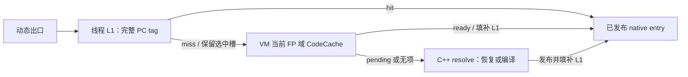

# 线程 L1 与 VM 共享 L2：实现与验收（2026-11-08）

本轮将旧 ARM64 每出口 16 槽缓存替换为每 guest thread 的 L1，复用现有 VM/domain CodeCache 作为共享 L2。IR、Block/Function 分配、Uniform 状态合同与 CodeHeap 所有权不变。默认仍全部 JIT。

基线为 `cbd06547a2d9e5259f65bc99a69e95c055aa8bcb`。实现位于 `SwiftVM-submit-20261104` 工作树；没有改动冻结的 `SwiftVM` 参考树。本轮尚未提交。

本文的测量数据保留初次 L1 验收快照；资源创建后续改为按需，见[最新实现与实测](dispatch-resource-optimization-2026-11-08.md)。下文生命周期说明已同步最终实现，“尚未提交”等描述记录测量当时的状态。

## 数据与职责

| 位置 | 职责 |
| --- | --- |
| `execution/dispatch_cache.{h,cpp}` | 线程 L1 的匿名映射、ready 填补、失效、释放；每项 16 B，不拥有代码 |
| `execution/guest_thread.h` | 每个 GuestThread 持有一个 DispatchCache |
| `execution/code_cache.{h,cpp}`、`code_link.cpp` | VM/domain 共享 L2、cold/JIT 策略、ready unit/alias 目录与静态链接记录 |
| `execution/dispatch.{h,cpp}` | NativeRunContext ABI、冷 resolver 及成功解析后的 L1 填补 |
| `execution/runtime.cpp`、`smc.cpp` | 映射生命周期、FP 域切换、SMC 撤销与冷边界回收 |
| `backend/arm64/emit_dispatch.cpp` | 动态出口 L1、静态尾转移、context 字段访问；控制指令语义仍在 emit_control.cpp |
| `backend/*/entry_elf.S` | 共享 native dispatcher；ARM64 另有 L2-only 入口承接 inline miss |
| `backend/dispatch_layout.inc` | 四后端共用的 L1/L2 布局常量 |
| `execution/code_identity.cpp`、`backend/relocation.h` | 持久代码兼容 key 与 DispatcherL2 语义重定位 |
| `tests/rebuild/dispatch_cache_test.cpp`、`arm64_link_test.cpp` | 存储、域切换、SMC、pending、共享出口、别名及计数合同 |

### L1

- 每线程 `2^20` 项 × 16 B，映射容量为 16 MiB；RW anonymous mmap，按页需求分配。实际动态单元发布前建立；纯静态 JIT 和解释器独占模式可以不建立。磁盘 / AOT 恢复保守准备映射。没有预先遍历清零整表。
- 索引为 `pc & ((1<<20)-1)`，以字节 PC 低位索引；tag 比较完整 64 位 PC。64 B 对齐目标不再被旧 `pc[5:2]` 索引压到一个槽。相距 1 MiB 的 PC 仍可能冲突，按完整 tag 失配进入 L2。
- 项仅有 `{pc, host_entry}`。普通空项 tag=0；slot0 单独用 UINT64_MAX。二者的索引关系保证空项不会命中自己的槽，PC0 与 UINT64_MAX 都可用。
- `NativeRunContext::l1` 使用末尾原有 padding：offset1032，context 大小仍为1040。没有新增永久保留寄存器。
- 热路径没有有效位/epoch/模式比较。ARM64 inline 核心七条指令，非置标志 SUB/CBNZ 保留 guest NZCV；x7 只携带本次选中的槽地址，x8..x15 pin16 不受影响。各动态出口保留各自的间接 BR。

### L2 与 miss

L2 继续使用现有 open-addressed PC 目录和 code_id，保留 Function 的多个 entry/alias 及 cold policy。没有新增第三层 map。ARM64 inline miss 通过 DispatcherL2 跳入 L2-only 入口；不再重复计算 L1 索引或重复探测目录。pending thunk 不进入 L1。其他后端在共享 dispatcher 内先 L1 再 L2。

手工构造 NativeRunContext / callback 使用者以及纯静态 VM 路径可以令 l1=null，走共享目录；实际动态单元在任何入口或直链可达前已准备有效映射，inline 热路径不增加 null 检查。普通运行不更新诊断计数器；诊断分别计 dispatch、ready hit、真实 L2 probe。x64 根 uncounted 路径遇到 pending 时直接进 cold，避免误跳 PendingCounted 造成负扣 hit。

旧的 per-site DATA 数组、Dynamic link kind、AddIndirectSite、ResetIndirectSite、reset_indirect callback、local_dispatch_cache/callable_directory 包装已退役。静态链接重置记录由32 B减到24 B。

## 正确性与生命周期

1. L1 仅借用 ready 代码；CodeHeap 继续拥有 executable mapping 和 fault metadata。L2 grow 不使现有 L1 entry 失效，因为代码地址不迁移。
2. DAZ/FTZ 导致实际软件 FP specialization 域改变时，在原有冷服务边界 madvise(DONTNEED) 重置线程 L1，并恢复 slot0 sentinel。仅 RC 改变或同域刷新保留 L1。
3. VM 在首次实际 SMC 页布防前创建16 MiB虚拟的空 L1（初始仅触及 sentinel 页）。SMC handler 切换 context.l1 到该预先建立的空映射，同时撤销 L2 入口和静态链接；handler 不 mmap、不清整表、不释放正在执行的代码。
4. 下一个冷 resolver 先重置线程 L1、清 L2，再释放旧 heap。HostPointer(write)、访存服务及文件映射失效沿用同一个冷失效入口。
5. Close 在执行和 signal borrows 已结束后撤销借用，释放实际已建立的 L1 mapping 和 heap；释放失败仍留在原 owner 供重试。映射初始化、重置、释放成本计入现有 compile 请求窗口。
6. 持久 key 纳入 L1 offset/项数/项大小/启用能力；新 inline miss 用稳定 HostSymbol::DispatcherL2 重定位，旧产物不会按旧 ABI 复活。

当前 VM 仍只执行一个 guest thread，L2 的共享是 VM/domain 的所有权边界；没有在本轮增加 clone、并行 guest 执行或跨线程 SMC 停机协议。未来并行执行须在发布/失效层实现同步，不能据本轮单线程验证宣称并发安全。

## 红魔热态派发结果

复用上一轮相同14个 ELF、相同 PMU controller、相同固定 FEX performance ELF，红魔 bf1359ff CPU4；每用例/引擎固定3次交错取中位数，合计126正式样本。FEX 默认 multiblock 与 TSO 保留，不能把 FEX CompileBlock 等同 SVM Block。所有 checksum、零解释器回退与无 multiplex 检查通过。CPU4 min/max614400/1171200kHz，未修改频率或其他服务。

下表单位为 cycles/guest kernel迭代，包含选择、校验等共同工作；CALL包含RET，不是孤立一次查表的周期数。旧表的“冲突”指旧16槽索引布局。

| 用例 | 旧 Block | 新 Block | 旧 Function | 新 Function | 本轮 FEX |
| --- | ---: | ---: | ---: | ---: | ---: |
| call-direct | 7.865 | 7.774 | 7.864 | 7.771 | 6.338 |
| call-mono | 8.988 | 8.936 | 8.979 | 8.890 | 7.508 |
| call-4-spread | 9.135 | 8.882 | 9.048 | 8.912 | 7.508 |
| call-16-spread | 9.117 | 8.904 | 9.204 | 8.901 | 7.718 |
| call-4-collide64 | 14.802 | 8.932 | 15.029 | 8.931 | 7.503 |
| call-16-collide64 | 15.186 | 8.943 | 15.340 | 8.910 | 7.719 |
| call-64-permuted | 12.764 | 15.532 | 17.790 | 15.468 | 16.899 |
| jump-direct | 4.984 | 4.983 | 4.179 | 4.178 | 3.061 |
| jump-mono | 6.433 | 6.357 | 6.369 | 6.293 | 6.405 |
| jump-4-spread16 | 6.582 | 6.490 | 6.489 | 6.451 | 6.577 |
| jump-4-collide64 | 14.756 | 6.477 | 14.913 | 6.449 | 6.571 |
| jump-64-permuted | 13.832 | 13.203 | 18.398 | 16.061 | 16.918 |
| return-4-spread | 10.146 | 10.049 | 10.209 | 10.714 | 10.609 |
| return-4-collide | 15.898 | 10.000 | 15.849 | 10.743 | 10.588 |

4/16目标64 B对齐CALL的cycles下降约40–42%；冲突JMP下降约56–57%；共享RET冲突下降约32–37%。CALL冲突每迭代指令数从60.25/63.63回到43.00；JMP从46.25/46.75回到29.00/29.50。独立诊断中冲突/64目标场景L2 probe从每迭代约0.75–1.63降为约0.000004–0.000013，仅剩冷启动等少量探测。

单态CALL+RET仍约比FEX多18–19% cycles；单态/四目标JMP约处于FEX同水平。L1不是返回预测栈，也没有减少guest栈和Uniform维护。

### 64目标随机CALL的Block回退

该项旧批次12.764→新15.532 cycles（+21.7%），Function则17.790→15.468。追加预登记3对原二进制/新二进制交错测量，Block旧14.150→新15.683（+10.8%）；全部样本保留，没有替换原批次或挑最快值。

追加对照中指令54.28→43.00，而branch misses从中位0.105增至0.301/迭代。旧进程自身范围12.37–16.95 cycles，显示分支预测/布局敏感。本轮新实现仍低于该固定FEX的约16.9cycles，但不能宣称所有相对旧版场景都改善。可观测回退与分支预测变化一致；未将其进一步归因为单个硬件predictor机制。后续返回意图/continuation优化需另立任务，不能为此恢复每出口缓存层。

## compile guard

使用相同CoreMark O2 guest与固定20次迭代，核对各CRC（final4983）。这是短时编译回归guard，未满足CoreMark官方10秒要求，不能作为正式CoreMark分数。所有L1映射与回收仍在compile窗口中。

普通steady_clock墙钟先固定3对、因调度干扰再预登记6对，合计每scope/版本9次。保留全部数据，结果如下（ms）：

| 模式 | 旧 compile 墙钟 | 新 compile 墙钟 | 旧 backend 墙钟 | 新 backend 墙钟 |
| --- | ---: | ---: | ---: | ---: |
| block | 43.854 | 42.484 | 14.214 | 13.201 |
| function | 52.594 | 72.127 | 17.349 | 18.124 |

Function普通墙钟中位明显变差，不能隐藏或称为严格墙钟验收通过；未改动的frontend阶段也从约19.21升到35.24ms。为区分实际CPU工作与调度等待，补两种独立诊断：

- 整个新进程的user PMU（启动+编译+短执行+回收，3次交错，不冒称compile-only）：Block cycles -1.05%、Function +0.36%；instructions分别 -0.87%/-0.66%。task-clock分别+1.75%/+3.63%，包含kernel。所有event time_enabled=time_running。
- 仅测量子进程使用LD_PRELOAD小shim，将CLOCK_MONOTONIC替换为CLOCK_THREAD_CPUTIME_ID，读取原有阶段timer。产品二进制不改，3对交错，CRC通过。该方法用系统调用读钟，较原vDSO增加开销，不能混入普通墙钟或正式运行分数。

| 模式 | 旧 compile 线程CPU诊断 ms | 新 compile 线程CPU诊断 ms | 变化 |
| --- | ---: | ---: | ---: |
| block | 55.531 | 54.804 | -1.31% |
| function | 56.866 | 56.300 | -1.00% |

这两组诊断未显示compile CPU成本明显回退，支持普通墙钟差异含显著调度等待；仍不以CPU诊断替代真实墙钟延迟承诺。guard的native bytes：Block387944→310856（-19.9%），Function421800→331584（-21.4%）；静态/动态混合记录收敛后，link relocation rows也减少。

## 验证与证据

- macOS：ARM动态发码合同、code image、四后端portable重定位。
- Android红魔：ARM链接/动态派发6组、runtime engine10组、persistence含SMC4组、native relocation1组、AOT调用3组；另新增存储1组、强制软件FP域及热SMC重入2组（Block/Function均覆盖）。
- x64/RV64/LoongArch64真实Linux内核均通过：各18个Catch用例（存储1、FP域/热SMC2、engine10、persistence4、native relocation1）及4个x86 Mixed/ARM JIT的Block/Function smoke。没有用QEMU-user替代fault/SMC验证；QEMU与临时initrd已回收。
- 手机私有FEXServer已停止，确认无打开的本轮运行文件后删除私有目录，回收297070592 B分配空间。源代码、二进制gzip与唯一原始证据留在Data2。

证据根目录：`/Volumes/Data2/swiftvm-middle-results-relocated-20261025/thread-dispatch-cache-20261108/`。

| 文件/目录 | 内容 |
| --- | --- |
| `plan.json`、`guest/manifest.json`、`environment.json` | 原ELF复用、交错次数、私有FEX环境 |
| `records.json`、`comparison.json`、`return-fanin/` | 126个正式PMU样本与全部原始输出 |
| `random-call-paired/` | 随机CALL Block追加3对baseline/candidate，不覆盖主批次 |
| `diagnostic-records.json` | 14次独立计数诊断，不混入热态PMU |
| `compile-guard/` | 36条普通墙钟guard；extended-summary是9次中位，初始3次summary仍保留 |
| `compile-process-pmu/` | 12条整进程PMU guard及精确tid、CPU、event运行时长 |
| `compile-thread-clock/` | 测量shim源码/编译命令/哈希与12条线程CPU分阶段诊断 |
| `baseline-identity.json`、`candidate-identity.json` | 实际测量产品二进制身份；二进制gzip保留 |
| `android-tests/`、`host/`、`x64/`、`riscv64/`、`loongarch64/` | 测试命令、stdout/stderr、kernel和清理记录 |

旧基线报告保留于 [indirect-dispatch-benchmark-2026-11-07.md](indirect-dispatch-benchmark-2026-11-07.md)，不回写为本轮结果。
